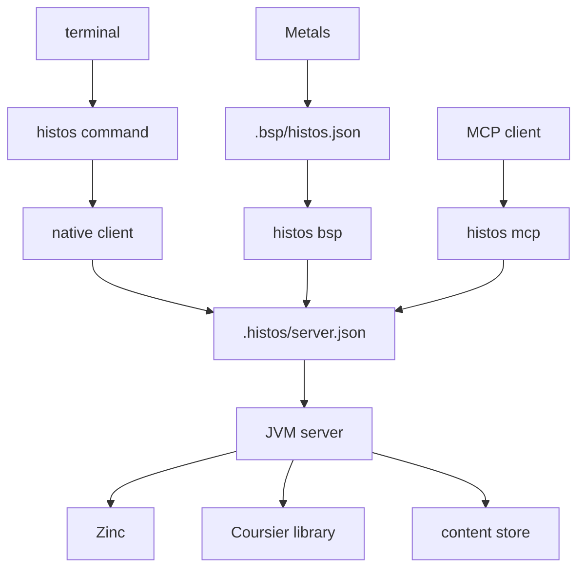
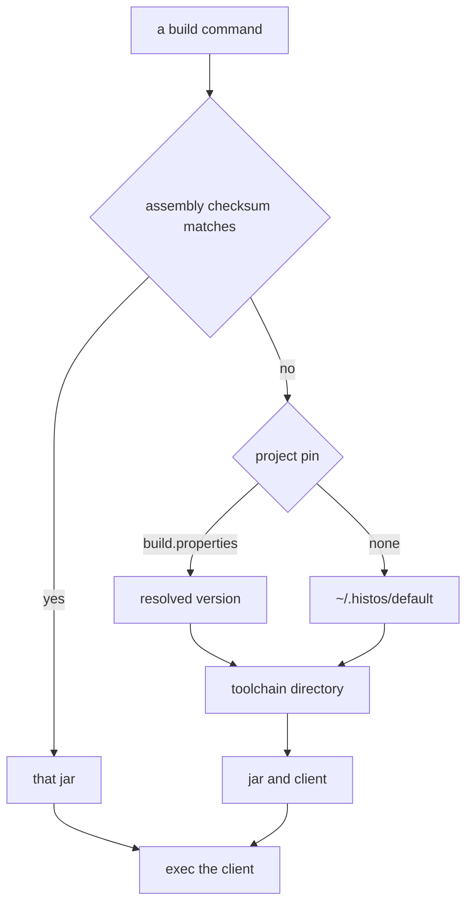
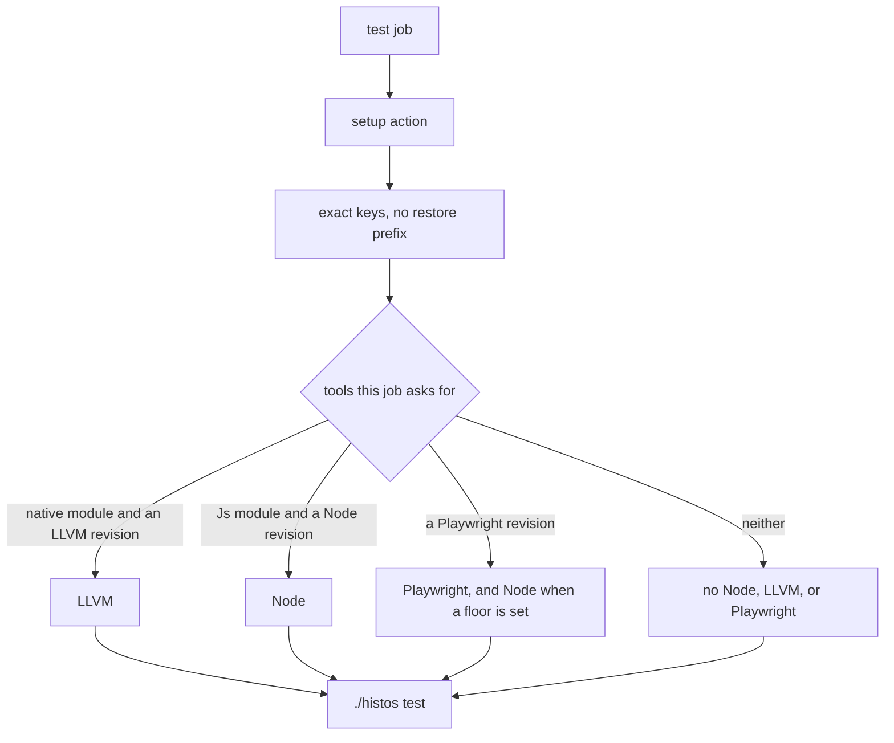
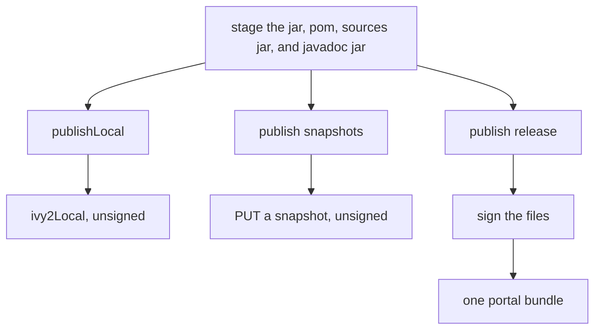
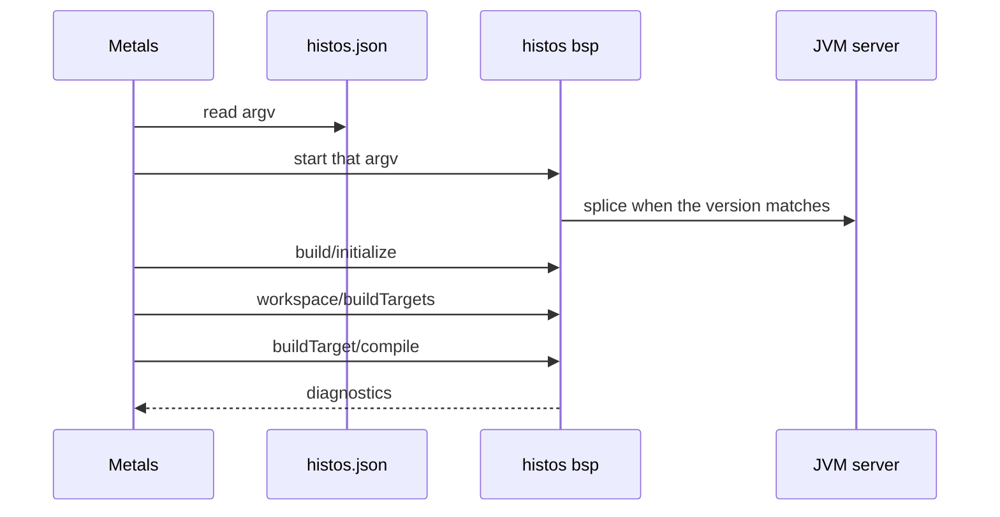
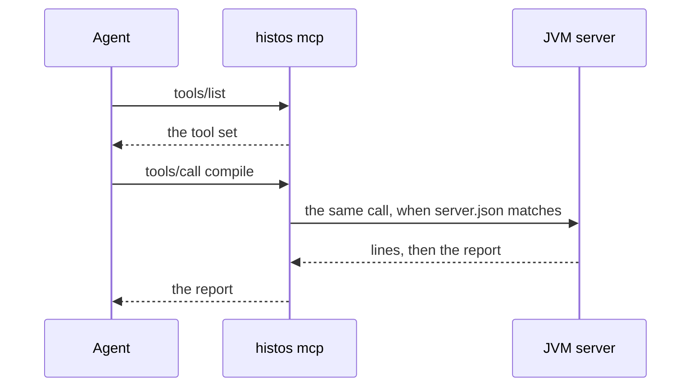
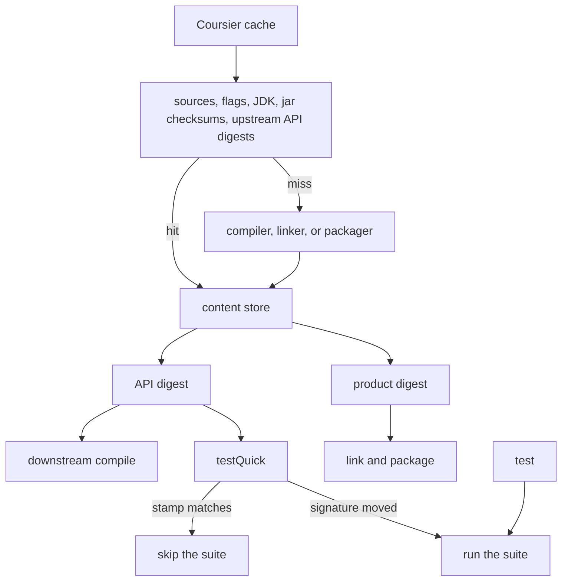
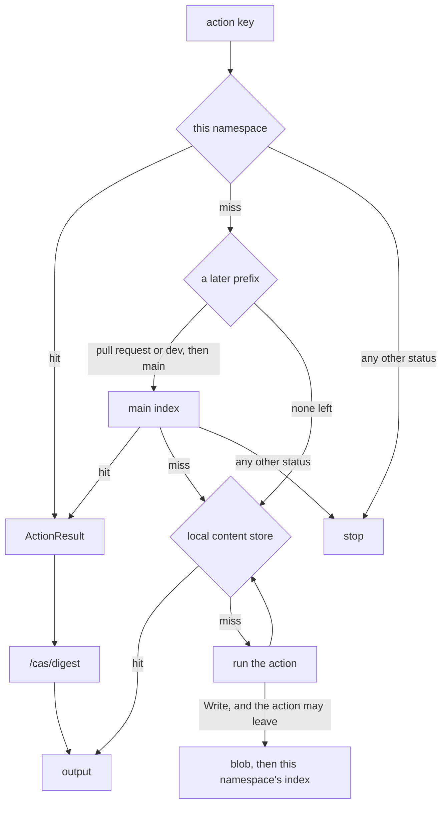

# Histos

Histos is a Scala build tool. The build is data. The work is a ZIO effect. A person and an agent ask for the same operation and read the same result.

The terminal prints that result and chooses an exit. An agent receives the result as data and sees each line as it is printed. An editor uses BSP. If the work ran, the result is a report, including a compile or a test that failed. If the request never started, the result is a fault.



A batch command execs the native client. The client reads `.histos/server.json` and talks to that JVM server, starting one when none is listening. `server`, `bsp`, and `mcp` stay on the jar. When the recorded version matches, BSP copies frames onto that server and MCP sends the same call. No server means that process does the work. A different version stops.

This is pre-release. The API may break when that makes it more honest. Other repositories take snapshots.

What we still intend is [next](docs/next.md).

## A build

A build file is a Scala program that returns a graph. A module names its platforms (`jvm`, `js`, `native`), its Scala versions, and its dependencies. A version, a dependency, a path, a url, and a name are typed literals. A bad one does not compile the build file. This repository is built by [histos.scala](histos.scala). The literals are [Literals.scala](api/src/histos/Literals.scala).

## Install

Histos runs on macOS and Linux. A Windows machine uses WSL. A native Windows build may come later.

Histos does not install a JDK. A JDK 21 or newer has to be on `PATH`. On macOS: `brew install --cask temurin@21`. On Linux: https://adoptium.net/temurin/releases?version=21

The `cs` binary is not required. Dependency resolution uses the Coursier library inside the server. That library writes `~/.cache/coursier/v1` itself.

One POSIX script is the installer and the command:

```sh
curl -fsSL https://github.com/early-effect/histos/releases/download/dist/shim | sh
export PATH="$HOME/.histos/bin:$PATH"
```

The script does not edit a shell rc. A second run is a no-op when the installed shim matches.

A first install writes `~/.histos/default` when that file is missing. The value is the published dist channel: `channel` when that file is on the dist base, otherwise the newest `channel-<version>-SNAPSHOT` asset, or the newest release when no snapshot channel is published. The next command resolves it, so `histos new` works straight after install.

`histos self update` replaces the shim when the published shim hash differs. `histos toolchain install <version>` downloads one version and, when no default is set, records that version. `histos toolchain list` prints installed versions. `histos update` moves the selected version: outside a project it rewrites `~/.histos/default`, and when that file is missing it resolves the same published channel first. Inside a project it rewrites `histos.version` in `build.properties` and leaves the user default alone. `histos update --make-default` writes that same resolved version into both files. A `SNAPSHOT` pointer becomes one timestamp. A release pin stays. A snapshot pointer is read from the channel at most once an hour, and `histos update` reads it every time. A cached channel is used when the network is down. Nothing else updates in the background. Outside CI, a pin older than the newest published release prints a notice once a day. The check is cached under `~/.histos`.

`histos new <name>` creates a one-module project pinned to the toolchain that wrote it. `histos init` writes the current directory. The default scaffold is `.gitignore`, the `./histos` wrapper, `workflow --update`, and `resolve --update`, then `doctor` outside CI. `--bare` writes the build file and the sources only. `histos init --from sbt` reads `build.sbt`. `histos init --from zipx` reads `project/ZipxVersions.scala`. A setting the draft does not map stays as a comment. The second line the command prints is `histos test`.

`--compile-client` on the install script, `histos toolchain install`, and `histos update` links a native client for that version after the jar is checked. It is not sticky. Clang has to already be on `PATH`. Histos does not install it. A platform with no prebuilt client runs `java -jar` and says that `--compile-client` will link one. The first prebuilt clients are `linux-x86_64` and `macos-aarch64`.

A project pin wins. The layout is `~/.histos/bin/histos`, `~/.histos/default`, and `~/.histos/toolchains/<version>/` with the manifest, `histos.jar`, and `histos-client`. The content store is `~/.cache/histos` unless `XDG_CACHE_HOME` is set.



GitHub Actions use `.github/actions/setup` from this repo:

```yaml
- uses: early-effect/histos/.github/actions/setup@main
```

`version` empty reads `build.properties`. The action restores `~/.histos/toolchains` and `~/.cache/coursier/v1`. It does not install a JDK, Node, LLVM, or Playwright, and it does not open the content store. A job that needs a JDK calls `actions/setup-java` itself.

## This repository

Histos builds itself. [histos](histos) comes from `workflow --update`. A local assembly is checked against `.histos/assembly.sha256`. Otherwise the script execs the user shim.

`HISTOS_ASSEMBLY`, when set, is the jar. Otherwise `dist/histos.jar` is that jar when the file exists. Either jar has to match `.histos/assembly.sha256`. A missing file or a different checksum fails, and the script does not fall through. `dist/` and `.histos/assembly.sha256` stay uncommitted. CI starts from the version line. When that toolchain does not yet have a command this checkout renders, one job assembles this tree and the other jobs reuse that jar. A pin that already has `doctor` skips that upload. The `workflow` and `supply-chain` jobs then assemble this checkout themselves, because `workflow --check` compares the files the running jar renders with the files in the tree.

[histos.scala](histos.scala) compiles against `bootstrap/histos-api.jar` packed inside the running jar. `.histos/classes/api` is the api compiled for the modules after that.

`assembly` compiles with the running jar and writes `dist/histos.jar` unless a path is given. It packs the api it just compiled at `bootstrap/histos-api.jar` inside that jar. Only the default path writes `.histos/assembly.sha256`. The next `./histos` in this checkout runs `dist/histos.jar` when that checksum matches.

`histos.version=0.1.0` pins that release. The shim installs that toolchain from the GitHub release `dist`: the jar, the manifest, and a prebuilt client when the manifest names one. `histos.version=0.1.0-SNAPSHOT` follows the development snapshot. A timestamp such as `0.1.0-20261101.030257-1` freezes that channel. `histos update` resolves a snapshot channel and writes that timestamp. A release pin stays. `launcher --latest` writes the snapshot pointer and does not fetch. A release pin stays there too. Any of these lines may be hand-edited. A bad line fails at boot. CI runs the committed line through the shim. The shim fetches `channel-<histos.version>` from `dist` when the line is a snapshot pointer. The body of that file is one timestamp revision. Run the `snapshots` workflow on the default branch. That is the publish. On that branch it runs `./histos assembly`, then `./histos publish snapshots` with `HISTOS_SESSION=snapshot`, `HISTOS_SHA` set to the commit, and `HISTOS_BRANCH=default`. The command uploads `channel-<ship>-SNAPSHOT`, `<rev>-manifest.json`, and `<rev>-histos.jar` to the existing `dist` release. `<rev>` is the timestamp Maven stored for the module that names the asset, and it is the channel body. The manifest leaves `clients` empty, so the shim runs `java -jar`. A dispatch from another branch sets `HISTOS_BRANCH=other`, stores the commit coordinate, and uploads no channel.

The wrapper script names the ship. That number is the prefix on its errors. `build.properties` names the published Histos that builds this tree, and that toolchain can be another release or a snapshot. A bad line fails at boot. This checkout's script is `0.2.0`. Its version line is `0.2.0-SNAPSHOT`. The native client sends that version line. The server records the same line.

`.bsp/histos.json` takes its `version` from that line, and `histos version` prints `histos` and the same line. The next `./histos` rewrites the connection file when the line changes. A missing or bad line does not name a version: the connection file stays untouched, and `histos version` fails. The file's `graph` is a hash of the build files. A running `bsp` rewrites it when that hash changes, and Metals treats the new file as a build change.

## A workflow



The setup action restores toolchains and `~/.cache/coursier/v1`. It does not install those tools, and it does not open the content store. The test job restores `~/.cache/histos`, and after the suite it deletes that key and saves the store again so the next run sees the products this one wrote. `versions` and `workflow` do not open that scope, so a job that does not compile cannot publish an empty store. Only a test job installs Node, LLVM, or Playwright, and only for the modules that job runs. Playwright is also installed when the build names its revision, because this suite launches Firefox from a JVM test. `install-deps firefox` stays on every such run. The browser download waits for a cache miss.

A site is a `SiteJob`. `Automatic` uploads its directory and deploys it from a `pages` job on a push to the repository's default branch. `Manual` writes `histos-pages.yml`, and that workflow deploys when someone runs it. `Both` is the default and does both. A site job runs on the default branch only, so a pull request does not build it and does not request the `github-pages` environment. The branch comparison is `github.ref == format('refs/heads/{0}', github.event.repository.default_branch)`.

## Publishing

The decision is [publishing.md](docs/publishing.md). `publishLocal`, `publish snapshots`, and `publish release` are three commands. The last two close the build's `sona` layer. The staged revision chooses the Sonatype branch. The command name does not.



`publishLocal` and `publish release` stage the same files: the jar, the pom, the sources jar, and a javadoc jar that holds that module's scaladoc. A library module stages its jar. An assembly stages the packaged program. `publish snapshots` stages the same files and omits the javadoc jar. `publishLocal` writes those files where Coursier resolves `ivy2Local` and does not sign. A snapshot coordinate is a PUT of those files and does not sign. A release signs those files, then uploads one portal bundle. A warning from scaladoc does not fail the publish. `Projects.docCheck` adds a CI job that runs the same scaladoc beside the suite and fails on a warning.

- A snapshot needs `SONATYPE_USERNAME` and `SONATYPE_PASSWORD`.
- A release also needs `PGP_SECRET`, `PGP_PASSPHRASE`, and `PGP_KEY_HEX`.
- A `-ci` coordinate is not a Sonatype publish. `publish snapshots` and `publish release` fail that session before staging. `publishLocal` writes it.

A catalog row is `ships(Ship("histos").next(0, 2, 0)(api, app))`. The number is the next release. Everyday compiles `0.2.0-ci`. `publish snapshots` derives the stored coordinate and the `0.2.0-SNAPSHOT` pointer. `0.0.1` is already on Central. `ship"..."` is only the number.

A laptop publishes snapshots by naming the session. The catalog stays on the next release. `releases` may be empty.

```bash
export HISTOS_SESSION=snapshot
export HISTOS_SHA=$(git rev-parse HEAD)
export HISTOS_BRANCH=default
./histos run versions
```

`HISTOS_BRANCH=default` moves the `0.2.0-SNAPSHOT` pointer. `other` stores only the commit snapshot. `publish release` uses `export HISTOS_SESSION=release` and the same `releases` file. `histos doctor` warns `ship.should-bump` when that number is already released. It does not open a bump pull request.

A dependency on an owned ship is a pin, not a revision string. Third-party coordinates stay `dep"..."`.

```scala
Ship("histos").next(0, 2, 0).pointer.dep(organization"rocks.earlyeffect", artifact"histos-api")
Ship("histos").next(0, 2, 0).commit("0123456789abcdef0123456789abcdef01234567").dep(
  organization"rocks.earlyeffect",
  artifact"histos-api",
)
Ship("histos").next(0, 2, 0).released.dep(organization"rocks.earlyeffect", artifact"histos")
```

`.pointer` is `0.2.0-SNAPSHOT`. `.commit` is `0.2.0-<12 hex>-SNAPSHOT`. `.released` is `0.2.0`. The three types are distinct, so a release API does not accept a snapshot pin.

The default `sona` is `Sona.layer(ReleaseMode.Automatic)`. That upload sends `publishingType=AUTOMATIC` and polls until `PUBLISHED` or `FAILED`. The deployment file is written as `PUBLISHED`. A build that overrides `sona` with `Sona.layer(ReleaseMode.Hold)` sends `USER_MANAGED` and polls until `VALIDATED` or `FAILED`. The client prints each step as it happens: `building`, `staged`, `signing`, `bundling`, `uploading`, and `installing`. A local install prints `installing`. A snapshot prints `uploading <artifact> <revision>`. A release prints `signing`, `bundling`, and `uploading <ship> to the portal`. The portal post then prints `uploading bundle to the portal`, and `uploading...` if that post is still running after 30 seconds. Each status is `portal <id> is <STATE>`. Until the waited state arrives, the line names it. The first read, a changed state, and every thirty quiet reads print. A status read that has not returned prints `reading portal <id>` after that same wait. A failure is printed when it happens. `--automatic` forces Automatic for that one run. There is no `--hold`. The snapshot branch ignores the mode.

`publish release` does not stage a snapshot coordinate. It reports that ship and continues with the others. A ship that depends on a snapshot is reported and not uploaded. One ship's upload failure does not fail the others. Missing credentials, a missing signing key, or a portal base that cannot be read fails the whole invocation before compile, when the layer's secret names are the five below. `publish snapshots` checks the username and password only. A layer whose secret names differ skips the check.

Unset, `PGP_SECRET` is the key and `PGP_PASSPHRASE` unlocks it. `PGP_KEY_HEX`, when set, selects that fingerprint. `HISTOS_SIGNER=gpg` signs with gpg, and then the fingerprint is required. The release workflow lists `SONATYPE_USERNAME`, `SONATYPE_PASSWORD`, `PGP_SECRET`, `PGP_PASSPHRASE`, and `PGP_KEY_HEX`.

A token is a ship, an aggregate, or a module. No token publishes every ship the command can write. `publishLocal` does not take a directory and it does not write `~/.m2`. It accepts a snapshot, a release, and a `-ci` coordinate.

`publish promote <deployment>` publishes a `VALIDATED` deployment. `publish drop <deployment>` drops the deployment first, then deletes the GitHub asset when that ship names one. A failed delete leaves the deployment dropped.

`publish assets` uploads the file named on an assembly when `.histos/deployments/<ship>` says `VALIDATED` or `PUBLISHED`, and a GitHub release for that tag already exists. A named ship in another state fails. No name skips a ship with no file, or a file in another state. The command does not create the release. The release workflow does not run it.

The workflow is dispatch only. A tag does not publish. Each ship runs `./histos publish release <ship>`, which signs the staged files and uploads that bundle. The file does not pass `--automatic`. This build is Automatic anyway, because that is the default layer. Hold is the build that also renders `histos-promote.yml`. That file's only input is the deployment id, and its command is `./histos publish promote`. After a non-snapshot ship that names an asset has published, that job runs `./histos assembly`, then `ubuntu-26.04` and `macos-26` install Temurin 25 and run `./histos client`. The macOS job wraps `clang` with the Xcode SDK. The install job uploads the jar, `linux-x86_64` and `macos-aarch64` clients, and the manifest to the existing `dist` release. A snapshot ship does not add those jobs. A ship that names an asset renders `histos-snapshots.yml`. Run that workflow on the default branch. It publishes the Maven snapshot and the dist channel in one dispatch. The release named `dist` already exists. The workflow does not create it.

Rehearse with `./histos portal`. It binds loopback and prints a base URL. Set `HISTOS_PORTAL` to that URL. Unset, the client uses `https://central.sonatype.com`. [ReleaseSpec](engine/test/ReleaseSpec.scala) runs that client against [PortalServer](central/src/histos/central/PortalServer.scala) and does not call Central.

The ship `histos` publishes `api`, a library, and `app`, an assembly. `engine` and `central` are not members. The three publish commands package `app` the same way. A release signs that jar. `assembly` writes `dist/histos.jar` for this checkout. That file is the local launcher, not a second publication. The pom carries the organization description and url, which Central requires. A release also needs a license, a developer, and an scm, or the command fails before upload. Histos does not create a tag or a GitHub release. [AssetSpec](engine/test/AssetSpec.scala) is a loopback stand-in and does not call GitHub.

`ci.yml` does not publish and does not run on a tag. The release job does not run the suite again. After a release is on Central, the next development catalog is a snapshot. The version line stays a published Histos, stable or snapshot, and the shim downloads that toolchain.

## An operation

`version` prints the ship number. `graph` prints each project with its platforms and Scala versions, then each plugin. Environment values are left out. `toolchain` prints the JDK a compile would use, Node when a module is JavaScript, and clang when a module is native.

`compile` takes project names. No name compiles every module. `clean` takes project names too. No name wipes every product root under `.histos` and does not read the build. A name wipes that module. An aggregate expands to its modules, and upstream stays. The pin and the launcher file are at the repo root, so they stay. The assembly checksum and the server stay. `cleanFull` takes no project. It wipes those products, then drops this project's content-store entries. `assembly` takes an optional path.

`client` links the native client and writes `dist/histos-client`. It does not start that binary. The test job runs `client` before `./histos test`, so the suite uses it. `test` runs the suites. The default `testStore` is `Off`, so a full run launches every suite. `testQuick` skips a suite whose stored fingerprint still matches. `testOnly` takes `--module` and at least one pattern. `testQuick` takes the same flags, and its patterns may be empty. `Local` skips on `test` as well. `Remote` does not skip and does not upload. `run <name> [jvm|js|native]` runs that module. `run inspect` prints the project names. `run versions` prints the version decision. `run <plugin>/<task>` runs a plugin task.

`publishLocal`, `publish snapshots`, `publish release`, `publish assets`, `publish promote`, and `publish drop` are the commands in Publishing. `preview` of `compile`, `test`, `publishLocal`, `publish snapshots`, `clean`, `cleanFull`, or `run` writes nothing. Compile and test name the sources the last analysis says are stale. A test preview names the suites a quick run would skip and the ones it would run. When the analysis cannot be read, the line says the staleness is unknown. When a digest cannot be read, the line says the suite is not known to be skippable.

`~` runs a command again after a source save. The server does that when one is up. This process does it otherwise. `mcp`, `bsp`, `server`, `portal`, `observe`, and a nested `~` are usage and do not start that loop. `observe` reads the stored tally and does not load the graph. `cancel` names the run id the command minted. `server` keeps a warm process. `reload` asks that process to load the build again, and fails when no server is up. `reboot` replaces a running server, or starts one. `mcp` and `bsp` open a transport.

`cache path` prints the store. `cache list` prints each digest and its size. `cache clean` removes an entry older than 30 days that no project keeps. `--dry-run` names those entries and leaves them. `cache promote --from` and `--to` take `main`, `pr/<n>`, or `dev/<name>`. The remote cache is not configured, so that command reports `remote cache is not configured` and does not open a connection.

`resolve` fetches what `dependencies.lock` recorded and checks each sha256. `resolve --update` solves and writes that file. `resolve --check` solves again and fails when the result is not the lock. `workflow` compares the rendered workflow files and the launcher scripts with the tree. `workflow --update` writes them. Neither publishes, and neither changes the version line. `launcher --update` writes the timestamp of a snapshot channel. A release pin stays, and the failure names `histos launcher --latest`. `launcher --latest` writes the snapshot pointer. A release pin stays.

A word the grammar does not own is a plugin command, when the build registered it. A reserved root word cannot be one.

The tally names files compiled, files skipped, modules, and classes written. A count that is unknown is omitted. A failure count is added when one happened.

## An editor

Metals is the editor path. It speaks BSP 2.2 to Histos. There is no sbt BSP server in this project.



Open the project in an editor that runs Metals. Metals discovers `.bsp/histos.json`. Import the build. Metals starts the `argv` in that file: `./histos bsp` when the project ships the wrapper, and `histos bsp` otherwise. The working directory is the project.

A command writes that file when the pin parses and the build fingerprint can be read. A missing or bad line leaves the file alone. This checkout already commits it. The `version` field is that line. `bspVersion` is `2.2.0`. `languages` is `scala`. `graph` is a hash of the build files. Metals ignores the field and hashes the file, so a rewrite is a build change. A running `bsp` rewrites the file when that hash changes.

One target is one cell: the module, the Scala version, the platform, and a scope of `main` or `test`. `histos.scala` is its own target. A compile from the editor is `buildTarget/compile` for that target. The scalac options include `-Xsemanticdb` and `-sourceroot`, which is what Metals uses to navigate. Diagnostics are `build/publishDiagnostics` on each source file. A compile that fails is still that report.

`bsp` runs on the jar. A server recorded at the same version receives the session. No server means the `bsp` process compiles. `histos reload` asks a running server to load the build again. `histos reboot` replaces that server, or starts one. `~ bsp` is usage and does not start a session.

## An agent

An agent uses MCP. The same calls a person runs are tools. The process working directory is the project root.



Point the client's stdio server at the shim. In this checkout the command is `./histos` and the argument is `mcp`, because the wrapper is how this repo boots.

```json
{
  "mcpServers": {
    "histos": {
      "command": "histos",
      "args": ["mcp"]
    }
  }
}
```

`tools/list` is `graph`, `run`, `cancel`, `compile`, `test`, `publishLocal`, `publishSnapshots`, `toolchain`, `version`, `assembly`, `clean`, `cleanFull`, `resolve`, `workflow`, `reload`, `reboot`, `cachePath`, `cacheList`, `cacheClean`, `launcherUpdate`, `watch`, `preview`, and `observe`. `compile` with an empty project list compiles every module. `test` takes suite globs in `patterns` and `run` or `quick` in `mode`. An absent mode runs the suites. `run` takes a main, `inspect`, `versions`, or a plugin task id. `watch` takes the inner command and does not take a leading `~`.

When `.histos/server.json` names this version, the tool sends the call there and prints each line as it arrives. No server means this process keeps one graph and runs the call. A different version fails the tool. A compile or a test that ran and failed comes back as a report. A request that never started fails the tool.

`acp` is a reserved word and has no command. `~ mcp` is usage and does not start a session.

## Cache

Compile, package, and link are content-addressed. A hit means the declared inputs and the toolchain identity matched. A miss names the input that changed. The decision is [cache-work-plan.md](docs/cache-work-plan.md).



The content store is `~/.cache/histos`, or `$XDG_CACHE_HOME/histos`. A blob's name is its digest. The API digest is the public signature, written beside the analysis. A comment or a method body does not change it, so a downstream compile hits. A public signature changes it, so that compile runs. The product digest is the class bytes after jar timestamps, line numbers, and the `TASTY` attribute are taken out. Link and package key on that digest. A trailing comment that does not move member positions keeps the link. A method body runs it.

`test` launches the selected suites. Generated CI runs `test`. `testQuick` is local, and its stamp includes the upstream API digest, so a signature change cannot skip the suite. `TestStore` on a module is `Off`, `Local`, or `Remote`. `Off` is the default and does not skip `test`. `Local` skips `test` when the stored suite digest still matches. `Remote` is refused when the module names a need. The remote URI is configuration, so `Remote` does not upload and does not skip.

`./histos clean` deletes the work tree and leaves the store. `cleanFull` forgets this project's entries. `cache clean` drops an entry older than 30 days that no project keeps.

### Remote

The remote is a Bazel cache. A team shares compile, package, and link results through that protocol, and the build stays the Scala graph. The server is bazel-remote, or anything else that speaks the same API. `HISTOS_CACHE_URI` picks the client. `http` and `https` use the HTTP cache. `grpc` is plaintext and `grpcs` is TLS. Unset or blank is off and opens nothing. A bad scheme, mode, namespace, or address fails. It does not fall through to off. `HISTOS_CACHE_MODE` is `read` unless it is `write`.



Two stores, one key. `/cas/{digest}` holds the bytes. The digest is the name, so a bad blob is a different name and an honest index entry never fetches it. `/{namespace}/ac/{digest}` holds an ActionResult whose stdout digest names that blob. The namespace is a prefix on the index. It is not part of the digest. The key is the declared inputs plus the toolchain: OS, arch, JDK, Scala, and the linker. The lock digest is an input. A hit requires the whole key. A prefix does not drop an input to recover an older result.

A pull request reads `pr/<n>`, then `main`, and writes `pr/<n>` only. A push to the repository's default branch reads and writes the `main` namespace. That token is `CacheNamespace.Main`. It is not the git branch name. A laptop reads `main` and writes only when it sets `dev/<name>`. That namespace reads `dev/<name>`, then `main`. CI does not read `dev`. A miss tries the next prefix. HTTP reports that as 404. gRPC reports it as `NOT_FOUND`. A hit or any other status stops the walk.

A run asks the remote first, then the local content store, then runs the action. `Write` uploads after a miss, and only when the action may leave the machine. Compile may leave. A test, a publish, and an action that needs the network or docker stay. The blob is written first. A crash leaves an unreferenced blob, not an index entry for bytes that never arrived. `Read` looks and does not upload. `Off` is the process default, so neither lookup nor upload opens a connection.

`promote"rebuild"` is the default. Main fills `main` by doing the work, so a pull request cannot fill the index the next pull request reads. `promote"copy-index"` copies that pull request's index onto `main` and does not compile. The owner picks it. `purge` deletes the caller's index and leaves every blob, including a blob another namespace still names. `purge` and `cache promote` stay on HTTP. A `grpc` or `grpcs` address refuses them and does not open a second port. The generated test job sets `HISTOS_CACHE_NAMESPACE` to `pr/<n>` on a pull request and to `main` on a push to the default branch. Docs, deploy, versions, workflow, and release leave it unset. The workflow does not set `HISTOS_CACHE_URI`.

The URI is configuration. Until it is set, `cache promote` reports `remote cache is not configured` and does not open a connection.

GitHub restores the content-store directory, the Coursier directory, and the toolchain directory with an exact key and no restore prefix. That copy is not the compile key. A later compile still hits or misses inside the store. Coursier is only the dependency jars, at `~/.cache/coursier/v1`.

## Tools already on the machine

Histos does not install a JDK, Coursier, Node, or clang. The running JVM must be JDK 21 or newer. The launcher script prints that floor. A JavaScript module needs Node 25 or newer. Histos resolves that binary in order: `HISTOS_NODE`, the `nodePath` on `RunnerTools`, `.histos/node.local`, then `node` on `PATH`. `HISTOS_NODE` and `nodePath` are absolute paths of a binary named `node`. A path that is missing, not executable, or older than 25 fails, and Histos does not try the next source. The message names the source. `.histos/toolchain.local` names a JDK home. `.histos/node.local` names a Node home, not the binary. A file that points at a missing or too-old home fails. Histos does not pick a different one. A generated workflow installs Node, LLVM, and Playwright only for the modules that job runs. A JVM-only project installs none of them. LLVM is `LLVM-<revision>-Linux-X64.tar.xz` from the llvm-project release. A miss unpacks it. A hit does not. The step runs either way: it checks `clang` and puts `bin` on `PATH`. Playwright's browser download runs on a miss. The step still runs on a hit, checks the package, and runs `install-deps firefox`, because a fresh runner does not keep the apt packages.

## Plugins

A plugin is a Scala 3 library with one [HistosPlugin](api/src/histos/plugin/HistosPlugin.scala). The build file names it in the header and registers it with `use`. It compiles against `histos.api`. It does not see the engine. A command name the grammar owns is reserved. `acp` is reserved and has no command. [PluginSpec](api/test/PluginSpec.scala) locks that contract.

## Scenarios

A scenario checks a build by standing it up. One content store, one or more checkouts, sources written by the test, and an assertion on the result. That is how Histos is checked against itself: two copies of a project share a cache, a clean restores, and a skip that hides a change fails. The same shape is the Histos side when the other side is sbt and zipx. That comparison is the bench in [the cache plan](docs/cache-work-plan.md).

The decisions are [scenario-work-plan.md](docs/scenario-work-plan.md). The code is [Scenario.scala](engine/test/Scenario.scala), proved by [ScenarioSpec.scala](engine/test/ScenarioSpec.scala). A scenario is a test. It is not a command, and it is not a second language.

## License

Apache License 2.0. See [LICENSE](LICENSE).
