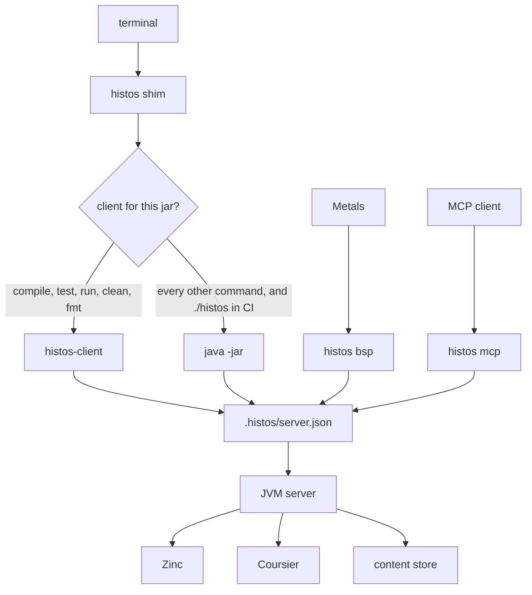

# Histos

Histos is a Scala build tool. The build is a Scala program that returns a graph. The work is a ZIO effect. A person, an editor, and an agent ask for the same operations and read the same results.



The shim sends `compile`, `test`, `run`, `clean`, `clean --full`, and `fmt` through `histos-client` when that binary was linked for this jar. Every other command runs `java -jar`. In CI, `./histos` runs `java -jar` too, even when a client is already on disk. `toolchain install --client` is the opt-in that places the kit and links when `CI` is set. Bare `toolchain client` still fails in CI. A verify task with a native link is the job that passes `--client`. `server`, `bsp`, `mcp`, and `toolchain` stay on the jar. Both paths talk to one warm JVM server for the project, and start one when none is listening. If the work ran, the result is a report, including a compile or a test that failed. If the request never started, the result is a fault with a diagnosis.

This is a 0.x release. The API breaks when that makes it more honest.

## Install

Histos runs on macOS and Linux. On Windows, use WSL.

Histos does not install a JDK, Node, or clang. It needs JDK 25 or newer. The checkout script the generator writes refuses an older JDK before it downloads the shim, and the shim refuses an older `java` with the install guide. The `./histos` committed in this repository is that wrapper. A JavaScript module needs Node 25 or newer. A native module needs clang. Dependency resolution uses the Coursier library inside the server, so the `cs` binary is not needed. A coordinate install downloads one pinned Coursier jar to `~/.histos/coursier.jar` and uses it only to fetch.

One POSIX script is the installer and the command:

```sh
curl -fsSL https://github.com/early-effect/histos/releases/download/dist/shim | sh
export PATH="$HOME/.histos/bin:$PATH"
```

The script installs itself as `~/.histos/bin/histos` and does not edit a shell rc. A first install writes `~/.histos/default` to the latest stable release on `dist`. A snapshot is the default only when `dist` has no release. An explicit `channel` asset on `dist` wins over both.

### Toolchains and pins

A toolchain is one Histos version under `~/.histos/toolchains/<version>/`: its manifest and `histos.jar`. A manifest that names a jar and `jarSha256` is a published fat jar: the shim downloads it and checks the checksum. A manifest that names `group`, `artifact`, and `revision` is a thin module: the shim resolves that coordinate and packs `histos.jar` on this machine. A later command leaves that packed jar in place while the coordinate is unchanged. When the manifest names a link kit, `toolchain install` and `update` also place `client-kit.zip` beside the jar. A command fetches the manifest, and packs or downloads the jar, only when that directory does not already have both. Once those two files are on disk, a command does not touch the network. An ordinary CI install uses the jar and does not fetch the kit. `toolchain install --client` is the opt-in that places the kit and links when `CI` is set. Bare `toolchain client` fetches a missing kit, then links, and CI still refuses that command. A verify task with a native link is the job that passes `--client`.

A native client is optional. On a terminal, `toolchain install` and `update` ask once per jar whether to build `histos-client` on this machine. Enter means yes. Answering `n` is remembered for that jar, and later commands do not ask. `histos toolchain client` builds it later. `--client` builds without asking, and `--no-client` skips. With no terminal and CI unset, install prints one line that names `histos toolchain client` and does not link. In CI, `./histos` always runs `java -jar`, even when a client is already on disk. `toolchain install --client` still places the kit and links when `CI` is set. Bare `toolchain client` fails in CI. Building the client needs clang 21 on `PATH` and takes a few minutes, once for that jar. On a terminal the link prints `Linking the native client` and a dot each second until it finishes. A redirected run prints one line when it starts and one when it finishes, with no dots. A missing clang, a missing kit, or a failed link still leaves the jar installed. Histos does not install clang.

A checkout may name a local toolchain in `.histos/toolchain`. The file is one path segment, the id `publish local` installed under `~/.histos/toolchains/<id>` with its jar and a manifest. Every command except `update` uses that directory and does not fetch. `update` resolves the pin, writes it, and runs that pin: the version it prints and the client it offers are that pin. A missing jar fails when a command runs the local id. Delete the file to return to the pin. The tracked pin does not change.

A project pins its toolchain in `build.properties`:

```text
histos.version=0.3.2
```

The pin wins over `~/.histos/default`. It has three forms:

- `0.3.2` is a release.
- `0.3.2-SNAPSHOT` is a pointer that follows the newest snapshot of that line. The shim reads `channel-<pin>` from the `dist` release at most once an hour (`HISTOS_CHANNEL_REFRESH=every-call` reads it every time), and uses the cached answer when the network is down.
- A timestamp such as `0.3.2-20261112.042525-1`, or a commit pointer such as `0.3.2-7230ba21293f-SNAPSHOT`, freezes one build.

The shim answers these commands itself:

- `histos toolchain install 0.3.2` installs one version and checks every file it already has. It records that version as the default when none is set. `--client` and `--no-client` choose the native client. Passing both fails: they are opposites.
- `histos toolchain client` links `histos-client` beside the installed jar. CI refuses.
- `histos toolchain list` prints the installed versions.
- `histos self update` replaces the shim when the published one differs.
- `histos update` moves the pin. Inside a project it rewrites `build.properties`, removes the previous server's record, then runs `version` on the driver the next command would use. That rewrites `.bsp/histos.json`. Outside a project it rewrites `~/.histos/default` and stops. `--make-default` writes both.

`update` moves a release pin to the newest release and a snapshot pin to the newest snapshot line at or above its own. It keeps the pin's form: `--freeze` writes a timestamp and `--follow` writes a pointer. When a release has passed a snapshot pin, `update` asks on a terminal whether to switch, and `--stable` answers yes. Outside CI, a command on the JVM prints a notice when a published release has passed the project's pin. It asks Central at most once a day.

`HISTOS_HOME` moves `~/.histos`. `HISTOS_DIST` points the shim at another `dist` base.

## Start a project

```sh
histos new demo
cd demo
./histos test
```

`histos new <name>` writes a one-module project in a new directory. `histos init` writes one into the current directory. Both pin the toolchain that wrote them. `histos init --from sbt` drafts `histos.scala` from `build.sbt` and `project/plugins.sbt`, and `histos init --from zipx` from `project/ZipxVersions.scala`. A setting the draft does not map stays as a comment.

The full scaffold also writes `.gitignore`, a `./histos` script, the generated workflows, and `dependencies.lock`, then runs `doctor` outside CI. The script installs `shim-<sha256>` when `~/.histos/bin/histos` is missing, checks that sha256, and execs the shim. It does not fetch the moving `shim` name. `self update` still does. On a terminal it asks before writing the CI files and asks for the CI branch. `--yes` takes the defaults, and `--branch <name>` names the branch. `--bare` writes only `histos.scala`, `build.properties`, and the sources.

## A build

`histos.scala` defines `object build extends HistosBuild` with a `graph`. A module names its platforms (`Jvm`, `Js`, `Native`), its Scala versions, and its dependencies. Versions, dependencies, paths, urls, and names are typed literals, so a bad one does not compile the build file. The literals are [Literals.scala](api/src/histos/Literals.scala). This repository's build is [histos.scala](histos.scala).

```scala
import histos.*

object build extends HistosBuild:
  def graph =
    val zio = dep"dev.zio::zio:2.1.27"
    val app = module("app", Jvm)(scala"3.10.1")
      .libraryDependencies(zio)
      .testDependencies(zio.module("zio-test"), zio.module("zio-test-sbt"))
      .main(MainClass("demo.Main"))
    Projects(app)
```

- A third-party root is one `dep"..."` literal. A family member is `.module("other")` on that value, which copies the organization, kind, and revision.
- `.compileOnly` stays on the compile classpath and out of the pom. `.provided` stays on the compile classpath, off a JVM run and a fat jar, and is `provided` in the pom.
- `.excluding(organization, artifact)` excludes a published artifact. `.sbt(sbt"2")` makes an sbt plugin coordinate.
- A dependency on a ship this build owns is a pin: `.pointer` is `<ship>-SNAPSHOT`, `.commit(sha)` is `<ship>-<12 hex>-SNAPSHOT`, and `.released` is the ship number.

A Native module names the clang major it must find on `PATH` with `.clang(ClangMajor(21))`, and may name its Scala Native with `.nativeVersion(...)`. `.threadStack(ThreadStack("16m"))` is the stack every thread of its binary gets when Histos runs or tests it: a byte count, or a count of `k` or `m`, from `64k` to `1024m`. A module that names none gets `8m`. A Js or JVM module that names a Native setting does not compile.

### Scala versions

Each module names its own Scala versions in the second argument list: `module("lib", Jvm)(scala"3.10.0")`, or `module("lib", Jvm)(scala"3.10.1", scala"2.13.18")` to cross-build. A cell is one module, one Scala version, and one platform, and it compiles, caches, tests, and publishes on its own. Modules in one build may differ. A module reads each upstream at one cell, by the [Scala compatibility rules](https://docs.scala-lang.org/overviews/core/binary-compatibility-of-scala-releases.html):

- The upstream's cell at the module's exact version, when it declares one.
- Otherwise, for Scala 3, the newest Scala 3 cell whose TASTy the module's compiler accepts: any patch of its own minor, or an older minor. A module older than every upstream cell is `MissingUpstream`. Before the first compile, when no TASTy exists yet, it reads the newest declared cell no newer than itself.
- For 2.13, the newest 2.13 patch the upstream declares.
- Scala 3 and 2.13 cells never read each other, and a cell reads only the upstream's cell on its own platform.

`UpstreamCells.read` is that choice. Compile, test, the quick stamp, run, assembly, publish, scaladoc, and BSP all use it.

`Projects` also carries the organization, license, developers, scm, url, resolvers, runner tools, CI settings, coverage excludes, formatting, plugins, and the ship catalog. `Projects.locked` pins jars to `dependencies.lock`.

## Commands

`histos help` lists the commands, and `histos help <command>` prints one.

| Group | Commands |
| --- | --- |
| Information | `version`, `graph`, `observe`, `help` |
| Build | `compile`, `run`, `clean`, `fmt` |
| Test | `test`, `coverage`, `affected`, `~` |
| Project | `new`, `init` |
| Publish | `publish local`, `publish snapshots`, `publish release`, `publish assets`, `publish promote`, `publish drop`, `bump` |
| Dependencies | `resolve`, `deps` |
| CI | `workflow`, `doctor`, `setup supply-chain`, `--explain` |
| Cache | `cache path`, `cache list`, `cache clean`, `cache promote`, `cache forget`, `cache verify` |
| Server | `server`, `bsp`, `mcp`, `reload`, `reboot`, `cancel` |
| Toolchain | `toolchain install`, `toolchain client`, `toolchain list`, `update`, `self update` |
| Preview | `preview compile`, `preview test`, `preview publish local`, `preview publish snapshots`, `preview clean`, `preview run` |
| Building Histos | `assembly`, `portal` |

### Build and run

`histos compile [project ...]` compiles the named projects, or every module. An aggregate expands to its modules.

`histos run <name> [jvm|js|native] [-- arg ...]` runs a module's main. Tokens after `--` are the program's arguments, and an absent `--` passes none. `jvm`, `js`, and `native` before `--` name the platform. The program sees the caller's environment and working directory. Its standard input is the caller's, copied as a pipe, and Ctrl-C is delivered to the program. `histos run inspect` prints the project names, `histos run versions` prints the version decision, `histos run doc` writes scaladoc, and `histos run <plugin>/<task>` runs a plugin task. A task does not take program arguments.

`histos clean [project ...]` deletes products. No name wipes every product root under `.histos`, including the scaladoc and coverage output, without reading the build. A name wipes that module, and an aggregate expands. `histos clean --full` wipes the products, removes this project's keep file from the content store, and then deletes every store entry no remaining project keeps. It takes no project.

`histos fmt` formats with the scalafmt the build declares (`.scalafmt` reads `.scalafmt.conf`, `.scalafmt(RepoPath("config/scalafmt.conf"))` another file). The `version` in that configuration is the scalafmt that runs, locked with its sha256 by `resolve --update`. No name formats every module's `src` and `test` trees and `histos.scala`. A name formats that module. `--file <path>` formats repository-relative files. The configuration's include and exclude filters apply, and `project.git` applies except with `--file`. `histos fmt --check` writes no source, names each unformatted file, and fails. It records known-formatted files in `.histos/format/ledger`. On a server, `fmt` holds the lock a compile holds, so a format and a compile in one checkout run one after the other.

### Test

`histos test [project ...]` runs the selected suites. `histos test --affected '["api"]'` runs only those modules, and `["all"]` runs everything. `histos affected --base <sha>` prints the modules that differ from that commit as that JSON list.

`histos test api --only '*Grammar*'` runs suites that match a pattern. `histos test --quick` skips a suite whose stored stamp still matches, and takes the same projects and patterns. The stamp includes the upstream API digest, so a signature change runs the suite.

A module's `TestStore` is `Off` (the default), `Local`, or `Remote`. `Local` lets `test` skip a suite whose stored digest still matches. `Remote` does not skip and does not upload.

`histos coverage [project ...]` instruments Scala 3 and Scala 2.13 on the JVM, runs the suites, and writes the report under `.histos/coverage`. JavaScript and Native are named and not measured. Floors are `--min-stmt`, `--min-branch`, `--min-stmt-file`, `--min-branch-file`, `--min-stmt-package`, and `--min-branch-package`, and `--exclude-class` and `--exclude-file` take regexes. `test` stays uninstrumented, and publish never reads `.histos/coverage`.

### Watch

`histos ~ compile` runs a command again after a source save, on the server when one is up. A save is a file whose bytes changed, whatever its modified time says. The watch covers `histos.scala` and the `src` and `test` trees of the modules the command names, or of every module when it names none. A `publish local` or `publish snapshots` watch covers the modules its tokens select, as `preview` does: a ship's modules, an aggregate's modules, or the module named. A change in an upstream module that is not named does not wake it. A plugin task watches the files it declared, or `histos.scala` when it declared none. `histos ~ --restart run app` starts the program, compiles after each change, and restarts the program when that compile succeeds and the change is one of its sources. A failed compile prints its errors and leaves the program running. On a server, the program holds the compile lock only until it has compiled, so the next compile does not wait for the program to exit.

### Preview

`histos preview compile`, `histos preview test`, `histos preview publish local`, `histos preview publish snapshots`, `histos preview clean`, `histos preview clean --full`, and `histos preview run <name>` write nothing. A compile or test preview names the sources the last analysis says are stale, and a test preview names the suites a quick run would skip. `histos preview test --only '*Grammar*'` limits that list to the pattern. When the analysis cannot be read, the line says the staleness is unknown.

### Information

`histos version` prints the toolchain this command runs, then the server's version when a server is up. The pin prints as the shim resolved it, so a `-SNAPSHOT` pointer prints its timestamp. A checkout with `.histos/toolchain` prints that local id instead. `update` prints the pin it just resolved. A local toolchain built from another commit, or from a dirty tree, prints one warning on stderr and the command runs. The line is `local toolchain built from <commit> (dirty); this checkout is <head>`, and the dirty word is omitted when the pack was clean. `histos doctor` reports that same line as `toolchain.local`, a warning, so the exit stays 0. `histos graph` prints each module with its platforms and Scala versions, each aggregate with its members, and each plugin. `histos observe` prints the stored compile tally. The JDK, Node, and clang lines are on `histos doctor` (below).

### Dependencies

`histos resolve` fetches what `dependencies.lock` records and checks each sha256. `resolve --update` solves and writes the lock, and `resolve --check` fails when a fresh solve differs. `histos deps check`, `deps update [--yes] [--security]`, `deps audit [--report]`, `deps pr [--security] [--open]`, `deps alert`, and `deps snapshot [--submit]` check, update, audit, and report dependencies. `deps pr`, `deps alert`, and `deps snapshot --submit` write to the repository `GITHUB_REPOSITORY` names, or else the one a github.com `origin` names, and refuse when neither names one. They send `GH_TOKEN`, else `GITHUB_TOKEN`, and an empty one is unset. `HISTOS_DRY_RUN=1` prints their calls and sends none. `histos setup supply-chain [--from zipx] [--fix] [--yes]` writes the supply-chain files.

### Doctor

`histos doctor [project ...]` runs the repository checks and lists errors and warnings. `--verbose` lists every check, `--area <area>` limits them, `--json` prints JSON, `--preflight <job>` runs the offline checks for one CI job, and `--fix` applies local edits. Named projects are the modules this run launches, which decides whether Node and clang are probed. With no `--json` and no `--preflight`, the whole doctor and `--area toolchain` also print the JDK, Node, and clang lines, including `node not required` or `clang not required` when the graph does not need that tool. `histos --explain supply.pin` explains one check by its id.

## CI

`histos workflow --update` writes the generated workflows, and `histos workflow --check` (the default) compares them with the tree. Neither publishes or changes the pin.

The generator installs Histos with `early-effect/histos/.github/actions/setup` at the full commit stored in the launcher jar that renders the workflow. The comment on that `uses` line is the same commit. The action runs `install/histos` from that ref, then `toolchain install` of `histos.version` from `build.properties` (or of the action's `version` input). GitHub sets `CI`, so that install places the jar and does not fetch the kit or link a client. A verify task with a native link is the job that runs `install/histos toolchain install --client`. That flag places the kit and links when `CI` is set. Bare `toolchain client` still fails in CI. `Projects.ciSetup(CiSetup.Wrapper)` is the other choice: pinned `actions/cache` steps for `~/.histos/toolchains` and the Coursier cache, then the job's own command, and no Histos action. A job that renders a workflow runs `git remote set-head origin --auto` after a full checkout, because a fetch does not write `refs/remotes/origin/HEAD`.

`ci.yml` in this repository is that render. Its jobs:

- `affected` computes the modules that changed.
- `test` runs `./histos test --affected ...` on a pull request or a dispatch. It restores and saves the content store `~/.cache/histos` under a key per pull request.
- `versions` runs `./histos run versions`.
- `scaladoc` runs `./histos run doc`. This build calls `.docCheck`, so a warning fails the job.
- `format` runs `./histos fmt --check`. This build declares `.scalafmt`.
- `cache-seed` compiles on a push to the default branch and saves the main store.
- `workflow` runs `doctor` and `workflow --check`.
- `supply-chain` checks the workflows, the lock, and the advisories.
- `dependency-snapshot` submits the dependency graph on a push to the default branch.

The generator also writes a `coverage` job when the build calls `.coverage()`, and one job for each plugin `TaskJob` or `SiteJob`. This build does neither, so those jobs are not in this `ci.yml`. A catalog with two toolchain ships does not render: one publish names one toolchain.

Node is installed for a JavaScript module, or when Playwright is installed. LLVM is installed for a native module. In this repository that is LLVM on `test`, `scaladoc`, and `cache-seed`, and Node plus Playwright on `test` and `cache-seed`, because `RunnerTools` names a Playwright revision. An ordinary `./histos` command in CI does not link `histos-client`, and CI does not install LLVM in order to do so. A verify task with a native link is the job that passes `--client`, and that job installs clang from `runnerTools`.

A `SiteJob` publishes one directory. `Automatic` deploys from a `pages` job on a push to the default branch, `Manual` writes `histos-pages.yml` for a person to dispatch, and `Both` (the default) does both.

The catalog adds `histos-release.yml` (dispatch only), `histos-promote.yml` when the release holds the deployment, and `histos-snapshots.yml` when a ship names an asset. The supply chain adds `histos-deps.yml`, and `histos-audit.yml` when it schedules an audit. This repository's snapshot workflow is one job: it runs `./histos publish snapshots`. It does not assemble a launcher and it does not link a client. The release workflow publishes the ship, then an `install` job uploads the manifest, the client kit, and the shim to the `dist` release. It does not upload a toolchain jar or a linked client. The installing machine packs the jar from the published coordinate. This build's publisher finishes the release, so there is no promote workflow.

## Publishing

A ship is a catalog row, `Ship("demo").next(0, 1, 0)(api, app)`, and the number is the next release. SNAPSHOT is never written in the catalog. `histos run versions` prints what a session would publish.

| Command | Writes |
| --- | --- |
| `publish local` | The snapshot coordinate of HEAD into Coursier's `ivy2Local`, unsigned. A release when `HISTOS_SESSION=release`. |
| `publish snapshots` | `<ship>-<sha>-SNAPSHOT` and the moving `<ship>-SNAPSHOT` pointer to Sonatype, unsigned, without a javadoc jar. The same command uploads that coordinate to the GitHub `dist` release: the channel file, the manifest, the client kit when the ship has one, and the shim when the repository has `install/histos`. It does not upload a toolchain jar. |
| `publish release` | The ship number, signed, as one Central portal bundle. Requires `HISTOS_SESSION=release`. The release workflow's `install` job, not this command, uploads the manifest, the kit, and the shim to `dist`. |

`publish local` and `publish release` stage the jar, the pom, the sources jar, and a javadoc jar that is one HTML page. Publish does not run scaladoc. `publish snapshots` stages the same files without the javadoc jar. An assembly module publishes its own classes. The pom lists the module graph, and the installing machine builds the runnable jar. A token is a ship, an aggregate, or a module, and no token publishes every ship the command can write. `publish snapshots` moves the pointer from any checkout, and `publish local` moves it only on the default branch.

A ship that names `.toolchain` makes `publish local`, `publish snapshots`, and `publish release` compile the client kit before they write anything. The kit is the client's compiled native code and the versions a later link needs. It contains no clang and no linked binary. Publish does not link a binary. `publish local` resolves the staged coordinate from ivy and packs the toolchain jar under `~/.histos/toolchains/<id>`, writes `.histos/toolchain`, and writes `dist/install` for a local installer. The manifest names the Maven coordinate and, for a local publish, the ivy coordinate. It does not name a jar checksum. The native client is built on the machine that installs, with `histos toolchain client`. A ship without `.toolchain` publishes coordinates only. Two ships that name a toolchain fail the workflow render.

- A snapshot needs `SONATYPE_USERNAME` and `SONATYPE_PASSWORD`. An upload to `dist` also needs `GITHUB_TOKEN` (or `gh auth token`) and `GITHUB_REPOSITORY` (or an `origin` remote that names `owner/name`).
- A release also needs `PGP_SECRET`. `PGP_PASSPHRASE` unlocks it (empty by default), and `PGP_KEY_HEX` selects a fingerprint. `HISTOS_SIGNER=gpg` signs with `gpg` instead, and then `PGP_KEY_HEX` is required and `PGP_SECRET` is not read.
- A release needs a license, a developer, and an scm, or the command fails before upload. Each pom is checked against Central first, and an already public coordinate is held.

The `releases` file at the root records what is already published. Empty means the catalog number is not released. This line means it is, so a snapshot of that number is held and `histos bump` is the next edit:

```text
histos matches
```

A missing file refuses every publish.

The default layer is `Sona.layer(ReleaseMode.Automatic)`, which publishes and waits for `PUBLISHED`. `ReleaseMode.Hold` waits for `VALIDATED`, and `histos publish promote <deployment>` or `histos publish drop <deployment>` finishes it. `--automatic` forces Automatic for one run. Each step prints as it happens: building, staged, signing, bundling, uploading, and the portal state.

`histos publish assets` uploads the file an assembly names when its deployment is `VALIDATED` or `PUBLISHED` and the GitHub release for that tag exists. It needs `GITHUB_TOKEN` and `GITHUB_REPOSITORY`.

`histos bump [--major | --minor | --patch] [ship ...]` refreshes published version metadata on every invocation. A Maven stable wins over ivy2 local. It moves `.next` past that stable only when the stable has caught `.next`; an ahead catalog stays unchanged. A failed refresh cannot reuse stale cached metadata as a remote answer. The default is the next patch. It does not change the pin. `doctor` warns `ship.should-bump` when the number is already released and `ship.pin` when the pin trails a published Histos release.

## Editors

Metals speaks BSP 2.2 to Histos. Open the project and import the build. Metals reads `.bsp/histos.json` and starts its `argv` (`./histos bsp` when the project has the script, `histos bsp` otherwise). `histos update` removes the previous server's record and rewrites that file from the pin. A running `bsp` rewrites it when the build files change, which Metals treats as a build change.

One target is one cell: a module, a Scala version, a platform, and `main`, or `test` when the cell has test sources. `histos.scala` is its own target. Scala 3 targets compile with `-Xsemanticdb` and `-sourceroot`, and Scala 2 targets with the semanticdb plugin. Diagnostics arrive as `build/publishDiagnostics`, or `build/logMessage` when a problem has no position.

`bsp` stays on the JVM. When a server is recorded, the session runs there, and a server at another version is replaced first. With no server, `bsp` compiles in its own process.

## Agents

An agent uses MCP. Point the client's stdio server at `histos` (or `./histos` in a project with the script) with the argument `mcp`:

```json
{
  "mcpServers": {
    "histos": {
      "command": "histos",
      "args": ["mcp"]
    }
  }
}
```

The tools are `graph`, `run`, `cancel`, `compile`, `test`, `publish`, `version`, `assembly`, `clean`, `resolve`, `workflow`, `fmt`, `reload`, `reboot`, `cachePath`, `cacheList`, `cacheClean`, `watch`, `preview`, `observe`, and `doctor`. `publish` takes a place, `local` or `snapshots`. `test` takes a mode, `clean` takes an extent, `fmt` takes a mode, and `preview` takes an operation. Each sends the same call the command sends and returns the report as data, with each line as it is printed. A compile or test that failed is a report. A request that never started fails the tool.

## The server

`histos server` keeps a warm process in the foreground. Batch commands start one when none is listening. One server serves a checkout: a server that finds another listening on its socket stops with `another histos server is listening at <socket>`. The record is `.histos/server.json`. The socket is `~/.histos/run/<name>.sock` (or under `HISTOS_HOME`), named for the checkout's path, so a checkout at any depth fits the length a Unix socket path allows. The record names the toolchain the server runs. When it differs from the command's, the command reboots the server and runs on the replacement, which starts as the command's toolchain and not as the server it replaced.

`histos reload` asks the running server to load the build again. `histos reboot` replaces the server, or starts one. `histos cancel <id>` cancels the run id a command printed. A command whose client exits, by Ctrl-C or a kill, ends its run on the server, so the next command does not wait behind it.

When a native client was built for this jar, it sends the plain forms of `compile`, `test`, `run`, `clean`, `clean --full`, and `fmt` to the server itself, without starting a JVM to enter the tool. In CI, `./histos` still uses the jar. `toolchain install --client` is the opt-in that places the kit and links when `CI` is set. Bare `toolchain client` still fails in CI. A verify task with a native link is the job that passes `--client`. `server`, `bsp`, `mcp`, and `toolchain` stay on the jar. `clean --full` is only that form with no project. Every other command, and any of those with a flag the client does not read (`test --quick`, `test --only`, a project on `clean --full`), runs `java -jar` on the toolchain jar.

## Cache

Compile and package are content-addressed. The content store is `~/.cache/histos`, or `$XDG_CACHE_HOME/histos`. A blob's name is its digest.

- The API digest is a compiled module's public signature. A comment or a method body does not change it, so a downstream compile hits. A public signature change runs that compile.
- The product digest is the class bytes with jar timestamps, line numbers, and the `TASTY` attribute taken out, and with the checkout root removed from a path. Every other string stays. A link whose key is unchanged is restored, and the linker does not start. Packaging keys on the digest.
- A `test --quick` stamp includes the upstream API digest, and hashes each class a suite uses without its line numbers or its `TASTY` attribute, so a comment does not run the suite again.
- `histos cache path` prints the store, `cache list` prints each digest and its size, and `cache clean` removes entries older than 30 days that no project keeps. `--dry-run` names them and keeps them.

A remote cache speaks the Bazel remote cache protocol (bazel-remote or anything compatible). Module compile, package, and link read and write it through the same namespace walk a plugin task uses. `HISTOS_CACHE_URI` selects it: `http` and `https` use HTTP, `grpc` is plaintext gRPC, and `grpcs` is TLS. Unset or blank is off. A bad value fails and does not fall back to off. `HISTOS_CACHE_MODE` is `read` unless it is `write`, and a laptop's `write` opens as read: only CI stores. `HISTOS_CACHE_NAMESPACE` is `main` unless it names `pr/<n>` or `dev/<name>`. A lookup tries this namespace, then `main`, then the local store, and then runs the action. Every download is checked against its digest. A compile whose sources change while it runs is not stored. A remote that times out is a miss: the action runs, and a store the remote did not take is skipped. A gRPC call times out after 30 seconds with nothing moving, and HTTP uses its client's connect and read timeouts. Any other remote failure stops the action. `histos cache promote --from pr/12 --to main` copies an HTTP index. The push job writes `main` by compiling when the build's promote setting is `rebuild`, and by that copy when it is `copy-index`. `histos cache forget <namespace|module>` drops a remote namespace or one module's local compile hit. `histos cache verify [module ...]` recompiles stored hits in a scratch checkout and names a module whose classes differ. `clean --full` remains the local wipe.

CI restores the content store, the Coursier cache, and the toolchains with exact keys. That copy is not the compile key. A compile still hits or misses inside the store.

## Tools on the machine

Histos uses the JDK, Node, and clang already installed.

- JDK: `.histos/toolchain.local` names a JDK home. Otherwise the running JVM (`java.home`).
- Node: `HISTOS_NODE`, then the `nodePath` on `RunnerTools`, then `.histos/node.local` (a Node home), then `node` on `PATH`. A source that is missing, not executable, or older than the floor fails, and the next source is not tried. A pre-release sorts below its release, so `v25.0.0-rc.1` is older than a floor of 25.
- clang: on `PATH`.

A file that points at a missing or too-old home fails, and Histos does not pick another.

## Lock

`dependencies.lock` is the pin file `DependencyLock` writes. `histos resolve` fetches what it records and checks each sha256. `resolve --update` solves and writes the lock. `resolve --check` fails when a fresh solve differs. The lines are `cell` or `test`, `direct`, `artifact`, `evict`, `plugin`, `source`, and `tool`. A `plugin` line is the organization, the name, the revision, and `exact-binary`, `source`, or `binary-or-source`. A published coordinate in a build file is a `dep"..."` literal. The lock does not add another published-pin syntax. The field order is in [docs/plugins.md](docs/plugins.md).

`Projects.locked` selects `Resolution.Lock`. Omission is `Resolution.Solve`. An optional `histos.plugins.scala` can select resolution before main compiles, and main inherits it. The same selection on main agrees. A different explicit selection is a conflict. The lock file's presence does not select `Resolution.Lock`.

Offer, update, local, and frozen are lock-strategy decisions on a catalog load. This guide does not add a command flag for them.

## Plugins

A plugin is a constructor-injected service. A coordinate does not install it. `histos.plugins.scala` names coordinates. `histos.scala` activates services and tasks. Early lock and loading policy, when a build needs it, is `histos.strategies.scala`. The types live in [api/src/histos/plugin](api/src/histos/plugin). The guide is [docs/plugins.md](docs/plugins.md). Its examples are the compiler fixtures named there, not a second copy of those sources.

A command name the grammar owns is reserved. `acp` is reserved and has no command.

A plugin task's `run` is called inside a `Scope` that closes when the task returns. [PluginScopes](api/src/histos/plugin/PluginScopes.scala) also names the generation scope, which stays open across saves until the build or a plugin source changes. `src/main/resources` and `src/test/resources` are copied into the class directories, and `.resources` adds generated files. The binary jar of a module the graph names as a plugin carries `META-INF/histos/version`, the sha256 of the host api jar. Authors do not write that file.

`.pluginLibrary` publishes a plugin library with a rebuild recipe. `.pluginLibrary(PluginPublication.BinaryOnly)` keeps binding metadata and no recipe.

`histos.version` is `0.5.0-a91069ce8ed2-SNAPSHOT`, the assembled host packed from `a91069ce`. This repository's `histos.scala` declares no plugins. The pointer `0.5.0-SNAPSHOT` is not this pin.

## Building Histos

Histos builds itself. `histos.scala` names `Ship("histos")` with members `api`, `wire`, `central`, `engine`, and `app`, and `.toolchain(launcher = app, client = client)`. The number on `.next` is the next release. `histos bump` moves it.

`histos.version` in `build.properties` is the published Histos that CI installs. Each job runs `./histos` on that jar. `histos.scala` is compiled against the api packed inside the running jar, so a change that adds build API this file uses needs a pin that already has it. `.histos/toolchain`, written by `publish local`, wins over the pin for every command except `update`. Delete that file to return to the pin.

`histos publish local` publishes the thin modules to ivy, packs the toolchain jar from that coordinate, compiles the client kit, installs both under `~/.histos/toolchains/<id>`, and writes `.histos/toolchain`. It does not link `histos-client`. `histos assembly app` writes `dist/histos.jar` for this checkout and does not install a toolchain. `histos portal` rehearses a release.

`histos publish snapshots` writes the Maven snapshot and uploads to the GitHub release named `dist`:

- `channel-<ship>-<sha>-SNAPSHOT`, and `channel-<ship>-SNAPSHOT` when this command moves the pointer. Each body is one timestamp. The channel file is uploaded last.
- `<timestamp>-manifest.json`, naming the Maven coordinate and, for this ship, the client kit.
- `<timestamp>-client-kit.zip`
- `shim-<sha256>`, `shim`, and `shim.sha256`. The pinned name is the digest, so those bytes do not move.

The manifest does not name a jar. The shim resolves the coordinate and packs `histos.jar` on the installing machine. A manifest that still names `jar` and `jarSha256` is an older fat jar, and the shim downloads that file.

To build this tree with a snapshot of itself: commit, run `histos publish snapshots`, then set `histos.version` to `<ship>-<12 hex of that commit>-SNAPSHOT`. `workflow --update`, run by that jar, pins the setup action to the commit stored in the jar.

`gh workflow run histos-release.yml --ref main` publishes the ship to Central. The `install` job then uploads the manifest, the kit, and the shim to `dist`. After that release is on Central, `histos bump` moves `.next`.

There is no `client` command and no `launcher` command. `histos toolchain client` links the client beside the installed jar. `histos update` moves the pin.

## License

Apache License 2.0. See [LICENSE](LICENSE).
