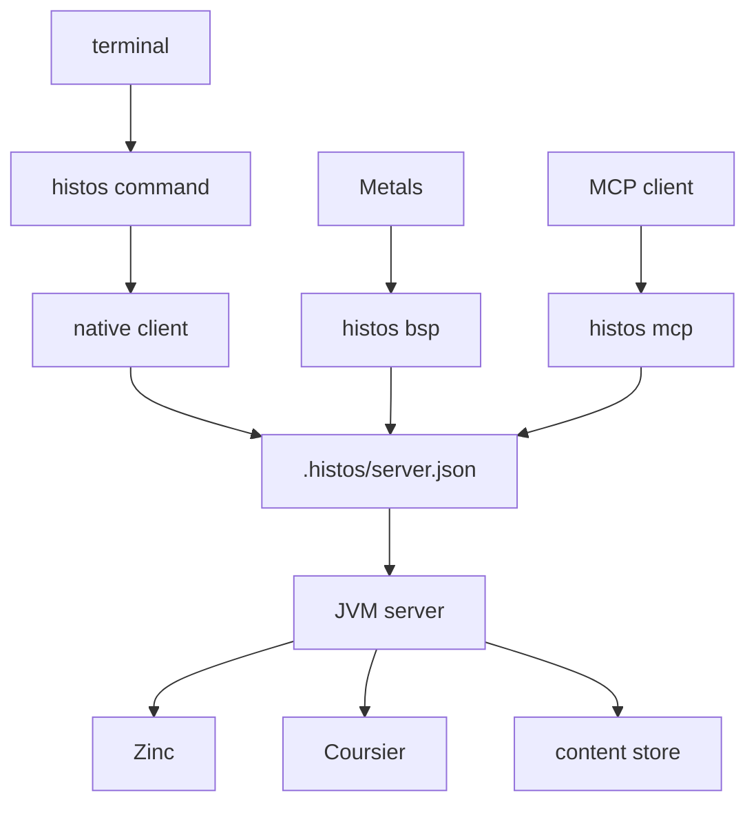

# Histos

Histos is a Scala build tool. The build is a Scala program that returns a graph. The work is a ZIO effect. A person, an editor, and an agent ask for the same operations and read the same results.



A command goes to a warm JVM server for its project, and starts one when none is listening. If the work ran, the result is a report, including a compile or a test that failed. If the request never started, the result is a fault with a diagnosis.

Histos is pre-release. The API breaks when that makes it more honest. What we still intend is [next](docs/next.md).

## Install

Histos runs on macOS and Linux. On Windows, use WSL.

Histos does not install a JDK, Node, or clang. It needs JDK 25 or newer, and the shim refuses an older `java` with the install guide. A JavaScript module needs Node 25 or newer. A native module needs clang. Dependency resolution uses the Coursier library inside the server, so the `cs` binary is not needed.

One POSIX script is the installer and the command:

```sh
curl -fsSL https://github.com/early-effect/histos/releases/download/dist/shim | sh
export PATH="$HOME/.histos/bin:$PATH"
```

The script installs itself as `~/.histos/bin/histos` and does not edit a shell rc. A first install writes `~/.histos/default`, the toolchain used outside a project, from the channel `dist` publishes.

### Toolchains and pins

A toolchain is one Histos version under `~/.histos/toolchains/<version>/`: its manifest, `histos.jar`, and, when the manifest names one for this platform, the native client `histos-client`. Prebuilt clients exist for `linux-x86_64` and `macos-aarch64`. Before a command runs, the shim fetches whatever that directory is missing and checks it against the manifest. Once the directory is complete, a command does not touch the network. Without a client, the shim runs `java -jar`.

A project pins its toolchain in `build.properties`:

```text
histos.version=0.2.10
```

The pin wins over `~/.histos/default`. It has three forms:

- `0.2.10` is a release.
- `0.2.10-SNAPSHOT` is a pointer that follows the newest snapshot of that line. The shim reads `channel-<pin>` from the `dist` release at most once an hour (`HISTOS_CHANNEL_REFRESH=every-call` reads it every time), and uses the cached answer when the network is down.
- A timestamp such as `0.2.10-20261112.042525-1`, or a commit pointer such as `0.2.10-7230ba21293f-SNAPSHOT`, freezes one build.

The shim answers four commands itself:

- `histos toolchain install 0.2.10` installs one version and checks every file it already has. It records that version as the default when none is set.
- `histos toolchain list` prints the installed versions.
- `histos self update` replaces the shim when the published one differs.
- `histos update` moves the pin. Inside a project it rewrites `build.properties`. Outside one it rewrites `~/.histos/default`. `--make-default` writes both.

`update` moves a release pin to the newest release and a snapshot pin to the newest snapshot line at or above its own. It keeps the pin's form: `--freeze` writes a timestamp and `--follow` writes a pointer. When a release has passed a snapshot pin, `update` asks on a terminal whether to switch, and `--stable` answers yes. Outside CI, a command on the JVM prints a notice when a published release has passed the project's pin. It asks Central at most once a day.

`HISTOS_HOME` moves `~/.histos`. `HISTOS_DIST` points the shim at another `dist` base.

## Start a project

```sh
histos new demo
cd demo
./histos test
```

`histos new <name>` writes a one-module project in a new directory. `histos init` writes one into the current directory. Both pin the toolchain that wrote them. `histos init --from sbt` drafts `histos.scala` from `build.sbt` and `project/plugins.sbt`, and `histos init --from zipx` from `project/ZipxVersions.scala`. A setting the draft does not map stays as a comment.

The full scaffold also writes `.gitignore`, a `./histos` script that runs the installed shim, the generated workflows, and `dependencies.lock`, then runs `doctor` outside CI. On a terminal it asks before writing the CI files and asks for the CI branch. `--yes` takes the defaults, and `--branch <name>` names the branch. `--bare` writes only `histos.scala`, `build.properties`, and the sources.

## A build

`histos.scala` defines `object build extends HistosBuild` with a `graph`. A module names its platforms (`Jvm`, `Js`, `Native`), its Scala versions, and its dependencies. Versions, dependencies, paths, urls, and names are typed literals, so a bad one does not compile the build file. The literals are [Literals.scala](api/src/histos/Literals.scala). This repository's build is [histos.scala](histos.scala).

```scala
import histos.*

object build extends HistosBuild:
  def graph =
    val zio = dep"dev.zio::zio:2.1.27"
    val app = module("app", Jvm)(scala"3.10.0")
      .libraryDependencies(zio)
      .testDependencies(zio.module("zio-test"), zio.module("zio-test-sbt"))
      .main(MainClass("demo.Main"))
    Projects(app)
```

- A third-party root is one `dep"..."` literal. A family member is `.module("other")` on that value, which copies the organization, kind, and revision.
- `.compileOnly` stays on the compile classpath and out of the pom. `.provided` stays on the compile classpath, off a JVM run and a fat jar, and is `provided` in the pom.
- `.excluding(organization, artifact)` excludes a published artifact. `.sbt(sbt"2")` makes an sbt plugin coordinate.
- A dependency on a ship this build owns is a pin: `.pointer` is `<ship>-SNAPSHOT`, `.commit(sha)` is `<ship>-<12 hex>-SNAPSHOT`, and `.released` is the ship number.

`Projects` also carries the organization, license, developers, scm, url, resolvers, runner tools, CI settings, coverage excludes, formatting, plugins, and the ship catalog. `Projects.locked` pins jars to `dependencies.lock`.

## Commands

`histos help` lists the commands, and `histos help <command>` prints one.

| Group | Commands |
| --- | --- |
| Information | `version`, `graph`, `toolchain`, `observe`, `help` |
| Build | `compile`, `run`, `clean`, `cleanFull`, `fmt` |
| Test | `test`, `testOnly`, `testQuick`, `coverage`, `affected`, `~` |
| Project | `new`, `init` |
| Publish | `publishLocal`, `publish snapshots`, `publish release`, `publish assets`, `publish promote`, `publish drop`, `bump` |
| Dependencies | `resolve`, `deps` |
| CI | `workflow`, `doctor`, `setup supply-chain`, `--explain` |
| Cache | `cache path`, `cache list`, `cache clean`, `cache promote` |
| Server | `server`, `bsp`, `mcp`, `reload`, `reboot`, `cancel` |
| Preview | `preview compile`, `preview test`, `preview publishLocal`, `preview publish snapshots`, `preview clean`, `preview cleanFull`, `preview run` |
| Building Histos | `assembly`, `client`, `launcher`, `portal` ([self-host](docs/self-host.md)) |

### Build and run

`histos compile [project ...]` compiles the named projects, or every module. An aggregate expands to its modules.

`histos run <name> [jvm|js|native]` runs a module's main. `histos run inspect` prints the project names, `histos run versions` prints the version decision, `histos run doc` writes scaladoc, and `histos run <plugin>/<task>` runs a plugin task. `run` passes no program arguments.

`histos clean [project ...]` deletes products. No name wipes every product root under `.histos` without reading the build. A name wipes that module, and an aggregate expands. `histos cleanFull` wipes the products, removes this project's keep file from the content store, and then deletes every store entry no remaining project keeps.

`histos fmt` formats with the scalafmt the build declares (`.scalafmt` reads `.scalafmt.conf`, `.scalafmt(RepoPath("config/scalafmt.conf"))` another file). The `version` in that configuration is the scalafmt that runs, locked with its sha256 by `resolve --update`. No name formats every module's `src` and `test` trees and `histos.scala`. A name formats that module. `--file <path>` formats repository-relative files. The configuration's include and exclude filters apply, and `project.git` applies except with `--file`. `histos fmt --check` writes no source, names each unformatted file, and fails. It records known-formatted files in `.histos/format/ledger`.

### Test

`histos test [project ...]` runs the selected suites. `histos test --affected '["api"]'` runs only those modules, and `["all"]` runs everything. `histos affected --base <sha>` prints the modules that differ from that commit as that JSON list.

`histos testOnly --module api '*Grammar*'` runs suites that match a pattern. `histos testQuick` skips a suite whose stored stamp still matches, and takes the same `--module` and patterns. The stamp includes the upstream API digest, so a signature change runs the suite.

A module's `TestStore` is `Off` (the default), `Local`, or `Remote`. `Local` lets `test` skip a suite whose stored digest still matches. `Remote` does not skip and does not upload.

`histos coverage [project ...]` instruments Scala 3 and Scala 2.13 on the JVM, runs the suites, and writes the report under `.histos/coverage`. JavaScript and Native are named and not measured. Floors are `--min-stmt`, `--min-branch`, `--min-stmt-file`, `--min-branch-file`, `--min-stmt-package`, and `--min-branch-package`, and `--exclude-class` and `--exclude-file` take regexes. `test` stays uninstrumented, and publish never reads `.histos/coverage`.

### Watch

`histos ~ compile` runs a command again after a source save, on the server when one is up. The watch covers `histos.scala` and the `src` and `test` trees of the modules the command names, or of every module when it names none. A change in an upstream module that is not named does not wake it. A plugin task watches the files it declared, or `histos.scala` when it declared none. `histos ~ --restart run app` starts the program and restarts it on a change (see [Known gaps](#known-gaps)).

### Preview

`histos preview compile`, `preview test`, `preview publishLocal`, `preview publish snapshots`, `preview clean`, `preview cleanFull`, and `preview run` write nothing. A compile or test preview names the sources the last analysis says are stale, and a test preview names the suites a quick run would skip. When the analysis cannot be read, the line says the staleness is unknown.

### Information

`histos version` prints the toolchain this command runs: the pin as the shim resolved it, so a `-SNAPSHOT` pointer prints its timestamp. With a server up it adds the server's version, its assembly checksum, and its snapshot line. `histos graph` prints each module with its platforms and Scala versions, each aggregate with its members, and each plugin. `histos toolchain` prints the JDK a compile would use, and Node or clang when a module needs them. `histos observe` prints the stored compile tally.

### Dependencies

`histos resolve` fetches what `dependencies.lock` records and checks each sha256. `resolve --update` solves and writes the lock, and `resolve --check` fails when a fresh solve differs. `histos deps check`, `deps update [--yes] [--security]`, `deps audit [--report]`, `deps pr [--security] [--open]`, `deps alert`, and `deps snapshot [--submit]` check, update, audit, and report dependencies. `histos setup supply-chain [--from zipx] [--fix] [--yes]` writes the supply-chain files.

### Doctor

`histos doctor [project ...]` runs the repository checks and lists errors and warnings. `--verbose` lists every check, `--area <area>` limits them, `--json` prints JSON, `--preflight <job>` runs the offline checks for one CI job, and `--fix` applies local edits. Named projects are the modules this run launches, which decides whether Node and clang are probed. `histos --explain supply.pin` explains one check by its id.

## CI

`histos workflow --update` writes the generated workflows, and `histos workflow --check` (the default) compares them with the tree. Neither publishes or changes the pin.

`ci.yml` has these jobs:

- `affected` computes the modules that changed.
- `test` runs `./histos test --affected ...` on a pull request or a dispatch. It restores and saves the content store `~/.cache/histos` under a key per pull request.
- `versions` runs `./histos run versions`.
- `scaladoc` runs `./histos run doc` when the build calls `.docCheck`, and fails on a warning.
- `coverage` runs `./histos coverage` when the build calls `.coverage()`.
- `format` runs `./histos fmt --check` when the build declares `.scalafmt`.
- `cache-seed` compiles on a push to the default branch and saves the main store.
- `workflow` runs `doctor` and `workflow --check`.
- `supply-chain` checks the workflows, the lock, and the advisories.
- `dependency-snapshot` submits the dependency graph on a push to the default branch.
- Plugin jobs (`TaskJob`, `SiteJob`). Each runs one task of the plugin that contributes it.

Each job runs `./.github/actions/setup`, which installs the shim, installs the pinned toolchain, and restores `~/.histos/toolchains` and the Coursier cache. That action lives in this repository. A consumer repository has to provide it today (see [Known gaps](#known-gaps)). Node and LLVM are installed only in jobs that need them: the test job for the modules it runs, `scaladoc` for the build's JavaScript and native modules, and `cache-seed` for every module. Playwright, and Node with it, is installed in those jobs whenever the build names a Playwright revision.

A `SiteJob` publishes one directory. `Automatic` deploys from a `pages` job on a push to the default branch, `Manual` writes `histos-pages.yml` for a person to dispatch, and `Both` (the default) does both.

The catalog adds `histos-release.yml` (dispatch only), `histos-promote.yml` when the release holds the deployment, and `histos-snapshots.yml` when a ship names an asset. The supply chain adds `histos-deps.yml`, and `histos-audit.yml` when it schedules an audit.

## Publishing

The decision is [publishing.md](docs/publishing.md). A ship is a catalog row, `Ship("demo").next(0, 1, 0)(api, app)`, and the number is the next release. SNAPSHOT is never written in the catalog. `histos run versions` prints what a session would publish.

| Command | Writes |
| --- | --- |
| `publishLocal` | The snapshot coordinate of HEAD into Coursier's `ivy2Local`, unsigned. A release when `HISTOS_SESSION=release`. |
| `publish snapshots` | `<ship>-<sha>-SNAPSHOT` and the moving `<ship>-SNAPSHOT` pointer to Sonatype, unsigned, without a javadoc jar. |
| `publish release` | The ship number, signed, as one Central portal bundle. Requires `HISTOS_SESSION=release`. |

`publishLocal` and `publish release` stage the jar, the pom, the sources jar, and a javadoc jar of that module's scaladoc. `publish snapshots` stages the same files without the javadoc jar. An assembly module stages its packaged program. A token is a ship, an aggregate, or a module, and no token publishes every ship the command can write. `publish snapshots` moves the pointer from any checkout, and `publishLocal` moves it only on the default branch.

- A snapshot needs `SONATYPE_USERNAME` and `SONATYPE_PASSWORD`.
- A release also needs `PGP_SECRET`. `PGP_PASSPHRASE` unlocks it (empty by default), and `PGP_KEY_HEX` selects a fingerprint. `HISTOS_SIGNER=gpg` signs with `gpg` instead, and then `PGP_KEY_HEX` is required and `PGP_SECRET` is not read.
- A release needs a license, a developer, and an scm, or the command fails before upload. Each pom is checked against Central first, and an already public coordinate is held.

The `releases` file at the root records what is already published. Empty means the catalog number is not released. This line means it is, so a snapshot of that number is held and `histos bump` is the next edit:

```text
histos matches
```

A missing file refuses every publish.

The default layer is `Sona.layer(ReleaseMode.Automatic)`, which publishes and waits for `PUBLISHED`. `ReleaseMode.Hold` waits for `VALIDATED`, and `histos publish promote <deployment>` or `histos publish drop <deployment>` finishes it. `--automatic` forces Automatic for one run. Each step prints as it happens: building, staged, signing, bundling, uploading, and the portal state.

`histos publish assets` uploads the file an assembly names when its deployment is `VALIDATED` or `PUBLISHED` and the GitHub release for that tag exists. It needs `GITHUB_TOKEN` and `GITHUB_REPOSITORY`.

`histos bump [--major | --minor | --patch] [ship ...]` moves `.next` past the newest stable version Coursier lists, when that stable has caught `.next`. The default is the next patch. It does not change the pin. `doctor` warns `ship.should-bump` when the number is already released and `ship.pin` when the pin trails a published Histos release.

## Editors

Metals speaks BSP 2.2 to Histos. Open the project and import the build. Metals reads `.bsp/histos.json` and starts its `argv` (`./histos bsp` when the project has the script, `histos bsp` otherwise). A command rewrites that file when the pin changes, and a running `bsp` rewrites it when the build files change, which Metals treats as a build change.

One target is one cell: a module, a Scala version, a platform, and `main`, or `test` when the cell has test sources. `histos.scala` is its own target. Scala 3 targets compile with `-Xsemanticdb` and `-sourceroot`, and Scala 2 targets with the semanticdb plugin. Diagnostics arrive as `build/publishDiagnostics`, or `build/logMessage` when a problem has no position.

`bsp` stays on the JVM. When a server is recorded, the session runs there, and a server at another version is replaced first. With no server, `bsp` compiles in its own process.

## Agents

An agent uses MCP. Point the client's stdio server at `histos` (or `./histos` in a project with the script) with the argument `mcp`:

```json
{
  "mcpServers": {
    "histos": {
      "command": "histos",
      "args": ["mcp"]
    }
  }
}
```

The tools are `graph`, `run`, `cancel`, `compile`, `test`, `publishLocal`, `publishSnapshots`, `toolchain`, `version`, `assembly`, `clean`, `cleanFull`, `resolve`, `workflow`, `fmt`, `reload`, `reboot`, `cachePath`, `cacheList`, `cacheClean`, `launcherUpdate`, `watch`, `preview`, `observe`, and `doctor`. Each sends the same call the command sends and returns the report as data, with each line as it is printed. A compile or test that failed is a report. A request that never started fails the tool.

## The server

`histos server` keeps a warm process in the foreground. Batch commands start one when none is listening. The record is `.histos/server.json`, and the socket is `.histos/server.sock`. The record names the toolchain the server runs. When it differs from the command's, the command reboots the server and runs on the replacement.

`histos reload` asks the running server to load the build again. `histos reboot` replaces the server, or starts one. `histos cancel <id>` cancels the run id a command printed.

The native client sends the plain forms of `compile`, `test`, `run`, `clean`, `cleanFull`, and `fmt` to the server itself, without starting a JVM to enter the tool. Every other command, and any of those with a flag the client does not read, runs `java -jar` on the toolchain jar.

## Cache

Compile and package are content-addressed. The content store is `~/.cache/histos`, or `$XDG_CACHE_HOME/histos`. A blob's name is its digest.

- The API digest is a compiled module's public signature. A comment or a method body does not change it, so a downstream compile hits. A public signature change runs that compile.
- The product digest is the class bytes with jar timestamps, line numbers, and the `TASTY` attribute taken out. Packaging keys on it.
- `testQuick` stamps include the upstream API digest.
- `histos cache path` prints the store, `cache list` prints each digest and its size, and `cache clean` removes entries older than 30 days that no project keeps. `--dry-run` names them and keeps them.

A remote cache speaks the Bazel remote cache protocol (bazel-remote or anything compatible). Today it serves plugin tasks only. `HISTOS_CACHE_URI` selects it: `http` and `https` use HTTP, `grpc` is plaintext gRPC, and `grpcs` is TLS. Unset or blank is off. A bad value fails and does not fall back to off. `HISTOS_CACHE_MODE` is `read` unless it is `write`, and `HISTOS_CACHE_NAMESPACE` is `main` unless it names `pr/<n>` or `dev/<name>`. A lookup tries this namespace, then `main`, then the local store, and then runs the action. `histos cache promote --from pr/12 --to main` copies an index over HTTP, and reports `remote cache is not configured` when the URI is unset.

CI restores the content store, the Coursier cache, and the toolchains with exact keys. That copy is not the compile key. A compile still hits or misses inside the store.

## Tools on the machine

Histos uses the JDK, Node, and clang already installed.

- JDK: `.histos/toolchain.local` names a JDK home. Otherwise the running JVM (`java.home`).
- Node: `HISTOS_NODE`, then the `nodePath` on `RunnerTools`, then `.histos/node.local` (a Node home), then `node` on `PATH`. A source that is missing, not executable, or older than the floor fails, and the next source is not tried.
- clang: on `PATH`.

A file that points at a missing or too-old home fails, and Histos does not pick another.

## Plugins

A plugin is a service, and the layer provides it. The contract is [plugins.md](docs/plugins.md). A command name the grammar owns is reserved. `acp` is reserved and has no command.

A plugin task's `run` is called inside a `Scope` that closes when the task returns. [PluginScopes](api/src/histos/plugin/PluginScopes.scala) also names the generation scope, which stays open across saves until the build or a plugin source changes. `src/main/resources` and `src/test/resources` are copied into the class directories, and `.resources` adds generated files. The binary jar of a module the graph names as a plugin carries `META-INF/histos/version`, the sha256 of the host api jar.

## Known gaps

These are true today and tracked:

- Generated workflows use `./.github/actions/setup`, which only this repository has. [cli-work-plan.md](docs/cli-work-plan.md)
- `~ --restart run` cannot restart on a server, because the running program holds the compile lock. A failed compile still restarts the program.
- No native or JavaScript link is skipped, and the remote cache does not serve compile, package, or link. The `promote` setting is not read yet. [cache-work-plan.md](docs/cache-work-plan.md)

## Building Histos

Histos builds itself, and that needs commands no other build uses: `assembly`, `client`, `launcher`, and `portal`. How the pin, the local assembly, the snapshot channel, and the native clients fit together is [self-host.md](docs/self-host.md).

## License

Apache License 2.0. See [LICENSE](LICENSE).
