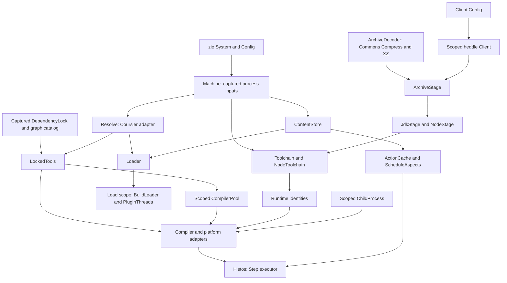

# Histos architecture

**Checkpoint:** 2026-10-24, M3 baseline `d2b4630` plus locally verified M4 implementation.

The final source-built suite passed **663 tests, zero failures**, with one Windows-only fixture ignored on macOS. Heddle 0.13.0 is published and locked; the unchanged 80 MiB fixed-length, chunked, and close-delimited updater tests passed. Generated workflow/scripts and dependency verification passed. Warm command-level graph, resolve, compile, full/quick test, application/plugin run, workflow and BSP proofs passed with external outbound networking denied. Actual Windows execution remains the PR CI gate. [audit.md](audit.md) records verification and remaining findings; [roadmap.md](roadmap.md) separates delivered code from future services. A behavior change updates these documents in the same PR.

## Modules and build model

A repository evaluates `histos.scala` into an immutable, validated `ProjectGraph`. Compile, test, run, publish, plugins, and workflow rendering operate on that graph. Histos builds its own four modules through [`histos.scala`](../histos.scala).

| Module | Responsibility | Dependencies |
| --- | --- | --- |
| `api` | Graph/builders, literals, version model, Step algebra, plugin descriptions and runner contract | ZIO |
| `central` | Local Maven and Sonatype snapshot publishers | `api`, ZIO, heddle |
| `engine` | Load, resolve, compile/link/test/run, runtimes, cache/executor, packaging, publishing, workflow rendering | `central`, `api`, ZIO/Streams, Dotty, Zinc, Coursier, ASM, Commons Compress, XZ |
| `app` | CLI, server/client, BSP, MCP | `engine`, ZIO CLI, heddle-mcp |

Dependency revisions belong to the build file, not this document. Linkers execute in child JVMs and are not loaded into the engine.

[`ModuleDef`](../api/src/histos/ProjectDef.scala) is immutable. Modules require a nonempty platform set and full Scala versions. Aggregates select direct module members and have no classpath or cell. A cell is one module, Scala version, and platform, with separate compile/test dependency scopes. [`Projects`](../api/src/histos/Graph.scala) returns `Either[BuildError, ProjectGraph]` and reports the first validation error (G12). Mixed test-main/provider settings are rejected while constructing the graph, but the builder still represents that invalid combination (G1).

[`ToolCatalog`](../api/src/histos/ToolCatalog.scala) separates compiler support, Scala.js, and Scala Native defaults. `Projects.tools` preserves it across builder combinations. Module `jsVersion` and `nativeVersion` override the platform defaults. [`JsVersion`](../api/src/histos/JsVersion.scala) and [`ToolRevision`](../api/src/histos/ToolRevision.scala) have compile-time literals and typed runtime parsers. Platform-only settings are still validated on general modules rather than excluded by their types (G2).

Source roots are `<module>/src`, or the directory supplied by `.in`. A single-module graph may use root `src`. Tests use `src/test` plus a sibling `test` directory. Platform/version directories select files for a cell. Main and tests compile separately. See [Sources](../engine/src/histos/zinc/Sources.scala), [GraphSpec](../api/test/GraphSpec.scala), and [SelectionSpec](../engine/test/SelectionSpec.scala).

## Construction and resource ownership

Layers construct adapters; methods perform build work. Existing services and scoped operations are not a completed `Build` or `PlatformBackend` abstraction.

- [`Machine.load`](../engine/src/histos/jdk/Toolchain.scala) captures the fiber's environment and `user.home`, `os.name`, `os.arch`, and `java.home`. `HISTOS_NATIVE` and `HISTOS_JDK_SETTLED` are Config over that map. Missing CPU metadata is typed, not guessed.
- [`Workspace`](../engine/src/histos/workspace/Workspace.scala) owns path-bearing IO, shared writes/deletes, and scoped temporary directories. IO failures retain the path and operation through `IoFailure`/`IoFault`.
- [`Loader`](../engine/src/histos/load/Loader.scala) takes Resolve and ContentStore. Its caller's Scope owns temporary build classes, BuildLoader, and PluginThreads. `loadLocked` consumes a supplied generation and is a mandatory trait operation.
- [`CompilerPool`](../engine/src/histos/zinc/CompilerPool.scala) uses keyed semaphores and scoped classloaders. It is a batch pool, not ZKeyedPool and not a proven server-lifetime compiler pool. Each loader is now acquired under Scope before fallible Zinc construction; the failure-path regression passes under S16.
- [`ArchiveStage`](../engine/src/histos/archive/ArchiveStage.scala) takes Client, ArchiveDecoder, and validated budgets. Client.layer owns transport resources; decoder/stage operations own opened streams, channels, responses, and scratch.
- [`ChildProcess`](../engine/src/histos/process/ChildProcess.scala) owns subprocess lifetime and pipe readers. The load/server scopes own their respective classloaders and sockets. These lifetimes do not grant a sandbox.

## Compiler provenance and loading

There are three compiler selections:

| Consumer | Selection | Byte provenance |
| --- | --- | --- |
| Build file and source/path plugins | Validated running Dotty revision from [BuildCompiler](../engine/src/histos/toolchain/BuildCompiler.scala) | Actual embedded compiler location and executing runtime, not a module tool cell |
| Module compilation | The module cell's Scala version | Checksum-verified compiler/bridge/support tool cell |
| Js/Native bridge compilation | Catalog-selected auxiliary Scala version | Its own locked compiler and platform-support requests |

A version string is not a byte identity. Source-plugin cache code uses CompilerIdentity in addition to API/source/dependency digests. Current BuildCompiler.identity hashes Dotty, TASTy and compiler-interface code sources plus the supplied boundary/classpath content; assembly locations naturally identify the whole jar. The executing JVM runtime is included separately. Changed-support-byte and non-assembly regressions passed under L14.

Loader scans the constrained plugin header, materializes locked plugins, compiles source/path plugins first, and blanks header lines in a temporary build file while preserving diagnostic positions. It compiles that file against boundary/API and plugin classpaths, then evaluates the graph.

[`ApiBoundary`/`BuildLoader`](../engine/src/histos/load/BuildLoader.scala) delegate API root, plugin/version, ZIO, izumi-reflect, and Scala names to the host. Other Histos namespaces are refused before plugin URLs are searched. Refusals belong to one load/run and are cleared after reading. [`PluginThreads`](../engine/src/histos/load/PluginThreads.scala) pin the build context loader across ordinary and blocking execution. [plugins.md](plugins.md) describes linking and trust limits.

## Dependency lock and generations

[`DependencyLock`](../engine/src/histos/resolve/DependencyLock.scala) contains module/test cells, plugin cells, and tool cells. Each jar records organization, published name, exact revision, optional [`JarClassifier`](../engine/src/histos/resolve/JarClassifier.scala), repository, and SHA-256. Classified and main jars are different artifacts. [`ArtifactName`](../engine/src/histos/resolve/ArtifactName.scala) owns Scala/platform suffixes.

[`ToolRequest`/`LockedTool`](../engine/src/histos/resolve/ToolCell.scala) record a typed role, Scala version and platform/environment variant, ordered roots, Single/Closure transitivity, optional Native origin, resolver policy, artifacts, and evictions. Tool cells cover compiler bridges/support, SemanticDB, Js libraries/linkers/environments/test adapters, Chekhov, and Native plugins/libraries/linkers/test runners.

[`LockedTools`](../engine/src/histos/resolve/LockedTools.scala) is an immutable view of a captured lock, catalog, repositories, and resolver. Materialization validates the request/policy and required direct roots, then fetches recorded artifacts without a graph solve. `ResolveError` distinguishes NoTool, ToolDrift, ToolRoot(Missing/Duplicated), Checksum, compiler-version, and Native-origin failures. Direct-root coverage does not prove the entire transitive closure offline.

The live raw Coursier fetch boundary is [`CoursierResolve`](../engine/src/histos/resolve/CoursierResolve.scala); its library runner and IO failures map to ResolveError. No compiler/platform adapter has authority to silently repair a missing tool cell.

One operation must use one lock generation through compile, test, classpath, link, run, and package. CompileSession, suitesLocked, and BSP request capture implement parts of that wiring. Plugin task compile/classpath preparation now shares a memoized captured lock/runtime in source. Plugin and application operation-barrier regressions passed under L11. Atomic writes alone do not make repeated reads one snapshot.

### CLI authority

| Command | Behavior |
| --- | --- |
| `resolve --update` | Stage header plugin cells in memory, load that supplied generation, solve module/tool cells, then commit the combined lock only after success |
| `resolve` | Require locked plugins, verify planned tools and module artifacts, fetch exact missing cached bytes if necessary; no implicit solve |
| `resolve --check` | No write. Re-solve plugin/module cells to check drift; materialize tool cells without a tool solve |
| `launcher --update` | Update the existing valid immutable remote launcher pin, without loading the graph; print revision and digest |
| `workflow` or `workflow --check` | Compare graph workflows and generated scripts using the existing launcher pin |
| `workflow --update` | Rewrite generated workflows/scripts; never advance the launcher pin |

Both resolve flags together and both workflow flags together are usage errors. Bare `launcher` is rejected. Launcher update errors exit 5. Header plugins are planned against Central before the loaded graph's custom resolvers exist. Low-level independent lock writers remain in Resolve; they do not define the CLI's staged transaction. See [Grammar](../app/src/histos/cli/Grammar.scala), [Cli](../app/src/histos/cli/Cli.scala), [Calls](../app/src/histos/server/Calls.scala), and [ToolCellsSpec](../engine/test/ToolCellsSpec.scala).

Exact fetches can need a network on a cold cache. “Offline generation” means rendering does not refresh metadata, not that a cold build load needs no bytes. Empty graphs still have mandatory build-compiler tools to verify.

## Compile, link, test, and run

[`Histos`](../engine/src/histos/schedule/Histos.scala) runs existing Step graphs with a promise per step identity and permits per resource class. An independent failed compile does not cancel siblings; the compile command fails after the last cell. [`Step`](../api/src/histos/step/Step.scala), [`StepKind`](../api/src/histos/step/StepKind.scala), and [`StepAspect`](../api/src/histos/step/StepAspect.scala) provide typed composition/cache eligibility. Test/run/publish orchestration already enters the executor, but that does not finish test outcome semantics or backend unification (P4-P7).

Compilation uses Zinc for Scala 3 and 2.13. Main outputs are `.histos/classes/<module>/<scala>/<platform>`; tests use `.histos/test-classes`. SemanticDB is enabled. Persisted `inc.zip` analysis under `.histos/analysis` is passed to the next compile, preserving unchanged classes and deleting outputs for removed sources. The module classpath never includes engine/plugin jars; compiler and Histos markers are refused.

[`ToolInput`](../engine/src/histos/resolve/ToolInput.scala) fingerprints a selected request and its verified artifact identities/hashes. Compile keys, compiler pool keys, and Zinc setup fingerprints use different relevant subsets, not an undifferentiated whole-lock list. Selected platform revision and runtime identity must change the appropriate key; unrelated tools must not. Run steps retain their selected verified inputs; production relevance tests passed under L10. Absolute source paths remain a separate portability problem (P16).

Js runs through Node, Jsdom, or Firefox/Chekhov. Node is selected once within an operation and passed to child launches, including Playwright's Node path. Native application Scala version selects application libraries; `native.bridgeScala` selects the JVM linker bridge compiler. Native origin comes from the captured Machine and reaches compilation/linking. Clang is still an installed tool. Generated Scala bridge sources and forced link-cache recreation remain P1/P2, even though their jar dependencies are locked.

Tests run in child processes, not inside the engine. The default is ZIO Test; an sbt test-interface provider or one TestMain can replace it. Children get main/test classes, upstream main classes, and locked jars, with a reduced environment. Unix JVM and Node/Native launch helpers own process groups so cancellation reaches descendants after their leader exits. Windows engine support is still P12; standalone Windows bootstrap is a separate gate.

`testOnly` uses fully qualified suite patterns and fails when none match. `testQuick` still uses SuiteStamp and QuickRecord. [`TestContext`](../engine/src/histos/testrun/TestContext.scala) now verifies selected compilation/execution tools and runtime inputs before cached success in source. Its final regressions passed under L20; upstream jars, flags, synchronous bytecode scanning and persistence errors remain P6/P15. Histos `test` and `testQuick` are distinct commands.

`run <module> [jvm|js|native]` starts its named main. A multiplatform module requires a platform. `run inspect`, `run versions`, and `run <plugin>/<task>` use the task registry. Watch reruns a command after source changes. See [GraphCompileSpec](../engine/test/GraphCompileSpec.scala), [ZincSpec](../engine/test/ZincSpec.scala), [ModuleTestSpec](../engine/test/ModuleTestSpec.scala), and [ProgramSpec](../engine/test/ProgramSpec.scala).

## Runtime host locks and trust

JDK and Node use shared [`ToolLock`](../engine/src/histos/toolchain/ToolLock.scala): exactly one major and full version, plus a nonempty archive table. Each archive row contains canonical OS/CPU host, source URI, and checksum. Hosts cannot repeat. Old singleton url/sha256 fields are rejected. Runtime adapters nest shared schema errors and retain their own pin/version failures.

Canonical hosts are `macos-x86_64`, `macos-aarch64`, `linux-x86_64`, `linux-aarch64`, `windows-x86_64`, and `windows-aarch64`. [`HostPlatform`](../engine/src/histos/toolchain/HostPlatform.scala) accepts machine CPU aliases but lock tokens are canonical. A valid lock may omit the current host; selection fails with NoArchive(host) before transport or unrelated probes. Archive order is never a fallback priority.

[`ArchiveSource`](../engine/src/histos/archive/ArchiveSource.scala) validates absolute file/HTTPS URIs. Locked FileUrl values stay platform-neutral until the selected row is materialized, so Windows need not interpret a macOS file path. HTTPS queries and percent-encoded filenames are supported; archive HTTP, credentials, fragments, malformed escapes and raw controls are not. See the shared [runtime schema fixtures](../engine/test/fixtures/runtime-lock) and [ToolLockSpec](../engine/test/ToolLockSpec.scala). Cross-reader acceptance remains L15 until final engine/POSIX/Windows results agree.

With a lock, its verified archive is the default. `toolchain.local` or `node.local` explicitly chooses a local home and bypasses host matching, not schema validation. Malformed/unreadable present files are errors, not absence. Engine selection parses a present lock even with a local override; standalone override precedence must remain covered by its fixtures.

Without a lock, startup retains the installed JVM and Node execution may use PATH. This repository has no committed runtime locks. That is a deliberate local trust seam, not authenticated provisioning. Locked Node selection must not execute unrelated PATH/manager/cached candidates just for a trace (L16). Explanation currently requires a lock even where execution supports bootstrap (P10).

RuntimeIdentity is either the selected archive checksum or canonical local home plus content. Local hashing includes names, linked content/targets and executable state. JdkRuntime and NodeRuntime retain identity; Node's compatibility choose projections have been removed. Compiler/platform requests now reuse JdkRuntime rather than a duplicate ResolvedJdk. Final local cross-consumer verification passed.

## Archive decoder and installation

[`ArchiveDecoder`](../engine/src/histos/archive/Archive.scala) is a swappable trait. Its fold callback owns each DecodedEntry body: a file body is consumed once, completely, before advancing; it is closed when that callback ends. Consumers cannot collect advancing tar cursors and later read substituted entry bytes.

[`CommonsArchiveDecoder`](../engine/src/histos/archive/CommonsArchiveDecoder.scala) supplies maintained ZIP/tar/gzip/XZ parsing. [`ArchiveExtract`](../engine/src/histos/archive/ArchiveExtract.scala) separately owns containment, entry/link/duplicate/mode policy. Replacing a parser does not replace that security policy. [`ArchiveBudget`](../engine/src/histos/archive/ArchiveBudget.scala) bounds download, decompression, extracted/per-entry bytes, entry count, metadata, and decoder memory. Published Adoptium archive sizing informed the defaults and deterministic budget tests passed. These delivered-entry bounds are not a process-wide heap cap: Commons ZIP central-directory allocation precedes the entry checks (P21).

ArchiveStage streams and hashes file/HTTPS downloads into unique same-filesystem scratch, verifies the archive, extracts to scoped scratch, validates the exact full runtime version, records installation content, and publishes a complete tree atomically. Warm reuse rechecks archive and tree. Response scopes remain open through body consumption; stream/channel/scratch resources close on failure and interruption. Only bounded writes/publication are masked, not downloads or lock waits.

[`RuntimeCache`](../engine/src/histos/archive/RuntimeCache.scala) enforces owner-private roots and ancestor/ownership policy. Extraction preserves executable capability without importing unsafe write/special permissions. Installation manifests operate within this protected local-owner boundary; they do not authenticate against an attacker controlling the launching account. Legacy unmarked installations fail validation. Engine `unpack` manifests and standalone `install.*` inventories are distinct layouts.

Runtime errors preserve selected-source, host, checksum, extraction, budget, cache, version and path-bearing IO failures through JDK/Node adapters. See [ArchiveStageSpec](../engine/test/ArchiveStageSpec.scala), [ArchiveDecoderSpec](../engine/test/ArchiveDecoderSpec.scala), [RuntimeSecuritySpec](../engine/test/RuntimeSecuritySpec.scala), and [RuntimeInterruptionSpec](../engine/test/RuntimeInterruptionSpec.scala). All 12 owned runtime/archive suites passed 132 tests in standalone source runs, then passed again with external outbound networking denied. Those fixtures are not the full Histos command/launcher/Windows integration gate.

## Launcher pin and update transaction

Assembly writes a runnable jar and its separate `.histos/assembly.sha256`; lazy-val bytecode rewriting avoids dependency calls to Unsafe. Assembly is still repository-specific (P8). Source `dist/histos.jar` or HISTOS_ASSEMBLY uses that source digest, not the remote pin.

Remote startup consumes [`LauncherPin`](../engine/src/histos/publish/LauncherPin.scala): repository, snapshot directory version, immutable timestamp/build revision, and SHA-256 for fixed Histos coordinates. Every reused/downloaded remote jar is checked against the committed pin. Startup never consults latest metadata or remote sidecars.

Dedicated update:

1. Read an existing valid pin. Securely parse bounded metadata and select its exact unclassified jar revision.
2. Read a bounded sidecar; stream/hash the artifact into scoped same-filesystem scratch with a framing-independent size bound.
3. Acquire the persistent repository file lock and compare the complete current pin with the original. A stale writer fails with typed Conflict.
4. Atomically place verified reusable bytes, then replace the pin last. Bounded commit operations complete before finalization; downloads and lock waits remain interruptible.

The commit-lock file remains on disk after release so concurrent processes cannot lock different replacement inodes. The launcher pin belongs in version control; reusable launcher bytes and temporary update state do not.

Client and LauncherCommit are constructor-injected seams, not business logic hidden in layers. Metadata/checksum/artifact errors, size, IO, transport and conflicts remain LauncherError until CLI rendering. Invalid/download/staging failures preserve the original pin. This authenticates against the repository trusted during explicit update, not a signature authority or a power-loss durability guarantee.

[`LauncherScript`](../engine/src/histos/publish/LauncherScript.scala) generates POSIX and stock PowerShell launchers. They select the exact JDK host pin, privately stage safe archives and check the whole installed runtime before Java, including library/image/link/mode changes. Windows uses a suspended process assigned to a kill-on-close job before resuming. Actual Windows execution remains T16.

**Verified delivery:** launcher `0.0.1-20261024.182342-16`, SHA-256 `046c3ec7409867f9b2477997ee8d9e0507fe520d234cca860a9d307181ad81b9`, was published and pinned after the full source suite. The three real 80 MiB transport tests pass with published Heddle 0.13.0. The exact published launcher cold-download and warm offline boot passed using an owner-private cache. Stock Windows execution remains T16. MacOS shared-temp ancestor mode reporting remains P23; its conservative rejection preserves the private-cache boundary.

## Server, BSP, and MCP

The CLI is one-shot; `server` opts into a warm process. A matching server receives a Call before client-side loading. Missing/corrupt records fall back locally; differing versions require reboot. The server fingerprints the build file, dependency lock, and path-plugin files. Successful reload swaps the graph; failure keeps the last good graph and fails that call. Reboot starts a successor and stops the old process, including idle connections.

Runtime selection is distinct from graph reload. Plugin, attached and BSP request paths select fresh operation runtimes; regression tests verify override/home/content changes affect the next operation while its captured values remain stable (L13). This is not yet one Build service or proven session compiler pooling.

Metals uses the `.bsp/histos.json` connection file and BSP 2.2 over stdio, spliced onto a live server when present. Main/test/build-file targets, sources/dependency sources, scalac options, compile diagnostics, discovered mains/suites and JVM environments are implemented. Js/Native targets require `.histos/bsp-platforms`. Changed targets notify every spliced session. Requests remain serial and BSP ignores cancellation (A10). Classpath/URI/allow-list work still belongs outside thin handlers (A6/A7).

MCP exposes graph, compile, test, publish, run, cancel and toolchain through heddle-mcp. It attaches to a matching server or holds a local graph. Results remain CLI text strings; typed report/fault schemas, multiplexed progress and cancellation by run id are M6 work. Plugin Call.Task arguments are still lost through server/MCP (A25).

## Publish, cache, and CI

Local publish writes one coordinate per platform cell, with main-scope dependencies in its POM. Snapshot upload uses scoped heddle Client, the fiber clock, captured credentials and Config.Secret. Repositories allow HTTPS or loopback HTTP. Version schemes and manual catalog pins live in [`histos.version`](../api/src/histos/version) and the build file.

The content store uses XDG_CACHE_HOME or the user's cache directory. Cache clean removes old unused CAS/plugin entries and scratch, with per-project keep sets; it does not remove shared JDK/launcher installations. Remote cache remains test-only/in-memory, without live configuration. Plugins declare inputs/outputs and use Scheduler/ScheduleAspects for manifests, while Histos owns orchestration.

Generated [`ci.yml`](../.github/workflows/ci.yml) runs test, catalog versions, plugin jobs and workflow drift. It still derives hardcoded uncached Node/LLVM/browser steps from `.github/ci-tools` (C1). Split axes still need CLI support (C2). The hand-written [`launcher-windows.yml`](../.github/workflows/launcher-windows.yml) is an M4 bootstrap verification exception; M8 must eventually absorb it without losing coverage. Its [PowerShell fixture](../engine/test/fixtures/launcher-windows.ps1) has not yet run on Windows.

## Errors, exits, and migration

Domain adapters use nested error ADTs with paths/coordinates/reasons. Socket and MCP edges still flatten them to text (A1/A2/A12); existing platform/startup failures remain P7. Errors are not typed all the way to every surface yet.

| Exit | Meaning |
| --- | --- |
| 0 | Success |
| 1 | Task failed |
| 2 | Usage |
| 3 | Load failed |
| 4 | Toolchain failed |
| 5 | Resolve/launcher update failed; missing lock for test/run |
| 6 | Workflow/script drift |
| 7 | Test failed or unknown test project |
| 8 | Compile failed, including missing lock |
| 9 | Publish failed |
| 130 | Interrupted |
| Other | Started program's exit status |

The missing-lock split remains A17. Prerelease migration is deliberate:

- Rebuild with the current source runtime before consuming tool/classifier lock sections. Advance only to a verified immutable M4 snapshot; do not release to bypass the interim launcher limitation.
- Replace singleton runtime locks with typed version and nonempty host entries. Use JdkLock/NodeLock.from and archive(host), not removed source/sha fields or old positional constructors.
- Supply mandatory Machine architecture in fixtures/adapters. Archive types now live in histos.archive; decoder implementations use owned fold callbacks.
- Implement Loader.loadLocked and Resolve.resolveTool explicitly in custom adapters. Preserve supplied generations rather than degrading to legacy load behavior.
- Binary plugins must match the new API digest or use their locked source fallback. Product snapshot labels do not imply compatibility.
- Restage only the affected unmarked/corrupt runtime digest installation. Tightened private-cache policy can reject shared/writable roots; do not delete unrelated user caches.

The local user is the trust boundary. Build/plugin/test code runs with that user's permissions; classloaders, declared inputs, checksums and child processes are not a filesystem/network sandbox. Local runtime overrides and absent locks remain explicit exceptions to archive trust. Clang/browser/system-package and portable source-root coverage remain later work.
