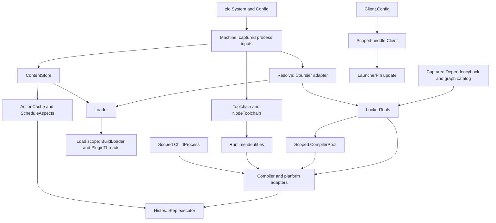

# Histos architecture

This describes the implemented types, service boundaries and resource ownership. [audit.md](audit.md) tracks remaining concerns; [roadmap.md](roadmap.md) owns their milestone plan. A behavior change updates these documents in the same PR.

## Modules and build model

A repository evaluates `histos.scala` into an immutable, validated `ProjectGraph`. Compile, test, run, publish, plugins, and workflow rendering operate on that graph. Histos builds its own four modules through [`histos.scala`](../histos.scala).

| Module | Responsibility | Dependencies |
| --- | --- | --- |
| `api` | Graph/builders, literals, version model, Step algebra, plugin descriptions and runner contract | ZIO |
| `central` | Local Maven and Sonatype snapshot publishers | `api`, ZIO, heddle |
| `engine` | Load, resolve, compile/link/test/run, runtimes, cache/executor, packaging, publishing, workflow rendering | `central`, `api`, ZIO/Streams, Dotty, Zinc, Coursier, ASM |
| `app` | CLI, server/client, BSP, MCP | `engine`, ZIO CLI, heddle-mcp |

Dependency revisions belong to the build file, not this document. Linkers execute in child JVMs and are not loaded into the engine.

[`ModuleDef`](../api/src/histos/ProjectDef.scala) is immutable. Modules require a nonempty platform set and full Scala versions. Aggregates select direct module members and have no classpath or cell. A cell is one module, Scala version, and platform, with separate compile/test dependency scopes. [`Projects`](../api/src/histos/Graph.scala) returns `Either[BuildError, ProjectGraph]` and reports the first validation error (G12). Mixed test-main/provider settings are rejected while constructing the graph, but the builder still represents that invalid combination (G1).

[`ToolCatalog`](../api/src/histos/ToolCatalog.scala) separates compiler support, Scala.js, and Scala Native defaults. `Projects.tools` preserves it across builder combinations. Module `jsVersion` and `nativeVersion` override the platform defaults. [`JsVersion`](../api/src/histos/JsVersion.scala) and [`ToolRevision`](../api/src/histos/ToolRevision.scala) have compile-time literals and typed runtime parsers. Platform-only settings are still validated on general modules rather than excluded by their types (G2).

Source roots are `<module>/src`, or the directory supplied by `.in`. A single-module graph may use root `src`. Tests use `src/test` plus a sibling `test` directory. Platform/version directories select files for a cell. Main and tests compile separately. See [Sources](../engine/src/histos/zinc/Sources.scala), [GraphSpec](../api/test/GraphSpec.scala), and [SelectionSpec](../engine/test/SelectionSpec.scala).

## Construction and resource ownership

Layers construct adapters; methods perform build work. Existing services and scoped operations are not a completed `Build` or `PlatformBackend` abstraction.

- [`Machine.load`](../engine/src/histos/jdk/Toolchain.scala) captures the fiber's environment and `user.home`, `os.name`, `os.arch`, and `java.home`. `HISTOS_NATIVE` is Config over that map. Missing CPU metadata is typed, not guessed.
- [`Workspace`](../engine/src/histos/workspace/Workspace.scala) owns path-bearing IO, shared writes/deletes, and scoped temporary directories. IO failures retain the path and operation through `IoFailure`/`IoFault`.
- [`Loader`](../engine/src/histos/load/Loader.scala) takes Resolve and ContentStore. Its caller's Scope owns temporary build classes, BuildLoader, and PluginThreads. `loadLocked` consumes a supplied generation and is a mandatory trait operation.
- [`CompilerPool`](../engine/src/histos/zinc/CompilerPool.scala) uses keyed semaphores and scoped classloaders. It is a batch pool, not ZKeyedPool and not a proven server-lifetime compiler pool. Each loader is now acquired under Scope before fallible Zinc construction; the failure-path regression passes under S16.
- [`ChildProcess`](../engine/src/histos/process/ChildProcess.scala) owns subprocess lifetime and pipe readers. The load/server scopes own their respective classloaders and sockets. These lifetimes do not grant a sandbox. The heddle client used by launcher update is scoped the same way.

## Compiler provenance and loading

There are three compiler selections:

| Consumer | Selection | Byte provenance |
| --- | --- | --- |
| Build file and source/path plugins | Validated running Dotty revision from [BuildCompiler](../engine/src/histos/toolchain/BuildCompiler.scala) | Actual embedded compiler location and executing runtime, not a module tool cell |
| Module compilation | The module cell's Scala version | Checksum-verified compiler/bridge/support tool cell |
| Js/Native bridge compilation | Catalog-selected auxiliary Scala version | Its own locked compiler and platform-support requests |

A version string is not a byte identity. Source-plugin cache code uses CompilerIdentity in addition to API/source/dependency digests. Current BuildCompiler.identity hashes Dotty, TASTy and compiler-interface code sources plus the supplied boundary/classpath content; assembly locations naturally identify the whole jar. The executing JVM runtime is included separately. [SelectedToolsSpec](../engine/test/SelectedToolsSpec.scala) covers changed support bytes and non-assembly provenance.

Loader scans the constrained plugin header, materializes locked plugins, compiles source/path plugins first, and blanks header lines in a temporary build file while preserving diagnostic positions. It compiles that file against boundary/API and plugin classpaths, then evaluates the graph.

[`ApiBoundary`/`BuildLoader`](../engine/src/histos/load/BuildLoader.scala) delegate API root, plugin/version, ZIO, izumi-reflect, and Scala names to the host. Other Histos namespaces are refused before plugin URLs are searched. Refusals belong to one load/run and are cleared after reading. [`PluginThreads`](../engine/src/histos/load/PluginThreads.scala) pin the build context loader across ordinary and blocking execution. [plugins.md](plugins.md) describes linking and trust limits.

## Dependency lock and generations

[`DependencyLock`](../engine/src/histos/resolve/DependencyLock.scala) contains module/test cells, plugin cells, and tool cells. Each jar records organization, published name, exact revision, optional [`JarClassifier`](../engine/src/histos/resolve/JarClassifier.scala), repository, and SHA-256. Classified and main jars are different artifacts. [`ArtifactName`](../engine/src/histos/resolve/ArtifactName.scala) owns Scala/platform suffixes.

[`ToolRequest`/`LockedTool`](../engine/src/histos/resolve/ToolCell.scala) record a typed role, Scala version and platform/environment variant, ordered roots, Single/Closure transitivity, optional Native origin, resolver policy, artifacts, and evictions. Tool cells cover compiler bridges/support, SemanticDB, Js libraries/linkers/environments/test adapters, Chekhov, and Native plugins/libraries/linkers/test runners.

[`LockedTools`](../engine/src/histos/resolve/LockedTools.scala) is an immutable view of a captured lock, catalog, repositories, and resolver. Materialization validates the request/policy and required direct roots, then fetches recorded artifacts without a graph solve. `ResolveError` distinguishes NoTool, ToolDrift, ToolRoot(Missing/Duplicated), Checksum, compiler-version, and Native-origin failures. Direct-root coverage does not prove the entire transitive closure offline.

The live raw Coursier fetch boundary is [`CoursierResolve`](../engine/src/histos/resolve/CoursierResolve.scala); its library runner and IO failures map to ResolveError. The build resolves through [`Resolve.coursier`](../engine/src/histos/resolve/Resolve.scala): Coursier's own cache, a local read when the file is already there, and one fetch into that cache when it is not. The content store is a different directory. A test that publishes to a file repository keeps a private cache for those artifacts. No compiler/platform adapter has authority to silently repair a missing tool cell.

One operation must use one lock generation through compile, test, classpath, link, run, and package. CompileSession, suitesLocked, and BSP request capture implement parts of that wiring. Plugin task compile/classpath preparation now shares a memoized captured lock/runtime in source. Plugin and application tests exercise generation replacement between operation phases. Atomic writes alone do not make repeated reads one snapshot.

### CLI authority

| Command | Behavior |
| --- | --- |
| `resolve --update` | Stage header plugin cells in memory, load that supplied generation, solve module/tool cells, then commit the combined lock only after success |
| `resolve` | Require locked plugins, verify planned tools and module artifacts, fetch exact missing cached bytes if necessary; no implicit solve |
| `resolve --check` | No write. Re-solve plugin/module cells to check drift; materialize tool cells without a tool solve |
| `launcher --update` | Update the existing valid immutable remote launcher pin, without loading the graph; print revision and digest |
| `workflow` or `workflow --check` | Compare graph workflows and generated scripts using the existing launcher pin |
| `workflow --update` | Rewrite generated workflows/scripts; never advance the launcher pin |
| `clean [project ...]` | Delete build products under `.histos`. No names wipes every product root and does not load the graph. A name selects that project; an aggregate expands to its modules and does not walk upstream. Locks, the assembly jar, and the server stay |
| `cleanFull` | Full product wipe, then forget this repo in the content store: drop its keep file and delete `cas` and `plugins` entries no remaining keep set names. No project names |

Both resolve flags together and both workflow flags together are usage errors. Bare `launcher` is rejected. Launcher update errors exit 5. Header plugins are planned against Central before the loaded graph's custom resolvers exist. Low-level independent lock writers remain in Resolve; they do not define the CLI's staged transaction. See [Grammar](../app/src/histos/cli/Grammar.scala), [Cli](../app/src/histos/cli/Cli.scala), [Calls](../app/src/histos/server/Calls.scala), and [ToolCellsSpec](../engine/test/ToolCellsSpec.scala).

That table is what `resolve` and `workflow` do with or without a server. Both paths call the same work: `resolve --update` stages plugin cells, loads that generation, solves, and commits once. Check and verify load the locked generation instead of trusting the adopted graph. Workflow checks or rewrites workflow files and then launcher scripts, and does not advance the launcher pin.

Exact fetches can need a network on a cold cache. “Offline generation” means rendering does not refresh metadata, not that a cold build load needs no bytes. Empty graphs still have mandatory build-compiler tools to verify.

### Preview

`histos preview compile [project ...]` asks what a compile will do ([`Plan`](../engine/src/histos/preview/Plan.scala)). The same question is the MCP tool `preview` with operation `compile` and `projects`. The plan lists each module a compile would enter, its Scala version, its platform, and why: `selected`, or `upstream` of a selection. An aggregate name selects its modules. A module outside that closure is omitted. Each unit lists the upstream module names on that platform and the main source paths that would be handed to the compiler. Test sources are not those paths. The plan writes nothing: no class files, no `inc.zip`, no lock, and no products. It does not predict a duration. File-level staleness is unknown. Zinc answers which sources are invalid only inside compile, and that compile writes class files and `inc.zip`. The plan does not guess from a cell hash, a timestamp, or a directory census. Test, publish, clean, cleanFull, and run still cannot be asked what they will do. [`graph`](../app/src/histos/cli/GraphText.scala) prints the static shape, not the effect of a command. `toolchain` prints the runtime that was accepted (A34).

Three commands already look like previews and are not that plan:

- `resolve --check` does not write `.histos/dependencies.lock`. It re-solves module and plugin cells, materializes locked tool bytes (that materialize can download), and prints one line per module cell.
- `workflow --check` compares rendered workflow files and launcher scripts to what is committed, with or without a server. It prints no job list and no diff.
- `cache clean --dry-run` lists content-store entries older than 30 days and outside every project's keep set, as `would remove <digest>` or `would remove nothing`. It does not delete them, does not sweep temps, and does not include launcher jars. It is not a preview of `clean` or `cleanFull`.

## Compile, link, test, and run

[`Histos`](../engine/src/histos/schedule/Histos.scala) runs existing Step graphs with a promise per step identity and permits per resource class. An independent failed compile does not cancel siblings; the compile command fails after the last cell. [`Step`](../api/src/histos/step/Step.scala), [`StepKind`](../api/src/histos/step/StepKind.scala), and [`StepAspect`](../api/src/histos/step/StepAspect.scala) provide typed composition/cache eligibility. Test/run/publish orchestration already enters the executor, but that does not finish test outcome semantics or backend unification (P4-P7).

Compilation uses Zinc for Scala 3 and 2.13. Main outputs are `.histos/classes/<module>/<scala>/<platform>`; tests use `.histos/test-classes`. `clean` deletes those product trees. `cleanFull` also forgets this repository in the content store. SemanticDB is enabled. Persisted `inc.zip` analysis under `.histos/analysis` is passed to the next compile, preserving unchanged classes and deleting outputs for removed sources. The module classpath never includes engine/plugin jars; compiler and Histos markers are refused.

A compile starts with `compiling <module> <scala> <platform>`, printed from [`CompileFeed.Began`](../engine/src/histos/zinc/GraphCompile.scala) when that cell starts. An unchanged cell then prints `<module> <scala> <platform> skipped unchanged`, plus the file counts when that cell knows them. A cell Zinc recompiles prints the source-file counts from that round's analysis when those counts are known. `classes: N` is printed only when N is `.class`, `.sjsir`, or `.nir` files written in that round. [`CompiledCell.classFiles`](../engine/src/histos/zinc/GraphCompile.scala) stays the classes-directory census, including leftovers, and is not printed. When the cells finish, one line spells `files compiled: N skipped: N; modules: N`. It adds `classes: N` only when every finished cell reported its writes, and `failed: N` only when a cell failed. File numbers are omitted when a cell's source set is unknown or a cell failed. [`CompileConsole`](../app/src/histos/cli/CompileConsole.scala) keeps that line after it is printed. An unchanged test compile says `test compile unchanged`; the suites still run. It is not reported as tests skipped. A testQuick hit is a different line, `<module> <scala> <platform> <suite> cached` (A32). `run` and assembly print the same compile lines. Diagnostics on the terminal and on MCP include path, line, column, and severity.

[`ToolInput`](../engine/src/histos/resolve/ToolInput.scala) fingerprints a selected request and its verified artifact identities/hashes. Compile keys, compiler pool keys, and Zinc setup fingerprints use different relevant subsets, not an undifferentiated whole-lock list. Selected platform revision and runtime identity must change the appropriate key; unrelated tools must not. Run steps retain their selected verified inputs; [SelectedToolsSpec](../engine/test/SelectedToolsSpec.scala) covers production relevance. Absolute source paths remain a separate portability problem (P16).

Js runs through Node, Jsdom, or Firefox/Chekhov. Node is selected once within an operation and passed to child launches, including Playwright's Node path. Native application Scala version selects application libraries; `native.bridgeScala` selects the JVM linker bridge compiler. Native origin comes from the captured Machine and reaches compilation/linking. Clang is still an installed tool. Generated Scala bridge sources and forced link-cache recreation remain P1/P2, even though their jar dependencies are locked.

Tests run in child processes, not inside the engine. The default is ZIO Test; an sbt test-interface provider or one TestMain can replace it. Children get main/test classes, upstream main classes, and locked jars, with a reduced environment. Unix JVM and Node/Native launch helpers own process groups so cancellation reaches descendants after their leader exits. Windows engine support is still P12. The Windows launcher script only finds `java.exe` and runs the pinned jar.

`testOnly` uses fully qualified suite patterns and fails when none match. A passing suite stores its fingerprint whichever command ran it. `testQuick` skips a suite whose stored fingerprint still matches. `test` always runs. [`TestContext`](../engine/src/histos/testrun/TestContext.scala) verifies selected compilation/execution tools and runtime inputs before a cached success counts. Its regressions cover cached success and corrupt selected tools; upstream jars, flags, synchronous bytecode scanning and persistence errors remain P6/P15.

`run <module> [jvm|js|native]` starts its named main. A multiplatform module requires a platform. `run inspect`, `run versions`, and `run <plugin>/<task>` use the task registry. Watch reruns a command after source changes and prints `watching` plus each path that woke it. The watcher records mtime and size to decide that a path changed, and the line prints the path only. See [GraphCompileSpec](../engine/test/GraphCompileSpec.scala), [ZincSpec](../engine/test/ZincSpec.scala), [ModuleTestSpec](../engine/test/ModuleTestSpec.scala), and [ProgramSpec](../engine/test/ProgramSpec.scala).

## JDK and Node floors

Histos does not install a JDK or Node. If JDK 21 or Node 25 is not already there, it explains what it found and fails.

[`Toolchain`](../engine/src/histos/jdk/Toolchain.scala) accepts the running JVM, read from `java.home`. [`NodeToolchain`](../engine/src/histos/node/NodeToolchain.scala) accepts `node` on `PATH`, and only when a module targets `Platform.Js`. Ordering is numeric, component by component. A missing component is zero, so `22` satisfies `21.0.2` and `21.0.1` does not. The JDK comparison strips a leading `1.` the same way the release file does.

`.histos/toolchain.local` and `.histos/node.local` name a home the user already chose. A present file that is missing, unreadable, or below the floor is a rejection of that file. Histos does not create the home and does not fall through.

The chosen home's identity is a salt of its canonical path and the build the JDK already publishes as `JAVA_RUNTIME_VERSION` in `release` ([`Jdk`](../engine/src/histos/jdk/Jdk.scala), [`RuntimeFiles`](../engine/src/histos/toolchain/RuntimeFiles.scala)). Node's salt is its canonical home and `node --version`. The salt is taken once, when the runtime is accepted. Replacing a file inside the home does not change it. A JVM module never consults Node. Clang stays an installed tool the user provides.

Canonical host labels (`macos-aarch64`, `linux-x86_64`, and the other four OS/CPU pairs) still describe the machine for Native origin. [`HostPlatform`](../engine/src/histos/toolchain/HostPlatform.scala) accepts CPU aliases. See [RuntimeHostSchemaSpec](../engine/test/RuntimeHostSchemaSpec.scala), [JdkSpec](../engine/test/JdkSpec.scala), and [NodeSpec](../engine/test/NodeSpec.scala).

[`RuntimeCache`](../engine/src/histos/archive/RuntimeCache.scala) keeps the launcher jar directory owner-private. That check does not install a JDK or Node, and it does not authenticate against an attacker who already controls the launching account.

## Launcher pin and update transaction

Assembly writes a runnable jar and its separate `.histos/assembly.sha256`; lazy-val bytecode rewriting avoids dependency calls to Unsafe. Assembly is still repository-specific (P8). Source `dist/histos.jar` or HISTOS_ASSEMBLY uses that source digest, not the remote pin.

Remote startup consumes [`LauncherPin`](../engine/src/histos/publish/LauncherPin.scala): repository, snapshot directory version, immutable timestamp/build revision, and SHA-256 for fixed Histos coordinates. Every reused/downloaded remote jar is checked against the committed pin. Startup never consults latest metadata or remote sidecars.

Dedicated update:

1. Read an existing valid pin. Securely parse bounded metadata and select its exact unclassified jar revision.
2. Read a bounded sidecar; stream/hash the artifact into scoped same-filesystem scratch with a framing-independent size bound.
3. Acquire the persistent repository file lock and compare the complete current pin with the original. A stale writer fails with typed Conflict.
4. Atomically place verified reusable bytes, then replace the pin last. Bounded commit operations complete before finalization; downloads and lock waits remain interruptible.

The commit-lock file remains on disk after release so concurrent processes cannot lock different replacement inodes. The launcher pin belongs in version control; reusable launcher bytes and temporary update state do not.

Client and LauncherCommit are constructor-injected seams, not business logic hidden in layers. Metadata/checksum/artifact errors, size, IO, transport and conflicts remain LauncherError until CLI rendering. Invalid/download/staging failures preserve the original pin. This authenticates against the repository trusted during explicit update, not a signature authority or a power-loss durability guarantee.

[`LauncherScript`](../engine/src/histos/publish/LauncherScript.scala) generates the POSIX and Windows scripts. Each finds `java` and runs the pinned launcher jar. The script does not read `toolchain.local` and does not install a JDK. The engine applies the floor after the process starts. POSIX cache privacy, the pin, and offline reuse are exercised by [LauncherPinSpec](../engine/test/LauncherPinSpec.scala) and [BootstrapSpec](../app/test/BootstrapSpec.scala). The Windows script is the same contract and is not an execution gate.

The committed [.histos/launcher.lock](../.histos/launcher.lock) is the authoritative remote revision and checksum.

## Server, BSP, and MCP

The CLI is one-shot; `server` opts into a warm process. A matching server receives a Call before client-side loading. Missing/corrupt records fall back locally; differing versions require reboot. The server fingerprints the build file, dependency lock, and path-plugin files. Successful reload swaps the graph; failure keeps the last good graph and fails that call. Reboot starts a successor and stops the old process, including idle connections.

Runtime selection is distinct from graph reload. Plugin, attached and BSP request paths select fresh operation runtimes; regression tests verify override/home/content changes affect the next operation while its captured values remain stable (L13). This is not yet one Build service or proven session compiler pooling.

Metals uses the `.bsp/histos.json` connection file and BSP 2.2 over stdio, spliced onto a live server when present. Main/test/build-file targets, sources/dependency sources, scalac options, compile diagnostics, discovered mains/suites and JVM environments are implemented. Js/Native targets require `.histos/bsp-platforms`. Changed targets notify every spliced session. Requests remain serial and BSP ignores cancellation (A10). Classpath/URI/allow-list work still belongs outside thin handlers (A6/A7). BSP is the editor protocol. Agent parity does not add publish, clean, or cancel to it.

MCP registers one tool for each operation a human can run, except `mcp`, `bsp`, and `server`, which stay process entry points ([`HistosMcp`](../app/src/histos/mcp/HistosMcp.scala)). `test` is one tool. Patterns and `quick` cover `testOnly` and `testQuick`. `histos cancel <id>` and the `cancel` tool send `Call.Cancel`. The server still keys runs by that id. It is not run-id cancellation (A8). Each tool returns one string after the call finishes. [`Session.spoken`](../app/src/histos/client/Session.scala) joins stdout and, on success, drops stderr. [`Call`](../app/src/histos/server/Daemon.scala) includes version, cache path, cache list, cache clean, launcher update, watch, and preview compile, plus the operations the CLI already attached. Watch is a session over the inner command. `Call.Task` carries `PluginArgs`, the arguments a contributed command parsed. Reload with no server reports that no server is running. Reboot with no server starts one. The `preview` tool, operation `compile`, writes nothing and prints the compile plan. File-level staleness in that plan is unknown. A compile reports source files, class files written this round, and modules. Typed reports, streamed events, and run-id cancellation remain M6 work. They are not what these tools do today.

## Publish, cache, and CI

Local publish writes one coordinate per platform cell, with main-scope dependencies in its POM. Snapshot upload uses scoped heddle Client, the fiber clock, captured credentials and Config.Secret. Repositories allow HTTPS or loopback HTTP. Version schemes and manual catalog pins live in [`histos.version`](../api/src/histos/version) and the build file.

The content store uses XDG_CACHE_HOME or the user's cache directory. Cache clean removes old unused CAS/plugin entries and scratch, with per-project keep sets. It does not remove launcher jars. Remote cache remains test-only/in-memory, without live configuration. Plugins declare inputs/outputs and use Scheduler/ScheduleAspects for manifests, while Histos owns orchestration.

Generated [`ci.yml`](../.github/workflows/ci.yml) runs test, catalog versions, plugin jobs and workflow drift. It still derives hardcoded uncached Node/LLVM/browser steps from `.github/ci-tools` (C1). The Node pin there is 25, the same floor a Js launch requires. Split axes still need CLI support (C2).

## Errors, exits, and migration

Domain adapters use nested error ADTs with paths/coordinates/reasons. Socket and MCP edges still flatten them to text (A1/A2/A12); existing platform/startup failures remain P7. Errors are not typed all the way to every surface yet.

| Exit | Meaning |
| --- | --- |
| 0 | Success |
| 1 | Task failed |
| 2 | Usage |
| 3 | Load failed |
| 4 | Toolchain failed |
| 5 | Resolve/launcher update failed; missing lock for test/run |
| 6 | Workflow/script drift |
| 7 | Test failed or unknown test project |
| 8 | Compile failed, including missing lock |
| 9 | Publish failed |
| 130 | Interrupted |
| Other | Started program's exit status |

The missing-lock split remains A17. Prerelease migration is deliberate:

- Rebuild with the current source runtime before consuming tool/classifier lock sections. Advance only to a verified immutable snapshot; do not release to bypass the interim launcher limitation.
- JDK 21 and Node 25 are floors. Histos does not install either. A present `toolchain.local` or `node.local` that is missing or too old is a rejection of that file.
- Supply mandatory Machine architecture in fixtures/adapters.
- Implement Loader.loadLocked and Resolve.resolveTool explicitly in custom adapters. Preserve supplied generations rather than degrading to legacy load behavior.
- Binary plugins must match the new API digest or use their locked source fallback. Product snapshot labels do not imply compatibility.
- Restage only the affected unmarked/corrupt runtime digest installation. Tightened private-cache policy can reject shared/writable roots; do not delete unrelated user caches.

The local user is the trust boundary. Build, plugin, and test code runs with that user's permissions. Classloaders, declared inputs, checksums, and child processes are not a filesystem or network sandbox. Clang, browsers, and system packages remain tools the user installs. Portable source-root coverage remains later work.
