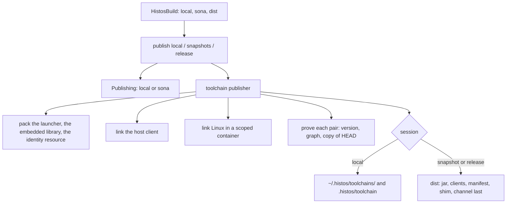
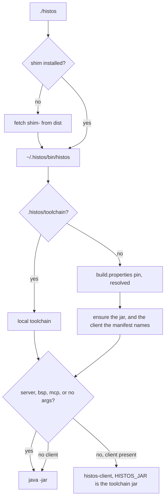

# CLI and toolchain

All work in this plan follows the zio-architect ethos (the agent rules in the local `AGENTS.md`):

- Scala 3, braceless.
- ZIO services wired by layers, with scoped layers for anything that opens.
- Typed error enums, opaque values, and exhaustive matches.
- Total code: no partial accessors, casts, `throw`, `return`, or `null` in contracts.
- Effects as values, and structured concurrency.
- Builders that pin the hard type first.
- Tests that assert values, not `isSuccess`.

## Why

A product is built by the previous product. Histos almost never pins a stable release to build itself, so the builder is the previous snapshot, and that snapshot is one ship: a jar and the native client linked for that jar. The pull request is the next ship. The launcher that drives the pull request is the pin's client. The client this commit would ship is an output, and it is proved when the ship exists, at publish, before anything uploads ([#159](https://github.com/early-effect/histos/issues/159)).

The command line grew while it was hard to make Histos build Histos. Several commands exist only for that bootstrap: `assembly` hardcodes the modules `app` and `api`, `client` links a module named `client`, `launcher` moves the pin a second way, and `portal` rehearses Central. A person who builds a Scala project with Histos should see the commands they use, named the way they think, and nothing that only this repository needs. How Histos ships itself is data on its ship row and a publisher layer, the same shape as `sona`.

This file is the decision. The checklist below is the work. Top to bottom. Finish one item and prove it before starting the next. Proof runs through the histos MCP tools or `./histos` in this checkout, whichever fits. Both send the same call. Tests bind loopback. They do not call Central, GitHub, a keyserver, or a container runtime.

## What is true at the start

- The pin is the `0.2.10` release, and `.next` is `0.3.0`. That release names `linux-x86_64` and `macos-aarch64` clients, so the setup action's `toolchain install` fetches the Linux client and CI runs it. The snapshot pin before it, `0.2.10-7230ba21293f-SNAPSHOT`, named only `macos-aarch64`, and every Linux job ran `java -jar`. A laptop snapshot pin taken by a later item names only `macos-aarch64` until the container item lands, unless that snapshot comes from `histos-snapshots.yml`.
- CI installs `.github/actions/setup/histos`, a hand copy of `install/histos` last touched in #126. `install/histos` moved in #138, so a shim fix does not reach CI.
- `install/histos` calls `ensure_toolchain` only when `histos.jar` is missing. A cached jar leaves the client absent.
- `link-client` links on every pull request. Its skip check reads the raw pin as a toolchain directory, and the shim installs the resolved timestamp. Nothing runs the file it writes.
- `CommandJob`, `HistosCommand` (one case), `PinClient`, `ClientWhen`, `JobStep.Command`, and `RunLine.Client` exist only for that job.
- `Assemble` hardcodes `app`, `api`, and `histos.cli.Main`. `assembly` defaults to `dist/histos.jar` and writes `.histos/assembly.sha256`, and the wrapper then runs that jar as the launcher. Any build with an assembly module gets that wrapper.
- `ClientBinary.present` and `installShip` infer the client matrix from a module named `client`, an LLVM pin, and an asset.
- `ToolchainStamp` writes the commit revision into `wire` sources under `target/unmanaged`, so `wire` and everything downstream recompile after an assembly at a new commit.
- `ApiClock` stops a command when the local assembly's stamp is not what HEAD would publish. `.histos/allow-drift` is the hatch.
- `--compile-client` needs `sourcesSha256`, which no publish writes. Only tests call `Dist.bundle` and `Dist.sources`. `Dist.buildFile` is a histos build in a string.
- `launcher --update` moves the pin through Coursier's Maven snapshots. `histos update` moves it through `dist`.
- Generated workflows use `./.github/actions/setup` and `./.github/actions/origin-head`. Nothing writes either into a consumer repository.
- `.bsp/histos.json` (tracked) launches `["./histos","bsp"]`. `.mcp.json` launches `./histos mcp`.
- The repository merges by squash or rebase. A commit-coordinate pin taken from a pull-request branch is not on `main` after merge.

## Decisions

- **The builder.** The pin builds the pull request, locally and in CI. The pin's jar and the pin's client are one product.
- **The pin's client drives.** The shim installs the pin's client when the manifest names this platform, also when the jar is already cached. `server`, `bsp`, `mcp`, and a bare invocation stay on `java -jar`. A pin with no client for this platform runs `java -jar`. Linking this checkout to cover a missing pin client is a hybrid, and it is not done. `link-client` and the command-job API are deleted.
- **The ship's pair is proved at publish.** `publish local`, `publish snapshots`, and `publish release` run the new client against the new jar in a copy of HEAD: `version`, then `graph`. That covers exec, the server spawn, the version handshake, and loading `histos.scala`. A failure refuses the upload. A release proves every pair before the portal upload, so a broken pair never reaches Central.
- **Linux from a Mac.** A Linux host links `linux-x86_64` itself. A Mac links `macos-aarch64` itself and links `linux-x86_64` in a container through `docker` or `podman`, held in a scope so the container is removed on interruption. The image is pinned by digest and has a JDK 21 or newer. The container gets a copy of HEAD and runs the Linux pair proof too. In a workflow the macOS client stays a macOS job, and the publish job links Linux on its own runner.
- **The toolchain is on the ship row.** `Ship("histos").next(0, 3, 0)(api, app).toolchain(launcher = app, client = client)`. It replaces `.clients(...)`, `ClientBuilds`, `ClientBinary.present`, `installShip`, `Dist.buildFile`, and the hardcoded `app`, `api`, and `histos.cli.Main`. The launcher embeds the ship's library members. A toolchain ship ships every dist platform's client on every publish.
- **A dist publisher layer.** The engine's stock toolchain publisher is a layer like `sona`: pack the launcher, link the clients, prove the pairs, then install locally or upload to `dist`.
- **The launcher's identity is a resource.** The ship coordinate, the full commit, and the dirty flag are written into the launcher jar at pack time as `META-INF/histos/toolchain.json`. No source file carries the commit, so `wire` does not recompile per commit. The native client has no stamp. Its identity is the toolchain id the shim passes in `HISTOS_VERSION`.
- **Dogfood is a local toolchain.** `publish local` installs this ship under `~/.histos/toolchains/<local id>` with its jar, this platform's client, and a manifest, and writes `.histos/toolchain` (gitignored with the rest of `.histos`). The shim prefers that file over `build.properties`. Delete it to return to the pin. The tracked pin never changes for a local run. `HISTOS_ASSEMBLY`, `dist/histos.jar` as a launcher, `.histos/assembly.sha256`, and `AssemblyMark` are deleted.
- **A stale local toolchain warns.** When the local toolchain was built from another commit or a dirty tree, every command prints one line naming both, `doctor` reports a warning, and the command runs. The `ApiClock` stop and `allow-drift` are deleted. If the older jar lacks new API, `histos.scala` fails to compile and says so.
- **Fat jars.** `histos assembly [module ...]` is the generic verb, the same word sbt-assembly and Mill use. It writes each `.assembly` module to its `.asset` path, or to a build output path, and prints the path. It has no launcher side effects.
- **A bootstrap wrapper in every build.** `./histos` installs the shim at a pinned sha256 when `~/.histos/bin/histos` is missing, then execs it. `init`, `new`, and `workflow --update` write it for every build, and `workflow --check` keeps it current. The shim it installs is a content-addressed `dist` asset, `shim-<sha256>`, which never moves. Editors and agents keep a repository-relative launch path, and a fresh clone needs only a JDK.
- **CI setup is the build's choice.** `Projects.ciSetup(CiSetup.Remote)` is the default and renders `early-effect/histos/.github/actions/setup@<full commit of the rendering ship>`, which runs `install/histos` from that same ref. `CiSetup.Wrapper` renders no external action: pinned `actions/cache` steps, then `./histos`. `origin-head` becomes an inline `git remote set-head origin --auto` step. This repository uses `Remote` at the pin's commit, like any consumer. No copy of the shim exists anywhere.
- **Verbs with flags.** `test [project ...] [--affected <json>] [--quick] [--only <pattern> ...]`, `clean [--full]`, `publish local`, and the same forms under `preview`. `testOnly`, `testQuick`, `cleanFull`, and `publishLocal` are gone, with no aliases.
- **The command line and MCP stay in parity.** Every command has a tool that sends the same call, and every tool has a command. A removal or a rename lands on both in the same step.
- **Removed from the command line and MCP.** `client`, the self-host `assembly`, `launcher`, `portal`, `observe`, the server `toolchain` (its report moves into `doctor`'s Toolchain area), and the shim's `--compile-client`. `server` stays in the jar, because the client spawns it, and leaves `histos help`.
- **The JDK floor is 25.** The shim, the wrapper, and the engine's `Floor` check for 25 and name it. The child-process bootstrap compiles `java.lang.foreign`, which JDK 21 marks preview, and 25 is the LTS the client jobs already pin.
- **A bug found is a bug fixed.** A bug this work finds gets a failing test, then the fix, in this stack. It is not deferred to an issue. The ledger names the item that fixes it.
- **Scenarios come back.** The harness was meant to work like sbt `scripted` with a typed oracle, and the #132 suite rewrite dropped it by mistake. It returns on today's test helpers, and it proves the cache fixes below.
- **Delivery.** One stacked pull request per checklist item. A step that changes build API the pin compiles, or text the pin renders, pins a snapshot of its own commit: commit, `./histos publish snapshots` from the laptop, pin the commit channel, push.

## Docs teach the truth

README and AGENTS.md describe the code at the commit they ship in. They are never a backlog a later step catches up on.

- A step that changes behavior updates every README and AGENTS.md sentence about that behavior in the same pull request. A sentence the step makes false is deleted or rewritten there. The last item is a read-through, and anything it finds is recorded below as a miss.
- `ReadmeLawSpec` gates the README. Every `histos ...` and `./histos ...` invocation in a code span or block either parses through `Grammar.parse` or is a shim command (`update`, `self update`, `toolchain install`, `toolchain list`). Every repository path the README links exists. Once the grammar step lands, a removed word used as a command fails the spec.
- AGENTS.md is gitignored, so it never shows in a diff. Each pull request description lists the AGENTS.md lines it changed and why. The spec cannot read it in CI, so each item below names the AGENTS.md sweep.
- Comments and scaladoc are docs. A step that deletes a mechanism deletes the text that describes it, including `Help` entries.

## Shape

```scala
// api: the ship row
enum Ship:
  case Line(
      shipName: ShipName,
      number: ShipNumber,
      modules: ::[ProjectName],
      described: Option[PomText] = None,
      located: Option[HttpUrl] = None,
      toolchain: Option[ShipToolchain] = None,
  )

final case class ShipToolchain(launcher: ProjectName, client: ProjectName)

// api: how CI installs Histos
enum CiSetup:
  case Remote
  case Wrapper

// engine: the toolchain publish fails with one of these
enum ToolchainPublishError:
  case Pack(error: AssembleError)
  case Link(platform: DistPlatform, error: ProgramError)
  case Container(error: ContainerError)
  case Proof(platform: DistPlatform, error: PairError)
  case Upload(error: DistError)
  case Install(failure: IoFailure)

enum ContainerError:
  case NoRuntime
  case Pull(image: String)
  case Run(step: String, exit: Int)
  case Copy(path: Path)

enum PairError:
  case Exec
  case Handshake(wanted: String, got: String)
  case Load(fault: BuildFault)
```

`.toolchain(launcher = app, client = client)` takes module values. The load checks that the launcher is a ship member with `.assembly` and that the client is a Native module with a main. Whether the platform can be a type parameter is settled in a `scala-cli` miniature before the signature is fixed. Names above are sketches. Each step settles its own.





## Ledger

Each item audits the files it touches against the Totality list and adds what it finds here.

| # | Category | Hit | Item |
| --- | --- | --- | --- |
| 1 | Shim bug | `ensure_toolchain` runs only when the jar is missing | Shim |
| 2 | Drift | `.github/actions/setup/histos` is a stale copy of `install/histos` | Shim |
| 3 | Dead code | `--compile-client`, `Dist.buildFile`, `Dist.sources`, `Dist.bundle`, `DistLayout.sources`, `sourcesSha256` | Shim |
| 4 | Single-use API | `CommandJob`, `HistosCommand`, `PinClient`, `ClientWhen`, `JobStep.Command`, `RunLine.Client` | Link job |
| 5 | CI waste | `link-client` links every pull request, and its skip check reads the raw pin | Link job |
| 6 | Heuristic | `ClientBinary.present`, `installShip`, and `ClientBuilds` infer the toolchain | Ship row |
| 7 | Self-host in the engine | `Assemble` hardcodes `app`, `api`, and `histos.cli.Main` | Ship row |
| 8 | Self-host in the CLI | `assembly` defaults to `dist/histos.jar` and writes `.histos/assembly.sha256` | Ship row |
| 9 | Cache identity | `ToolchainStamp` writes the commit into `wire` sources | Ship row |
| 10 | Self-host in the CLI | `histos client` links the module named `client` | Dist layer |
| 11 | Self-host at run time | `ApiClock` stop, `allow-drift`, `AssemblyMark`, `HISTOS_ASSEMBLY`, the wrapper's `dist/histos.jar` | Dist layer |
| 12 | Snapshot clients | A laptop publish names only `macos-aarch64` | Container |
| 13 | Consumer CI | Generated workflows use local `setup` and `origin-head` actions only this repository has | CI setup |
| 14 | Moving asset | `dist/shim` moves, so a pinned wrapper needs `shim-<sha256>` | CI setup |
| 15 | Two wrappers | `Skeleton.wrapper` (a thin exec that `init` and `new` write) and `LauncherScript` (the local-jar wrapper `workflow --update` writes, only for builds with an assembly module) | CI setup |
| 16 | Two update paths | `launcher --update/--latest` against `histos update` | Grammar |
| 17 | Rehearsal in the CLI | `portal` | Grammar |
| 18 | Name collision | The server `toolchain` against the shim's `toolchain install/list` | Grammar |
| 19 | Internal in help | `server` | Grammar |
| 20 | Low value | `observe` | Grammar |
| 21 | sbt names | `testOnly`, `testQuick`, `cleanFull`, `publishLocal`, and their `preview` forms | Grammar |
| 22 | Stringly MCP | `ResolveArgs.action`, `WorkflowArgs.action`, `LauncherArgs`, `TestArgs.mode`, `FmtArgs.mode`, `PreviewArgs.operation` | Grammar |
| 23 | Booleans and strings in commands | `Command.New(bare, yes)`, `Doctor(json, fix, yes, verbose)`, `Setup(from: Option[String])`, `PublishLocal(tokens: List[String])` | Grammar, where touched |
| 24 | `Either[String, _]` | `Help.render` | Grammar |
| 25 | Docs | The README teaches `publish local` (the command is `publishLocal`), `~ run app --restart` (the form is `~ --restart run app`), `--compile-client`, a JDK 21 floor, link caching, a remote cache for compile, package, and link, and scenarios, and links four deleted files | README, then every item |
| 26 | AGENTS.md | `testQuick` as a command, a local suite on `dist/histos.jar`, the dogfood line, docker in tests, the read rule for this file, and worktree and MCP rules written as hard rules | Work plan, then every item |
| 27 | Docs gate | Nothing checks that README commands parse or that its links exist | README |
| 28 | Handshake bug | The shim exports the resolved timestamp as `HISTOS_VERSION`, and the server records the `build.properties` pointer. With a `-SNAPSHOT` pin and a client, every command reboots the server and then fails | Shim |
| 29 | JDK floor | The shim, the wrapper, and the engine accept JDK 21. The child-process bootstrap that test, run, and link use compiles `java.lang.foreign`, which JDK 21 marks preview | Shim (the floor is 25). The rendered `./histos` wrapper keeps 21 until the CI setup item rewrites it, because CI's `workflow --check` renders it with the pin |
| 30 | Startup race | The client reads `server.json` when the socket accepts, before a new server rewrites it. The restart error names only the assembly, even when the version is what differs | Dist layer |
| 31 | Hatch skew | The MCP `test` tool refuses a stale local assembly with `.histos/allow-drift` set. The terminal path continues | Dist layer (the hatch is deleted) |
| 32 | Drift at HEAD | `1b88d92` moved `.next` to `0.3.0`. The committed wrapper and `histos-release.yml` still say `0.2.10` | README (`workflow --update`) |
| 33 | Help text | `publish snapshots` says the pointer moves on the default branch (it moves from any checkout). `fmt --check` says it writes nothing (it rewrites `.histos/format/ledger`). `histos help` does not list `--explain` | Grammar |
| 34 | Restart watch | `~ --restart run` cannot restart on a server, because the program holds the compile lock. A failed compile still restarts the program | Restart watch |
| 35 | Cache claims | No native or JavaScript link is skipped, although `JsKey` and `NativeKey` exist. The remote cache serves plugin tasks only. The `promote` strategy is never read, and `purge` has no caller | Link cache, Remote cache |
| 36 | Scenarios | The #132 suite rewrite dropped `Scenario.scala` and `ScenarioSpec.scala` with their helpers. AGENTS.md, `next.md`, and `scenario-work-plan.md` describe them as present | Scenarios |
| 37 | Test helper copies | Twelve app specs copy the same checkout-root walk | Grammar, where touched |
| 38 | Opaque fetch failure | PR #160's first scaladoc run failed on a cold cache with `resolve failed while fetch`. `CoursierResolve.lift` dropped which artifact failed and why, and nothing retried a download that failed in transit (Coursier's own backoff is milliseconds) | Shim |
| 39 | Setup input name | The setup action passed its `version` input as `HISTOS_VERSION`, the name the runtime reads as the toolchain identity | Shim |

## Left out

- Collapsing pull-request jobs onto one warm JVM server.
- Dropping the Native `api` and `wire` suites.
- Running this commit's client against the pin's jar.
- Replacing the macOS client job with a container.

## Risks

- A remote action pinned at a commit that lives only on a merged pull-request branch has to keep resolving after the branch is deleted. The CI setup item proves it, or pins move to `main` commits only.
- A `linux/amd64` container on Apple Silicon runs under emulation, so the Linux link is slower there.
- The ship row, dist layer, and CI setup items each pin a snapshot of their own commit before CI can compile `histos.scala`.
- The ship row and dist layer items are the large ones. Either splits along pack, then link, then proof, if it outgrows one review.

## Checklist

- [x] **Work plan.** This file, and AGENTS.md aligned with the decisions above. Proof: this file, and the AGENTS.md sweep: the quick run named without a command, the dogfood and CI lines, the builder rule, the docs rule, the read rule for this file, the container rule for tests, and the worktree and MCP lines written as guidelines with CLI and MCP parity.
- [x] **README.** Docs only, before any behavior changes. The README becomes a user guide: install, a build, the commands, CI, and publishing. How Histos builds Histos moves to `docs/self-host.md`. The false claims in ledger row 25 are fixed. `ReadmeLawSpec` lands. Four read-only fact-checks of the old README against the code found the rows 25 and 28 to 37. Proof: on the old README, `ReadmeLawSpec` named four dead links, two commands missing an argument, and three lines that were not commands. On the new README it is green. Its second law runs the check on a sample with an unparseable command, an unknown usage, and a missing link, and names exactly those. `workflow --update` rendered the `0.3.0` ship (row 32).
- [x] **Shim.** A toolchain directory is complete when the verified jar is present and, when the manifest names this platform, the client too. `ensure_toolchain` fetches only what is missing. The setup action runs `install/histos` from its own ref, and its copy is deleted. The `--compile-client` path is deleted. Proof, in `ShimUpdateLawSpec` style on loopback: a cached jar and a manifest that names a client fetch and exec that client with `HISTOS_JAR` set to the toolchain jar. A missing client that the manifest does not name runs `java -jar`. `server`, `bsp`, `mcp`, and no arguments run `java -jar` with an executable client present. The setup action execs `install/histos`. The server records the identity the shim passes in `HISTOS_VERSION`, so a `-SNAPSHOT` pin with a client agrees with its own server (row 28): a law boots a server under a pointer pin and a timestamp `HISTOS_VERSION` and shows the next command attaches without a reboot. The JDK floor is 25 in the shim, the wrapper, and the engine (row 29), with a law for each refusal text. No pin move. Until the container item lands, Russ decides for each snapshot pin whether it comes from a laptop publish (no Linux client) or from `histos-snapshots.yml` (both clients). Done, with rows 38 and 39 fixed in the same pull request:
  - `ShimLaunchLawSpec` covers the cached jar, the clientless manifest, the protocol commands, and JDK 21. Against `main`'s shim, the cached-jar and JDK laws were red.
  - `RunVersionLawSpec` was red against `main`'s `Cli.scala`: the server recorded `histos 0.3.0-SNAPSHOT`.
  - `FetchRetryLawSpec` runs under `TestClock`. `ShimUpdateLawSpec` moved onto the shared `ShimRig`.
  - `./histos test api wire engine app central`: api 201 and wire 248 on JVM and Native, engine 693, app 194, central 81.
  - `fmt --check` and `workflow --check` are clean. The wrapper's floor waits for the CI setup item (row 29).
- [ ] **Link job.** `link-client` leaves `histos.scala` and `ci.yml`, then the command-job API is deleted. Proof: render tests show no `link-client`, and no job needs a link job or downloads `dist/histos-client`. No pin move, because the pin renders the same file once `histos.scala` stops naming the job.
- [ ] **Scenarios.** The harness returns on today's test helpers: `Scenario.open` is one store and a compiler-start count, `checkout` is a work tree, and `compile` and `test` run that checkout against the scenario store. Read [scenario-work-plan.md](scenario-work-plan.md) first, and close its unchecked items there in order. Proof: `ScenarioSpec`, the two laws it had before #132 (two checkouts of the same bytes miss on the absolute source path, and a wiped checkout restores without a compiler start), green on today's engine.
- [ ] **Restart watch.** `~ --restart run` restarts a running program on a change, on a server and in process. The program does not hold the compile lock. A failed compile leaves the program running and prints the failure. Proof: a law with a real child that counts starts: a source change restarts it once, a broken change leaves it running, and leaving the watch stops it. The same law on the server path.
- [ ] **Link cache.** A native or JavaScript link whose key (`NativeKey`, `JsKey` on product digests) is in the store restores the linked output and does not start the linker. Read [cache-work-plan.md](cache-work-plan.md) first. Proof: a scenario counts linker starts: a trailing comment keeps the link, a method body relinks, and a wiped checkout restores without a link.
- [ ] **Remote cache.** Module compile, package, and link read and write the remote cache through the same namespace walk plugin tasks use. The push job writes `main` per the build's `promote` setting, and `purge` is either reachable or deleted. Read [cache-work-plan.md](cache-work-plan.md) first. Proof: a scenario against the loopback store shows a second checkout's compile is a remote hit with no compiler start, a pull-request namespace never writes `main`, and `copy-index` against `rebuild` behaves as the setting says.
- [ ] **Ship row.** `.toolchain(launcher, client)` lands, and ledger rows 6 to 9 close. `assembly [module ...]` becomes generic. The launcher identity becomes `META-INF/histos/toolchain.json`. Read [cache-work-plan.md](cache-work-plan.md) first. Proof: load errors for a bad launcher and a bad client, renders of the snapshot and release workflows, a compile-identity test that `wire` is unchanged across commits, and `assembly` writing an asset and printing its path. Pin move.
- [ ] **Dist layer.** The three publish commands pack the launcher, link the host client, and prove the pair. Local installs the toolchain and writes `.histos/toolchain`, and the shim honors it. Ledger rows 10 and 11 close. The skew warning and its `doctor` check land. The workflows feed a macOS client job into the publish job, and a release proves every pair before the portal upload. Proof: the pair proof against a loopback fixture, where a broken handshake refuses the upload with a typed error, the local install layout and the override, the skew warning text, and the workflow renders. Pin move.
- [ ] **Container.** The container runtime layer, the Linux link, and the Linux pair proof. A second main class in the launcher jar does the link, so the grammar gains no verb. Proof: a fake runtime covers the commands it runs, cleanup on interruption, and error mapping. Manual: a Mac `publish snapshots` whose manifest names both platforms, then pin it.
- [ ] **CI setup.** `Projects.ciSetup`, the inline `origin-head` step, `shim-<sha256>` on `dist`, and the bootstrap wrapper for every build. Ledger rows 13 to 15 close. Proof: renders for both choices, the wrapper installing the pinned shim on loopback and refusing a checksum mismatch, and `init` and `new` writing it. Live: a remote action pinned at a branch-only commit still resolves after the branch is deleted. Pin move.
- [ ] **Grammar.** The verbs with flags, the removals, `server` out of help, `Help` and MCP in step, and typed MCP arguments. Ledger rows 16 to 24 close. `ReadmeLawSpec` refuses the removed words. Proof: `GrammarLawSpec`, `HelpLawSpec`, and `McpLawSpec` cover each new form and refuse each removed word with a typed error that names the replacement.
- [ ] **Read-through.** README, AGENTS.md, `docs/self-host.md`, [next.md](next.md), [publishing.md](publishing.md), and [release-work-plan.md](release-work-plan.md) read against the code at the tip. The work plans are groomed to match or marked as history. Anything found here is recorded in the ledger as a miss.
