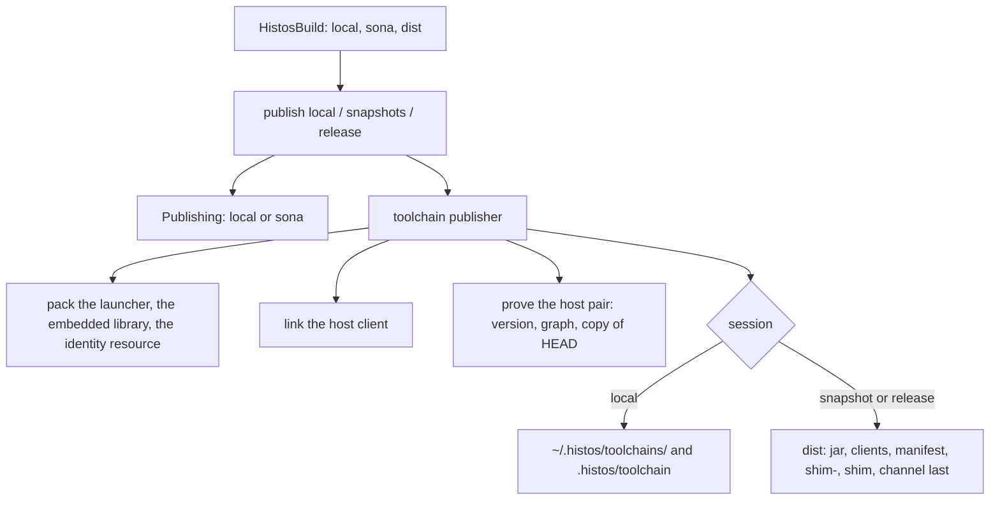
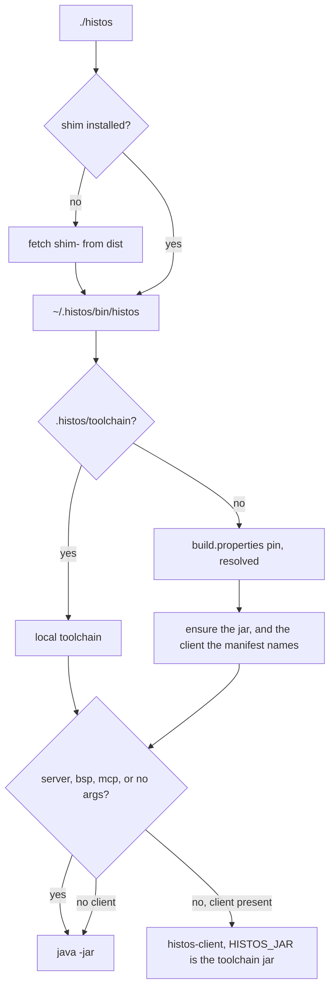

# CLI and toolchain

All work in this plan follows the zio-architect ethos (the agent rules in the local `AGENTS.md`):

- Scala 3, braceless.
- ZIO services wired by layers, with scoped layers for anything that opens.
- Typed error enums, opaque values, and exhaustive matches.
- Total code: no partial accessors, casts, `throw`, `return`, or `null` in contracts.
- Effects as values, and structured concurrency.
- Builders that pin the hard type first.
- Tests that assert values, not `isSuccess`.

## Why

A product is built by the previous product. Histos almost never pins a stable release to build itself, so the builder is the previous snapshot, and that snapshot is one ship: a jar and the native client linked for that jar. The pull request is the next ship. The launcher that drives the pull request is the pin's client. The client this commit would ship is an output, and it is proved when the ship exists, at publish, before anything uploads ([#159](https://github.com/early-effect/histos/issues/159)).

The command line grew while it was hard to make Histos build Histos. Several commands exist only for that bootstrap: `assembly` hardcodes the modules `app` and `api`, `client` links a module named `client`, `launcher` moves the pin a second way, and `portal` rehearses Central. A person who builds a Scala project with Histos should see the commands they use, named the way they think, and nothing that only this repository needs. How Histos ships itself is data on its ship row and a publisher layer, the same shape as `sona`.

This file is the decision. The checklist below is the work. Top to bottom. Finish one item and prove it before starting the next. Proof runs through the histos MCP tools or `./histos` in this checkout, whichever fits. Both send the same call. Tests bind loopback. They do not call Central, GitHub, a keyserver, or a container runtime.

## What is true at the start

- The pin is the `0.2.10` release, and `.next` is `0.3.0`. That release names `linux-x86_64` and `macos-aarch64` clients, so the setup action's `toolchain install` fetches the Linux client and CI runs it. The snapshot pin before it, `0.2.10-7230ba21293f-SNAPSHOT`, named only `macos-aarch64`, and every Linux job ran `java -jar`. A laptop snapshot names the host platform only (D19). `histos-snapshots.yml` still links each platform on its own runner.
- CI installs `.github/actions/setup/histos`, a hand copy of `install/histos` last touched in #126. `install/histos` moved in #138, so a shim fix does not reach CI.
- `install/histos` calls `ensure_toolchain` only when `histos.jar` is missing. A cached jar leaves the client absent.
- `link-client` links on every pull request. Its skip check reads the raw pin as a toolchain directory, and the shim installs the resolved timestamp. Nothing runs the file it writes.
- `CommandJob`, `HistosCommand` (one case), `PinClient`, `ClientWhen`, `JobStep.Command`, and `RunLine.Client` exist only for that job.
- `Assemble` hardcodes `app`, `api`, and `histos.cli.Main`. `assembly` defaults to `dist/histos.jar` and writes `.histos/assembly.sha256`, and the wrapper then runs that jar as the launcher. Any build with an assembly module gets that wrapper.
- `ClientBinary.present` and `installShip` infer the client matrix from a module named `client`, an LLVM pin, and an asset.
- `ToolchainStamp` writes the commit revision into `wire` sources under `target/unmanaged`, so `wire` and everything downstream recompile after an assembly at a new commit.
- `ApiClock` stops a command when the local assembly's stamp is not what HEAD would publish. `.histos/allow-drift` is the hatch.
- `--compile-client` needs `sourcesSha256`, which no publish writes. Only tests call `Dist.bundle` and `Dist.sources`. `Dist.buildFile` is a histos build in a string.
- `launcher --update` moves the pin through Coursier's Maven snapshots. `histos update` moves it through `dist`.
- Generated workflows use `./.github/actions/setup` and `./.github/actions/origin-head`. Nothing writes either into a consumer repository.
- `.bsp/histos.json` (tracked) launches `["./histos","bsp"]`. `.mcp.json` launches `./histos mcp`.
- The repository merges by squash or rebase. A commit-coordinate pin taken from a pull-request branch is not on `main` after merge.

## Decisions

- **The builder.** The pin builds the pull request, locally and in CI. The pin's jar and the pin's client are one product.
- **The pin's client drives.** The shim installs the pin's client when the manifest names this platform, also when the jar is already cached. `server`, `bsp`, `mcp`, and a bare invocation stay on `java -jar`. A pin with no client for this platform runs `java -jar`. Linking this checkout to cover a missing pin client is a hybrid, and it is not done. `link-client` and the command-job API are deleted.
- **The ship's pair is proved at publish.** `publish local`, `publish snapshots`, and `publish release` run the new client against the new jar in a copy of HEAD: `version`, then `graph`. That covers exec, the server spawn, the version handshake, and loading `histos.scala`. A failure refuses the upload. A release proves the host pair before the portal upload, so a broken pair never reaches Central.
- **Host client.** A publish links the host only. A Mac links `macos-aarch64`. A Linux machine links `linux-x86_64`. There is no container and no cross-build. Client files already under `dist/clients` are uploaded, so a workflow can still ship both: the macOS job links macOS, and the Linux publish job links Linux. A laptop names the host.
- **The toolchain is on the ship row.** `Ship("histos").next(0, 3, 0)(api, app).toolchain(launcher = app, client = client)`. It replaces `.clients(...)`, `ClientBuilds`, `ClientBinary.present`, `installShip`, `Dist.buildFile`, and the hardcoded `app`, `api`, and `histos.cli.Main`. The launcher embeds the ship's library members. A toolchain ship links the host client. It does not cross-build the other platform (D19).
- **A dist publisher layer.** The engine's stock toolchain publisher is a layer like `sona`: pack the launcher, link the host client, prove that pair, then install locally or upload to `dist`.
- **The launcher's identity is a resource.** The ship coordinate, the full commit, and the dirty flag are written into the launcher jar at pack time as `META-INF/histos/toolchain.json`. No source file carries the commit, so `wire` does not recompile per commit. The native client has no stamp. Its identity is the toolchain id the shim passes in `HISTOS_VERSION`.
- **Dogfood is a local toolchain.** `publish local` installs this ship under `~/.histos/toolchains/<local id>` with its jar, this platform's client, and a manifest, and writes `.histos/toolchain` (gitignored with the rest of `.histos`). The shim prefers that file over `build.properties`. Delete it to return to the pin. The tracked pin never changes for a local run. `HISTOS_ASSEMBLY`, `dist/histos.jar` as a launcher, `.histos/assembly.sha256`, and `AssemblyMark` are deleted.
- **A stale local toolchain warns.** When the local toolchain was built from another commit or a dirty tree, every command prints one line naming both, `doctor` reports a warning, and the command runs. The `ApiClock` stop and `allow-drift` are deleted. If the older jar lacks new API, `histos.scala` fails to compile and says so.
- **Fat jars.** `histos assembly [module ...]` is the generic verb, the same word sbt-assembly and Mill use. It writes each `.assembly` module to its `.asset` path, or to a build output path, and prints the path. It has no launcher side effects.
- **A bootstrap wrapper in every build.** `./histos` installs the shim at a pinned sha256 when `~/.histos/bin/histos` is missing, then execs it. `init`, `new`, and `workflow --update` write it for every build, and `workflow --check` keeps it current. The shim it installs is a content-addressed `dist` asset, `shim-<sha256>`, which never moves. Editors and agents keep a repository-relative launch path, and a fresh clone needs only a JDK.
- **CI setup is the build's choice.** `Projects.ciSetup(CiSetup.Remote)` is the default and renders `early-effect/histos/.github/actions/setup@<full commit of the rendering ship> # <that same commit>`, which runs `install/histos` from that same ref. The comment is that commit: the pin scan requires one, and this action has no release tag. `CiSetup.Wrapper` renders no external action: pinned `actions/cache` steps, then `./histos`. `origin-head` becomes an inline `git remote set-head origin --auto` step. This repository uses `Remote`, like any consumer. No copy of the shim exists anywhere. The committed workflows and `./histos` are that render, pinned at `aa4f835` (D20).
- **Verbs with flags.** `test [project ...] [--affected <json>] [--quick] [--only <pattern> ...]`, `clean [--full]`, `publish local`, and the same forms under `preview`. `testOnly`, `testQuick`, `cleanFull`, and `publishLocal` are gone, with no aliases.
- **The command line and MCP stay in parity.** Every command has a tool that sends the same call, and every tool has a command. A removal or a rename lands on both in the same step.
- **Removed from the command line and MCP.** `client`, the self-host `assembly`, `launcher`, `portal`, `observe`, the server `toolchain` (its report moves into `doctor`'s Toolchain area), and the shim's `--compile-client`. `server` stays in the jar, because the client spawns it, and leaves `histos help`.
- **The JDK floor is 25.** The shim, the wrapper, and the engine's `Floor` check for 25 and name it. The child-process bootstrap compiles `java.lang.foreign`, which JDK 21 marks preview, and 25 is the LTS the client jobs already pin.
- **A bug found is a bug fixed.** A bug this work finds gets a failing test, then the fix, in this stack. It is not deferred to an issue. The ledger names the item that fixes it.
- **A clock warning is a bug.** When a pull request's CI finishes, its test log is read for `not advancing the test clock`. Each hit is fixed in the next pull request: the code under test takes a clock the test controls, or the law takes `withLiveClock` when it bounds real work.
- **Scenarios come back.** The harness was meant to work like sbt `scripted` with a typed oracle, and the #132 suite rewrite dropped it by mistake. It returns on today's test helpers, and it proves the cache fixes below.
- **Delivery.** One stacked pull request per checklist item. A step that changes build API the pin compiles, or text the pin renders, pins a snapshot of its own commit: commit, `./histos publish snapshots` from the laptop, pin the commit channel, push.

## Docs teach the truth

README and AGENTS.md describe the code at the commit they ship in. They are never a backlog a later step catches up on.

- A step that changes behavior updates every README and AGENTS.md sentence about that behavior in the same pull request. A sentence the step makes false is deleted or rewritten there. The last item is a read-through, and anything it finds is recorded below as a miss.
- `ReadmeLawSpec` gates the README. Every `histos ...` and `./histos ...` invocation in a code span or block either parses through `Grammar.parse` or is a shim command (`update`, `self update`, `toolchain install`, `toolchain list`). Every repository path the README links exists. Once the grammar step lands, a removed word used as a command fails the spec.
- AGENTS.md is gitignored, so it never shows in a diff. Each pull request description lists the AGENTS.md lines it changed and why. The spec cannot read it in CI, so each item below names the AGENTS.md sweep.
- Comments and scaladoc are docs. A step that deletes a mechanism deletes the text that describes it, including `Help` entries.

## Shape

```scala
// api: the ship row
enum Ship:
  case Line(
      shipName: ShipName,
      number: ShipNumber,
      modules: ::[ProjectName],
      described: Option[PomText] = None,
      located: Option[HttpUrl] = None,
      toolchain: Option[ShipToolchain] = None,
  )

final case class ShipToolchain(launcher: ProjectName, client: ProjectName)

// api: how CI installs Histos
enum CiSetup:
  case Remote
  case Wrapper

// engine: the toolchain publish fails with one of these
enum ToolchainPublishError:
  case Pack(error: AssembleError)
  case Link(platform: DistPlatform, error: ProgramError)
  case Proof(platform: DistPlatform, error: PairError)
  case Upload(error: DistError)
  case Install(failure: IoFailure)

enum PairError:
  case Exec
  case Handshake(wanted: String, got: String)
  case Load(fault: BuildFault)
```

`.toolchain(launcher = app, client = client)` takes module values. The load checks that the launcher is a ship member with `.assembly` and that the client is a Native module with a main. The miniature accepted `Platform.Native.type <:< C` with no call-site ascription, and a JVM-only client was refused with `the toolchain client builds Native, and this module does not`. Names above are sketches. Each step settles its own. The Dist layer's `ToolchainPublishError` is `Pack`, `Link`, `Proof`, `Unsupported`, `Upload`, and `Install`. There is no container case (D19).





## Ledger

Each item audits the files it touches against the Totality list and adds what it finds here.

| # | Category | Hit | Item |
| --- | --- | --- | --- |
| 1 | Shim bug | `ensure_toolchain` runs only when the jar is missing | Shim |
| 2 | Drift | `.github/actions/setup/histos` is a stale copy of `install/histos` | Shim |
| 3 | Dead code | `--compile-client`, `Dist.buildFile`, `Dist.sources`, `Dist.bundle`, `DistLayout.sources`, `sourcesSha256` | Shim |
| 4 | Single-use API | `CommandJob`, `HistosCommand`, `PinClient`, `ClientWhen`, `JobStep.Command`, `RunLine.Client` | Link job |
| 5 | CI waste | `link-client` links every pull request, and its skip check reads the raw pin | Link job |
| 6 | Heuristic | `ClientBinary.present`, `installShip`, `ClientBuilds`, and `JobCheck.launcher` (which reserves a `launcher` job name for a module named `client`) infer the toolchain | Ship row |
| 7 | Self-host in the engine | `Assemble` hardcodes `app`, `api`, and `histos.cli.Main` | Ship row |
| 8 | Self-host in the CLI | `assembly` defaults to `dist/histos.jar` and writes `.histos/assembly.sha256` | Ship row |
| 9 | Cache identity | `ToolchainStamp` writes the commit into `wire` sources | Ship row |
| 10 | Self-host in the CLI | Closed. There is no `client` verb. `publish local`, `publish snapshots`, and `publish release` link the host client | Dist layer |
| 11 | Self-host at run time | Closed. The `ApiClock` stop, `allow-drift`, `AssemblyMark`, `HISTOS_ASSEMBLY`, and the wrapper's `dist/histos.jar` are deleted. `Successor` is the version only and drops an inherited `HISTOS_ASSEMBLY` ([test-audit.md](test-audit.md) B29) | Dist layer |
| 12 | Snapshot clients | Closed. A publish links the host only (D19). A laptop names that host. A Linux job on a macOS-only pin runs `java -jar` | Host client |
| 13 | Consumer CI | Closed. The generator renders `early-effect/histos/.github/actions/setup@<full commit> # <that commit>` and an inline `git remote set-head origin --auto`. The committed workflows pin that action at `aa4f835` | CI setup |
| 14 | Moving asset | Closed. The wrapper installs `shim-<sha256>`. `dist` still publishes `shim` and `shim.sha256` so `self update` can move. The wrapper does not fetch those names. This pin uploaded `shim-f7a6d9b0753081d607a2106789bfa221807f164a66b759870ef66e5afde297c5` | CI setup |
| 15 | Two wrappers | Closed. One wrapper, `LauncherScript`. `init`, `new`, and `workflow --update` write it for every build, including one with no assembly module. It checks `Toolchain.Floor` and installs `shim-<sha256>`. The committed `./histos` is that wrapper | CI setup |
| 16 | Two update paths | `launcher --update/--latest` against `histos update` | Grammar |
| 17 | Rehearsal in the CLI | `portal` | Grammar |
| 18 | Name collision | The server `toolchain` against the shim's `toolchain install/list` | Grammar |
| 19 | Internal in help | `server` | Grammar |
| 20 | Low value | `observe` | Grammar |
| 21 | sbt names | `testOnly`, `testQuick`, `cleanFull`, `publishLocal`, and their `preview` forms | Grammar |
| 22 | Stringly MCP | `ResolveArgs.action`, `WorkflowArgs.action`, `LauncherArgs`, `TestArgs.mode`, `FmtArgs.mode`, `PreviewArgs.operation` | Grammar |
| 23 | Booleans and strings in commands | `Command.New(bare, yes)`, `Doctor(json, fix, yes, verbose)`, `Setup(from: Option[String])`, `PublishLocal(tokens: List[String])` | Grammar, where touched |
| 24 | `Either[String, _]` | `Help.render` | Grammar |
| 25 | Docs | The README teaches `publish local` (the command is `publishLocal`), `~ run app --restart` (the form is `~ --restart run app`), `--compile-client`, a JDK 21 floor, link caching, a remote cache for compile, package, and link, and scenarios, and links four deleted files | README, then every item |
| 26 | AGENTS.md | `testQuick` as a command, a local suite on `dist/histos.jar`, the dogfood line, docker in tests, the read rule for this file, and worktree and MCP rules written as hard rules | Work plan, then every item |
| 27 | Docs gate | Nothing checks that README commands parse or that its links exist | README |
| 28 | Handshake bug | The shim exports the resolved timestamp as `HISTOS_VERSION`, and the server records the `build.properties` pointer. With a `-SNAPSHOT` pin and a client, every command reboots the server and then fails | Shim |
| 29 | JDK floor | Closed. The shim, the wrapper, and the engine check JDK 25. The committed `./histos` refuses an older JDK before it fetches the shim | CI setup |
| 30 | Startup race | Closed. The client notes the `server.json` stamp before spawn and accepts a record only when it is strictly newer. The restart error names the version: `histos server at <socket> did not record version <wanted>; it has <got>`. The reboot loop after the `0.3.0` pin was a different cause ([test-audit.md](test-audit.md) B29, fixed) | Dist layer |
| 31 | Hatch skew | Closed. The hatch is deleted. A stale local toolchain warns on the command line and in `doctor`, and the command runs | Dist layer |
| 32 | Drift at HEAD | `1b88d92` moved `.next` to `0.3.0`. The committed wrapper and `histos-release.yml` still say `0.2.10` | README (`workflow --update`) |
| 33 | Help text | `publish snapshots` says the pointer moves on the default branch (it moves from any checkout). `fmt --check` says it writes nothing (it rewrites `.histos/format/ledger`). `histos help` does not list `--explain` | Grammar |
| 34 | Restart watch | `~ --restart run` cannot restart on a server, because the program holds the compile lock. A failed compile still restarts the program | Restart watch |
| 35 | Cache claims | A native or JavaScript link whose key is in the store is restored and the linker does not start. Compile, package, and link share that remote walk. A laptop write opens as read. The renderer reads `promote`. `purge` is reachable, and a gRPC address reports that it is HTTP only (fixed) | Remote cache |
| 36 | Scenarios | The #132 suite rewrite dropped `Scenario.scala` and `ScenarioSpec.scala` with their helpers. AGENTS.md, `next.md`, and `scenario-work-plan.md` describe them as present | Scenarios |
| 37 | Test helper copies | About 25 specs copy the same checkout-root walk. `Scenario.tools` has the shared one | Test audit (S1 and P1 in [test-audit.md](test-audit.md)) |
| 38 | Opaque fetch failure | PR #160's first scaladoc run failed on a cold cache with `resolve failed while fetch`. `CoursierResolve.lift` dropped which artifact failed and why. `ResolveError.Download` now names each artifact, its fault, and the repository's reason, so the next failure says what to fix | Shim |
| 39 | Setup input name | The setup action passed its `version` input as `HISTOS_VERSION`, the name the runtime reads as the toolchain identity | Shim |
| 40 | Socket path | The server socket is `.histos/server.sock` under the checkout. A path past 104 bytes on macOS cannot bind, so a deep worktree cannot run `./histos test` | Socket path |
| 41 | Error position | A test compile error prints without its file and line. A main compile error prints both | Error positions |
| 42 | Program output | `Program.runCell` collects the program's feed with `runCollect` inside its step, so `histos run` prints the output only after the program exits | Program output |
| 43 | Clock smells | Laws whose code sleeps or times out on `TestClock` warn, and can hang: the fetch retry in `BspSuiteLawSpec` (row 38) and the doctor timeout in `DoctorProbeLawSpec` | Restart watch, then each PR reads its CI logs for the warning |
| 44 | Stale proofs | Closed. `TestStore` is `GraphShapeLawSpec` and `SuiteLaunchLawSpec`. `testQuick stamp` is `ScenarioSpec`, `SuiteCoverLawSpec`, and `SuiteLaunchLawSpec`. `ModuleTestQuickSpec` and `SchemaSpec` are gone | Read-through |
| 46 | Flaky scope law | `PluginScopeLawSpec` failed in #161's CI: a closed invocation socket still answered. `ServerSocket.close` defers the close to a thread blocked in `accept`, and Linux keeps accepting until it wakes. The fixture's release now joins that thread | Shim |
| 47 | Native crash | #161's first CI run crashed the `wire` Native test binary with `Unhandled signal 11` at a guard-page address, and the rerun passed. A crash is a bug, not a flake. The log's trace is Scala Native's module-initialization wait recursing into itself until the stack ran out (scala-native#4366), which a link without the optimizer exposes. The same bug crashes the native client on macOS with `Unhandled signal 10` and hangs it with no output, a few runs in a hundred. A miniature reproduces both on a Mac, so no Linux container is needed to see it. The catalog now pins a nightly with the fix (scala-native#5221). A second cause, a macOS suite thread too small for ZIO's run loop, is fixed | [test-audit.md](test-audit.md) B25, B26, and B27 (fixed, and a Native suite keeps its timeout for B27). No open item owns it |
| 48 | Ambient cache | `GraphTastyLawSpec` read the locked Scala 3.9 compiler from the Coursier cache, and nothing fetched it before the suite on a cold cache, so the law passed or failed with run order. The setup action now runs `histos resolve` when the repository has a lock | Restart watch |
| 50 | Silent test warnings | A suite's test compile passes no problem listener, so test-source warnings print nowhere. The CLI shows them only when the compile fails | Program output (both are feed changes) |
| 49 | Test value | Laws written in bulk: each needs to assert a property users depend on, fail when that property breaks, and stay deterministic and hermetic. The findings, the product bugs they hid, and the seams they need are [test-audit.md](test-audit.md) | Test audit |
| 45 | Three restart copies | The daemon, the CLI, and the MCP session each chose the restart compile and ignored its result | Restart watch |
| 51 | Raw deployment id | `Command.PublishPromote(id: String)`, `Command.PublishDrop(id: String)`, `Call.PublishPromote`, and `Call.PublishDrop` carry the id as typed. The grammar should parse it as a `DeploymentId`, whose `from` already names an empty or spaced id | Grammar |
| 52 | Unverified store | D12 is in. Only CI writes the remote. A download is checked against its digest. A compile whose sources change while it runs is not stored. `histos cache forget` and `histos cache verify` name a hit beside `clean --full` (fixed) | Remote cache |
| 53 | Stamp positions | `SuiteStamp` hashed raw class bytes, `TASTY` attribute included, so a trailing comment in a class a suite calls ran the suite again ([test-audit.md](test-audit.md) B33, fixed) | Scenario stamp |
| 54 | Path scrub | `ProductDigest.normalize` used to cut every rooted string constant to its leaf, so `/api/v1/users` and `/api/v2/users` were both `users`. D10 strips only the checkout root and leaves every other string intact. A link key includes that digest, so the path change relinks. The quick stamp still keeps every path (B33). Package still runs | Link cache |
| 55 | Inherited label | Closed. The shim sets `HISTOS_VERSION` from the toolchain it selected before the native client and before `java -jar`, including `server`, `bsp`, and `mcp`. The wrapper does not set it | CI setup |
| 56 | Finished plans | Closed. `release-work-plan.md`, `format-work-plan.md`, `coverage-work-plan.md`, `plugins-plan.md`, and `site-publish-modes.md` had no open item. The README, [publishing.md](publishing.md), and [plugins.md](plugins.md) keep the user text. `site-publish-modes.md` still described `CiJob.site` as `Option[RepoPath]`. The code is `SitePublish`. The format plan's last box still said the `0.2.3` pin had no `.scalafmt`. The format job runs on the current pin | Read-through |

## Left out

- Collapsing pull-request jobs onto one warm JVM server.
- Dropping the Native `api` and `wire` suites.
- Running this commit's client against the pin's jar.
- Replacing the macOS client job with a container.
- Cross-building the other platform's client in a container (D19). A publish links the host only.

## Risks

- D20. The setup action is pinned only to a commit already on `main`. A branch-only SHA is not used. The branch-only resolution check was not run.
- The ship row and the dist layer each pinned a snapshot of their own commit before CI could compile `histos.scala`. CI setup does not. The build file is unchanged, and this pull request stays on the current pin.
- The ship row and dist layer items are the large ones. Either splits along pack, then link, then proof, if it outgrows one review.

## Checklist

The open items are written as agent-ready briefs, with their order, bindings, and proofs, in [agent-briefs.md](agent-briefs.md).

- [x] **Work plan.** This file, and AGENTS.md aligned with the decisions above. Proof: this file, and the AGENTS.md sweep: the quick run named without a command, the dogfood and CI lines, the builder rule, the docs rule, the read rule for this file, the container rule for tests, and the worktree and MCP lines written as guidelines with CLI and MCP parity.
- [x] **README.** Docs only, before any behavior changes. The README becomes a user guide: install, a build, the commands, CI, and publishing. How Histos builds Histos moves to `docs/self-host.md`. The false claims in ledger row 25 are fixed. `ReadmeLawSpec` lands. Four read-only fact-checks of the old README against the code found the rows 25 and 28 to 37. Proof: on the old README, `ReadmeLawSpec` named four dead links, two commands missing an argument, and three lines that were not commands. On the new README it is green. Its second law runs the check on a sample with an unparseable command, an unknown usage, and a missing link, and names exactly those. `workflow --update` rendered the `0.3.0` ship (row 32).
- [x] **Shim.** A toolchain directory is complete when the verified jar is present and, when the manifest names this platform, the client too. `ensure_toolchain` fetches only what is missing. The setup action runs `install/histos` from its own ref, and its copy is deleted. The `--compile-client` path is deleted. Proof, in `ShimUpdateLawSpec` style on loopback: a cached jar and a manifest that names a client fetch and exec that client with `HISTOS_JAR` set to the toolchain jar. A missing client that the manifest does not name runs `java -jar`. `server`, `bsp`, `mcp`, and no arguments run `java -jar` with an executable client present. The setup action execs `install/histos`. The server records the identity the shim passes in `HISTOS_VERSION`, so a `-SNAPSHOT` pin with a client agrees with its own server (row 28): a law boots a server under a pointer pin and a timestamp `HISTOS_VERSION` and shows the next command attaches without a reboot. The JDK floor is 25 in the shim, the wrapper, and the engine (row 29), with a law for each refusal text. No pin move. A laptop publish names the host only (D19). `histos-snapshots.yml` still links each platform on its own runner. Done, with rows 38 and 39 fixed in the same pull request:
  - `ShimLaunchLawSpec` covers the cached jar, the clientless manifest, the protocol commands, and JDK 21. Against `main`'s shim, the cached-jar and JDK laws were red.
  - `RunVersionLawSpec` was red against `main`'s `Cli.scala`: the server recorded `histos 0.3.0-SNAPSHOT`.
  - `DownloadFaultsLawSpec` maps each Coursier artifact error to one fault and checks the message. `ShimUpdateLawSpec` moved onto the shared `ShimRig`.
  - A ZIO-level retry was tried and removed. It slept on the caller's clock, so `BspSuiteLawSpec` waited on `TestClock` in CI. It also duplicated the backoff Coursier's downloader already applies to timeouts, socket, DNS, and HTTP 408, 429, and 5xx failures.
  - `./histos test api wire engine app central`: api 201 and wire 248 on JVM and Native, engine 693, app 194, central 81.
  - `fmt --check` and `workflow --check` are clean. The wrapper's floor waits for the CI setup item (row 29).
- [x] **Link job.** `link-client` leaves `histos.scala` and `ci.yml`, then the command-job API is deleted. Proof: render tests show no `link-client`, and no job needs a link job or downloads `dist/histos-client`. No pin move, because the pin renders the same file once `histos.scala` stops naming the job. Done:
  - `CommandJob`, `HistosCommand`, `ClientWhen`, `PinClient`, `JobStep`, `RunLine`, `Projects.job`, and the graph's `jobs` are gone.
  - `CiJob` now names its `task`, since every job runs one plugin task, and job placement carries a `PluginId` with no `Option`.
  - `CiClientLawSpec` asserts this repository's `ci.yml` links no client, fetches none, and needs no link job. `main`'s `ci.yml` fails it (the `link-client` job at line 191).
  - `./histos test api wire engine app central`: api 201 and wire 248 on JVM and Native, engine 693, app 194, central 81.
  - `workflow --check` (with the pin's generator) and `fmt --check` are clean.
- [x] **Scenarios.** The harness returns on today's test helpers: `Scenario.open` is one store and a compiler-start count, `checkout` is a work tree, and `compile` and `test` run that checkout against the scenario store. Read [scenario-work-plan.md](scenario-work-plan.md) first. Proof: `ScenarioSpec`, the two laws it had before #132 (two checkouts of the same bytes missed on the absolute source path, and a wiped checkout restored without a compiler start), green on that engine. Done, with no production change:
  - `ScenarioSpec`: 2 passed. The compile law showed the two keys differ, the wipe removes `Core.class`, the recompile restores it with the first key, writes no class, and keeps the start count at 2. The quick law shows a hit stays in its checkout, and the record is a file under it, not a blob.
  - `GraphCompile.jdkHere` had no callers and is deleted.
- [x] **Scenario stamp.** The scenario plan's "Stamp as a scenario": an upstream comment and a new public method run through `Checkout.test`, and a second checkout of the same test is not cached. The old proof is `git show ba3297b:engine/test/ModuleTestSpec.scala`. Proof: a scenario law with both changes. Done, with no production change:
  - `ScenarioSpec`: 9 passed. The stamp law runs `app`'s suite over `core`. A trailing comment on a `core` class the suite never names moves that class's bytes, keeps `core`'s API digest, and leaves the suite cached with its record unchanged. A new public method on that class moves the API digest, and the suite runs and stores a new stamp.
  - The per-checkout law runs the same two-module test in two checkouts. The second runs although the first's record matches, stores the same fingerprint, and that fingerprint is not a blob.
  - Both laws were green on today's engine. Each goes red on a broken one: the stamp without its `api` lines skips the suite after the method, a stamp of every class reruns it after the comment, and a record kept by digest outside the checkout caches the second checkout.
  - The cache plan's "testQuick stamp" proof now names these laws and the unit laws behind the rest of that item (row 44).
  - The item's findings closed on the same branch. A trailing comment in a class the suite calls ran it again (row 53, B33). The stamp now hashes each class without its positions, and a body change there, a path constant's directory included, still reruns it. A law shows two upstreams named in either order give one stamp. `ScenarioSpec`: 11 passed. Row 54 was the path scrub the stamp does not take. D10 removed that scrub from the product digest, and the stamp still keeps every path.
- [x] **Repo-relative sources.** The scenario plan's "Repo-relative sources": the source row hashes the path relative to the checkout, so two checkouts of the same tree share a compile hit with no second compiler start, and a wiped checkout of either still restores. Read [cache-work-plan.md](cache-work-plan.md) first. Proof: `ScenarioSpec`, with the miss assertion replaced by the hit. Done:
  - `JvmCompile.sourceDigest` hashes each source's path relative to the checkout, then its bytes. The checkout path is not a row. A source outside the checkout is `CompileError.Outside`. Recall and compile both call that function, and `CellTools.key` is still the one key.
  - `ScenarioSpec`: the second checkout is a hit (same key, no miss, the class is on disk) and the wiped checkout restores with the start count still at 1.
  - `ZincCompileLawSpec`: two directories with the same relative path and bytes hash equal, list order does not change the digest, a different relative path does, and a file outside the checkout is refused.
  - `./histos test api wire central engine app`: api 196 and wire 247 on JVM and Native, central 86, engine 720, app 213. No clock warning. `fmt --check`, `workflow --check`, and `run doc` are clean.
- [x] **Restart watch.** `~ --restart run` restarts a running program on a change, on a server and in process. The program does not hold the compile lock. A failed compile leaves the program running and prints the failure. Proof: a law with a real child that counts starts: a source change restarts it once, a broken change leaves it running, and leaving the watch stops it. The same law on the server path. Done:
  - `Daemon.lease` holds the writer permit for a program run only until `Calls.run` signals its compile, through `Perform.Edges.compiled`.
  - `Watching.compileFor` and `Watching.restarts` replace the three copies of the restart decision (row 45), and `Say.dropExitInto` hands the compile's result back.
  - Proof by mechanism, with no new end-to-end server law: `RestartLawSpec` proves start, keep, and stop for whatever decision it is given. Since the test audit (P38) its child is a fiber and the poll runs on the test clock.
  - `WatchRestartLawSpec` proves the decision: only a successful compile of a change under a root restarts, while a failed report, a fault, or no result keeps the program.
  - `LeaseLawSpec` proves the lock: a run frees it at its compile signal while it still runs, so a compile takes it, and a failed run frees it.
  - `CallsRunLawSpec` proves a real run signals once and a refused run never does.
  - The doctor's real-probe laws now take `withLiveClock` (row 43).
- [x] **Test audit.** Read-only reviewers go module by module over every spec. Each law must assert a property a user or this repository depends on, must fail when that property breaks (shown against a broken implementation where it is cheap), and must be deterministic and hermetic: no wall-clock races, no ambient cache, no network, no shared mutable state across laws. A law that tests ZIO, the JDK, or a library is deleted. A duplicate is merged. Findings land in [test-audit.md](test-audit.md) with the pull request that fixes them, and each module's fixes ship as their own pull request (engine as two). Audited: 1,401 laws, 368 flagged, 43 product bugs (B1 to B43), eleven decisions for Russ (D1 to D11), and eight seams (S1 to S8). Done:
  - Every row the audit owns is checked: the api, wire, central, engine A-L, engine M-Z, and app layers, then the follow-ups for E98, E100 to E103, W19, P49, and B29, then the doctor and reboot layer: B30 to B32, B36 to B38, W20, and E104 to E106.
  - E29 stays open. The CI setup item (row 29) owns it, because the rendered wrapper's floor moves with that item. B39 stays open for the same item (row 55). B40 closed with the link cache item. B41 closed with the orphan drain.
  - `./histos test api wire central engine app` is green on JVM and Native with no clock warning, and `fmt --check`, `workflow --check`, and `run doc` are clean.
- [x] **Socket path.** The server socket lives at a short path under `~/.histos` keyed by the checkout, so any checkout depth binds. Proof: a law that a 200-byte checkout path yields a socket path under the platform limit, and a server bound there in a deep temp checkout. Done:
  - `SocketPath` (in `wire`, shared by the JVM server and the native client) is `<HISTOS_HOME or ~/.histos>/run/<FNV-1a 64 of the checkout path>.sock`.
  - `SocketPathLawSpec`, on JVM and Native: a 200-byte checkout's socket is under 104 bytes, the name is stable and per checkout, both platforms produce the JDK-computed `1cd4fc81c8742440` for `/work/repo`, and the home is `HISTOS_HOME` or `.histos` under the user home.
  - `DaemonOpenLawSpec`: a real server in a checkout more than 240 bytes deep binds, answers `version`, and removes its socket.
  - `./histos test wire app central`: wire 251 on JVM and Native, app 201, central 81. The native client compiles.
- [x] **Error positions.** A test compile error prints `file:line:col` like a main compile error. Proof: a law on the rendered failure of a broken test source. Done:
  - The reporter kept only each problem's message. Now each failure diagnostic is `path:line:column: error: message`, through the same `Lines` rendering the console streams, and a warning is not part of the failure.
  - Streaming a test-source warning, while the suite still passes, is the silent test warnings item.
  - Proof: a new `ScenarioSpec` law compiles a broken main source and a broken test source with the real compiler. Both failure texts name the file and line, carry `: error: `, and carry no warning. It was red against the old reporter for both.
  - `./histos test wire engine app`: wire 251 on JVM and Native, engine 693, app 201.
- [x] **Silent test warnings.** A warning in a test source is a `CompileFeed.Diagnostic` on the test session, with the file and the line, and the suite still passes. Proof: `ScenarioSpec`, "a warning in a test source is on the feed, and the suite still passes". Done:
  - `SuiteLaunch` called `TestCompile.compiledTests` without `hear`. The default listener was `_ => ()`, so a problem never reached the session. The CLI prints `CompileFeed.Diagnostic` already. Nothing else reports it.
  - `ModuleTest.heard` passes that listener. The compiler calls it on its own thread, and the callback offers `CompileFeed.Diagnostic` onto the session while the test compile is still running. A warning is not a failure.
  - Red: `shown` was `Chunk()`. The suite had passed, and the feed had no warning. That run was 738 passed and 1 failed.
  - Green: the same law. The line names the test file, `:5:`, and `: warn:`, and the message contains `deprecated`.
  - `./histos test api wire central engine app`: api 196 on jvm and on native, wire 247 on jvm and on native, central 86, engine 740, app 214. No test-clock warning. `./histos fmt --check`, `./histos workflow --check`, and `./histos run doc` are clean.
- [x] **Program output.** `histos run` streams the program's output as it runs. Proof: a law with a real child that prints a line, then waits on a gate: the line arrives before the gate opens. Done:
  - `Program.runCell` ran each cell as a step that collected the whole feed with `runCollect`, so nothing printed until the program exited.
  - The step now hands each feed to a queue that the stream reads as it fills. The producer is forked into the stream's scope, so ending the stream stops the program.
  - Proof: the `ScenarioSpec` law runs a real program that prints `ready`, then waits for a gate the law opens only after it sees `ready`. It was red before the fix (no output within 60 seconds) and is green after.
  - `./histos test engine app`: engine 694, app 201.
  - Silent test warnings closed after this: a test compile now passes the same problem listener the main compile uses.
- [x] **Link cache.** A native or JavaScript link whose key (`NativeKey`, `JsKey` on product digests) is in the store restores the linked output and does not start the linker. Read [cache-work-plan.md](cache-work-plan.md) first. Proof: a scenario counts linker starts: a trailing comment keeps the link, a method body relinks, a changed path constant relinks, and a wiped checkout restores without a link. Done:
  - D10. `ProductDigest.normalize` strips only the checkout root, on a path boundary, and leaves every other string. Two directories that differ by `/api/v1/users` against `/api/v2/users` digest differently. A filesystem root is not a checkout root. Red: both directories hashed to `c859aaff191ea80f46c45021b876546bc890750b45837b361cebe17ed8b2ca08`. Green: `ProductDigestLawSpec`, 2 passed.
  - B40. A Native compile that wrote class files and no `.nir` for a `.scala` source fails with `CompileError.NoNir` and stores nothing. Recall of a Native analysis in that shape drops the store entry and misses. Red: the compile returned `Right` with two class files and two store entries. Green: `ZincCompileLawSpec`, 6 passed, including "a native compile that produced no nir for a source fails and stores nothing".
  - `NativeKey` is the Scala version, the clang version and target, the main class, each classes directory's product digest, and the toolchain fingerprints. `JsKey` was already the product digests. A hit restores the file into a fresh work directory and does not start the linker child.
  - `ScenarioSpec` "a stored native link is restored: a comment keeps it, a body or a path constant relinks, and a wipe restores": linker starts stay at 1 across the comment, move to 2 on the method body and 3 on `/api/v1/users` to `/api/v2/users`, and stay at 3 when the wiped checkout links again. The restored bytes match the last link. The suite is 16 passed. The test's clock is live because the timer is clang and the Scala Native linker.
  - `./histos test api wire central engine app`: api 196 on jvm and on native, wire 247 on jvm and on native, central 86, engine 723, app 213.
- [x] **Remote cache.** Module compile, package, and link read and write the remote cache through the same namespace walk plugin tasks use. The push job writes `main` per the build's `promote` setting, and `purge` is either reachable or deleted. Read [cache-work-plan.md](cache-work-plan.md) first. D12 binds it: only CI writes the remote, downloads are checked against their digest, a compile whose sources changed while it ran is not stored, and `histos cache forget` and `histos cache verify` land. Proof: a scenario against the loopback store shows a second checkout's compile is a remote hit with no compiler start, a laptop run never writes the remote, a pull-request namespace never writes `main`, and `copy-index` against `rebuild` behaves as the setting says. Laws cover the digest check, the changed-sources guard, `forget`, and `verify` naming a product that differs. Done:
  - A laptop `HISTOS_CACHE_MODE=write` opens as read and stores nothing. `CI` or `GITHUB_ACTIONS` opens as write. `openWriter` is the forget and purge path, and an unset URI is `RemoteError.Off`.
  - A download whose bytes are not the recorded digest is not stored. A connect timeout or a read timeout is a miss. Any other remote failure still stops the step.
  - A compile whose sources change after the key is fixed is not stored. The next compile of the edited tree is a miss and starts the compiler. Zinc writes no class when the analysis already matches those sources.
  - `histos cache forget <namespace|module>` and `histos cache verify [module ...]` parse on the command line and in MCP. Forgetting a module drops the blob and the marker, and the next compile starts. Verify names a tampered archive and leaves an honest one unnamed. `clean --full` stays the local wipe. gRPC `purge` is reachable and answers `HttpOnly("purge")`, and the blob stays.
  - `RemoteScenarioSpec`, 8 passed: the second checkout restores with no compiler start, the laptop writes nothing, `pr/7` leaves `main` empty, CopyIndex stores what Rebuild skips, the source guard, module forget, verify, and the loopback purge.
  - The renderer sets `HISTOS_CACHE_MODE=write`. Rebuild's cache-seed compiles into `main`. CopyIndex runs `histos cache promote` and does not compile. `./histos workflow --check` matches the pin, so the committed `ci.yml` is unchanged. This brief does not pin.
  - `./histos test api wire central engine app`: api 196 on jvm and on native, wire 247 on jvm and on native, central 86, engine 737, app 214. No test-clock warning. `./histos fmt`, `./histos fmt --check`, `./histos workflow --check`, and `./histos run doc` are clean.
  - Rows 35 and 52 close. No ledger row was added.
- [x] **Ship row.** `.toolchain(launcher, client)` lands, and ledger rows 6 to 9 close. `assembly [module ...]` becomes generic. The launcher identity becomes `META-INF/histos/toolchain.json`. Read [cache-work-plan.md](cache-work-plan.md) first. Proof: load errors for a bad launcher and a bad client, renders of the snapshot and release workflows, a compile-identity test that `wire` is unchanged across commits, and `assembly` writing an asset and printing its path. Pin move. Done:
  - The miniature accepted `Platform.Native.type <:< C` with no call-site ascription. A JVM-only client was refused with `the toolchain client builds Native, and this module does not`. No dist-platform type parameter.
  - `Ship("histos").next(0, 3, 0)(api, app).toolchain(launcher = app, client = client)` is the row. `.clients`, `ClientBuilds`, `ClientBinary.present`, `installShip`, and `ToolchainStamp` are gone. A ship with no `.toolchain` publishes no client. A ship with `.toolchain` links the host client. It does not cross-build the other platform (D19). The load refuses a launcher that is missing, not a member, or not an assembly, and a client that is missing, not Native, or has no main. Those are two `BuildError`s, and each names the ship and the module.
  - `histos assembly <module> ...` writes each named assembly module to its asset, or to `target/assembly/<module>.jar`, and prints that path. An empty list is an error that names the assembly modules. It does not write `.histos/assembly.sha256` and it does not hardcode `app`, `api`, or `histos.cli.Main`. The launcher jar carries `META-INF/histos/toolchain.json` (the ship coordinate, the full commit, and the dirty flag) when it is packed. No source file carries the commit.
  - Red, `./histos test api`, before the check: api 196 passed and 2 failed, on JVM and on Native. `a launcher that is not a member of the ship is refused` (`ToolchainLawSpec.scala:19`): `None` was not `Some(ToolchainLauncher(..., NotMember))`. `a client that does not build Native is refused` (`ToolchainLawSpec.scala:29`): `None` was not `Some(ToolchainClient(..., NotNative))`.
  - Green: `ToolchainLawSpec`, `WorkflowInstallLawSpec`, `CompileIdentityLawSpec` (the original compile-key laws stay, and `wire`'s source digest is unchanged across two commits), `CallsAssemblyLawSpec`, and `AssembleLawSpec`.
  - `./histos test api wire central engine app`: api 202 on jvm and on native, wire 247 on jvm and on native, central 86, engine 741, app 214. No test-clock warning. `./histos fmt` and `./histos fmt --check` are clean. `./histos run doc` is clean. With the row on `.toolchain`, a jar packed from these classes loads it: `./histos graph` prints api, wire, client, central, engine, and app.
  - Pin: `publish snapshots` of `c7d1b28` uploaded `0.3.0-c7d1b280cc0a-SNAPSHOT`. The manifest names that jar and the macOS client linked from this commit. Linux is absent from this pin, so a Linux job runs `java -jar`. A laptop publish stays host-only (D19). `histos.version` is the commit channel. `workflow --update` rewrote the workflows from that jar.
- [x] **Dist layer.** The three publish commands pack the launcher, link the host client, and prove the pair. Local installs the toolchain and writes `.histos/toolchain`, and the shim honors it. Ledger rows 10, 11, 30, and 31 close. The skew warning and its `doctor` check land. The workflows feed a macOS client job into the publish job, and a release proves the host pair before the portal upload. Proof: the pair proof against a loopback fixture, where a broken handshake refuses the upload with a typed error, the local install layout and the override, the skew warning text, and the workflow renders. Pin move. Done:
  - `DistStock.live` is the publisher, the same shape as `SonaStock.layer >>> build.sona`. A ship with no `.toolchain` skips it. The proof runs before the Maven publish and before the `dist` upload. `PairError.Handshake` refuses both. This layer links the host only. A platform that was not linked is omitted, and none at all is refused.
  - `publish local` installs `histos.jar`, this platform's `histos-client`, and `manifest.json` under `~/.histos/toolchains/<id>`, and writes `.histos/toolchain` (one path segment, the ship coordinate). The shim prefers that file over `build.properties` and does not fetch. A bad id or a missing jar fails. Delete the file to return to the pin. The tracked pin does not change.
  - A stale local toolchain prints one line, `local toolchain built from <commit> (dirty); this checkout is <head>`, and `(dirty)` is omitted when the pack was clean. `doctor` reports the same sentence as `toolchain.local`, a warning, and the exit stays 0. The command runs. There is no stop and no `.histos/allow-drift`. `HISTOS_ASSEMBLY`, `dist/histos.jar` as a launcher, `.histos/assembly.sha256`, and `AssemblyMark` are deleted. `META-INF/histos/toolchain.json` stays. `Successor` is the version only and drops an inherited `HISTOS_ASSEMBLY`.
  - The client notes the `server.json` stamp before spawn. After the socket accepts, it reads a record only when that stamp is strictly newer. The restart error is `histos server at <socket> did not record version <wanted>; it has <got>`.
  - Red, `./histos test wire --only histos.server.ServerStampLawSpec`, with `writtenAfter` answering `now.isDefined`: both cells failed. `wire 3.10.0 jvm - a stamp that is not strictly newer is not a new server`, `Result was false`, `ServerStamp.writtenAfter(Some(prior), Some(same)) = true`, at `wire/test/ServerStampLawSpec.scala:18`, `0 tests passed. 1 tests failed`. Native failed the same assertion (`0 passed, 1 failed`). Summary: `tests passed: 0 failed: 2 cached: 0 modules: 1`. The predicate is `found.compareTo(prior) > 0` again.
  - Green: `PairProofLawSpec`, `ShimLaunchLawSpec`, `ToolchainLocalLawSpec`, `ApiClockLawSpec`, `ServerStampLawSpec` on JVM and Native, `WorkflowInstallLawSpec` (including a plain ship beside a toolchain ship), `LauncherScriptLawSpec`.
  - The generator renders a `macos-26` job that runs `./histos publish local` and uploads `client-macos-aarch64`, then a publish job that needs it. A snapshot publish downloads `client-*`, installs Linux LLVM, and runs `./histos publish snapshots`. A toolchain release needs that client job, proves the pair, then uploads. The committed `ci.yml` and `./histos` were not rewritten. `./histos workflow --check` compares them to this pin and exited 0.
  - `./histos test api wire central engine app`: api 202 on jvm and on native, wire 246 on jvm and on native, central 86, engine 747, app 214. `tests passed: 7 failed: 0 cached: 0 modules: 5`. No test-clock warning. `./histos fmt` and `./histos fmt --check` are clean. `./histos run doc` is clean. The layer commit does not change `histos.version`.
  - Pin: `publish snapshots` of `e63ffcc` uploaded `0.3.0-e63ffcc0142a-SNAPSHOT`, timestamp `0.3.0-e63ffcc0142a-20261113.221908-1`. Manifest `jarSha256` is `655a133af0540bf7122486a31fa1f6de1c966e5685aba74361c35d6f6f7afd2d`. The only client is `macos-aarch64`. A laptop publish stays host-only (D19), so a Linux job on this pin runs `java -jar`. `histos.version` is that channel. `workflow --update` rewrote `./histos`, `histos-snapshots.yml`, and `histos-release.yml`.
- [x] **Container.** Dropped. D19: a publish links the host only. There is no container, no second main, and no cross-build. A Mac names `macos-aarch64` and a Linux machine names `linux-x86_64`. Client files already under `dist/clients` are still uploaded. Done:
  - The Dist layer already links the host only. The unpushed container link was not merged. A trial `publish snapshots` from that jar built the image and then failed before any upload: the container reported `no build file at /work/histos.scala` because the checkout copy lived in `java.io.tmpdir`.
  - No code change and no pin move.
- [x] **CI setup.** `Projects.ciSetup`, the inline `origin-head` step, `shim-<sha256>` on `dist`, and the bootstrap wrapper for every build. Ledger rows 13 to 15, 29, and 55 close. Proof: renders for both choices, the wrapper installing the pinned shim on loopback and refusing a checksum mismatch, and `init` and `new` writing it. Pin move, packed from a commit already on `main` (D20).
  - The generator and the laws landed in #201 (`aa4f835`). `./histos test api wire engine app`: api 202 on jvm and on native, wire 246 on jvm and on native, engine 754, app 215. `./histos fmt --check` and `./histos run doc` were clean.
  - Pin, packed from `aa4f835` on `main`: `publish snapshots` uploaded `0.3.0-aa4f8351e207-SNAPSHOT`, timestamp `0.3.0-aa4f8351e207-20261114.015759-1`. Manifest `jarSha256` is `c6c4d60307e8dad7b5c25e372ef04e85c70816ff912ea518111fb3948528e7c9`. The only client is `macos-aarch64`. The shim digest is `f7a6d9b0753081d607a2106789bfa221807f164a66b759870ef66e5afde297c5`, uploaded as `shim-<that>` before `shim` and `shim.sha256`. `histos.version` is that channel. `workflow --update` rewrote `ci.yml`, `histos-deps.yml`, `histos-snapshots.yml`, `histos-release.yml`, and `./histos`. `./histos workflow --check` exited 0.
- [x] **Grammar.** The verbs with flags, the removals the decisions name, `server` out of help, `Help` and MCP in step, and typed MCP arguments. Ledger rows 16, 18, 19, 21, 22, 23, 24, 33, and 51 close. Rows 17 and 20 stay open. `ReadmeLawSpec` refuses the removed words. Proof: `GrammarLawSpec`, `HelpLawSpec`, and `McpLawSpec` cover each new form and refuse each removed word with a typed error that names the replacement. Done:
  - `test --only`, `test --quick`, `clean --full`, and `publish local`, and the same forms under `preview`, replace `testOnly`, `testQuick`, `cleanFull`, and `publishLocal`. No alias.
  - `client` is removed. The error names `publish`. `launcher` and the MCP name `launcherUpdate` are removed. The error names `update`. Bare `toolchain` is removed. The error names `doctor`. `toolchain install` and `toolchain list` stay on the shim.
  - `--compile-client` was already gone (row 3). No parser case was added.
  - `assembly` stays a verb. The Ship row gives it module names. An empty list is an error that names the assembly modules.
  - `portal` stays (row 17). `observe` stays (row 20). The decisions name no successor, so neither command was removed and no successor was invented.
  - `server` still parses and is absent from `histos help`.
  - `publish promote` and `publish drop` parse a `DeploymentId`. `Help.render` returns `Either[HelpError, String]`. `Command.New`, `Doctor`, `Setup`, and `PublishLocal` carry typed choices. MCP arguments are the wire enums. One `publish` tool, place `local` or `snapshots`.
  - Proof: `./histos test api wire central engine app` is green on JVM and Native, with no clock warning. api 196, wire 247, central 86, engine 720, app 213. `./histos workflow --check` exits 0 and leaves `ci.yml` as it is. `./histos run doc` is clean. `./histos fmt --check` is clean.
- [x] **Read-through.** README, AGENTS.md, `docs/self-host.md`, [next.md](next.md), [publishing.md](publishing.md), and the release history read against the code at the tip. The work plans are groomed to match. Anything found is a ledger row. Done:
  - Row 44. The `TestStore` proof names `GraphShapeLawSpec` and `SuiteLaunchLawSpec`.
  - Row 56. Deleted `release-work-plan.md`, `format-work-plan.md`, `coverage-work-plan.md`, `plugins-plan.md`, and `site-publish-modes.md`. [publishing.md](publishing.md) is the publish decision. The README keeps `fmt`, `coverage`, and the site modes. [plugins.md](plugins.md) is the plugin contract.
  - Kept [next.md](next.md), [source-work-plan.md](source-work-plan.md), [cache-work-plan.md](cache-work-plan.md), [scenario-work-plan.md](scenario-work-plan.md), and [test-audit.md](test-audit.md). Those still have open work, or they are the list of what is still wanted.
  - [publishing.md](publishing.md): a layer example called `Publishing.fromEffect` on a `ZIO` value. `fromEffect` takes a request function. The build's layer is `build.sona`.
