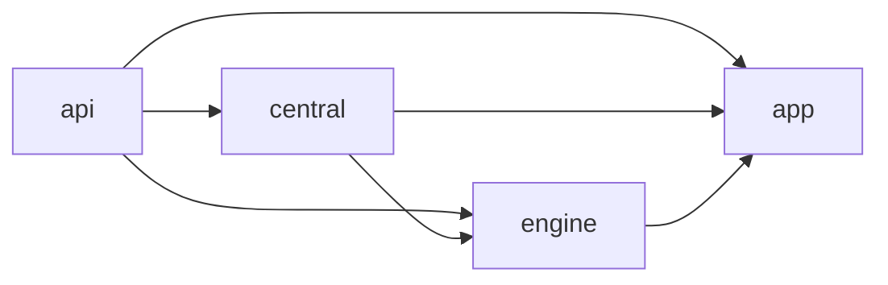
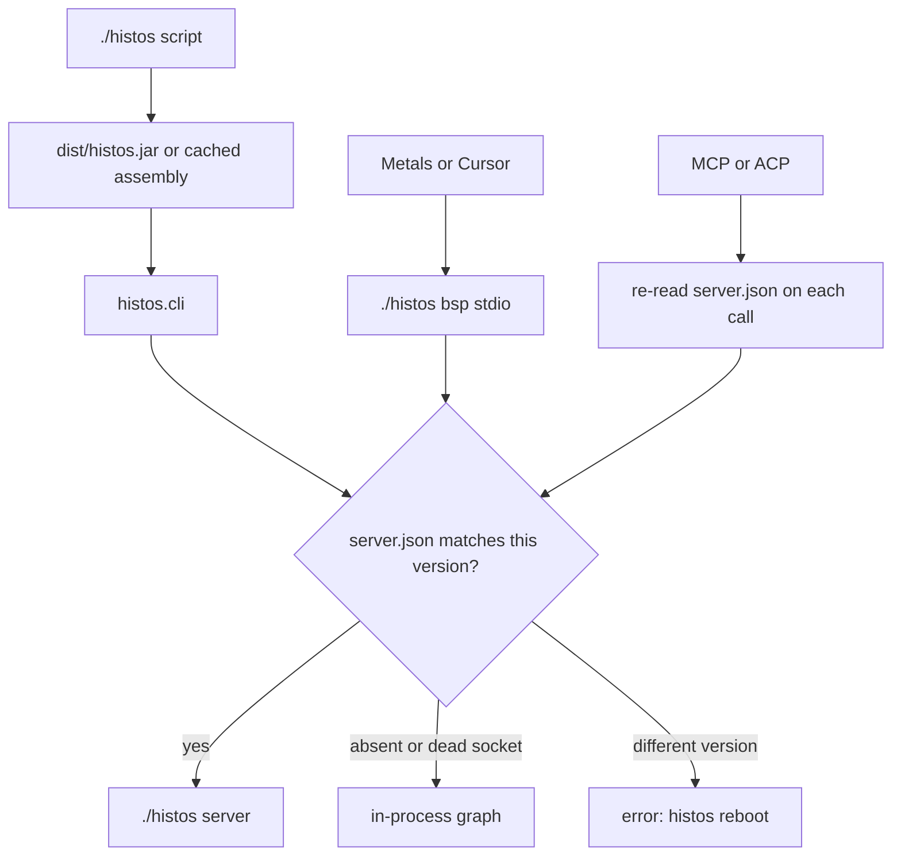
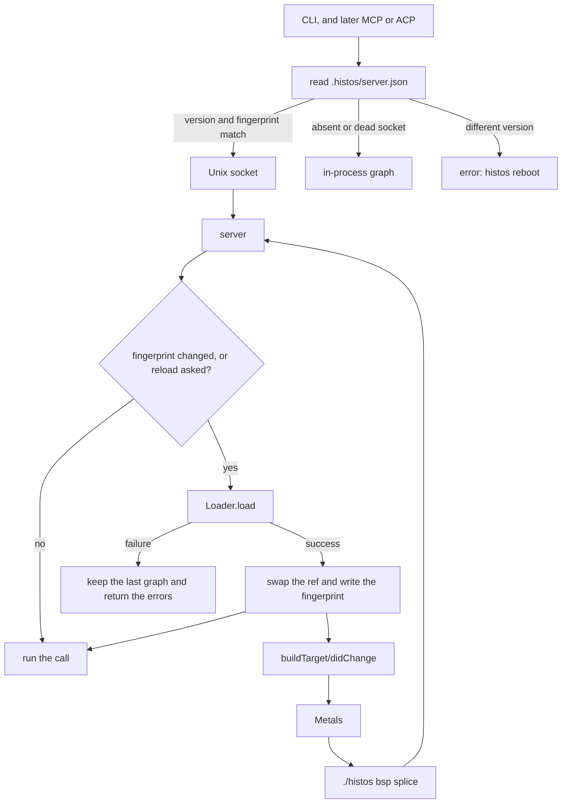

# Histos

**Status:** Draft
**Date:** 2026-10-20
**Org:** early-effect
**Repo:** `early-effect/histos`
**Author:** placeholder

This document describes this tree. What the code does is stated in the present tense. The commits at the bottom are the remaining work.

The plugin contract stays in [plugins.md](plugins.md). This file only summarizes it. That file follows the loader in this tree: platform parent, boundary names from the engine host, no second api `URLClassLoader`.

## Overview

Histos is a ZIO build tool for the person who runs it and for the agent that calls it. CI is the command the repo already runs, and an independent failure does not hide the next one. Effects are values. Errors are typed enums. Selection, compile, test, publish, and the server are ZIO programs over one immutable graph. A protocol handler does not hide a second build. A test does not load another module's classes inside the server JVM.

sbt's split is the familiar one: `dependsOn` is the classpath, and `aggregate` is which projects' tasks also run (`Project.dependencies` and `Project.aggregate`). Mill's familiar idea is that each module runs its own task. Histos keeps separate classpaths and one subprocess per module, Scala version, and platform, and it finishes the cells that do not depend on a failure so every one of those failures is visible. It does not add an sbt setting key, a Mill query language, a merged classpath, or a classloader-isolated test inside the server to look like either tool.

Evaluating `histos.scala` produces that immutable graph. Tasks run as ZIO effects. The CLI, BSP, MCP, and ACP call that graph.

A clone builds with `./histos`. The frozen script verifies a JVM assembly and execs it. The engine is that JVM process. Scala Native is a target platform, not the launcher.

Main already compiles and tests this repository. The JVM BSP session publishes a main target and a test target per module and Scala version, a target for `histos.scala`, SemanticDB, diagnostics, and `buildTarget/jvmTestEnvironment`. `compile`, `test`, and `bsp` can attach to an opt-in server. Js and Native targets are not in that list. An aggregate name still fails as `CiError.NotModule`. MCP loads its own graph. The commits at the bottom are the rest of this work.

## Background and Motivation

sbt-zipx was the previous build for early-effect libraries. Histos replaces it for a repo that has moved. The build describes CI. Artifact names stay the pin strings catalogs already use. There is no sbt, no scala-cli, and no GitHub Actions workflow in this repository today. The renderer exists. The file does not.

The first dogfood is this repo. It builds itself. The second is a local copy of ascent at `~/projects/early-effect/ascent-histos`. That copy compiles under `./histos`. Its tests, named mains, scalac flags, and publish coordinates are not wired, and it has no pull request. This design does not edit that tree.

Editors are the gap that blocks daily use. Metals keeps a presentation compiler and asks a build server for the classpath, the scalac options, and compile. Histos writes `.bsp/histos.json`. The JVM session reports the classpath, the scalac options, diagnostics, and `buildTarget/jvmTestEnvironment`. Js and Native targets are not in that list. Mill's answer was a BSP server that shares the build's output and daemon, not a VS Code extension and not a Bloop export. That is the path here.

An aggregate is the other gap. `inline def aggregate` takes `ProjectDef`, so a nested aggregate typechecks. `Workflow.target` rejects an aggregate name with `CiError.NotModule`. `GraphCompile.choose`, `ModuleTest.requested`, and `LocalPublish.choose` all call that function, so `histos test abc` fails with `'abc' is not a module` when abc's children are a, b, and c. sbt keeps `dependsOn` (classpath) and `aggregate` (which tasks also run) as separate lists (`Project.dependencies` and `Project.aggregate` in `main-settings/src/main/scala/sbt/Project.scala`). `root / test` runs each aggregated project's own test task. Mill's `__.test` selects each module's own task. Neither merges classpaths. Histos keeps that split. One Histos module already owns several platforms, so the aggregate selects modules and each module still expands to its own cells.

## Goals

- **Effect-native.** Task execution is a ZIO effect with typed errors, resource safety, interruption, and structured concurrency. The graph stores descriptions, not the effects.
- **One task surface.** CLI, BSP, MCP, and ACP inspect the graph, run a task, or cancel a run. Protocol handlers do not contain build logic.
- **An aggregate is a list of modules.** It selects those modules. It has no cell and no classpath. A nested aggregate does not compile.
- **One warm JVM.** `./histos server` holds the loaded graph. A command that loads a `ProjectGraph` attaches when `.histos/server.json` matches. A second load is the fallback when that server is absent or the socket is dead. A different `Cli.VersionText` asks for `histos reboot` and does not start a second writer.
- **Familiar, then honest.** The aggregate and the per-module task are the ideas people already know from sbt and Mill. The Histos rule is the classpath split above, not a copy of either tool's warts.
- **Zero-install for a clone.** `./histos` downloads the pinned assembly, and a JDK when no `java` is on `PATH`.
- **Exact Scala.** A module names full versions, such as `3.10.0` or `2.13.16`. A series such as `3` is not a pin.
- **The IDE compiles the way the CLI compiles.** Same Zinc analysis, same lock, same options, aside from flags that must not reach the presentation compiler.
- **Plugins as libraries on `histos.api`.** Enablement is a header the build names. A jar on the classpath does not mutate the build.
- **The build describes CI.** The workflow file is a render. Drift fails the build.

## Non-Goals

- sbt 1.x plugin APIs, AutoPlugin, or `plugins.sbt`.
- A binary-compatibility promise for `histos.api` before 1.0. `LinkStrategy.Api` is a typed refusal. MiMa waits for 1.0.
- Replacing Zinc, the Scala compiler, or Metals' presentation compiler.
- A VS Code extension that owns completion, diagnostics, or the presentation compiler.
- A Bloop export. Compilation must not leave the Histos process.
- Registering Js and Native BSP targets by default. A save must not relink.
- A DAP server and breakpoints in the first test slice.
- Loading `central` through the plugin classloader. It stays an in-tree module.
- Remote execution, a test filesystem or network jail, an sbt importer, and publishing Histos itself.
- A non-snapshot release. Nothing here tags a version.
- One test process per Scala version and platform with a merged classpath. Classpaths stay per module. Js links per module. Native links per module.
- `histos run` on an aggregate. A main needs one module, and a platform argument when that module builds more than one platform.
- Nested aggregates, and a runtime flatten that would accept them.
- Routing Metals test execution through `Call.Test`. Editor tests stay on `buildTarget/jvmTestEnvironment`.
- Turning on workflow `--platform` and `--scala`. The CLI grammar rejects those flags.
- Hot-swapping `dist/histos.jar` inside reload. A new jar is `histos reboot`.

## Key Decisions

1. **The launcher is the frozen script.** `./histos` and `histos.bat` verify the pinned JVM assembly and exec it. A native image is a second toolchain for a downloader. JDK policy lives in the engine. The script fetches the locked Temurin only when no `java` is on `PATH`. The engine checks the lock again and re-execs if it must. When `dist/histos.jar` is present, the script execs that file instead of a cached launcher.

2. **The engine is a JVM process.** Load, Zinc, Coursier, MCP, the server, and BSP run there. Scala Native `tools` stay out of the assembly. A link fetches the tools for the module's `nativeVersion` and runs them in a child. The engine does not load `scala.scalanative`.

3. **BSP follows Mill's native path, not Bloop and not a custom extension.** `.bsp/histos.json` already names `./histos bsp`. Metals and IntelliJ's Scala plugin spawn that process and speak BSP over stdio. Cursor is the same Metals extension. Histos is not in Metals' hardcoded build-tool list, so there is no Bloop preference to override. The presentation compiler stays Metals'. `scala3-presentation-compiler_3:3.10.0` is the compiler it should load. Histos does not ship one.

4. **Plugins are libraries on `histos.api`.** `contribute` is data. `run` is `ZIO[Scope, PluginRunError, PluginOutput]`. The graph does not store the effect. The spec is [plugins.md](plugins.md). The loader is in this tree.

5. **The Specular plugin lives in the Specular repo.** This repo's fixture is a fixture. Docs have to be generated from Specular itself, as a Histos module, not from a copy of Specular inside Histos.

6. **JVM targets are the default BSP list.** One JVM main cell per module and Scala version, a JVM test cell when the module has test sources, and a synthetic target for `histos.scala`. Every module id carries `&platform=jvm` and `&scope=`. Js and Native targets are published only when `.histos/bsp-platforms` names them. That file is absent by default. It is not a field on `Module`. `histos compile` still builds every platform the module names. `buildTarget/compile` passes the platform from the id and does not link. `workspace/buildTargets` reads the file on every request. Absent or empty publishes JVM only.

7. **Aggregate children are modules.** `aggregate` takes `ModuleDef`. A nested aggregate does not compile. There is no runtime flatten. An aggregate has no cell. `dependsOn` stays a compile edge.

8. **One selector.** `compile`, `test`, `testOnly`, `testQuick`, and `publish` share it. Empty names are the whole graph. A module name is that module. An aggregate name is its direct members. A repeated module is `CiError.Duplicate`. `Workflow.target` stays the CI name parser and keeps rejecting aggregates. `TestJob.Aggregate` is the empty split set, not a project aggregate.

9. **A failed cell does not cancel an independent sibling.** The command fails after the last cell if any cell failed. `histos run` on an aggregate stays `ProgramError.Aggregate`.

10. **The server is the warm process.** `Call` covers every command that loads a `ProjectGraph`: compile, test (patterns and quick), publish, graph, run (a main, with a platform when needed), a task (`inspect`, `versions`, or `plugin/task`), cancel, toolchain, resolve, workflow, and assembly. `cache` and `version` do not load a graph and stay in-process. CLI, MCP, and ACP re-read `.histos/server.json` on every call. They do not splice into the Metals stdio session. MCP and ACP become clients in the later commit. Until then the CLI and BSP are the clients.

11. **Reload stays in the same JVM.** `Loader.load` is the check. Success swaps the graph. Failure keeps the last good graph. The BSP session reads the graph from a ref and sends `buildTarget/didChange`. `histos reboot` is a new JVM, because `Cli.VersionText` does not change when `dist/histos.jar` is rebuilt.

12. **MCP and ACP return the CLI text.** Success and failure structured content are both `{value: string}`. That includes toolchain.

## As-Built Architecture

### Modules

`histos.scala` is the build. Four JVM modules, Scala `3.10.0`:



`dependsOn` points at the upstream. `central` sees `api`. `engine` sees `central` and `api`. `app` sees all three.

| Module | Path | Role |
| --- | --- | --- |
| `api` | `api/src/histos` | Graph, builder, literals, versions, `HistosPlugin`. Depends on ZIO `2.1.27` because `run` is a ZIO. The jar does not shade ZIO. |
| `central` | `central/src/histos/central` | Local Maven publisher. Not a plugin. |
| `engine` | `engine/src/histos` | Load, tasks, scheduler, cache, JDK, Node, Zinc, resolve, test, Js, Native, workflow. |
| `app` | `app/src/histos` | CLI, MCP, ACP, BSP, server. One `ZIOApp`. |

Pinned coordinates in `histos.scala`: ZIO `2.1.27`, Zinc `2.0.4`, Coursier `2.1.26`, `heddle-mcp` `0.12.0`, `zio-cli` `0.8.2`. The tool compiles with `scala3-compiler` `3.10.0`. That compiler loads `histos.scala`. It does not compile the modules. A module compile fetches the compiler the module names. Scala 3 and Scala 2.13 are accepted. Scala 2.12 and older are `CompileError.UnsupportedScala`.

`Loader.load` is `ZIO[Scope & Resolve & ContentStore, LoadError, LoadedBuild]`. The `Scope` closes the build classloader. `scan` reads the plugin header before that load. `buildClasspath` is `Boundary.jars`.

```scala
inline def module(name: String, platform: Platform, platforms: Platform*)(
    version: ScalaVersion,
    versions: ScalaVersion*,
): ModuleDef

inline def aggregate(name: String, project: ProjectDef, projects: ProjectDef*): AggregateDef
```

One platform and one Scala version are required. `scala"..."` and `dep"..."` are inline literals. A bad literal fails compilation of the build file. `Projects` returns `Either[BuildError, ProjectGraph]`. The project list is fixed when that value exists.

### Errors

Errors are enums with `message`. They are not `Either[String, _]`, and they do not carry a `Throwable`.

| Enum | Where | What it is |
| --- | --- | --- |
| `BuildError` | `api` | Graph validation. Cycles, duplicate names, mixed catalogs, bad edges. |
| `LoadError` | `engine/load` | Missing build file, compiler text, no `HistosBuild`, broken graph, IO. |
| `TaskError` | `engine/task` | Empty id, no runner, unknown run, version failure. |
| `ResolveError`, `LockError` | `engine/resolve` | Range, checksum, lock drift, missing lock, bad lock line. |
| `CompileError`, `GraphCompileError` | `engine/zinc` | Toolchain, banned jars, diagnostics, unknown cell. |
| `PublishError` | `central` | Bad artifact, escaped path, IO. The publisher returns `IO[PublishError, Published]`. |
| `CliParseError` | `app/cli` | Grammar rejection. |
| `ServerError` | `app/server` | Dead socket, stale fingerprint, bad frame. |
| `RemoteError` | `engine/schedule` | Cache off, read-only, dangling output. |

`PluginLoadError`, `PluginRunError`, `LoadError.Plugin`, `TaskError.Plugin`, and the `BuildError` cases for duplicate plugins, missing notes, and a `contribute` defect are in this tree.

`TaskId.Inspect` is `"inspect"`. `TaskId.Versions` is `"versions"`. `TaskKind` is `Inspect`, `Compile`, `Versions`, and `Plugin`. A plugin task id is a different string (`plugin/task`) and must not occupy the two built-in strings.

```scala
trait Tasks:
  def run(id: TaskId): ZIO[Scope, TaskError, Run]
  def cancel(id: RunId): IO[TaskError, Unit]
```

`cancel` interrupts the registered fiber. An unknown id is `TaskError.UnknownRun`.

### Process model



Batch is the default. `./histos test` does not leave a process behind. A successful ZIO `run` is process status 0, so the command exits with its status.

`./histos server` is opt-in. It listens on a Unix socket and writes `.histos/server.json` with `Cli.VersionText` (`histos 0.0.1-SNAPSHOT`) and a fingerprint. BSP's own version field is the bare `0.0.1-SNAPSHOT`. The two strings are not compared to each other. The fingerprint is `histos.scala`, `.histos/dependencies.lock`, and regular files under each header `plugin(path)` (`Fingerprint.read`). Every command that loads a graph attaches when the version matches. `cache` and `version` stay in-process. A missing server or a dead socket runs the command in-process. A different version fails with `ServerError.DifferentVersion` and does not load a second graph. The server reloads when the fingerprint changes, and a live BSP splice receives `buildTarget/didChange`. `Call` is compile, test (patterns and quick), publish, graph, run, task, cancel, toolchain, resolve, workflow, assembly, reload, reboot, and bsp.

`testQuick` attaches. `Call.Test` carries the suite patterns. MCP and ACP send that same `Call` and return the CLI text. They do not splice into the BSP session.

`./histos mcp` and `./histos bsp` are the processes their clients own. BSP splices stdio onto the server when the version matches. Server and BSP frames are `Content-Length` (`app/src/histos/bsp/Frame.scala`), with an 8 MiB body limit. MCP and ACP are newline JSON.

`./histos ~ <command>` stays in the client. Each iteration sends the inner `Call` and does not load a graph while the server matches. Ctrl-C stops the in-flight work.

Zinc `2.0.4` builds a fresh compiler for every compile. The server exists so Metals and the batch command share a process and the analysis files under `.histos/analysis/<module>/<scala>/<platform>`.

### Compile, test, resolve

Resolution is Coursier as a library (`io.get-coursier::coursier:2.1.26`). The `cs` program is not a resolver. Coursier types stay in the adapter. `Resolve` is the seam tests replace.

A direct revision is exact. A range, or a revision that starts with `latest`, is `ResolveError.Range`. `.histos/dependencies.lock` is the authority. `histos compile` and `histos test` read it and download a missing locked jar. They do not re-solve. `histos resolve --update` and `histos resolve --check` are the network paths. A checksum miss is `ResolveError.Checksum`. A missing lock is `ResolveError.NoLock`.

The artifact suffix is one function of kind, Scala version, and platform: `_3` or `_2.13`, then `_sjs1` or `_native0.5`. Later work must not invent a second scheme. `_native0.5` is the ABI suffix. The toolchain revision is separate. Unset means `0.5.12` (`NativeToolchain.ReleaseRevision`). `HISTOS_NATIVE=ivy-local` or a `file:` URL is only the origin of those jars.

`libraryDependencies` are the compile cell and the pom. `testDependencies` are a second cell, `test <module> <scala> <platform>`, resolved together with the library dependencies. Compile and publish do not read it. An aggregate has no cell.

`histos compile` compiles every platform a module names. Outputs land at `.histos/classes/<module>/<scala>/<platform>`. Sources are `<directory>/src`, or the repository `src` when the graph has one module. `.in(path"...")` sets the directory. `src/test` is tests. A package named `test` under `scala` stays main. Platform directories (`jvm`, `js`, `native`, and the `scala*` aliases) and `scala-2.13` or `scala-3` filter only while they are still layout. `dependsOn` and `Dep.on` are platform-scoped. An unscoped edge applies to every platform the module builds.

`Module.flags` defaults to `ScalacFlags.empty`. `ModuleDef.scalac` replaces that list. Compile, test compile, and BSP `scalacOptions` pass `module.flags.argv`, then the SemanticDB append. `.scalac(EncodingUtf8)` is `-encoding` and `UTF-8`. The enum still has that one case. There is no `-Xfatal-warnings`. The text is produced in `JvmCompile`, not accepted as a raw `List[String]` from the build.

A test cell is one subprocess, not one process per case, and not a thread inside the server. The work directory is `.histos/test-work/<module>/<scala>/<platform>`. Test classes are `.histos/test-classes/...`, analysis `.histos/test-analysis/...`. The child environment is `HISTOS_REPO` and `PATH` only (`suiteEnv`). `runtimeClasspath`, `suiteEnv`, `testClasses`, and `testWork` are private. `runtimeClasspath` returns `cell.classes :: (upstream ++ library ++ jars)`. `cell.classes` is the main class directory of the `CompiledCell`. `library` is `JvmCompile.runtime`. `jars` is the module's locked artifacts plus upstream compile jars (`dependencyJars`), with the standard library removed. The module's artifacts are `ClasspathScope.Test` when `testDependencies` is non-empty, otherwise `ClasspathScope.Compile`. That is not a separate "compile jars, then test jars" sort. The JVM that runs is `TestClasspath(testClasses, linked.paths)` in `TestProcess.scala`, so the entries are the test class directory and then that list. A provider run's main class is `ProviderRunner.Main`, after `compiledTests` writes `Provider.scala` and compiles it into the test classes. `compiledTests` passes `ScalacFlags.empty`. The default provider is `TestProvider.Zio` (`zio.test.sbt.ZTestFramework`, library `dev.zio` / `zio-test-sbt`). The engine does not load it. Another provider names a framework class and a test-scoped library. `.test(TestMain(...))` opts out. A main and a provider together are `BuildError.MixedTest`. A module with no test sources reports `no tests`, which is success and not a passing suite.

`histos testOnly` filters by binary name (`*` any run, `?` one character, otherwise exact). `--module` limits the project. `histos testQuick` runs a suite only when its stamp changed or the last result was not a success. `./histos ~ testQuick` repeats that after a save.

Js fast-link and Native link run in a child JVM. The engine does not load the linker. `histos run <module>` starts the class named with `.main`, on the one platform the module builds. A module that builds more than one platform needs the platform argument (`histos run app jvm`). `histos run inspect` and `histos run versions` stay tasks.

The local cache is content-addressed under `~/.cache/histos` (or `XDG_CACHE_HOME`). `histos cache clean` drops JDKs, launchers, and compiled plugin sources unused for 30 days and keeps the current project. Nothing is deleted during a build.

`RemoteCache` defaults to `RemoteMode.Off`. A configured cache is read-only until opened for write. The only implementation in tree is the in-process `Memory` the tests plant. There is no network client. `Sendable.decide` sends a core compile, and a plugin task only when it is `Seal.Hermetic` with an empty `Need` set. Publish, test, `Network`, and `Docker` stay on the machine. `histos compile` does not configure a remote cache. Zinc's analysis file is that command's incrementality.

JDK selection is read-only against `JAVA_HOME`, `PATH`, an existing Coursier or sdkman install, then the Histos cache. Histos does not run `cs java` or `sdk install`. A bare machine gets a private Temurin from `.histos/jdk.lock`. Node follows the same rules and only when a Js task needs it (`.histos/node.lock`). A Native module declares a clang major. Histos checks `clang` on `PATH` and does not provision one. `histos toolchain` and the MCP tool `toolchain` print the same decision.

### BSP today

`.bsp/histos.json` names `./histos bsp`, BSP `2.2.0`, language `scala`. The session is `app/src/histos/bsp/Bsp.scala` and `Rpc.scala`. `Bsp.open` reads the graph from a ref. A successful reload swaps that ref and, when a splice is open, sends `buildTarget/didChange`. Frames are `Content-Length` (`Frame.scala`), with an 8 MiB body limit. Outgoing frames on one splice share one writer.

| Method | Behavior |
| --- | --- |
| `build/initialize` | Display name `histos`, version `0.0.1-SNAPSHOT`, BSP `2.2.0`. Capabilities are `compileProvider` for `scala`, `dependencySourcesProvider`, `jvmRunEnvironmentProvider`, `jvmTestEnvironmentProvider`, and `buildTargetChangedProvider`. No debug provider. |
| `build/initialized` | Ignored. |
| `workspace/buildTargets` | One main target per module and Scala version on JVM, plus `js` or `native` when `.histos/bsp-platforms` names that token and the module builds it. A test target when `ModuleTest.testSources` is non-empty, and `?build=histos.scala`. Sorted by name, then version, then platform. Absent or empty allow-list publishes JVM only. A bad token fails the request. |
| `buildTarget/sources` | Kind 1 file URIs. Main uses `Sources.select`. Test uses `ModuleTest.testSources`. The build target is the one file `histos.scala`. |
| `buildTarget/scalacOptions` | `SemanticDb.argv` for that Scala version. Production `ScalacFlags` stay empty, so the list is those SemanticDB flags. Main classpath is `JvmCompile.runtime`, the locked compile jars without a second standard library, and upstream class directories. Test classpath names that order (`main` classes, upstream classes, runtime, locked jars) and does not require the directories to exist. The build-file classpath is `Loader.buildClasspath`. `ScalaBuildTarget.jars` is `JvmCompile.scalaJars`. |
| `buildTarget/dependencySources` | `Resolve.sources` for each locked artifact, from `LockedArtifact.repository` only. Standard-library sources use `Repository.Central` only. A miss is omitted. |
| `buildTarget/compile` | Mains call `GraphCompile.cellFeed` with the platform on the ids and the requested versions. `picked` is those modules plus the upstream closure. Tests call `ModuleTest.compiledTests` with a `CompiledCell` whose classes directory is the main output and `classFiles` 0. The build id runs `Loader.reportBuild`. `build/publishDiagnostics` carries the Zinc range (`PositionBase.Zinc` subtracts one) or the dotty range unchanged. `clear` sends `reset: true` per source file at the start. Status `1` or `2`. `originId` is echoed. The compile does not link. |
| `buildTarget/jvmTestEnvironment` | Test classes, then `runtimeClasspath`. Working directory is `testWork`. Environment is `suiteEnv` (`HISTOS_REPO` and `PATH`). `jvmOptions` is empty. `canTest` is true on the test target. |
| `buildTarget/jvmRunEnvironment` | `Program.classpath` for a main id. `canRun` is true on the main target. |
| `buildTarget/scalaMainClasses` | The module's `.main`, plus `EntryPoints.mains` on the classes directory. |
| `buildTarget/scalaTestClasses` | Compiled suite names when the test classes directory exists. An uncompiled target is an empty list. |
| `build/shutdown`, `build/exit` | Shutdown returns JSON null. `exit` stops the process, status 0 only after shutdown. |

Anything else, including `debugSession/start`, is `bsp does not handle <method>` (`-32601`). There is no JDWP listener.

A module id is `directoryUri(repo)`, the module name, and `?scala=<version>&platform=<token>&scope=main` or `&scope=test`. Example shape: `file:///.../histos/api?scala=3.10.0&platform=jvm&scope=main`. The build id is `directoryUri(repo) + "?build=histos.scala"`, matched first. Missing `platform` or `scope` is an unknown target. Upstream dependencies are the same query. A test id depends on that module's main id.

`SemanticDb.argv` for Scala 2.13 is `-Xplugin:` of `org.scalameta` / `semanticdb-scalac_<scala>` / `4.17.3`, then `-Yrangepos` and `-P:semanticdb:sourceroot:<repo>`. Scala 3 stays `-Xsemanticdb` with no plugin jar. This repo is Scala `3.10.0`.

`workspace/buildTargets` reads `.histos/bsp-platforms` on every request. `buildTarget/compile` passes that platform to `cellFeed` and does not link.

`JvmCompile.compileOne` builds a new `ScalaInstance` and `CompilerCache.fresh` on every compile. The server's value is one JVM, one loaded graph, and one writer of `.histos/analysis`.

### Other protocol surfaces

The CLI is a zio-cli grammar (`app/src/histos/cli/Grammar.scala`) that parses into `Command`. The old note that zio-cli was waiting is false. Roots are `version`, `graph`, `run`, `test`, `testOnly`, `testQuick`, `compile`, `assembly`, `publish`, `mcp`, `acp`, `bsp`, `server`, `reload`, `reboot`, `toolchain`, `cache`, `resolve`, and `workflow`.

MCP (`heddle`) and ACP expose `graph`, `compile`, `test`, `publish`, `run`, `cancel`, and `toolchain`. Each call re-reads `.histos/server.json` and sends `Call` when the version matches. Success and failure are both the CLI text. ACP `initialize` is protocol version 1 and lists those commands. An unknown ACP method is still `acp does not handle <method>`.

`histos publish <repository>` writes a local Maven directory for modules the version decision publishes. Development (`-ci`) writes nothing. The artifact id uses the binary suffix. The pom lists library dependencies and published `dependsOn` modules. Credentials and signing are not this publisher. `central` is still that in-tree module.

The version model is the zipx pin strings, as tasks, not as an sbt session. A ship number lives on the catalog. Everyday development compiles `<ship>-ci` and does not publish it. A clean commit stores `<ship>-<12 lowercase hex>-SNAPSHOT`. The default branch also names a `<ship>-SNAPSHOT` pointer, which is not a pin. `manual("app", manual"1.2.3")` states a coordinate and does not read git or `.histos/releases`. One catalog does not mix the two schemes. This repo's `histos.scala` has an empty catalog and no organization, so it does not publish.

`Workflow.render` writes `.github/workflows/ci.yml`. An empty split set is `TestJob.Aggregate` and is the default: a `test` job (`./histos test`) and a `workflow` job (`./histos workflow --check`), `contents: read`, `actions/checkout@v4`, no `setup-java`. A non-empty catalog adds `./histos run versions`. This repo has no catalog, so that job is absent. The renderer can emit `--platform` and `--scala` for a matrix. The CLI grammar rejects those flags. This repo's graph uses the default empty set, so the command it would commit is `./histos test`, which the CLI accepts. Do not turn split axes on until the CLI accepts the flags. No workflow file is committed here. `TestJob.Aggregate` is the empty split set (`Splits.aggregate`). It is not a project aggregate. The two names stay separate. `Workflow.target` stays the CI name parser and keeps rejecting a project aggregate with `CiError.NotModule`. CI does not go through the module selector below.

### Plugins

The loader is `engine/src/histos/load` (`HeaderScan`, `ApiBoundary`, `BuildLoader`). `central` is not a plugin.

The spec is still [plugins.md](plugins.md). This summary does not replace the task, seal, and CI rules there. The types are `api/src/histos/plugin`. Its citations of design sections 2, 3, 4, 5.7, and 5.3 through 5.11 refer to the retired 2026-10-16 draft. Those section numbers are gone. The classloader and fingerprint sentences in that file match this design.

`LoaderLive.open` sets `host` to `classOf[HistosBuild].getClassLoader` and constructs `new ApiBoundary(host)`. `ApiBoundary` is parented on the platform loader. Boundary names load from that host: a second `ProjectGraph` from the api jar would be a different class, and the build object would not match. Refused `histos.*` names are thrown before a plugin URL is searched (`ClassHome.Refused`). That is the loader. Do not add another api `URLClassLoader` that defines those boundary classes again.

```scala
trait HistosPlugin:
  def id: PluginId
  def contribute: Contribution
  def run(request: RunRequest): ZIO[Scope, PluginRunError, PluginOutput]
```

`contribute` is not a `ZIO`. `Projects` copies `RegisteredPlugin` onto the graph and does not store the trait. A header line `plugin(dep"...")` or `plugin(path"...")` is the enablement. Exact-binary linking compares `ApiDigest` (sha256 of the api jar, resource `META-INF/histos/version`) to the jar this process loads. It does not compare `0.0.1-SNAPSHOT`. `LinkStrategy.Api` is `PluginLoadError.ApiLink`. Source and path plugins compile against the running api. Boundary names are `histos` (no subpackage), `histos.plugin`, `histos.version`, `zio.*`, and `scala.*`. They load from the engine host, as `ApiBoundary` does. Every other `histos.*` name is refused.

`histos run plugin/task` and MCP `run` execute that task inside the plugin `Scope`. `Workflow.renderAll` puts `JobWhen.Always` jobs in `ci.yml` and a `JobWhen.Schedule` job in `histos-<job>.yml`. The argv is `./histos run <plugin>/<task>`. The plugin does not write YAML.

The worked example is `engine/test/SpecularFixtureSpec.scala`. It is not the Specular repository.

`HistosPlugin.run` is a ZIO, so the api module depends on `dev.zio::zio:2.1.27`. The api jar does not shade ZIO. Plugins depend on `histos.api` only.

## Proposed Design

The JVM session, `buildTarget/jvmTestEnvironment`, and the plugin loader are in this tree. The sections below are what is not. The commit list is the order. Each commit compiles, and its tests cover what it adds.

### Scala 2.13 SemanticDB

`SemanticDb.argv` emits `-Yrangepos` and `-P:semanticdb:sourceroot:<repo>` for Scala 2.13. Those `-P:` strings are plugin options. They do nothing until that compiler loads `semanticdb-scalac` as a plugin. `JvmCompile.invoke213` calls `runZinc213` with `Nil` extra argv. `compilePrepared` turns plugin jars into `-Xplugin:` on the Scala 3 path only, and Scala 3 does not use this jar.

The jar is `org.scalameta` / `semanticdb-scalac_<full Scala version>` / `4.17.3`. The Scala version in the artifact name is the module's pin (`semanticdb-scalac_2.13.16` when the module names `2.13.16`). `4.17.3` is one exact revision, the scalameta pin in the Metals tree this repo already reads. It is not a range. A later bump changes the constant. The commit fetches that jar and passes `-Xplugin:<jar>` in the 2.13 extra argv, beside `-Yrangepos` and `-P:semanticdb:sourceroot:<repo>`. Those strings are not `ScalacFlag` cases and they are not on the user classpath. Scala 3 stays `-Xsemanticdb` and `-sourceroot` with no plugin jar. This repo's modules are Scala `3.10.0`. The engine fixture compiles a 2.13 cell and finds `META-INF/semanticdb` under the class directory.

### Aggregates select modules

`inline def aggregate` takes `ProjectDef`, so a nested aggregate typechecks (`Builder.scala`, `BuilderMacro.aggregate`, `AggregateDef.make`). `Workflow.target` returns `CiError.NotModule` (`'<name>' is not a module`). `GraphCompile.choose`, `ModuleTest.requested`, and `LocalPublish.choose` all call it. `histos compile abc` and `histos test abc` fail that way when abc's children are a, b, and c.

```scala
inline def aggregate(name: String, project: ModuleDef, projects: ModuleDef*): AggregateDef
```

`AggregateDef.make` takes `List[ModuleDef]`. A nested aggregate does not compile. There is no runtime walk that flattens one. `Projects.linkAggregate` still stores `List[ProjectName]`. The builder only accepts modules, so a build file cannot name an aggregate as a child. `linkAggregate` looks the child up by name. When that project is not a `Module`, the result is `BuildError.AggregateChild` (`aggregate '<name>' lists '<child>', which is not a module`). That case is for a graph that did not come from the builder. `Workflow.target` keeps `CiError.NotModule` for an aggregate name on the CI parser.

`Selection.select` lives in the engine and returns `Either[CiError, Selected]`. It uses `CiError.BadName`, `CiError.Unknown`, and `CiError.Duplicate`. It does not use `CiError.NotModule`. A name the user typed that is an aggregate expands.

| Names | Result |
| --- | --- |
| Empty | Every module, graph order (`graph.projects` collecting `Module`). Expanded set empty. |
| A module | That module. |
| An aggregate | Its direct children, in `Aggregate.children` order. |
| The same name twice | `CiError.Duplicate` on that raw name, before expansion. `abc abc` is `Duplicate(abc)`. |
| An aggregate and a member, or two aggregates that share a member | `CiError.Duplicate` on the module that appears twice. `abc` plus `a`, when abc contains `a`, is `Duplicate(a)`. |

`dependsOn` is not a member edge. `histos compile abc` compiles a, b, and c and their `dependsOn` upstreams, every Scala version and every platform each of those modules builds. That is `choose` calling `upstream` after `select`, then the existing `platforms` and `wanted`. `histos test abc` compiles that same closure and runs suites only for a, b, and c. A module d that a depends on is tested only when d is a member or is named itself. `testOnly --module abc *Foo*` and `testQuick` use the same selection. `ModuleTest.suites` already treats no match in the whole set as `ModuleTestError.NoneMatched`, and a member with no match does not fail the set when another member matched. `Grammar.walk` keeps every `--module` value and stops calling `distinct`, so a repeated raw name reaches `Selection`. `histos test a a` and `histos compile a a` already pass both names through. Their duplicate check stays in `Selection`. `testOnly --module abc --module abc *Foo*` does too.

`histos publish <repository> abc` publishes each member the version decision would publish if that member were named, including the existing `closure` of published `dependsOn` modules. A member with no coordinate is skipped. The line is the existing `LocalPublishError.NotPublished` message (`'<name>' is not in a ship`), on stdout. When at least one member publishes, the exit is success (0) and the skipped lines are printed with the published coordinates. When none of the members publish, the failure stays `LocalPublishError.NothingToPublish` (`nothing publishes`) and nothing is written. Empty names stay the ship members, as `choose` does today, and do not print a skip for every unpublished module. A module named directly, with no coordinate, is `NotPublished` for the whole command: exit `CliExit.PublishFailed` (9), and no artifact is written, including for any other name in that command. `histos run abc` stays `Program.locate`'s `ProgramError.Aggregate`.

`Workflow.target` is unchanged. CI render of an empty split set stays `./histos test` with no names. That command is the whole graph. It is not a project aggregate.

### A failed cell does not cancel its siblings

`compileLayers` is `ZIO.foldLeft` over layers and `ZIO.foreachPar` inside a layer and inside a module's Scala-version and platform cells. A failed effect interrupts the other fibers in that `foreachPar`, `slot.fail` makes `drain` fail the stream, and later layers do not run. `Cli.testLocal` and `Daemon.test` collect `GraphCompile.console` in a for-comprehension, so a compile failure never reaches `ModuleTest.suites`. A non-zero suite is already `TestStatus.Failed`: the CLI sets a flag and continues. A `ModuleTestError` on the suite stream, including `Process`, fails `concatAll` and drops later cells.

Cell failures become data. `compileModule` and `compileLayers` run every cell in the layer to completion. The fiber does not fail, so a sibling is not interrupted. A failed cell is not entered in the `done` map. The next layer runs. A module whose upstream cell failed hits the existing `upstreamClasses` check, `GraphCompileError.MissingUpstream`, and does not compile. Its siblings that do not depend on the failure still compile. `CompileFeed.Failed` carries one `GraphCompileError` for that cell. `GraphCompileError.Cells` holds the non-empty list of those errors. Its `message` is each cell's `message`, one per line.

These cases abort before any cell runs: `Target` (the selector's `CiError`), `UnknownCell`, `Cycle`, `Lock`, `LockRead`, and `Jdk`. `layersOf` reports `Cycle` before `compileLayers` starts. `pickCells` reports `UnknownCell` before `watch` starts.

These cases are `CompileFeed.Failed` and do not cancel an independent sibling: `NoRoot`, `NoSources`, `MissingUpstream`, `RootRead`, `Output`, and `Failed`.

The stream completes after the last cell. `histos compile` prints each failure's `message` (that text includes the platform) and exits `CliExit.CompileFailed` (8) if any cell failed. `GraphCompile.run` fails with `Cells` in that same situation, so `LocalPublish.run` compiles the independent cells, writes no jars, and fails. `cellFeed` uses the same layer loop, so `buildTarget/compile` of several targets publishes every independent cell and then returns status `2` when any requested cell failed. Status `1` means every requested cell compiled. A lock failure is still status `2`, and no cell ran. `BspSpec` asserts the mixed case: one target fails, a sibling target still compiles, and the result status is `2`.

`histos test` keeps the `CompiledCell`s that finished, runs `ModuleTest.suites` for those, and runs later members after a suite error. The command exits `CliExit.TestFailed` (7) after the last cell if any compile cell or suite failed. `NoneMatched` applies only when every selected cell compiled and no suite matched. A compile failure or a suite failure exits 7 and keeps those cell messages. It does not replace them with `NoneMatched`. `Daemon.test` follows the same control flow. `testQuick` does too.

### The server is the warm process

`Call` is `Compile(projects)`, `Test(projects)`, and `Bsp`. `Cli.test` skips `attach` when `quick` is true, and `Call.Test` has no patterns, so a live server drops a `testOnly` filter. `Daemon.accept` runs `handle` to completion before accepting again, so a BSP splice blocks every other client. `Fingerprint.read` on each request returns `Message.Stale` when the hash differs. The client then loads a second graph, including a `histos.scala` that does not compile. The server keeps the old graph. `Loader.reportBuild` only asks the compiler. `Loader.load` compiles, classloads, and builds `Projects`.



A graph-reading command is one that loads a `ProjectGraph`. `Call` is `Compile`, `Test` (pattern strings and `quick`), `Publish`, `Graph`, `Run(id, platform)` for a main, `Task(id)` for `inspect`, `versions`, and `plugin/task` (no platform), `Cancel`, `Toolchain`, `Resolve`, `Workflow`, `Assembly`, and the existing `Bsp`. `Reload` and `Reboot` are added with the reload commit. `cache` and `version` do not load a graph. They stay in-process. `./histos ~ <command>` stays in the client. Each iteration sends the inner command's `Call` and does not load a second graph while the server matches.

The server commit is the CLI and BSP. MCP and ACP keep loading their own graph until the later commit that makes them clients.

The CLI re-reads `.histos/server.json` on every call (`Attach.decide`). When the record matches, it is a client (`Client.talk`) and does not load a second graph. When the server is absent or the socket is dead, the caller runs in-process. When `record.version` differs from `Cli.VersionText`, the command fails with `ServerError.DifferentVersion` (`histos server is a different version. Run histos reboot`) and exits `CliExit.LoadFailed` (3). It does not attach and it does not load a graph. MCP and ACP, once they are clients, use that same rule and reuse one in-process graph only while the server is absent or dead, until a server appears or the fingerprint changes. They do not call `Client.splice`. That splice is the Metals stdio session.

`testQuick` attaches, so it is not a second writer of `.histos/analysis`. `accept` forks each connection on the server scope. A `Semaphore(1)` created in `Daemon.open` is held for compile, test, publish, assembly, `Run` of a main, and `buildTarget/compile`, because those write `.histos/classes` or `.histos/analysis`. `graph`, `toolchain`, `Task`, `cancel`, `resolve`, `workflow`, and reload do not take it. The connection acquires the permit with a release finalizer, so interrupt and a closed socket release it. `Call.Cancel` interrupts the task fiber in the server's registry. Two commands therefore do not write analysis at the same time. Cells inside one command stay parallel, and they write different directories.

### Reload, then reboot

A module source edit does not reload. A fingerprint change, and `histos reload`, call `Loader.load`. Success swaps the ref immediately, writes the new fingerprint, and replaces the runner map. Failure keeps the last graph and returns `LoadError.message` (`CompileFailed` or `BrokenGraph`, among the other cases). The client stays a client. It does not answer that failure by loading the broken file itself. A different `Cli.VersionText` is `ServerError.DifferentVersion`, not `Message.Stale`, and not an in-process load.

A cell reads the ref when it starts and keeps that generation. Cells already running finish on it. The next cell reads the new graph. The build classloader is not on the server's root scope. Each successful load has its own `Scope`. The previous scope closes when the last cell that captured it finishes. A failed load closes the scope it just opened. Two requests that both see a drift take one reload lock, so the check and the load are one critical section. `histos reload` loads even when the fingerprint matches.

The BSP session reads the graph through that ref. `Bsp.open` stops capturing the value `Daemon.bsp` passes today. After a successful swap, if a splice is open, the server sends `buildTarget/didChange`. The id lists are the ones `Session.targets` already builds, for the previous graph and the new graph. An id in both is kind 2. An id only in the new graph is kind 1. An id only in the old graph is kind 3. A classpath-only change still sends kind 2 for the ids that remain, so Metals reimports. `ProjectMetalsLspService.onBuildTargetChanges` cancels compilations and calls `connect(ImportBuildAndIndex)`. The splice stays up. Outgoing frames on that connection, including `build/publishDiagnostics` and this notification, share one writer. `Frame.write` is not safe if two fibers interleave bytes on the stream. `buildTargetChangedProvider` is true from `build/initialize`, which is when BSP 2.2 says the server admits the notification. This is not `workspace/reload`.

`histos reboot` is how a new `dist/histos.jar` is picked up. When a server is running, the order is: stop accepting, run `remove` once (delete `.histos/server.json` and the socket file), disarm that finalizer so process exit does not delete them again, spawn `./histos server`, then exit. The parent's exit leaves the child's socket and record in place. The script checks the assembly checksum and execs the jar. A JVM cannot replace its own image with that script. The observable result is one new server process. The BSP splice dies. Metals' `BuildServerConnection.reconnect` starts `./histos bsp` again. `metals.ask-to-reconnect` defaults to false, so that restart does not prompt. The next MCP call re-reads `server.json`. There is a window where the file is absent and that one call runs in-process. The call after the new record is written attaches. MCP does not restart.

When no server is running, `histos reboot` starts `./histos server`. `histos reload` fails with `ServerError.NoServer` (`no histos server is running`) and exits `CliExit.LoadFailed` (3). It does not load a graph and exit, because that load would be discarded. `ServerSpec` covers both.

`CommandName.reserved` gains `reload` and `reboot`, and the reserved list in [plugins.md](plugins.md) gains the same words, so a plugin cannot take them.

### MCP and ACP

`HistosMcp.tools` registers `graph`, `run`, `cancel`, and `toolchain`. `toolchain` succeeds as `ToolchainReport`, whose schema requires `jdk`. A failure is `ToolchainFault`, an enum. Heddel's `ToolCall.typedFailure` wraps a non-object as `{value: ...}` (`Structured.wrap`). Cursor checks that object against the success schema and reports a missing `jdk`. A missing lock is `ToolchainError.NoLock`: `no jdk lock at <path>`.

Every tool's success type and error type are `String`. A missing jdk lock is that message alone (`Survey.shown` is empty for `SurveyError.Jdk`). Success is `Survey.text`. When a later stage fails, `Survey.shown` is non-empty: the tool string is that stdout, a newline, then `SurveyError.message`. That is the CLI text, stdout then stderr. `graph`, `run`, and `cancel` already return strings. Their error type stops being `ToolFailure`, which is an object and would not wrap as `{value: string}`.

MCP and ACP expose `graph`, `compile`, `test`, `publish`, `run`, `cancel`, and `toolchain`. `resolve`, `workflow`, `assembly`, `reload`, and `reboot` stay CLI calls on the server. They are not tools. `run` params are `id` and an optional `platform`. A slash id is a plugin task and rejects a platform, which is the existing `CliParseError.TaskPlatform`. `inspect` and `versions` reject a platform too.

ACP stays newline JSON-RPC. `initialize` stays protocol version 1. `capabilities` stays an object:

```json
{"protocolVersion": 1, "capabilities": {"commands": ["graph", "compile", "test", "publish", "run", "cancel", "toolchain"]}}
```

`graph` and `toolchain` take `{}`. `compile` takes `{"projects": []}` (empty is the whole graph). `test` takes `{"projects": [], "patterns": [], "quick": false}`. `publish` takes `{"repository": "<path>", "projects": []}`. `run` takes `{"id": "<task or module>"}` or `{"id": "<module>", "platform": "jvm"}`. `cancel` takes `{"id": "<run id>"}`. Success and failure results are both `{"value": "<cli text>"}`. An unknown method stays the existing JSON-RPC error (`acp does not handle <method>`). The ACP test parses `result.value` for a toolchain success and for a missing jdk lock, and that failure value is the lock message, not an object with a `jdk` field. Those seven tools are the protocol surface. Each handler sends the matching `Call` and returns that call's CLI text. The handler does not contain its own compile or test implementation.

### Ascent's JVM modules, then Js and Native

The same session, pointed at `~/projects/early-effect/ascent-histos`, lists JVM targets the way this repo's targets work. That file registers 26 modules, all on Scala `3.9.0`. Nine of them build JVM, Js, and Native. Registering every platform would hand Metals a save-time matrix, and a Native target would relink. Mill did that. Histos does not.

Js and Native targets are omitted unless `.histos/bsp-platforms` names them. The file is repo-local. It is not a field on `Module`, not an environment variable, and not a graph flag. `histos compile` does not read it and still builds every platform the module names. The ascent `histos.scala` stays unchanged.

The file is one token per line, after trim. A blank line is skipped. A repeated `js` or `native` is one token. The only tokens are `js` and `native`. `jvm` is not a token, because JVM is the default. Any other token is `BspError.Platforms` with message `'<token>' is not a bsp platform`. An unreadable file is the same error with message `could not read <path>`. The targets request fails with that error. It does not fall back to a JVM-only list. The fingerprint does not cover this file, so `workspace/buildTargets` reads it on every request.

Absent or empty, after skipping blank lines, publishes JVM only. A `js` line publishes `&platform=js&scope=main` for each module that builds Js, and `&scope=test` when that module has test sources. A module that does not build Js gets no Js id. A `native` line uses `&platform=native` the same way. Both lines can be present.

The allow-list adds targets. It does not reuse the JVM URI. `buildTarget/compile` passes the platform token into `GraphCompile.cellFeed`, with the version set from the requested ids. `picked` is still the requested modules plus their upstream closure, and the check is that each module builds that platform. A JVM save passes `Platform.Jvm` only and does not compile Js or Native. An allowed Js or Native target runs the compiler `GraphCompile` already runs for that platform and does not call `JsLink` or `NativeLink`. Linking stays on `histos run` and `histos test`. Do not implement that compile with `runCells`, `console`, or `chooseCells`. A save compiles the targets that were published, and each call compiles its upstream closure inside that call. Targets that were not published cannot be relinked.

Metals can index Scala platform 2 (JS) and 3 (Native). Running them needs a DAP forwarder (Metals pull request 5197). That forwarder is out of scope.

The default path does not require an edit to the ascent copy. `BspSpec` covers a bad line (the targets request fails), a Js id that is not the JVM id, and a compile of that id that does not link. Opening the ascent copy, with the file absent, is the manual proof that a save stays on JVM.

### Specular

The Specular repository will gain a module that is a `HistosPlugin`, with a docs task and a CI job, pinning a snapshot of `histos.api`. It is not an sbt AutoPlugin, and it is not this repo's fixture. This work does not cut a release so that compile can happen. The commit is in the Specular repository. The loader it compiles against is the one in this tree. That commit waits. The plugin id, the task id, `JobWhen`, and the snapshot coordinate stay unnamed until the Specular work starts. An engineer does not start it now. `SpecularFixtureSpec` stays unchanged. When the names exist, the test in that repo loads the plugin and renders the job argv as `./histos run <plugin>/<task>`.

### Ascent proof

The local copy compiles. It does not name test dependencies, a test provider, a main class, scalac flags, an organization, or a catalog. This repo adds `Module.flags: ScalacFlags`, defaulting to `ScalacFlags.empty`, and `ModuleDef.scalac(flag: ScalacFlag, rest: ScalacFlag*)`. One call sets the list. A second call replaces it. Compile, test compile, and BSP `scalacOptions` and `buildTarget/compile` use `module.flags.argv`, then the SemanticDB append. A module that never calls `.scalac` stays on empty argv. `.scalac(EncodingUtf8)` is `-encoding` and `UTF-8` on the CLI and in `scalacOptions`. No new cases are added. If `-Xfatal-warnings` is added later, the CLI argv includes it and `scalacOptions` and `buildTarget/compile` omit it. The ascent-histos commit waits on the cases. It then names test dependencies, mains, and those cases, and runs `./histos compile` and `./histos test`. Central publish stays out.

### CI for this repo

The renderer already exists. Generate `.github/workflows/ci.yml` from this graph and commit it. The drift check is `./histos workflow --check`. The graph has empty splits and an empty catalog, so the file is the `TestJob.Aggregate` `test` job (`./histos test`) and the `workflow` job. Do not enable split axes. Do not add a publish job. A file repository is not a release. `Workflow.target` is not the module selector.

### Scala.js host

One new module in this repo follows the groks-beard host shape (`~/projects/early-effect/groks-beard`, project `host` in `build.sbt`): Scala.js, `ModuleKind.CommonJSModule`, and only that module imports `vscode`. The task is an engine task: full link of that module, then `vsce package`, with a typed error. It is not a `HistosPlugin` and it does not invoke a presentation compiler. That commit waits. The module name, the vscode coordinate, and the command list stay unnamed until the editor surface is designed. An engineer does not start it now. This design pass does not edit groks-beard.

## API / Interface Changes

`Loader.buildClasspath`, `GraphCompile.cellFeed`, `SemanticDb.argv`, and `private[histos]` on `testSources`, `runtimeClasspath`, `testClasses`, `compiledTests`, `suiteEnv`, and `testWork` are in this tree. `Bsp.open` already takes the classpath list and the notification sink. It still takes `graph: ProjectGraph` by value. The reload commit changes that argument to a read of the server's graph ref.

`aggregate` changes from `ProjectDef` to `ModuleDef`. `module` stays. `AggregateDef.make` takes `List[ModuleDef]`. The graph value stays `Aggregate(name, children: List[ProjectName], position)`. `ship` still takes `ProjectDef`. `BuildError.AggregateShipMember` still rejects an aggregate in a ship.

`Selection.select(graph, names): Either[CiError, Selected]` is the shared lookup. `Selected` is the modules in request order and the set of member names that came from an aggregate. Empty `names` yields every module and an empty expanded set. `GraphCompile.choose`, `ModuleTest.requested`, and `LocalPublish.choose` call it. `Workflow.target` does not. `Grammar.walk` keeps every `--module` and stops calling `distinct`, so a repeated raw name reaches `Selection`. `CiError.Duplicate` (`'<name>' is listed twice`) is that check.

`Call` gains `Test(projects, patterns, quick)`, `Publish(repository, projects)`, `Graph`, `Run(id, platform)`, `Task(id)`, `Cancel(id)`, `Toolchain`, `Resolve`, `Workflow`, `Assembly`, `Reload`, and `Reboot`, beside `Compile` and `Bsp`. `Task` is `inspect`, `versions`, or `plugin/task`, and it has no platform. Pattern strings are parsed with `SuitePattern.from`. A bad pattern is that error's message and exit code 2.

`CompileFeed` gains `Failed(error: GraphCompileError)`. The per-cell cases are `NoRoot`, `NoSources`, `MissingUpstream`, `RootRead`, `Output`, and `Failed`. `GraphCompileError.Cells` is the non-empty list of those. Its `message` is one cell message per line. `Target`, `UnknownCell`, `Cycle`, `Lock`, `LockRead`, and `Jdk` still fail before any cell runs. `linkAggregate` gains `BuildError.AggregateChild`.

`Rpc.Capabilities` gains `buildTargetChangedProvider: Boolean`, set true. The notification is BSP 2.2 `buildTarget/didChange`: `params.changes` is `BuildTargetEvent` values, each `{ target: { uri }, kind }`. `kind` is 1 created, 2 changed, 3 deleted. `data` and `dataKind` are not set.

MCP and ACP tool success and tool error are both `String`. Heddel wraps a non-object schema as `{value: string}` (`Structured.Wrapped`). `ToolchainReport` and `ToolchainFault` leave the tool surface.

`Module.flags` defaults to `ScalacFlags.empty`. `ModuleDef.scalac` sets that list. Compile, test compile, and BSP `scalacOptions` and `buildTarget/compile` pass `module.flags.argv`, then the SemanticDB append. No new `ScalacFlag` cases are added. The editor module waits, and it does not change `histos.api`.

## Data Model Changes

No new on-disk layout for classes, analysis, or the dependency lock. SemanticDB files appear under the class directory that compile already writes. The test target points at `.histos/test-classes`, which test already writes.

`buildTarget/dependencySources` does not add a `source` line to module cells. It may download a sources jar from the repository on that lock line, and a standard-library sources jar from `Repository.Central`. A miss is omitted. Plugin `source` lines stay as the lock writes them.

`.histos/bsp-platforms` is the BSP allow-list. The file is absent by default. `histos compile` does not read it. `.gitignore` does not ignore the whole `.histos` directory. This repo does not commit the file. JVM-only is the absent file, not a committed empty one.

Adding `.github/workflows/ci.yml` is the first workflow file in this repo. `.bsp/histos.json` stays. Its argv stays `./histos bsp`.

The server record stays `.histos/server.json`. `Fingerprint.read` hashes `histos.scala`, `.histos/dependencies.lock`, and regular files under each header `plugin(path)`. A module source edit is not in that hash, so it does not reload. `Cli.VersionText` stays `histos 0.0.1-SNAPSHOT` across assemblies, so a new `dist/histos.jar` is not a fingerprint change.

## Alternatives Considered

### sbt's aggregate and Mill's per-module task

sbt keeps two lists. `dependsOn` is who is on the classpath. `aggregate` is which projects also run the task. `root / test` runs each aggregated project's own test task. Mill's `__.test` is the same idea: select each module's task, do not merge the classpaths. Histos keeps that split, and one module already expands to a cell per Scala version and platform. The continuation rule is the part neither tool is copied for: an independent cell still runs after a sibling fails, so the person sees every failure. A query language, an sbt `SettingKey`, and one test process with a merged classpath were the familiar shapes that lose here. A test classloader inside the server JVM would share state across modules. The subprocess stays.

### Bloop export

Mill's path A, still called preferred on Metals' Mill page: `mill.contrib.bloop.Bloop/install` writes Bloop JSON, and Bloop compiles outside Mill. Histos rejects it. The IDE would compile with a different compiler invocation, a different analysis file, and a different classpath story than `./histos compile`. Two compilers is how "it works in the editor" becomes a bug. The cost of a native BSP session is the session this tree already runs. The cost of Bloop is a second build.

### A Scala.js VSIX as the language client

groks-beard shows the shape: one host module, CommonJS, `packageVsix`. That module can call commands. It cannot be the Scala language client. Completion, hover, and goto-definition are Metals' presentation compiler plus the classpath this server reports. An extension that spoke LSP itself would reimplement Metals and still need a build server. Cursor would need a second client. Mill wrote no Cursor-specific code. Neither do we. The VSIX, when it exists, is a command surface on top of a BSP loop that is already daily.

### A Histos presentation compiler

Metals already loads `scala3-presentation-compiler_3` for the Scala version the target reports. Metals main pins `latestScala3Next` at `3.10.0`, and that artifact is on Maven Central. A marketplace build from before the pin may warn. The fix is `metals.serverVersion`, checked in Doctor. Writing a presentation compiler would fork the Scala 3 compiler UI, ship it inside Histos, and still not be what Metals calls. It loses on maintenance and on the decision that Metals owns editing.

### `buildTarget/test` as the only test method

It is a real BSP request, and it would not make a code lens run. When the server has no debug provider, Metals starts its own DAP server and reads `jvmTestEnvironment`. Implementing only `buildTarget/test` fails the proof. `buildTarget/scalaTestClasses` is the deprecated list and is not the contract. Answering `debugSession/start` with no listener also fails it: Metals calls `connect(uri)`.

## Security and Privacy Considerations

The trust boundary is the local user. BSP, MCP, and ACP are stdio. The server is a Unix socket in the repo, gated by a fingerprint, not by a credential. Anyone who can connect to that socket can compile. Do not bind it to a network interface.

The launcher refuses to exec an assembly whose sha256 does not match `.histos/assembly.sha256`. The dependency lock refuses a jar whose bytes do not match. A download uses the repository the lock recorded and does not fall through to another. `buildTarget/dependencySources` is the exception that may download a sources classifier. A locked artifact uses `LockedArtifact.repository` only. `JvmCompile.runtime` uses `Repository.Central` only. Neither path tries a second repository. A miss is omitted from `sources`. It is not a blank URI, and it is not a failed import. There is no module source checksum to refuse on.

The test child sees `HISTOS_REPO` and `PATH` only. That is not a jail. Tests are not sendable. Publish writes a local directory and does not take a password. `RemoteCache` has no network client. A future client must keep using `Sendable.decide` and must not upload tests, publish, or a plugin task that declares `Network` or `Docker`.

`ApiBoundary` is parented on the platform loader and refuses `histos.*` outside the api surface. Boundary names load from the engine host that defined `HistosBuild`, so `ProjectGraph` is one class. A plugin that links `histos.schedule` or `histos.zinc` fails the load. Project compiles reject a jar that contains `HistosBuild` or `ClassMarker.PluginEntry` (`JvmCompile.jarBan`). Plugin classes stay on the build classloader.

Reload and reboot stay inside that boundary. Reload calls `Loader.load` in the server process. Reboot starts `./histos`, the frozen script, which checks `.histos/assembly.sha256` and execs the jar. Reboot stops accepting, runs `remove` once, disarms that finalizer, then starts `./histos server`. The parent's exit does not delete the child's socket or `server.json`. There is no network bind.

This work adds no telemetry.

## Observability

Compile prints one cell at a time: diagnostics, then `<module> <scala> <platform>` and the class directory. Test streams the framework's tree and closes with a summary line. `histos toolchain` prints the JDK decision, and Node or clang when the graph needs them. The server prints its socket path and then waits.

There is no metrics pipeline. Do not add one. The editor signal is `build/publishDiagnostics`, plus Metals Doctor. `jvmTestEnvironment` is the test protocol. A trace that shows `debugSession/start` means a real DAP server, which this work does not add.

The server streams `Message.Out`, `Message.Err`, and `Message.Exit`. A failed cell is `Message.Err`. The command's non-zero status is `Message.Exit` after the last cell. A skipped publish member is a `Message.Out` line. A reload failure is `LoadError.message` on `Message.Err` and exit code 3. Tool results are that same text.

## Risks

| Risk | Severity | Mitigation |
| --- | --- | --- |
| A marketplace Metals treats Scala `3.10.0` as a future version and will not load the presentation compiler. | Medium | Doctor is the check. Pin `metals.serverVersion` to a build that fetches `scala3-presentation-compiler_3:3.10.0`. Do not fork the presentation compiler. |
| Diagnostics are published under the stale method name `buildTarget/publishDiagnostics`. | High if wrong | Emit `build/publishDiagnostics` only. A BSP fixture asserts that method string. The integration page is not the spec. |
| Js and Native targets reuse the JVM id, or a save compiles every platform or every Scala version. | High if wrong | Every module id carries `&platform=` and `&scope=`. `.histos/bsp-platforms` absent publishes JVM only. `buildTarget/compile` calls `cellFeed` with that platform, the requested versions, and the upstream closure in `picked`. It does not call `console` (`only = None`), `runCells` (`platform = None`), or `chooseCells`. It does not call the linker. The ascent proof file is 26 modules, nine of them three platforms. |
| A save passes only the requested module, or test `scalacOptions` calls `runtimeClasspath` on import. | High if wrong | `compileLayers` starts from an empty `done` map. `GraphCompile.upstreamClasses` does not read disk, so `picked` includes the upstream closure and `layersOf` compiles it first. Test `scalacOptions` names the `runtimeClasspath` order and does not call `ModuleTest.upstreamClasses`. `Bsp.options` is `ZIO.foreach`, so one `MissingUpstream` fails the import. That error stays on `compiledTests` and the test run. `jvmTestEnvironment` still calls `runtimeClasspath` after compile. |
| `plugins.md` is read as the loader, and a second api `URLClassLoader` is added. | Medium | The loader in this tree parents `ApiBoundary` on the platform loader and loads boundary names from the engine host so `ProjectGraph` is one class. `central` stays in-tree. |
| The ascent copy is treated as a finished dogfood. | Medium | It compiles. Tests, mains, flags, and publish coordinates are unwired. Central publish stays out of the proof. |
| `testOnly` against a live server ignores the pattern, because `Call.Test` has no pattern field. | High until the server commit | That commit carries the patterns and `quick`. Editor tests stay on `jvmTestEnvironment`. |
| `Daemon.accept` stays serial, or a forked accept compiles the same cell twice. | High if wrong | Fork each connection. One semaphore around compile, test, publish, program run, and `buildTarget/compile`. |
| Reload closes the build classloader while a cell still uses it, or swaps a failed load. | High if wrong | A cell captures the generation it read. The scope closes when that count hits zero. `Loader.load` failure leaves the ref unchanged. |
| A reload between cells mixes two graphs in one command. | Medium | That is the rule: the next cell reads the new graph, and its upstream classes may be from the previous generation. A failed load does not swap. The whole command does not stay pinned to the graph it started with. |
| A matrix workflow is committed before the CLI accepts `--platform` and `--scala`. | Low | The workflow file is the empty-split render only. `TestJob.Aggregate` is not a project aggregate. |

## Rollout Plan

There is no flag service. Opt-in is the existing pattern: the server, the remote cache, and `.histos/bsp-platforms` once that file is read. `.bsp/histos.json` does not change. The JVM session and `jvmTestEnvironment` are already what Metals talks to. The commit list is the remaining sequence. A snapshot pin is how Specular compiles. Nothing here tags a release.

## Open Questions

Test launch is `buildTarget/jvmTestEnvironment`. Js and Native visibility is `.histos/bsp-platforms`. Aggregate selection, cell failure, the warm server, reload, reboot, and the MCP string result are decided above. Three items are deferred:

1. **`ScalacFlag` cases.** `Module.flags` and `ModuleDef.scalac` are added with no new cases. The cases are chosen later. This commit does not add `-deprecation`, `-feature`, `-Wunused:all`, `-language:implicitConversions`, or `-Xfatal-warnings`. If `-Xfatal-warnings` is added later, the CLI argv includes it and `scalacOptions` and `buildTarget/compile` omit it. The ascent-histos commit waits on the cases.
2. **Specular names.** The plugin id, task id, `JobWhen`, and snapshot coordinate stay unnamed until the Specular work starts. That commit is not one an engineer starts now. The shape stays: a `HistosPlugin` in the Specular repo, a docs task, a CI job, a snapshot pin, and this repo's fixture unchanged.
3. **Host names.** The module name, vscode coordinate, and command list stay unnamed until the editor surface is designed. That commit is not one an engineer starts now. The shape stays: one CommonJS module, vscode only there, full link then `vsce package`, and no presentation compiler.

## References

- [plugins.md](plugins.md), the plugin spec. Its loader and reload rules match this design.
- [plan.md](plan.md), the landed note. The remaining work is the commit list below.
- BSP `buildTarget/didChange`: `DidChangeBuildTarget.changes` of `BuildTargetEvent` (`target`, optional `kind` 1, 2, or 3). Spec: <https://build-server-protocol.github.io/docs/specification.html>. Metals handles it in `MetalsBuildClient.onBuildTargetDidChange` and `ProjectMetalsLspService.onBuildTargetChanges`.
- sbt `Project.aggregate` and `Project.dependencies`: `~/projects/forks/sbt/main-settings/src/main/scala/sbt/Project.scala`.
- Heddel `Structured.wrap`: `heddle/mcp-protocol/src/main/scala/heddle/mcp/protocol/Structured.scala`. `ToolCall.typedFailure` wraps a non-object error.
- `.bsp/histos.json`, `app/src/histos/bsp/Bsp.scala`, `Rpc.scala`, `Frame.scala`.
- `engine/src/histos/zinc/JvmCompile.scala` (`ScalacFlags`, `scalaJars`, `runtime`, `compilePrepared`, `runZinc213`, `CollectingReporter`), `GraphCompile.scala` (`CompileFeed`, `runCells`).
- `engine/src/histos/testrun/ModuleTest.scala` (`runtimeClasspath`, `compiledTests`, `suiteEnv`, `testSources`), `TestProcess.scala` (`TestClasspath`).
- `engine/src/histos/load/Loader.scala` (main `classpath` at `c31b8c4`, `rewrite`, `open`), `Boundary.scala` (`jars`), `BuildLoader.scala` (`ApiBoundary`).
- `engine/src/histos/resolve/Resolve.scala` (`sources`), `DependencyLock.scala` (`sourceOnly` rejects a module cell).
- Metals, integrating a new build tool: <https://scalameta.org/metals/docs/integrations/new-build-tool>. The diagnostic method on that page is stale.
- BSP Scala extension: <https://build-server-protocol.github.io/docs/extensions/scala>. `buildTarget/scalaTestClasses` is marked deprecated in favor of `buildTarget/jvmTestEnvironment`.
- metals#7544, the two test-launch paths. Metals pull request 5197, the non-JVM DAP forwarder.
- Mill: `./mill --bsp-install` writes `.bsp/mill.json` (Mill since 0.9.3). `build.mill` is itself a target. Path A, Bloop install, compiles outside Mill.
- groks-beard host and `packageVsix`: `~/projects/early-effect/groks-beard/build.sbt`.
- Ascent proof, local only: `~/projects/early-effect/ascent-histos`. Not the ascent repository. No pull request.

## Commits

The JVM BSP session, `buildTarget/jvmTestEnvironment`, and the plugin loader are already in this tree. They are not commits. Commits 1 through 8, and the workflow file, can be built now. Each of those compiles, and its tests cover what it adds. The ascent copy, the Specular plugin, and the Scala.js host stay at the end and wait. Their names are not invented.

### 1. Publish Js and Native targets only when the allow-list names them

**Message:** Keep a save on JVM unless the repo asks for Js or Native. `cellFeed` already takes a platform. The target list is what still publishes every save as JVM only.

**Files:** `app/src/histos/bsp/Bsp.scala` (read `.histos/bsp-platforms` inside `workspace/buildTargets`), `BspError.Platforms`, `app/test/BspSpec.scala`. No field on `Module`. No edit to `~/projects/early-effect/ascent-histos`.

**After this lands:** The file is one trimmed token per line. Blank lines are skipped. A repeated `js` or `native` is one token. Any other token, including `jvm`, fails the targets request with `'<token>' is not a bsp platform`. An unreadable file fails with `could not read <path>`. There is no silent JVM fallback. Absent or empty publishes JVM ids that already say `&platform=jvm`. A `js` or `native` line publishes that platform only for a module that builds it, and `&scope=test` only when that module has test sources. The id is not the JVM id. `buildTarget/compile` passes the token to `cellFeed` and does not link. `BspSpec` covers the bad line, the distinct id, and the compile that does not link. `histos compile` does not read the file.

### 2. Write SemanticDB for a Scala 2.13 cell

**Message:** `-P:semanticdb` is a plugin option. Emitting it without loading `semanticdb-scalac` does not write a database.

**Files:** `engine/src/histos/zinc/JvmCompile.scala` (`invoke213` passes `-Xplugin:` and the SemanticDB argv), an engine fixture on Scala 2.13.

**After this lands:** The jar is `org.scalameta` / `semanticdb-scalac_<the module's Scala version>` / `4.17.3`, an exact pin. The 2.13 extra argv is `-Xplugin:<jar>`, `-Yrangepos`, and `-P:semanticdb:sourceroot:<repo>`. Those strings are not `ScalacFlag` cases. The fixture finds `META-INF/semanticdb` under the class directory. Scala 3 stays `-Xsemanticdb` with no plugin jar.

### 3. Select the modules an aggregate names

**Message:** `histos test abc` fails with `'abc' is not a module` even when abc's children are modules. An aggregate should name those modules. It should not become a classpath.

**Files:** `api/src/histos/Builder.scala`, `Macros.scala`, `ProjectDef.scala` (`AggregateDef.make`), `BuildError.AggregateChild`, a new `Selection` in the engine, `GraphCompile.choose`, `ModuleTest.requested`, `LocalPublish.choose`, `app/src/histos/cli/Grammar.scala` (`walk` keeps every `--module` and does not call `distinct`), tests in `api/test`, `engine/test`, and `app/test`. `Workflow.target` and `Program.locate` stay.

**After this lands:** `aggregate` takes `ModuleDef`. A nested aggregate does not compile. A child that is not a module is `BuildError.AggregateChild` at link time, not `CiError.NotModule`. `Selection` uses `BadName`, `Unknown`, and `Duplicate` only. Empty names are the whole graph. A module name is that module. An aggregate name is its direct members. `histos compile abc` compiles a, b, c and their `dependsOn` upstreams, every Scala version and every platform those modules build. `histos test abc`, `testOnly --module abc`, and `testQuick` run each member on that member's own classpath. A repeated name, including an aggregate plus one of its members, is `CiError.Duplicate`. `histos publish <repository> abc` publishes the members the version decision would publish. A skipped member prints `'<name>' is not in a ship` and the command exits 0 when another member published. None published is `NothingToPublish`. A directly named module with no coordinate is `NotPublished` and writes no artifacts. `histos run abc` is `ProgramError.Aggregate`. `Workflow.target` still rejects an aggregate. `TestJob.Aggregate` is still the empty CI split.

### 4. Finish the other cells after one cell fails

**Message:** One platform's compile error hides the next platform, and a compile error hides every later test. The person who ran the command should see every independent failure.

**Files:** `engine/src/histos/zinc/GraphCompile.scala` (`compileLayers`, `CompileFeed.Failed`, `GraphCompileError.Cells`), `engine/src/histos/testrun/ModuleTest.scala` (`suites`), `app/src/histos/cli/Cli.scala` (`testLocal`), `app/src/histos/server/Daemon.scala` (`test`), `app/test/BspSpec.scala`, and the compile and test specs.

**After this lands:** `NoRoot`, `NoSources`, `MissingUpstream`, `RootRead`, `Output`, and `Failed` are per-cell data. Siblings that do not depend on them finish. `Target`, `UnknownCell`, `Cycle`, `Lock`, `LockRead`, and `Jdk` still abort before any cell. `Cells.message` is one cell message per line. `histos compile` exits 8 after the last cell if any cell failed. `histos test` exits 7. `NoneMatched` applies only when every selected cell compiled and no suite matched. A BSP compile of several targets returns status 2 when any requested cell failed, after the independent cells have run. Publish writes no jars when any cell failed.

### 5. Run every graph load in the server, and keep test filters

**Message:** `Call.Test` drops `testOnly` patterns, `testQuick` writes analysis beside the server, and a BSP splice occupies the only accept loop. A command that loads a graph in a second process is a second writer.

**Files:** `app/src/histos/server/Daemon.scala` (`Call`, `accept`, the compile semaphore, handlers), `app/src/histos/cli/Cli.scala`, `app/test/ServerSpec.scala`.

**After this lands:** `Call` is compile, test (patterns and quick), publish, graph, `Run` (a main and an optional platform), `Task` (`inspect`, `versions`, `plugin/task`, no platform), cancel, toolchain, resolve, workflow, assembly, and bsp. `cache` and `version` stay in-process. `~` stays in the client and each iteration sends the inner `Call`. `testQuick` attaches. A different `Cli.VersionText` is `ServerError.DifferentVersion` and exit 3, not an in-process load. Absent and dead stay in-process. A BSP splice does not block the next call. The compile permit covers compile, test, publish, assembly, a main, and `buildTarget/compile`, and interrupt releases it. MCP still loads its own graph.

### 6. Reload the graph in this JVM, and reboot into the next jar

**Message:** A fingerprint mismatch tells the client to compile a build file the server has rejected, and `Bsp.open` is holding the graph from splice time. A new `dist/histos.jar` cannot show up in `Cli.VersionText`.

**Files:** `app/src/histos/server/Daemon.scala` (generation ref, reload lock, reboot order, `Call.Reload`, `Call.Reboot`), `app/src/histos/bsp/Bsp.scala` and `Rpc.scala` (graph read, `buildTargetChangedProvider`, `buildTarget/didChange`), `app/src/histos/cli/Grammar.scala` and `Cli.scala`, `api/src/histos/plugin/Names.scala` (`reload`, `reboot`), the reserved list in `docs/plugins.md`, `app/test/ServerSpec.scala`, `app/test/BspSpec.scala`.

**After this lands:** A fingerprint change and `histos reload` call `Loader.load`. Success swaps the ref, writes the fingerprint, and closes the previous build classloader after the cells that captured it finish. The next cell reads the new graph. Failure keeps the last graph. With no server, `histos reload` is `ServerError.NoServer` and exit 3, and `histos reboot` starts `./histos server`. With a server, reboot stops accepting, runs `remove` once, disarms that finalizer, spawns `./histos server`, and exits without deleting the child's socket. BSP sends `buildTarget/didChange` with `target` and `kind` only. The splice stays up. A module source edit does not reload.

### 7. Point MCP and ACP at the server and return the CLI text

**Message:** Toolchain's success schema requires `jdk`, so a lock failure is reported as a missing field. MCP also loads a second graph beside the server.

**Files:** `app/src/histos/mcp/HistosMcp.scala`, `ToolchainView.scala` (leaves the tool result), `app/src/histos/acp/Acp.scala`, `app/src/histos/cli/Cli.scala` (the long-lived in-process graph), an MCP test and an ACP test.

**After this lands:** MCP and ACP re-read `.histos/server.json` on every call and send `Call` when it matches. They reuse one in-process graph only while the server is absent or dead. A different version is the reboot error. They do not splice into the BSP session. The seven tools are `graph`, `compile`, `test`, `publish`, `run`, `cancel`, and `toolchain`. Each handler sends the matching `Call` and returns that call's CLI text. It does not contain its own compile or test. Success and failure are both `String`, so structured content is `{value: string}`. A missing jdk lock is that message. ACP `initialize` returns `capabilities.commands` as that list. `run` is `{id, platform?}`. The ACP test parses `result.value`.

### 8. Give a module a typed scalac list

**Message:** Production argv is empty. An open `List[String]` from the build file is the stringly shape this tool refuses. The field can exist before any new case is chosen.

**Files:** `Module.flags: ScalacFlags` (default `ScalacFlags.empty`), `ModuleDef.scalac(flag: ScalacFlag, rest: ScalacFlag*)`, `GraphCompile.compileVersion`, `ModuleTest.compiledTests`, BSP `scalacOptions` and `buildTarget/compile`, a test that `.scalac(EncodingUtf8)` is `-encoding` and `UTF-8` on the CLI argv and in `scalacOptions`. No new `ScalacFlag` cases.

**After this lands:** `flags` defaults to `ScalacFlags.empty`. One `.scalac(...)` call sets that module's flags. A second call replaces the list. It does not append. A module that never calls `.scalac` stays on empty argv. Compile, test compile, and BSP `scalacOptions` and `buildTarget/compile` pass `module.flags.argv`, then the SemanticDB append. `.scalac(EncodingUtf8)` is `-encoding` and `UTF-8` on the CLI and in `scalacOptions`, and the test asserts that. This commit does not add `-deprecation`, `-feature`, `-Wunused:all`, `-language:implicitConversions`, or `-Xfatal-warnings`. If `-Xfatal-warnings` is added later, the CLI argv includes it and `scalacOptions` and `buildTarget/compile` omit it. The SemanticDB append stays beside `flags.argv`.

### 9. Add the generated workflow for this repo

**Message:** The renderer already matches this graph, and the repository has no workflow file, so a hand-written one would drift with nothing to check it against.

**Files:** `.github/workflows/ci.yml`, produced by `./histos workflow --update`.

**After this lands:** The file is the empty-split render: a `test` job (`./histos test`) and the `workflow` job. That empty split is `TestJob.Aggregate`, which is not a project aggregate. Empty catalog, so no `versions` job. No `--platform` or `--scala`. No publish job. `./histos workflow --check` fails a hand edit.

Commits 10, 11, and 12 wait. An engineer does not start them now.

### 10. Wire the ascent copy's tests, mains, and flags

**Waits.** The `ScalacFlag` cases are not chosen. This commit does not start until they are.

**Message:** The local copy compiles and does not test or name a main. It should use the cases chosen later, not a second flag spelling.

**Files:** `histos.scala` in `~/projects/early-effect/ascent-histos`. No new flag cases in this repo.

**After this lands:** `./histos compile` and `./histos test` run on that copy. Central publish stays out. No organization and no catalog.

### 11. Add Specular's docs plugin in the Specular repo

**Waits.** The plugin id, task id, `JobWhen`, and snapshot coordinate stay unnamed until the Specular work starts. An engineer does not start this commit now.

**Message:** Docs have to be generated from Specular itself. This repo's fixture is not that module.

**Files:** a new module in the Specular repository. None in this repo.

**After this lands:** That module is a `HistosPlugin` with a docs task and a CI job, on a snapshot of `histos.api`. The test loads the plugin and renders `./histos run <plugin>/<task>`. `SpecularFixtureSpec` is unchanged. No release tag.

### 12. Add the Scala.js host module

**Waits.** The module name, vscode coordinate, and command list stay unnamed until the editor surface is designed. An engineer does not start this commit now.

**Message:** Commands need a place to live once the BSP session is the one Metals uses daily. That module must not become a second presentation compiler.

**Files:** one new module in this repo. Only that module imports `vscode`. CommonJS. An engine task that full-links it and runs `vsce package`, with a typed error. Not a `HistosPlugin`.

**After this lands:** The test checks CommonJS, that no other module depends on vscode, and that the task does not start a presentation compiler. Completion stays with Metals.
