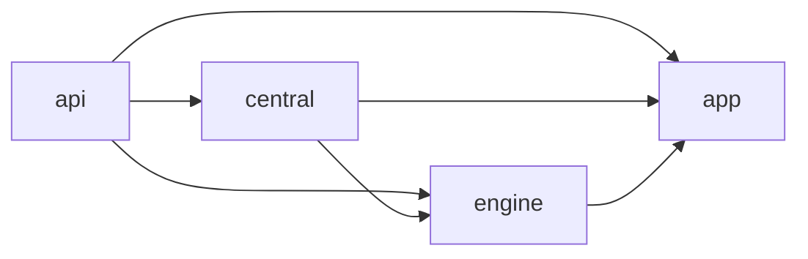
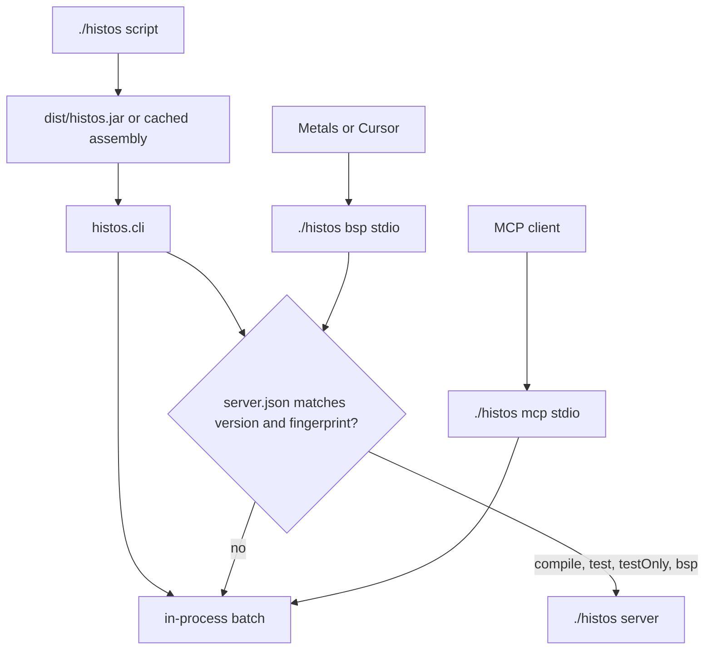
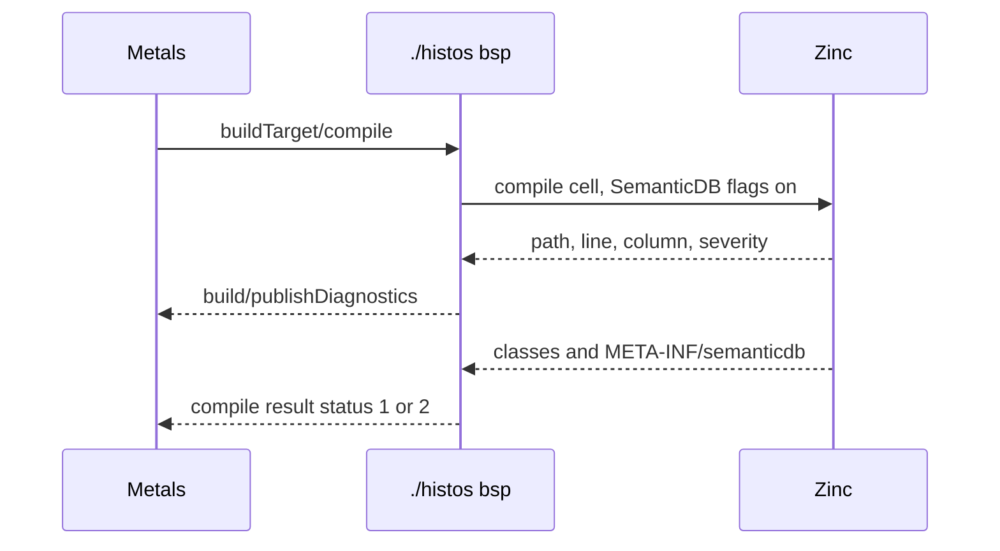

# Histos

**Status:** Draft
**Date:** 2026-10-20
**Org:** early-effect
**Repo:** `early-effect/histos`
**Author:** placeholder

This document describes the tree on main at `c31b8c4` (pull request #41) and the unmerged local branch `histos/plugins` (seven commits, no pull request). It replaces the 2026-10-16 draft. Work that has merged is stated in the present tense. The next stack is the PR plan at the bottom.

The plugin contract stays in [plugins.md](plugins.md). This file only summarizes it. The loader that contract describes is not on main.

## Overview

Histos is a pre-release Scala 3 and ZIO build tool. Evaluating `histos.scala` produces an immutable project graph. Tasks run as ZIO effects. The CLI, BSP, MCP, and ACP call that graph. They do not each grow a second build.

A clone builds with `./histos`. The frozen script verifies a JVM assembly and execs it. The engine is that JVM process. Scala Native is a target platform, not the launcher.

Main already compiles and tests this repository, speaks a thin BSP 2.2 session, and can attach `compile`, `test`, and `bsp` to an opt-in server. The editor cannot live on that session yet: scalac options are empty, diagnostics are dropped, main and test share one target, and there is no target for `histos.scala`. The next stack makes Metals (and therefore Cursor) use the same compile Histos uses, then carries that session to the ascent proof, lands the plugin branch, and generates CI for this repo.

## Background and Motivation

sbt-zipx was the previous build for early-effect libraries. Histos replaces it for a repo that has moved. The build describes CI. Artifact names stay the pin strings catalogs already use. There is no sbt, no scala-cli, and no GitHub Actions workflow in this repository today. The renderer exists. The file does not.

The first dogfood is this repo. It builds itself. The second is a local copy of ascent at `~/projects/early-effect/ascent-histos`. That copy compiles under `./histos`. Its tests, named mains, scalac flags, and publish coordinates are not wired, and it has no pull request. This design does not edit that tree.

Editors are the gap that blocks daily use. Metals keeps a presentation compiler and asks a build server for the classpath, the scalac options, and compile. Histos already writes `.bsp/histos.json`, but the process it starts cannot feed navigation or a test lens. Mill's answer was a BSP server that shares the build's output and daemon, not a VS Code extension and not a Bloop export. That is the path here.

## Goals

- **Effect-native.** Task execution is a ZIO effect with typed errors, resource safety, interruption, and structured concurrency. The graph stores descriptions, not the effects.
- **One task surface.** CLI, BSP, MCP, and ACP inspect the graph, run a task, or cancel a run. Protocol handlers do not contain build logic.
- **Zero-install for a clone.** `./histos` downloads the pinned assembly, and a JDK when no `java` is on `PATH`.
- **Exact Scala.** A module names full versions, such as `3.10.0` or `2.13.16`. A series such as `3` is not a pin.
- **The IDE compiles the way the CLI compiles.** Same Zinc analysis, same lock, same options, aside from flags that must not reach the presentation compiler.
- **Plugins as libraries on `histos.api`.** Enablement is a header the build names. A jar on the classpath does not mutate the build.
- **The build describes CI.** The workflow file is a render. Drift fails the build.

## Non-Goals

- sbt 1.x plugin APIs, AutoPlugin, or `plugins.sbt`.
- A binary-compatibility promise for `histos.api` before 1.0. `LinkStrategy.Api` is a typed refusal. MiMa waits for 1.0.
- Replacing Zinc, the Scala compiler, or Metals' presentation compiler.
- A VS Code extension that owns completion, diagnostics, or the presentation compiler.
- A Bloop export. Compilation must not leave the Histos process.
- Registering Js and Native BSP targets by default. A save must not relink.
- A DAP server and breakpoints in the first test slice.
- Loading `central` through the plugin classloader. It stays an in-tree module.
- Remote execution, a test filesystem or network jail, an sbt importer, and publishing Histos itself.
- A non-snapshot release. Nothing in this stack tags a version.

## Key Decisions

1. **The launcher is the frozen script.** `./histos` and `histos.bat` verify the pinned JVM assembly and exec it. A native image is a second toolchain for a downloader. JDK policy lives in the engine. The script fetches the locked Temurin only when no `java` is on `PATH`. The engine checks the lock again and re-execs if it must. When `dist/histos.jar` is present, the script execs that file instead of a cached launcher.

2. **The engine is a JVM process.** Load, Zinc, Coursier, MCP, the server, and BSP run there. Scala Native `tools` stay out of the assembly. A link fetches the tools for the module's `nativeVersion` and runs them in a child. The engine does not load `scala.scalanative`.

3. **BSP follows Mill's native path, not Bloop and not a custom extension.** `.bsp/histos.json` already names `./histos bsp`. Metals and IntelliJ's Scala plugin spawn that process and speak BSP over stdio. Cursor is the same Metals extension. Histos is not in Metals' hardcoded build-tool list, so there is no Bloop preference to override. The presentation compiler stays Metals'. `scala3-presentation-compiler_3:3.10.0` is the compiler it should load. Histos does not ship one.

4. **Plugins are libraries on `histos.api`.** `contribute` is data. `run` is `ZIO[Scope, PluginRunError, PluginOutput]`. The graph does not store the effect. The spec is [plugins.md](plugins.md). The implementation is `histos/plugins`, unmerged.

5. **The Specular plugin lives in the Specular repo.** This repo's fixture is a fixture. Docs have to be generated from Specular itself, as a Histos module, not from a copy of Specular inside Histos.

6. **JVM-only BSP first.** The default target list is one JVM main cell per module and Scala version, a JVM test cell, and a synthetic target for `histos.scala`. Every module id carries `&platform=jvm`, including while Js and Native are unpublished, so a later allow-list line cannot reuse that URI. Js and Native targets are published only when `.histos/bsp-platforms` names them, and their ids use `&platform=js` or `&platform=native`. That file is absent by default. It is not a field on `Module`. `histos compile` still builds every platform the module names. `buildTarget/compile` passes the platform from the id and does not link.

## As-Built Architecture

### Modules

`histos.scala` is the build. Four JVM modules, Scala `3.10.0`:



`dependsOn` points at the upstream. `central` sees `api`. `engine` sees `central` and `api`. `app` sees all three.

| Module | Path | Role |
| --- | --- | --- |
| `api` | `api/src/histos` | Graph, builder, literals, versions. On main it has no ZIO library dependency. |
| `central` | `central/src/histos/central` | Local Maven publisher. Not a plugin. |
| `engine` | `engine/src/histos` | Load, tasks, scheduler, cache, JDK, Node, Zinc, resolve, test, Js, Native, workflow. |
| `app` | `app/src/histos` | CLI, MCP, ACP, BSP, server. One `ZIOApp`. |

Pinned coordinates in `histos.scala`: ZIO `2.1.27`, Zinc `2.0.4`, Coursier `2.1.26`, `heddle-mcp` `0.12.0`, `zio-cli` `0.8.2`. The tool compiles with `scala3-compiler` `3.10.0`. That compiler loads `histos.scala`. It does not compile the modules. A module compile fetches the compiler the module names. Scala 3 and Scala 2.13 are accepted. Scala 2.12 and older are `CompileError.UnsupportedScala`.

On main, `Loader.load` is `ZIO[Scope, LoadError, LoadedBuild]`. The `Scope` closes the build classloader. The plugins branch widens the environment to `Scope & Resolve & ContentStore` and adds `scan`. BSP work that lands before that branch must keep compiling against the main signature.

```scala
inline def module(name: String, platform: Platform, platforms: Platform*)(
    version: ScalaVersion,
    versions: ScalaVersion*,
): ModuleDef

inline def aggregate(name: String, project: ProjectDef, projects: ProjectDef*): AggregateDef
```

One platform and one Scala version are required. `scala"..."` and `dep"..."` are inline literals. A bad literal fails compilation of the build file. `Projects` returns `Either[BuildError, ProjectGraph]`. The project list is fixed when that value exists.

### Errors

Errors are enums with `message`. They are not `Either[String, _]`, and they do not carry a `Throwable`.

| Enum | Where | What it is |
| --- | --- | --- |
| `BuildError` | `api` | Graph validation. Cycles, duplicate names, mixed catalogs, bad edges. |
| `LoadError` | `engine/load` | Missing build file, compiler text, no `HistosBuild`, broken graph, IO. |
| `TaskError` | `engine/task` | Empty id, no runner, unknown run, version failure. |
| `ResolveError`, `LockError` | `engine/resolve` | Range, checksum, lock drift, missing lock, bad lock line. |
| `CompileError`, `GraphCompileError` | `engine/zinc` | Toolchain, banned jars, diagnostics, unknown cell. |
| `PublishError` | `central` | Bad artifact, escaped path, IO. The publisher returns `IO[PublishError, Published]`. |
| `CliParseError` | `app/cli` | Grammar rejection. |
| `ServerError` | `app/server` | Dead socket, stale fingerprint, bad frame. |
| `RemoteError` | `engine/schedule` | Cache off, read-only, dangling output. |

The plugins branch adds `PluginLoadError` and `PluginRunError`, and `LoadError.Plugin`, `TaskError.Plugin`, `BuildError` cases for duplicate plugins, missing notes, and a `contribute` defect. Those cases are not on main.

`TaskId.Inspect` is `"inspect"`. `TaskId.Versions` is `"versions"`. On main, `TaskKind` is `Inspect`, `Compile`, and `Versions`. A plugin task id is a different string (`plugin/task`) and must not occupy those two.

```scala
trait Tasks:
  def run(id: TaskId): ZIO[Scope, TaskError, Run]
  def cancel(id: RunId): IO[TaskError, Unit]
```

`cancel` interrupts the registered fiber. An unknown id is `TaskError.UnknownRun`.

### Process model



Batch is the default. `./histos test` does not leave a process behind. A successful ZIO `run` is process status 0, so the command exits with its status.

`./histos server` is opt-in. It listens on a Unix socket and writes `.histos/server.json` with `Cli.VersionText` (`histos 0.0.1-SNAPSHOT`) and a fingerprint. BSP's own version field is the bare `0.0.1-SNAPSHOT`. The two strings are not compared to each other. On main the fingerprint is `histos.scala` plus `.histos/dependencies.lock`. The plugins branch also hashes regular files under each header `plugin(path)`. `compile`, `test`, and `bsp` attach when the record matches. A missing server, a dead socket, a different version, or a different fingerprint runs the command in-process. The server calls are `Call.Compile`, `Call.Test`, and `Call.Bsp`. Publish, resolve, workflow, run, and MCP do not attach.

`testQuick` does not attach. It compiles in-process and reads the same on-disk Zinc analysis the server writes. `testOnly` does attach, and `Call.Test` carries project names only. A live server therefore drops the `testOnly` pattern and runs the unfiltered suites. That is a defect. BSP test execution must not copy it.

`./histos mcp` and `./histos bsp` are the processes their clients own. MCP does not attach to the server. BSP does, by splicing stdio, when the fingerprint matches. Frames are `Content-Length` (`app/src/histos/bsp/Frame.scala`), with an 8 MiB body limit. They are not newline JSON.

`./histos ~ <command>` watches sources and reruns. Ctrl-C stops the in-flight work.

Zinc `2.0.4` builds a fresh compiler for every compile. The server exists so Metals and the batch command share a process and the analysis files under `.histos/analysis/<module>/<scala>/<platform>`.

### Compile, test, resolve

Resolution is Coursier as a library (`io.get-coursier::coursier:2.1.26`). The `cs` program is not a resolver. Coursier types stay in the adapter. `Resolve` is the seam tests replace.

A direct revision is exact. A range, or a revision that starts with `latest`, is `ResolveError.Range`. `.histos/dependencies.lock` is the authority. `histos compile` and `histos test` read it and download a missing locked jar. They do not re-solve. `histos resolve --update` and `histos resolve --check` are the network paths. A checksum miss is `ResolveError.Checksum`. A missing lock is `ResolveError.NoLock`.

The artifact suffix is one function of kind, Scala version, and platform: `_3` or `_2.13`, then `_sjs1` or `_native0.5`. Later work must not invent a second scheme. `_native0.5` is the ABI suffix. The toolchain revision is separate. Unset means `0.5.12` (`NativeToolchain.ReleaseRevision`). `HISTOS_NATIVE=ivy-local` or a `file:` URL is only the origin of those jars.

`libraryDependencies` are the compile cell and the pom. `testDependencies` are a second cell, `test <module> <scala> <platform>`, resolved together with the library dependencies. Compile and publish do not read it. An aggregate has no cell.

`histos compile` compiles every platform a module names. Outputs land at `.histos/classes/<module>/<scala>/<platform>`. Sources are `<directory>/src`, or the repository `src` when the graph has one module. `.in(path"...")` sets the directory. `src/test` is tests. A package named `test` under `scala` stays main. Platform directories (`jvm`, `js`, `native`, and the `scala*` aliases) and `scala-2.13` or `scala-3` filter only while they are still layout. `dependsOn` and `Dep.on` are platform-scoped. An unscoped edge applies to every platform the module builds.

Production compiles pass `ScalacFlags.empty`. `GraphCompile.compileVersion` and `ModuleTest.compiledTests` both construct `CompileToolchain(..., ScalacFlags.empty)`. `JvmCompile.compile` calls `compilePrepared` with no plugins. `compileOne` applies `flags.argv ++ extra`, which is `Nil`. The enum has one case, `EncodingUtf8` (`-encoding`, `UTF-8`). Nothing on the compile path passes it. `ZincSpec` constructs the case in samples. BSP `options` is `Nil`, which matches the empty argv, not the unused case. Reporting `-encoding` from the enum would make the IDE compile differently from `./histos compile`. `Module` has no scalac-options field. There is no `-Xfatal-warnings`. The text, when a case is actually held, is produced in `JvmCompile`, not accepted from the build.

A test cell is one subprocess, not one process per case, and not a thread inside the server. The work directory is `.histos/test-work/<module>/<scala>/<platform>`. Test classes are `.histos/test-classes/...`, analysis `.histos/test-analysis/...`. The child environment is `HISTOS_REPO` and `PATH` only (`suiteEnv`). `runtimeClasspath`, `suiteEnv`, `testClasses`, and `testWork` are private. `runtimeClasspath` returns `cell.classes :: (upstream ++ library ++ jars)`. `cell.classes` is the main class directory of the `CompiledCell`. `library` is `JvmCompile.runtime`. `jars` is the module's locked artifacts plus upstream compile jars (`dependencyJars`), with the standard library removed. The module's artifacts are `ClasspathScope.Test` when `testDependencies` is non-empty, otherwise `ClasspathScope.Compile`. That is not a separate "compile jars, then test jars" sort. The JVM that runs is `TestClasspath(testClasses, linked.paths)` in `TestProcess.scala`, so the entries are the test class directory and then that list. A provider run's main class is `ProviderRunner.Main`, after `compiledTests` writes `Provider.scala` and compiles it into the test classes. `compiledTests` passes `ScalacFlags.empty`. The default provider is `TestProvider.Zio` (`zio.test.sbt.ZTestFramework`, library `dev.zio` / `zio-test-sbt`). The engine does not load it. Another provider names a framework class and a test-scoped library. `.test(TestMain(...))` opts out. A main and a provider together are `BuildError.MixedTest`. A module with no test sources reports `no tests`, which is success and not a passing suite.

`histos testOnly` filters by binary name (`*` any run, `?` one character, otherwise exact). `--module` limits the project. `histos testQuick` runs a suite only when its stamp changed or the last result was not a success. `./histos ~ testQuick` repeats that after a save.

Js fast-link and Native link run in a child JVM. The engine does not load the linker. `histos run <module>` starts the class named with `.main`, on the one platform the module builds. A module that builds more than one platform needs the platform argument (`histos run app jvm`). `histos run inspect` and `histos run versions` stay tasks.

The local cache is content-addressed under `~/.cache/histos` (or `XDG_CACHE_HOME`). `histos cache clean` drops JDKs, launchers, and compiled plugin sources unused for 30 days and keeps the current project. Nothing is deleted during a build.

`RemoteCache` defaults to `RemoteMode.Off`. A configured cache is read-only until opened for write. The only implementation in tree is the in-process `Memory` the tests plant. There is no network client. `Sendable.decide` sends a core compile, and a plugin task only when it is `Seal.Hermetic` with an empty `Need` set. Publish, test, `Network`, and `Docker` stay on the machine. `histos compile` does not configure a remote cache. Zinc's analysis file is that command's incrementality.

JDK selection is read-only against `JAVA_HOME`, `PATH`, an existing Coursier or sdkman install, then the Histos cache. Histos does not run `cs java` or `sdk install`. A bare machine gets a private Temurin from `.histos/jdk.lock`. Node follows the same rules and only when a Js task needs it (`.histos/node.lock`). A Native module declares a clang major. Histos checks `clang` on `PATH` and does not provision one. `histos toolchain` and the MCP tool `toolchain` print the same decision.

### BSP today

`.bsp/histos.json` names `./histos bsp`, BSP `2.2.0`, language `scala`. The session is `app/src/histos/bsp/Bsp.scala` and `Rpc.scala`.

What it answers:

| Method | Behavior |
| --- | --- |
| `build/initialize` | Display name `histos`, version `0.0.1-SNAPSHOT`, BSP `2.2.0`. Capability is `compileProvider` for `scala` only. No test, run, or debug provider. |
| `build/initialized` | Ignored. |
| `workspace/buildTargets` | One target per module that builds JVM, per Scala version. Sorted by name, then version. |
| `buildTarget/sources` | One directory item (kind 2) for the source base: `<module>/src`, or the repository `src` when the graph has one module. |
| `buildTarget/scalacOptions` | `options` is `Nil`. Classpath is the Scala runtime, the locked compile jars, and upstream class directories. `classDirectory` is `.histos/classes/<module>/<scala>/jvm`. |
| `buildTarget/compile` | Calls `GraphCompile.runCells`. That passes `platform = None` into `watch`, and `platforms` then returns every platform the module builds. On this repo every module is JVM, so the session looks JVM-only. Status `1` on success, `2` on any `GraphCompileError`. `originId` is echoed. `collected` keeps only `CompileFeed.Done`, so the diagnostic feed is discarded. |
| `build/shutdown`, `build/exit` | Shutdown returns JSON null. `exit` stops the process, status 0 only after shutdown. |

Anything else, including `buildTarget/dependencySources`, `buildTarget/jvmTestEnvironment`, and `debugSession/start`, is `bsp does not handle <method>` (`-32601`).

Each target id is the repository directory URI, the module name, and `?scala=<version>`. Example shape: `file:///.../histos/api?scala=3.10.0`. `ScalaBuildTarget.platform` is `1` (JVM). Tags are `library`. `canCompile` is true. `canTest` and `canRun` are false. Dependencies are upstream JVM modules of the same Scala version. Js and Native cells are omitted from the target list. They are not omitted from `runCells`: a module that also builds Js or Native still compiles those platforms, because `runCells` never passes `Some(Platform.Jvm)`. That compile is `ScalaJs.compile` or `NativeCompile`, not `JsLink` or `NativeLink`. There is no test target, so main and test under that one directory share a target. There is no target for `histos.scala`. A missing lock fails `scalacOptions` as a JSON-RPC error (`-32603`). `compile` folds the same failure into status `2`.

This is enough for Metals to connect. It is not enough for navigation, diagnostics, or a test lens.

### Other protocol surfaces

The CLI is a zio-cli grammar (`app/src/histos/cli/Grammar.scala`) that parses into `Command`. The old note that zio-cli was waiting is false. Roots are `version`, `graph`, `run`, `test`, `testOnly`, `testQuick`, `compile`, `assembly`, `publish`, `mcp`, `acp`, `bsp`, `server`, `toolchain`, `cache`, `resolve`, and `workflow`.

MCP (`heddle`) exposes `graph`, `run`, `cancel`, and `toolchain`. The handler calls `Loader` and `Tasks`. ACP answers `initialize` (protocol version 1, empty capabilities) and rejects every other method. Neither protocol contains build logic.

`histos publish <repository>` writes a local Maven directory for modules the version decision publishes. Development (`-ci`) writes nothing. The artifact id uses the binary suffix. The pom lists library dependencies and published `dependsOn` modules. Credentials and signing are not this publisher. `central` is still that in-tree module.

The version model is the zipx pin strings, as tasks, not as an sbt session. A ship number lives on the catalog. Everyday development compiles `<ship>-ci` and does not publish it. A clean commit stores `<ship>-<12 lowercase hex>-SNAPSHOT`. The default branch also names a `<ship>-SNAPSHOT` pointer, which is not a pin. `manual("app", manual"1.2.3")` states a coordinate and does not read git or `.histos/releases`. One catalog does not mix the two schemes. This repo's `histos.scala` has an empty catalog and no organization, so it does not publish.

`Workflow.render` writes `.github/workflows/ci.yml`. An empty split set is Aggregate and is the default: a `test` job (`./histos test`) and a `workflow` job (`./histos workflow --check`), `contents: read`, `actions/checkout@v4`, no `setup-java`. A non-empty catalog adds `./histos run versions`. This repo has no catalog, so that job is absent. The renderer can emit `--platform` and `--scala` for a matrix. The CLI grammar rejects those flags. This repo's graph uses the default empty set, so the command it would commit is `./histos test`, which the CLI accepts. Do not turn split axes on until the CLI accepts the flags. No workflow file is committed here.

### Plugins, unmerged

`histos/plugins` is seven commits ahead of `c31b8c4`. There is no pull request. Main does not load a plugin.

The spec is still [plugins.md](plugins.md). This summary does not replace those rules. That file's opening sentence, which says the types are absent, is stale. The types are `api/src/histos/plugin`. Its citations of design sections 2, 3, 4, 5.7, and 5.3 through 5.11 refer to the retired 2026-10-16 draft. Those section numbers are gone.

The loader on the branch is `engine/src/histos/load` (`HeaderScan`, `ApiBoundary`, `BuildLoader`). `central` is still not loaded as a plugin. The branch does not match the classloader section of `plugins.md`.

`plugins.md` specifies `BuildLoader`, then `ApiBoundary`, then an api `URLClassLoader` whose URLs are the loader classpath plus ZIO 2.1.27, parented on the platform loader. The engine calls across. That parent is not `getClass.getClassLoader`.

`LoaderLive.open` sets `host` to `classOf[HistosBuild].getClassLoader`, which is the engine loader, and constructs `new ApiBoundary(host)`. `ApiBoundary` loads boundary names from that host (`BuildLoader.scala`). Refusing non-api `histos.*` is implemented (`ClassHome.Refused`). Loading `zio.*`, `scala.*`, and root `histos.*` from the engine loader is not the api `URLClassLoader` the spec names. The plugin pull request closes that gap to the spec. It does not accept the engine loader as the parent, and it does not redesign `HistosPlugin`.

```scala
trait HistosPlugin:
  def id: PluginId
  def contribute: Contribution
  def run(request: RunRequest): ZIO[Scope, PluginRunError, PluginOutput]
```

`contribute` is not a `ZIO`. `Projects` copies `RegisteredPlugin` onto the graph and does not store the trait. A header line `plugin(dep"...")` or `plugin(path"...")` is the enablement. Exact-binary linking compares `ApiDigest` (sha256 of the api jar, resource `META-INF/histos/version`) to the jar this process loads. It does not compare `0.0.1-SNAPSHOT`. `LinkStrategy.Api` is `PluginLoadError.ApiLink`. Source and path plugins compile against the running api. Boundary names are `histos` (no subpackage), `histos.plugin`, `histos.version`, `zio.*`, and `scala.*`. The spec loads those from the api `URLClassLoader`. The branch loads them from the engine loader, which is the divergence above. Every other `histos.*` name is refused.

`histos run plugin/task` and MCP `run` execute that task inside the plugin `Scope`. `Workflow.renderAll` puts `JobWhen.Always` jobs in `ci.yml` and a `JobWhen.Schedule` job in `histos-<job>.yml`. The argv is `./histos run <plugin>/<task>`. The plugin does not write YAML.

The worked example is `engine/test/SpecularFixtureSpec.test.scala`. It is not the Specular repository.

Because `run` mentions ZIO, this branch adds `dev.zio::zio:2.1.27` to the api module. The api jar does not shade ZIO. Plugins depend on `histos.api` only.

## Proposed Design

The next work is editor dogfood, then the plugin series that is already written, then the ascent proof and CI. None of it is a later phase.

### BSP Metals can live on

Metals requires `workspace/buildTargets`, `buildTarget/sources`, `buildTarget/scalacOptions`, `buildTarget/dependencySources`, and `buildTarget/compile`. During compile it reads the notification `build/publishDiagnostics`. The integration page still says `buildTarget/publishDiagnostics`. That name is stale. Metals does not parse it. This server must not emit it.

Diagnostics and formatting work without SemanticDB. Goto-definition and find-references do not. SemanticDB flags go on the compiler argv and on the list `scalacOptions` reports, so the files exist after the compile Metals asked for.

Production argv is empty (`ScalacFlags.empty`). The navigation PR adds one shared list, used by `GraphCompile`, by `ModuleTest.compiledTests`, and by `scalacOptions`: whatever `flags.argv` the toolchain actually holds, then `-Xsemanticdb`, `-sourceroot`, and the absolute repository path. Those SemanticDB flags are appended beside `flags.argv`. They are not `ScalacFlag` cases. `-sourceroot` takes a path, and a parameterless case cannot hold it. Do not report `-encoding` `UTF-8` unless the same PR starts passing `ScalacFlag.EncodingUtf8` into the CLI compile. Today it does not.

| Cell | Flags | Where the files go |
| --- | --- | --- |
| Scala 3 | The shared list. `-Xsemanticdb` and `-sourceroot <absolute workspace>` appended beside `flags.argv`. | `<classDirectory>/META-INF/semanticdb`. No plugin jar. |
| Scala 2.13 | `-Yrangepos` and `-P:semanticdb:sourceroot:<absolute workspace>` on `flags.argv`, plus a `semanticdb-scalac` plugin jar on the compiler classpath. | Same relative layout. |

This repo is Scala `3.10.0` only, so the first PR's cells are Scala 3. The 2.13 row is the rule for a later cell. `compilePrepared` already accepts plugin jars and turns them into `-Xplugin:` on the Scala 3 path (`plugins.map(pluginArg)`). Scala 2.13 drops that list: `invoke` calls `invoke213` without it, and `runZinc213` passes `Nil` as the extra argv while still applying `flags.argv`. A `semanticdb-scalac` jar is a later change to that 2.13 path, not a `ScalacFlag` case and not something `compilePrepared`'s signature alone delivers. The ascent proof file names `3.9.0` only. It does not, today, create a 2.13 BSP cell.

When a later `ScalacFlag` case adds `-Xfatal-warnings`, the CLI `GraphCompile` and the CLI test compile keep it. The copy `scalacOptions` reports, and the argv a BSP compile passes, drop it. The presentation compiler must not see it. The SemanticDB append does not include it.

`CompileFeed.Diagnostic` is a string today. `CollectingReporter.log` stores the `xsbti.Problem` and then calls `hear` with `problem.message` only. `CellNotes.hear` splits that message on newlines. Scalac messages usually do not include the path. The position was already dropped. The navigation PR carries the path and the range from `xsbti.Problem`. It does not parse `problem.message`. `xsbti.Position` exposes `startLine`, `startColumn`, `endLine`, and `endColumn`. Those optionals are 1-based. A BSP range has a start and an end, and both are 0-based. Publish all four, and subtract one from each present number. A missing end, or an end that equals the start, becomes a one-character span on that line. A range whose start equals its end does not paint a squiggle. `xsbti.Severity.Error`, `Warn`, and `Info` map to BSP diagnostic severities 1, 2, and 3. A problem whose position has no source is `build/logMessage`, not a diagnostic with a guessed range.

At the start of each target's compile, publish `build/publishDiagnostics` for that target with `reset: true` and an empty diagnostic list, so Metals drops stale squiggles. Later publishes for that same compile use `reset: false`. The compile result status stays `1` or `2`.

`Session.answer` returns one `Answer` (`Reply`, `Quiet`, or `Stop`). `Cli.speak` and `Daemon.bsp` each write one frame for that answer. A notification is another frame, written while compile is still running, before the result. The navigation PR passes a sink, `String => UIO[Unit]`, into `Bsp.open`. `speak` implements it with `Frame.write`. The server splice implements it with the writer `Daemon.bsp` already uses. The session calls the sink from the fiber that is collecting the feed. `hear` runs on the compiler thread (`JvmCompile.compile`). Do not write a frame from `hear`. `answer` still returns the compile result as one `Reply`.

`runCells` is the wrong entry. It passes `platform = None`, and `collected` keeps only `CompileFeed.Done`. `GraphCompile.console` is also the wrong entry. It calls `watch` with `only = None`, so every Scala version of the named modules is compiled, even when `platform` is `Some(Platform.Jvm)`. `watch` is private. It takes `picked: Either[GraphCompileError, List[Module]]`. That list is what `layersOf` schedules.

The navigation PR adds `GraphCompile.cellFeed(repo, graph, cells, platform, jdk): ZStream[Resolve, GraphCompileError, CompileFeed]`. `platform` is required. `None` is how `console` compiles every platform, so this entry does not offer it. The stream passes `Some(platform)` and the version set `runCells` already computes (`Some(cells.map(_._2.value).toSet)`) into `watch`, and it does not call `collected`. `picked` is the requested modules plus the upstream closure `upstream` already returns. `chooseCells` returns that list after its check. Passing only the requested modules is the wrong list. A JVM `buildTarget/compile` calls `cellFeed` with `Platform.Jvm` and the versions on the requested ids.

`compileLayers` starts from an empty `done` map and records a class directory only when that module is compiled inside the same call. `GraphCompile.upstreamClasses` reads that map and returns `MissingUpstream` when the dependency is absent. It does not read `.histos/classes`. A directory left by an earlier BSP request does not satisfy it. `layersOf` treats a dependency outside `picked` as already satisfied (`!names.contains(dependency)`), so a short list compiles the requested module immediately and then fails in `upstreamClasses`. A save of `engine` includes `api` and `central` in `picked`. `layersOf` compiles them first, and their class directories are in `done` when `engine` compiles.

`chooseCells` is not that picker. Its `known` requires `Platform.Jvm` and otherwise returns `UnknownCell`. A Js-only module would fail it. `cellFeed` keeps the closure and replaces that check: each requested module must build the `platform` argument and the requested Scala version, or the result is `UnknownCell`. The navigation PR only publishes JVM, so the check is JVM there. Item 3 passes `Platform.Js` or `Platform.Native` through the same method. Do not call `chooseCells`.

A test id does not use `cellFeed`, and it does not call `GraphCompile.run` or `ModuleTest.console`. `ModuleTest.console` calls `GraphCompile.run` with no platform, which compiles every platform and then runs suites. The test compile calls `compiledTests`. That method is unqualified `private` on `object ModuleTest` today (`ModuleTest.scala`, around line 721). `Bsp` is `package histos.bsp` and cannot see it. PR 1 widens it to `private[histos]` and keeps the signature: `CompiledCell` and the test sources, plus the repo, modules, module, JDK, lock, and repositories it already takes. It reads `cell.classes`, `cell.version`, and `cell.platform`. It does not read `classFiles`, and it does not compile main sources. Build the cell as `CompiledCell(name, version, platform, GraphCompile.classesDir(repo, name, version, platform), 0)`. The classes directory is the main output. Metals has already compiled the main id, because the test id depends on it. `compiledTests` then writes `.histos/test-classes` with the shared SemanticDB list and publishes the same structured diagnostics. It does not run the test.

Loader diagnostics are a second grammar. The build file is compiled by dotty `Driver` and `StoreReporter`, not by Zinc. The code today keeps `error.message` only. `LoaderLive.rewrite` already replaces the temp path with `histos.scala`. Scala 3.10 `SourcePosition.line`, `column`, `startLine`, `startColumn`, `endLine`, and `endColumn` are 0-based. `showLineColumn` prints `line + 1` and `column + 1`. Subtracting one places the squiggle on the previous line. Publish those four numbers unchanged. A point span, where start equals end, gets the same one-character extension as a Zinc range with no end. `Diagnostic.level` is the `scala3-interfaces` constant, not a BSP severity and not `xsbti.Severity`: `ERROR` is 2, `WARNING` is 1, `INFO` is 0. Map those to BSP severities 1, 2, and 3. Do not copy `level` through. The published URI is workspace `histos.scala`, after `rewrite`. Do not parse the message for a file name. A diagnostic with no position is `build/logMessage`.

`buildTarget/dependencySources` may download. It does not add a `source` line to a module cell. `DependencyLock.sourceOnly` returns `LockError.BadLine` for a `source` line on an open module cell, and it accepts one only on a plugin cell. `histos compile` and `histos test` stay lock readers. This request is the exception.

For each locked artifact on the target's cell, call `Resolve.sources` with that artifact's organization, name, revision, and `LockedArtifact.repository`. No other repository, and no fallthrough. `Resolve.sources` returns a digest. There is no module source checksum to compare, so this request does not refuse on digest. A `ResolveError.NotFound` omits that jar. The BSP item is `{ target, sources: Uri[] }`. A missing jar is absent from `sources`. It is never an empty string. The import still succeeds. Adding checksummed module `source` lines would be a lock-format change, and `sourceOnly` would have to start accepting them. That is not this PR.

`JvmCompile.runtime` is not a lock line. `Scala3.runtimeOf` returns `scala-library` when the library is merged, and `scala-library` plus `scala3-library` when it is not. Metals goto-definition into the standard library needs those sources. Request one sources jar per runtime jar from `Repository.Central` only, through the same `Resolve.sources`. Omit a miss. That Central request is not a fallthrough from a lock line. Do not add a second classifier client, and do not add a lock line for the standard library in this PR. The coordinate is `org.scala-lang` / `scala-library` / the Scala version, and `org.scala-lang` / `scala3-library_3` / the Scala version only for the legacy second jar `runtimeOf` already distinguishes.

Targets for this repo. Match `?build=histos.scala` before any module id. A module id must carry both `platform` and `scope`. Missing either is an unknown target, not a silent JVM main. `cellOf` reads those two tokens. Today's `Cell` is only a module and a Scala version. The session cell gains the platform.

| Target | Id | Sources | Classpath and class directory |
| --- | --- | --- | --- |
| Main, one per module, Scala version, and platform | `directoryUri(repo)`, the module name, `?scala=<version>&platform=jvm&scope=main` | Kind 1 file URIs from `Sources.select` on `GraphCompile.sourceBase`. Not the directory. `sourceItem` today returns that directory as kind 2, and the directory contains `src/test`. `Sources.select` already skips `src/test`. | `scalacOptions.classpath` stays `JvmCompile.runtime`, the locked compile jars, and upstream class directories (`Bsp.classpath`). `classDirectory` is `.histos/classes/<module>/<scala>/jvm`. `dependencies` are the upstream main ids, same query, `&platform=jvm&scope=main`. Today's `dependencyUris` has no scope and no platform. Tag `library`. `canCompile` true. |
| Test, one per module, Scala version, and platform that has test sources | The same prefix with `&platform=jvm&scope=test` | Kind 1 file URIs from `ModuleTest.testSources`, widened to `private[histos]`. That walks `Sources.tests` on the source base, plus `Sources.select` on the sibling root from `testBase`: `<module>/test`, or the repository `test` when the graph has one module. Tests are not only `src/test`. An empty list means no test target. | `scalacOptions.classpath` reports the `runtimeClasspath` order and does not call it: main class directory (`classesDir`), upstream class directories from `Module.chain`, `JvmCompile.runtime`, then the locked-jar tail described above. A missing directory is still named. Do not call `ModuleTest.upstreamClasses`. `classDirectory` is `testClasses`, widened to `private[histos]`: `.histos/test-classes/<module>/<scala>/jvm`. `dependencies` is the one main id of the same module, Scala version, and platform. Tag `test`. `canTest` stays false until the test-run PR. |
| `histos.scala` | `directoryUri(repo) + "?build=histos.scala"`. No module name. Today's module id is `directoryUri(repo) + name + "?scala=" + version` (`Bsp.targetUri`). This query is matched first, so it cannot collide with `cellOf`. | Kind 1, that file. | See below. |

`Bsp` is in `app`. It reaches engine helpers only when they are `private[histos]`, which is how it already calls `JvmCompile.scalaJars` and `GraphCompile.classesDir`. `testSources`, `runtimeClasspath`, `testClasses`, and `compiledTests` are private today. PR 1 widens those four to `private[histos]`. `suiteEnv` and `testWork` stay private until PR 2. `runtimeClasspath` stays the helper for `compiledTests` and for `jvmTestEnvironment`. Test `scalacOptions` does not call it.

`buildTarget/scalacOptions` is an import request. Metals sends it before any `buildTarget/compile`. `Bsp.options` is `ZIO.foreach` over the requested targets, so one failure fails the reply. `ModuleTest.upstreamClasses` walks `Module.chain`, which is upstream only, and fails `MissingUpstream` when a `dependsOn` class directory is not a directory. `runtimeClasspath` then prepends `cell.classes` with no such check. On a tree with no `.histos/classes`, `api` would succeed and `central`, `engine`, and `app` would fail the import. Name the directories instead, the way `Bsp.classpath` already names a main target's upstream class directory without checking that it exists. Main `scalacOptions` keeps that `Bsp.classpath` order (`JvmCompile.runtime`, locked compile jars, upstream class directories). The test report uses the `runtimeClasspath` order. `MissingUpstream` stays on `compiledTests` and on the test run.

The test-to-main edge is for that later compile. Metals orders `buildTarget/compile` from `BuildTarget.dependencies` (`BuildTarget.getDependencies`). After the main id and the upstream main ids have been compiled, the directories exist and `runtimeClasspath`'s check passes. The edge does not make the import request safe. The test compile does not call `GraphCompile.run` to paper over a missing directory. `GraphCompile.upstreamClasses` is a different check: it reads the in-call `done` map, not the disk, which is why `cellFeed` passes the upstream closure.

Two classpaths, and they are not the same field. `ScalaBuildTarget.jars` is the compiler classpath Metals uses to load `scala3-presentation-compiler`. `Bsp.target` already fills it from `JvmCompile.scalaJars` (compiler jars plus the runtime they linked). The build-file target keeps that, for Scala `3.10.0`. Do not put the api jar in `jars`.

`scalacOptions.classpath` on the build-file target is the user classpath the loader uses to compile `histos.scala`. On main (`c31b8c4`) `LoaderLive.classpath` is the api jar plus the code source of `scala.collection.immutable.Nil` (`scala-library`) and the code source of `scala.quoted.Quotes` (`scala3-library`), distinct. The comment in that file says the build compiles against the api jar and the Scala libraries. After the plugin branch, `Boundary.jars` is the user classpath: that list plus ZIO, `zio-stacktracer`, and `izumi-reflect`. It is never the engine jar, and it is not `ScalaBuildTarget.jars`.

`Bsp.open` today is `(repo, graph, jdk)`. It does not take this list. `bspLocal` holds `apiJar` and does not pass it. `Daemon.bsp` calls `Bsp.open(repo, graph, jdk)` only. `serve` holds `apiJar` and drops it before `Daemon.open`. The navigation PR adds `Loader.buildClasspath(apiJar): IO[LoadError, List[Path]]` on the `Loader` trait, because `bspLocal` has the service and cannot call a method that exists only on `LoaderLive`. `JvmCompile.scalaJars` can stay `private[histos]` on the object. This one cannot. On main the list is the api jar and the two Scala libraries. The plugin branch implements the same method with `Boundary.jars` and must not narrow it back to the api jar. `bspLocal` and the server both pass that list into `Bsp.open`, with the notification sink. `histos.api` does not change. `Bsp.open` does.

`ScalacOptionsItem.classDirectory` is required. For this target it is the repository directory. The loader compile does not write module classes there, and this target is not a Zinc cell under `.histos/classes`. `canCompile` is true. `canTest` and `canRun` stay false. `buildTarget/compile` on this id reruns the loader compile and publishes diagnostics through the dotty path above.

`canTest` on the test target stays false until the test-run PR. Advertising a test button that has no environment is a lie. The test tree is still compiled with the shared SemanticDB list in this PR, because a later gutter discovers suites from that compile.



The proof is opening this repo in VS Code and in Cursor. Metals Doctor is the check. The three bars are separate. Completion in `histos.scala` is the user classpath above (`Loader.buildClasspath`), with `ScalaBuildTarget.jars` still `JvmCompile.scalaJars`. A squiggle on a module file is the Zinc range above (1-based start through end, then minus one, at least one character). A squiggle on `histos.scala` is the dotty range unchanged (already 0-based) with `ERROR` mapped from 2 to BSP severity 1. Neither is a parsed message. Goto-definition on a project symbol needs the SemanticDB files from the shared list. A marketplace Metals from before the `3.10.0` pin may call that compiler a future version. If Doctor warns, pin `metals.serverVersion` to a build that fetches `scala3-presentation-compiler_3:3.10.0`. That is a settings pin, not a compiler we write. Record the bsp trace. That trace does not choose the test protocol. Item 1 sets `canTest` false, so Doctor does not send `debugSession/start` or `jvmTestEnvironment`.

### One JVM test from the editor

Current Metals (`DebugProvider.startDebugSession`) sends `debugSession/start` to the build server only when the server is a debugging provider or sbt. Otherwise Metals starts its own DAP server and reads `buildTarget/jvmTestEnvironment` for the classpath, the working directory, and the environment. metals#7544 is the pull request (June 2025) that records that split and that Metals applies those environment variables. It is not an issue number. This is the Mill path, and it is the protocol this slice implements. The navigation dogfood cannot choose it: item 1 sets `canTest` false, and Doctor does not send either request.

`buildTarget/scalaTestClasses` is deprecated in the BSP Scala extension in favor of `jvmTestEnvironment`. `buildTarget/test` is the generic BSP request. Code lenses and Test Explorer do not use it as the path that actually starts the process.

This slice does not advertise a debug provider. It implements `buildTarget/jvmTestEnvironment` for the JVM test target. Metals has already compiled that target, so the test classes and their SemanticDB files exist. The environment request does not compile.

| Field | Value |
| --- | --- |
| `classpath` | The test class directory (`.histos/test-classes/<module>/<scala>/jvm`), then the `runtimeClasspath` list: main class directory, upstream class directories, `JvmCompile.runtime`, then the locked-jar tail. This request runs after compile, so the directory check is the right one. `runtimeClasspath` and `testClasses` are already `private[histos]` from PR 1. This request widens `suiteEnv` and `testWork`. Do not copy any of the four. `runtimeClasspath` alone starts at the main class directory and has no test classes. |
| `workingDirectory` | `testWork`: `.histos/test-work/<module>/<scala>/jvm` |
| `environmentVariables` | `suiteEnv`: `HISTOS_REPO` and `PATH` only |
| `jvmOptions` | Empty. This repo has none. |

Metals then runs `TestSuiteDebugAdapter`, not `ProviderRunner`. Suite discovery uses the presentation compiler (`discoverTests` / `buildTargetClasses.getTestClasses`), which needs the SemanticDB files the navigation PR writes on the test compile. `zio-test-sbt` has to be on that classpath. A module on `TestProvider.Zio` already fails with `ModuleTestError.ProviderDependency` unless that library is a test dependency, so the locked test jars include it when the provider check would succeed. Do not add a second copy. Do not put the generated `Provider.scala` on this classpath. Metals is not launching `ProviderRunner.Main`. If the provider check would fail, the environment request fails with that error. It does not invent a classpath that cannot load the framework.

The proof is one JVM test from VS Code and from Cursor. Breakpoints stay out. There is no JDWP listener and no DAP implementation. If a later trace shows `debugSession/start`, the only honest follow-up is a real DAP server. This stack excludes that. Do not answer with a URI and no listener. Metals calls `connect(uri)` on the result and times out.

### Ascent's JVM modules, then Js and Native

The same session, pointed at `~/projects/early-effect/ascent-histos`, lists JVM targets the way this repo's targets work. That file registers 26 modules, all on Scala `3.9.0`. Nine of them build JVM, Js, and Native. Registering every platform would hand Metals a save-time matrix, and a Native target would relink. Mill did that. Histos does not.

Js and Native targets are omitted unless `.histos/bsp-platforms` names them. The file is repo-local. Absent or empty means only `Platform.Jvm` is published. A line is `js` or `native`. It is not a field on `Module`, not an environment variable, and not a graph flag. `histos compile` does not read it and still builds every platform the module names. The ascent `histos.scala` stays unchanged.

The allow-list adds targets. It does not reuse the JVM URI. A `js` line publishes `&platform=js&scope=main`, and `&scope=test` when that module has test sources. A `native` line uses `&platform=native`. Both lines can be present. `buildTarget/compile` passes the platform token into `GraphCompile.cellFeed`, with the version set from the requested ids. `picked` is still the requested modules plus their upstream closure, and the check is that each module builds that platform. A JVM save passes `Platform.Jvm` only and does not compile Js or Native. An allowed Js or Native target runs the compiler `GraphCompile` already runs for that platform and does not call `JsLink` or `NativeLink`. Linking stays on `histos run` and `histos test`. Do not implement that compile with `runCells`, `console`, or `chooseCells`. A save compiles the targets that were published, and each call compiles its upstream closure inside that call. Targets that were not published cannot be relinked.

Metals can index Scala platform 2 (JS) and 3 (Native). Running them needs a DAP forwarder (Metals pull request 5197). That forwarder is not this stack.

The default path does not require an edit to the ascent copy. The allow-list is new in this repo, covered by a fixture here: a Js or Native target compiles and does not link. Opening the ascent copy, with the file absent, is the manual proof that a save stays on JVM.

### The plugin series

Do not redesign it. Open the existing `histos/plugins` commits as a pull request. The review surface is [plugins.md](plugins.md) and the code on that branch. `central` stays in-tree. Those commits do not match the classloader section. The pull request closes that gap to the spec: an api `URLClassLoader` parented on the platform loader, and the engine calls across. It does not keep `classOf[HistosBuild].getClassLoader` as the boundary host. It does not redesign `HistosPlugin`, the header, or the task id.

Waiting to open that pull request until the BSP pulls are up is stack order. It is not a compile break. The branch already edits `JvmCompile.jarBan` (it also bans `ClassMarker.PluginEntry`). The navigation PR edits `JvmCompile.scala` and adds `Loader.buildClasspath`. Rebase across both. A stalled editor dogfood does not block that rebase.

### Specular

After that PR is merged, the Specular repository gains a Histos module that is a `HistosPlugin`. It contributes a docs task and a CI job. It is not an sbt AutoPlugin, and it is not this repo's fixture. Specular pins the snapshot of `histos.api`. This stack does not cut a release so that compile can happen. This design pass does not edit the Specular tree.

### Ascent proof

The local copy compiles. It does not name test dependencies, a test provider, a main class, scalac flags, an organization, or a catalog. The proof PR wires tests, named mains, and scalac flags, then `./histos compile` and `./histos test` on that tree. Central publish stays out.

`Module` has no flag field, and `ScalacFlag` has only `EncodingUtf8`, which production does not pass. The flag text stays produced by the engine. The PR adds cases for the flags that proof needs. It does not take an open `List[String]` from the build file. It depends on the navigation PR, because both change compiler argv. `-Xfatal-warnings`, if one of those cases, stays on the CLI argv and is dropped from the BSP copy of the shared list. The SemanticDB append stays beside `flags.argv`, not a new case.

### CI for this repo

The renderer already exists. Generate `.github/workflows/ci.yml` from this graph and commit it. The drift check is `./histos workflow --check`. The graph has empty splits and an empty catalog, so the file is the aggregate `test` job and the `workflow` job. Do not enable split axes in that PR. Do not add a publish job. A file repository is not a release.

### Scala.js host, after the BSP loop is daily

A later module in this repo follows the groks-beard host shape (`~/projects/early-effect/groks-beard`, project `host` in `build.sbt`). Only that module imports `vscode`. It is Scala.js, `ModuleKind.CommonJSModule`, and a `packageVsix` task: full link, then `vsce package`. It is not a `HistosPlugin`. It does not own completion, diagnostics, or the presentation compiler. Commands call BSP or the CLI. It waits until the BSP loop from the first PRs is in daily use. It does not wait on Specular or on the CI file. This design pass does not edit groks-beard.

## API / Interface Changes

`histos.api` does not change in the navigation PR. `Loader` gains `buildClasspath(apiJar): IO[LoadError, List[Path]]`. On main that is the api jar, `scala-library`, and `scala3-library`. `Bsp.open` gains that list and the notification sink. BSP gains `buildTarget/dependencySources` and the structured `build/publishDiagnostics` notifications the session currently cannot emit. Item 1 adds `GraphCompile.cellFeed`. Its `picked` is the requested modules plus the upstream closure, and its check is that the module builds `platform`, not `chooseCells`'s `Platform.Jvm` test. It widens `testSources`, `runtimeClasspath`, `testClasses`, and `compiledTests` to `private[histos]`. The test compile calls `compiledTests` with a `CompiledCell` built from `classesDir` and `classFiles = 0`. The signature still takes that cell and the test sources. Test `scalacOptions` names the `runtimeClasspath` order and does not call `upstreamClasses`. `suiteEnv` and `testWork` stay private until the test PR.

The test PR adds `buildTarget/jvmTestEnvironment` and sets `canTest` on the JVM test target. It widens `suiteEnv` and `testWork` to `private[histos]`. `runtimeClasspath`, `testClasses`, and `compiledTests` are already visible. It does not add `debugProvider`. It does not wait on a trace.

The ascent BSP PR reads `.histos/bsp-platforms`. Absent or empty publishes JVM only, and those ids still say `&platform=jvm`. A `js` or `native` line publishes that platform under its own id. There is no platform flag on `Module`. `buildTarget/compile` passes the platform token into `cellFeed`, with the upstream closure in `picked`, and does not link. It does not call `chooseCells`.

The plugin PR is the branch that already changed `Loader`, `BuildError`, and the api classpath, rebased across `JvmCompile.jarBan` and `Loader.buildClasspath`. It closes the classloader gap to `plugins.md`. Do not reshape `HistosPlugin`. Do not narrow `buildClasspath` back to the api jar. On that branch the method is `Boundary.jars`.

The ascent proof adds `ScalacFlag` cases and a place on `Module` to name them. `module` and `aggregate` keep the signatures above.

The editor module is new and isolated. It does not change `histos.api`.

## Data Model Changes

No new on-disk layout for classes, analysis, or the dependency lock. SemanticDB files appear under the class directory that compile already writes. The test target points at `.histos/test-classes`, which test already writes.

`buildTarget/dependencySources` does not add a `source` line to module cells. It may download a sources jar from the repository on that lock line, and a standard-library sources jar from `Repository.Central`. A miss is omitted. Plugin `source` lines stay as they are on the branch.

`.histos/bsp-platforms` is the BSP allow-list. The file is absent by default. `histos compile` does not read it. `.gitignore` does not ignore the whole `.histos` directory. This repo does not commit the file. JVM-only is the absent file, not a committed empty one.

The CI PR adds `.github/workflows/ci.yml`. That is the first workflow file in this repo. `.bsp/histos.json` stays. Its argv stays `./histos bsp`.

The server record stays `.histos/server.json`. The fingerprint function does not grow in the BSP PRs.

## Alternatives Considered

### Bloop export

Mill's path A, still called preferred on Metals' Mill page: `mill.contrib.bloop.Bloop/install` writes Bloop JSON, and Bloop compiles outside Mill. Histos rejects it. The IDE would compile with a different compiler invocation, a different analysis file, and a different classpath story than `./histos compile`. Two compilers is how "it works in the editor" becomes a bug. The cost of a native BSP session is the work in the PR plan. The cost of Bloop is a second build.

### A Scala.js VSIX as the language client

groks-beard shows the shape: one host module, CommonJS, `packageVsix`. That module can call commands. It cannot be the Scala language client. Completion, hover, and goto-definition are Metals' presentation compiler plus the classpath this server reports. An extension that spoke LSP itself would reimplement Metals and still need a build server. Cursor would need a second client. Mill wrote no Cursor-specific code. Neither do we. The VSIX, when it exists, is a command surface on top of a BSP loop that is already daily.

### A Histos presentation compiler

Metals already loads `scala3-presentation-compiler_3` for the Scala version the target reports. Metals main pins `latestScala3Next` at `3.10.0`, and that artifact is on Maven Central. A marketplace build from before the pin may warn. The fix is `metals.serverVersion`, checked in Doctor. Writing a presentation compiler would fork the Scala 3 compiler UI, ship it inside Histos, and still not be what Metals calls. It loses on maintenance and on the decision that Metals owns editing.

### `buildTarget/test` as the only test method

It is a real BSP request, and it would not make a code lens run. When the server has no debug provider, Metals starts its own DAP server and reads `jvmTestEnvironment`. Implementing only `buildTarget/test` fails the proof. `buildTarget/scalaTestClasses` is the deprecated list and is not the contract. Answering `debugSession/start` with no listener also fails it: Metals calls `connect(uri)`.

## Security and Privacy Considerations

The trust boundary is the local user. BSP, MCP, and ACP are stdio. The server is a Unix socket in the repo, gated by a fingerprint, not by a credential. Anyone who can connect to that socket can compile. Do not bind it to a network interface.

The launcher refuses to exec an assembly whose sha256 does not match `.histos/assembly.sha256`. The dependency lock refuses a jar whose bytes do not match. A download uses the repository the lock recorded and does not fall through to another. `buildTarget/dependencySources` is the exception that may download a sources classifier. A locked artifact uses `LockedArtifact.repository` only. `JvmCompile.runtime` uses `Repository.Central` only. Neither path tries a second repository. A miss is omitted from `sources`. It is not a blank URI, and it is not a failed import. There is no module source checksum to refuse on.

The test child sees `HISTOS_REPO` and `PATH` only. That is not a jail. Tests are not sendable. Publish writes a local directory and does not take a password. `RemoteCache` has no network client. A future client must keep using `Sendable.decide` and must not upload tests, publish, or a plugin task that declares `Network` or `Docker`.

On the plugin branch, `ApiBoundary` refuses `histos.*` outside the api surface. A plugin that links `histos.schedule` or `histos.zinc` fails the load. The boundary host is the engine loader, which `plugins.md` rejects. The plugin PR parents the api `URLClassLoader` on the platform loader and calls across. Project compiles reject a jar that contains `HistosBuild`. The branch also rejects a jar that contains `ClassMarker.PluginEntry` (`JvmCompile.jarBan`). Plugin classes stay on the build classloader.

This stack adds no telemetry.

## Observability

Compile prints one cell at a time: diagnostics, then `<module> <scala> <platform>` and the class directory. Test streams the framework's tree and closes with a summary line. `histos toolchain` and MCP `toolchain` print the JDK decision, and Node or clang when the graph needs them. The server prints its socket path and then waits.

There is no metrics pipeline. Do not add one in these PRs. The editor signal is `build/publishDiagnostics`, carrying the path and the start-to-end range from `xsbti.Problem`, plus Metals Doctor. The build file uses the 0-based dotty range instead. `reset: true` at the start of a target's compile drops stale squiggles. The dogfood trace is `~/Library/Caches/org.scalameta.metals/bsp.trace.json` on macOS (Metals reads it after a restart). The test PR does not read that trace to pick a protocol. `jvmTestEnvironment` is the protocol. A trace that later shows `debugSession/start` means a real DAP server, which this stack excludes.

BSP today returns status `1` or `2` and drops the feed. `CollectingReporter` already stored the `xsbti.Problem` and then published only `problem.message`. Until the navigation PR, a failed compile in the editor is a status code with no squiggle.

## Risks

| Risk | Severity | Mitigation |
| --- | --- | --- |
| A marketplace Metals treats Scala `3.10.0` as a future version and will not load the presentation compiler. | Medium | Doctor is the check. Pin `metals.serverVersion` to a build that fetches `scala3-presentation-compiler_3:3.10.0`. Do not fork the presentation compiler. |
| Diagnostics are published under the stale method name `buildTarget/publishDiagnostics`. | High if wrong | Emit `build/publishDiagnostics` only. A BSP fixture asserts that method string. The integration page is not the spec. |
| Js and Native targets reuse the JVM id, or a save compiles every platform or every Scala version. | High if wrong | Every module id carries `&platform=` and `&scope=`. `.histos/bsp-platforms` absent publishes JVM only. `buildTarget/compile` calls `cellFeed` with that platform, the requested versions, and the upstream closure in `picked`. It does not call `console` (`only = None`), `runCells` (`platform = None`), or `chooseCells`. It does not call the linker. The ascent proof file is 26 modules, nine of them three platforms. |
| A save passes only the requested module, or test `scalacOptions` calls `runtimeClasspath` on import. | High if wrong | `compileLayers` starts from an empty `done` map. `GraphCompile.upstreamClasses` does not read disk, so `picked` includes the upstream closure and `layersOf` compiles it first. Test `scalacOptions` names the `runtimeClasspath` order and does not call `ModuleTest.upstreamClasses`. `Bsp.options` is `ZIO.foreach`, so one `MissingUpstream` fails the import. That error stays on `compiledTests` and the test run. `jvmTestEnvironment` still calls `runtimeClasspath` after compile. |
| `histos/plugins` is described as merged, or as already matching `plugins.md`, or redesigned. | Medium | The loader is not on main. The PR is those seven commits, rebased across `JvmCompile`, and it closes the classloader gap to the spec. It does not accept the engine loader as the parent. `central` stays in-tree. |
| The ascent copy is treated as a finished dogfood. | Medium | It compiles. Tests, mains, flags, and publish coordinates are unwired. No pull request. This pass does not edit it. Central publish stays out of the proof. |
| `testOnly` against a live server ignores the pattern, because `Call.Test` has no pattern field. | Low | Recorded above. BSP uses `jvmTestEnvironment` and the suite Metals names. Do not route editor tests through `Call.Test`. |
| A matrix workflow is committed before the CLI accepts `--platform` and `--scala`. | Low | The CI PR commits the aggregate render only. |

## Rollout Plan

There is no flag service. Opt-in is the existing pattern: the server, the remote cache, and `.histos/bsp-platforms`.

1. Land the navigation PR. `.bsp/histos.json` does not change. Metals reconnects to the same argv. Dogfood this repo in VS Code and Cursor before the next PR. The trace is a record. It does not pick the test protocol.
2. Land the test PR. It implements `jvmTestEnvironment` and does not wait on that trace. Roll back by reverting. The old session returns `-32601` for the new methods, which is the behavior on main today.
3. Point the same binary at the ascent copy. Leave `.histos/bsp-platforms` absent. Confirm a save compiles JVM only and does not link.
4. Open the plugin PR from the existing branch, rebased across the BSP edits to `JvmCompile` and `Loader.buildClasspath`. Close the classloader gap. Do not retarget it onto a rewrite.
5. Specular consumes a snapshot. No tag.
6. Wire the ascent proof and run `./histos test` there. No Central publish.
7. Commit the generated workflow. Drift fails a hand edit. The launcher provisions the JDK. The workflow does not call `setup-java`.
8. The VSIX waits until step 1 is daily. It is installed by the user. It is not required to compile.

A bad BSP PR breaks the editor until revert. That is why navigation and test execution are separate pulls.

## Open Questions

None. Test launch is `buildTarget/jvmTestEnvironment`, with test classes prepended, decided in the test section. Sources jars may download from the lock's repository, decided in the navigation section. Js and Native BSP visibility is `.histos/bsp-platforms`, decided in the ascent section.

## References

- [plugins.md](plugins.md), the plugin spec. The implementation is the unmerged `histos/plugins` branch.
- [plan.md](plan.md), the landed note and the next stack.
- `.bsp/histos.json`, `app/src/histos/bsp/Bsp.scala`, `Rpc.scala`, `Frame.scala`.
- `engine/src/histos/zinc/JvmCompile.scala` (`ScalacFlags`, `scalaJars`, `runtime`, `compilePrepared`, `runZinc213`, `CollectingReporter`), `GraphCompile.scala` (`CompileFeed`, `runCells`).
- `engine/src/histos/testrun/ModuleTest.scala` (`runtimeClasspath`, `compiledTests`, `suiteEnv`, `testSources`), `TestProcess.scala` (`TestClasspath`).
- `engine/src/histos/load/Loader.scala` (main `classpath` at `c31b8c4`, `rewrite`, `open`), `Boundary.scala` (`jars`), `BuildLoader.scala` (`ApiBoundary`).
- `engine/src/histos/resolve/Resolve.scala` (`sources`), `DependencyLock.scala` (`sourceOnly` rejects a module cell).
- Metals, integrating a new build tool: <https://scalameta.org/metals/docs/integrations/new-build-tool>. The diagnostic method on that page is stale.
- BSP Scala extension: <https://build-server-protocol.github.io/docs/extensions/scala>. `buildTarget/scalaTestClasses` is marked deprecated in favor of `buildTarget/jvmTestEnvironment`.
- metals#7544, the two test-launch paths. Metals pull request 5197, the non-JVM DAP forwarder.
- Mill: `./mill --bsp-install` writes `.bsp/mill.json` (Mill since 0.9.3). `build.mill` is itself a target. Path A, Bloop install, compiles outside Mill.
- groks-beard host and `packageVsix`: `~/projects/early-effect/groks-beard/build.sbt`.
- Ascent proof, local only: `~/projects/early-effect/ascent-histos`. Not the ascent repository. No pull request.

## PR Plan

Ordered. Each pull is reviewable on its own once its dependencies have merged. Item 1 of the stack is two pulls: navigation, then one JVM test. The test protocol is already `jvmTestEnvironment`. The split is so a bad test slice can revert without taking navigation with it. The order is the order to open them. The plugin series waits on that order. The wait is not a compile break.

### 1. BSP navigation for this repo

**Depends on:** main at `c31b8c4`.

**Files:** `app/src/histos/bsp/Bsp.scala`, `Rpc.scala`, `app/src/histos/cli/Cli.scala` (`bspLocal` passes the classpath and the sink), `app/src/histos/server/Daemon.scala` (the splice does the same), `app/test/BspSpec.test.scala`, `engine/src/histos/load/Loader.scala` (`buildClasspath`), `engine/src/histos/zinc/JvmCompile.scala` (shared argv beside `flags.argv`, structured problems), `GraphCompile.scala` (`cellFeed`: version set, a required platform, the upstream closure as `picked`, no `collected`), `engine/src/histos/testrun/ModuleTest.scala` (widen `testSources`, `runtimeClasspath`, `testClasses`, and `compiledTests` to `private[histos]`; call `compiledTests` with a `CompiledCell` from `classesDir`. The signature stays). `Resolve.sources` is called, not rewritten. No module `source` lock line.

**Description:** One shared scalac list: `flags.argv` plus `-Xsemanticdb` and `-sourceroot <repo>`, used by `cellFeed`, by test compile, and by `scalacOptions`. Do not report `-encoding`. Notification `build/publishDiagnostics` from the Zinc range (`startLine` through `endColumn`, minus one, at least one character) or, for `histos.scala`, from the 0-based dotty range with `ERROR`/`WARNING`/`INFO` mapped from 2/1/0 to BSP 1/2/3. `reset: true` at the start of each target compile. A sink so `speak` and the server splice can write that frame before the result. `buildTarget/dependencySources` may download from the lock repository, omits a miss, and never inserts an empty URI. Standard-library sources come from `Repository.Central` the same way. Main ids are `?scala=<version>&platform=jvm&scope=main`. Test ids use `&scope=test` and depend on that main id. Main ids depend on upstream main ids. `canTest` stays false. `cellFeed`'s `picked` is the requested modules plus the upstream closure. The platform check replaces `chooseCells`'s hardcoded `Platform.Jvm`. Test `scalacOptions` reports the `runtimeClasspath` order and names a missing upstream directory. It does not call `ModuleTest.upstreamClasses`. `MissingUpstream` stays on `compiledTests` and the test run. Do not call `console`, `runCells`, `GraphCompile.run`, `chooseCells`, or `ModuleTest.console` from BSP compile. The `histos.scala` target id is `?build=histos.scala`. Its user classpath is `Loader.buildClasspath` (api jar, `scala-library`, `scala3-library` on main). `ScalaBuildTarget.jars` stays `JvmCompile.scalaJars`. Prove by opening this repo in VS Code and in Cursor. Completion in the build file is that user classpath. A squiggle on a module file is the Zinc range. A squiggle in `histos.scala` is the unshifted dotty range. Goto-definition is the SemanticDB files. Record the bsp trace. Do not use it to choose the test protocol.

### 2. One JVM test from the editor

**Depends on:** PR 1. Not on a trace.

**Files:** `Bsp.scala`, `Rpc.scala`, `BspSpec.test.scala`, `engine/src/histos/testrun/ModuleTest.scala` (widen `suiteEnv` and `testWork` only). `runtimeClasspath`, `testClasses`, `compiledTests`, and the SemanticDB test compile are already in PR 1.

**Description:** `buildTarget/jvmTestEnvironment` as specified above. This request runs after compile. Classpath is test classes, then the `runtimeClasspath` list, including its directory check. `canTest` true on the JVM test target. No debug provider. No DAP URI. Breakpoints stay out. Prove one JVM test from VS Code and from Cursor. Metals runs its own runner, so the test tree must already have been compiled with SemanticDB and `zio-test-sbt` must be on that classpath.

### 3. The same BSP for ascent's JVM modules

**Depends on:** PR 1. PR 2 if the proof includes a test lens. Does not depend on the plugin branch.

**Files:** BSP target construction, the reader for `.histos/bsp-platforms`, a fixture that a Js or Native target compiles and does not link. No field on `Module`. No edit to `~/projects/early-effect/ascent-histos` for the default.

**Description:** Opening that copy, with the allow-list absent, shows JVM targets whose ids already say `&platform=jvm`. A JVM save calls `cellFeed` with `Platform.Jvm` and the upstream closure in `picked`. It does not compile Js or Native. A `js` or `native` line publishes a different id. That compile does not link. It uses the same closure, with the check that the module builds the platform token. It does not call `chooseCells` (that picker rejects a module that does not build JVM).

### 4. Land the plugin series

**Depends on:** a rebase across PR 1's edits to `JvmCompile.scala` and `Loader.buildClasspath`. Not on a green editor dogfood. Open it after PRs 1 to 3 so the stack stays linear. That wait is stack order.

**Files:** the seven commits on `histos/plugins`, plus the classloader change that makes `ApiBoundary` parent an api `URLClassLoader` on the platform loader. Spec is `docs/plugins.md`. Do not redesign `HistosPlugin`, the header, or the CI render. Keep `Loader.buildClasspath`, implemented as `Boundary.jars`.

**Description:** Pull request of the branch that already exists, rebased, with the classloader gap closed to the spec. `central` stays in-tree. The fixture stays a fixture. The engine loader is not an accepted parent.

### 5. Specular plugin, in the Specular repo

**Depends on:** PR 4 merged, and a snapshot of `histos.api`. Not a release.

**Files:** a new module in the Specular repository. None in this repo. This design pass does not edit Specular.

**Description:** A `HistosPlugin` that contributes a docs task and a CI job, because docs come from Specular itself. This repo's `SpecularFixtureSpec` is unchanged.

### 6. Ascent proof: tests, mains, flags

**Depends on:** PR 1, because both change compiler argv. Not on the Specular plugin. Ordered after PR 5 so the stack stays linear. The Specular plugin is not a code dependency.

**Files:** `ScalacFlag` and a field on `Module` in this repo. Then `histos.scala` in `~/projects/early-effect/ascent-histos`: test dependencies or a provider, `.main` where a main exists, and the flags that proof needs. No organization and no catalog.

**Description:** `./histos compile` and `./histos test` on that copy. Central publish stays out. Flag text is still produced by the engine. New cases join `flags.argv`. They do not replace the SemanticDB append. `-Xfatal-warnings`, if added, stays on the CLI argv and is dropped from the BSP copy of the shared list.

### 7. Generated CI for this repo

**Depends on:** the renderer on main (`engine/src/histos/workflow/Workflow.scala`). No new renderer.

**Files:** `.github/workflows/ci.yml`, produced by `./histos workflow --update`.

**Description:** Commit the aggregate render. Drift check on. Empty catalog, so no `versions` job. Do not set split axes. Do not add a publish job.

### 8. Scala.js host and VSIX

**Depends on:** PRs 1 and 2 in daily use. Not on PRs 5 to 7.

**Files:** a new module in this repo. Only that module imports `vscode`. CommonJS. A `packageVsix` task shaped like groks-beard's `host` / `packageVsix`. Not a `HistosPlugin`.

**Description:** Commands call BSP or the CLI. Completion stays with Metals. Land it after the BSP loop is daily, not before.
