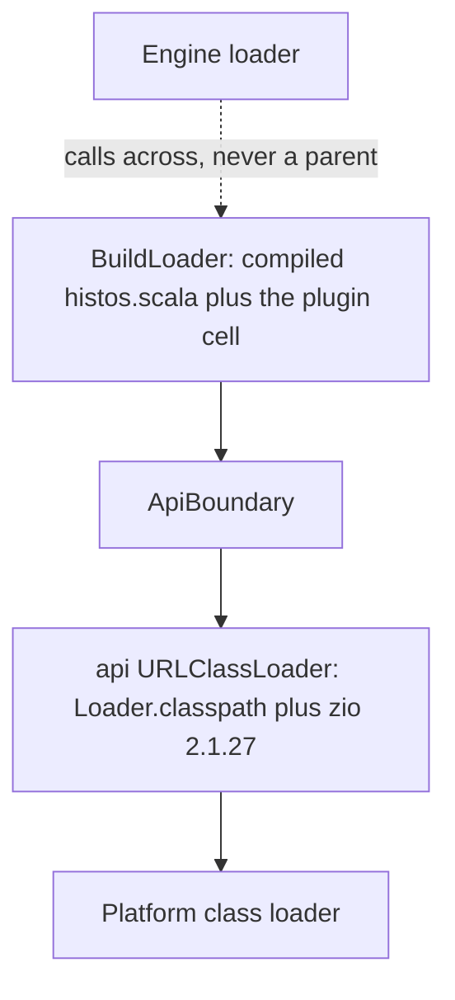
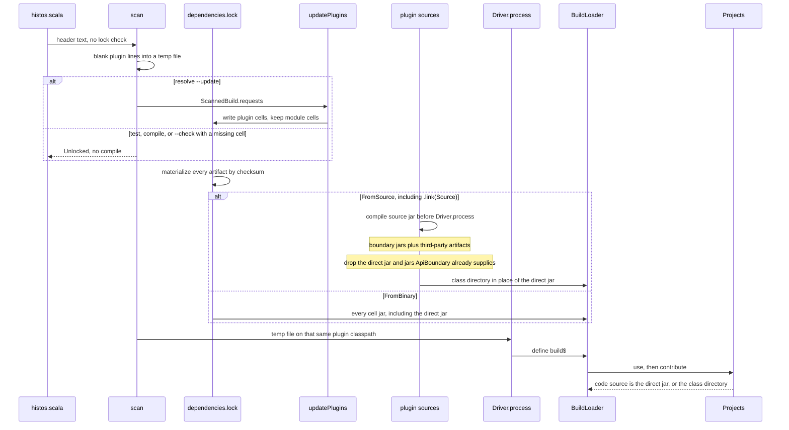

# Histos Plugin Architecture

**Status:** Draft
**Date:** 2026-10-18
**Org:** early-effect
**Repo:** `early-effect/histos`
**Author:** placeholder

This document is the implementable spec for [design.md](design.md) section 5.7. That section stays the summary. This file does not replace it, and it does not edit it. Where 5.7 names a rule (`ExactBinary`, `Source`, `BinaryOrSource`, `LinkStrategy.Api`, task nodes, CI jobs), this file says which type carries the rule and which function enforces it.

There is no `Plugin` trait, no `HistosPlugin`, and no plugin package under `api/src` today. Confirmed against the tree. `Seal` and `Need` exist, but only on the engine, in `engine/src/histos/schedule/Sendable.scala`. They move. They are not redesigned.

## Overview

A Histos plugin is a Scala 3.9+ library compiled against `histos.api`, plus one entry object the engine loads from the jar the build named. The entry returns pure data (task specs, command specs, CI jobs) and a runner the engine calls later. The project graph stores that data. It does not store the effect. The effect is the value `run` returns, a `ZIO[Scope, PluginRunError, PluginOutput]`.

The build opts in inside `histos.scala`. One file, one list. Nothing is discovered by scanning the dependency classpath, and nothing is applied because a jar happened to be present. Module settings the plugin offers are ordinary functions that return a new `ModuleDef`, the same way `.main`, `.jsEnv`, and `.in` already do.

`central` is the rehearsal, not the loader. `docs/plan.md` says the general plugin classloader is not the Central layer: one in-tree module that only sees `api` is the pattern, and the loader arrives when a second plugin exists. `central/src/histos/central/Publisher.scala` is that module. `Publisher.publish` returns `IO[PublishError, Published]`. It is not a `HistosPlugin`, and this spec does not pretend a loader already exists. `Loader.scala` compiles `histos.scala` against the api jar only.

The adoption shape this has to make cheap is a later Specular (docs and preview) that is not sbt's AutoPlugin. The worked example at the end is a fixture with that shape. It is not the Specular repository, and it is not part of the engine.

## Background and Motivation

Histos replaces sbt and zipx for a repo that has moved. Design section 2 already says plugins are ordinary libraries on `histos.api`, and that Central, docs, docker, deploy, coverage, and the dependency-update bot are plugins. Design section 3 already refuses sbt 1.x plugin APIs and a binary-compatibility promise for `histos.api` before 1.0. The engine pieces those plugins have to sit on are already there:

- Tasks are data plus a runner map. `engine/src/histos/task/Task.scala` defines `TaskId.Inspect` (`"inspect"`) and `TaskId.Versions` (`"versions"`). `TaskId.from` accepts any non-empty string. `Tasks.live` looks that string up in a map.
- Sendability is `Sendable.decide`. A plugin runner is `Runner.Plugin(seal)`. `Seal.Hermetic` with an empty `Need` set is `Verdict.Send`. `Seal.Open`, or any `Need` (`Network`, `Docker`), stays on the machine. `Sendable.ofAction` does not pass needs today: it only matches `TaskKind.Compile`, `Inspect`, and `Versions`, and it calls `decide` with `Set.empty`.
- `histos.scala` is compiled by `engine/src/histos/load/Loader.scala` against the api jar (`BuildClasspath`, assembly entry `bootstrap/histos-api.jar`). The build classloader's parent is `getClass.getClassLoader`, the engine loader. That parent is wrong for plugins and has to change before any plugin jar is loaded.
- Project compiles do not use that loader. `engine/src/histos/zinc/Scala3.scala` `EngineBoundary` shares only `xsbti.*` with the engine. `JvmCompile.jarBan` rejects a jar that contains `histos/HistosBuild.class` (`ClasspathBan.Histos`).
- The CLI is a closed zio-cli grammar in `app/src/histos/cli/Grammar.scala`. `Cli.parse` runs before `Loader.load`. An unknown command is `CliParseError.UnknownCommand` and never sees the graph.
- CI is `Workflow.document` in `engine/src/histos/workflow/Workflow.scala`. It emits the `test` job, a `versions` job when the catalog is non-empty, and the `workflow` drift job. It has nowhere to read a plugin job. The plugin must not write YAML.
- The daemon fingerprint (`app/src/histos/server/Daemon.scala` `Fingerprint.read`) hashes `histos.scala` and `.histos/dependencies.lock` only.
- `ContentStore.clean` walks the `cas` directory. `ContentStore.Retention` is 30 days. Design 5.3 already says compiled plugin sources follow that clean. The code does not clean a plugin-source directory yet, because the directory does not exist.

What hurts in sbt, by name, and what this spec does instead:

| sbt | Why it is hostile | Histos |
| --- | --- | --- |
| AutoPlugin `trigger` and `requires` | A jar on the classpath mutates a build the author did not name. | `use` names the plugin. No trigger. No `requires` that pulls another plugin in. |
| `plugins.sbt` split from `build.sbt` | Two files, two classpaths, the plugin graph is not the build. | One file, `histos.scala`. A header of literals is how that one file can be compiled against the jars it names. It is not a second file and not a second language. |
| `SettingKey` / `TaskKey` and the project, configuration, and task axes, plus `:=` and `++=` | Scope is a stringly product. The plugin surface is a macro language. | A setting is a function `ModuleDef => ModuleDef`. A task is a `DeclaredTask` the engine runs. No scope axis. |
| A plugin that cannot be called as Scala | `site / makeSite` is a key, not a function, so the build file cannot treat it as a value. | `Specular.site` is a function. `.pipe` applies it. The author can also write `Specular.site(module(...))`. |
| Binary compatibility of sbt as the plugin surface | Plugins break when sbt breaks, and the compatibility story is the whole builder. | The surface is `histos.api`. Before 1.0 it may break. `LinkStrategy.Api` stays a typed error. There is no shim. |

Publishing stays a task a plugin implements (design 5.9). This spec does not move `central` onto the loader. Central keeps compiling as the in-tree module that only sees `api` plus the ZIO it already declares in `histos.scala`.

## Goals and Non-Goals

### Goals

- A plugin compiles only against `histos.api`. The launcher supplies Histos and ZIO at runtime. The engine, the scheduler, the CLI, and `central` are not on the plugin compile classpath.
- Enablement is one explicit list in `histos.scala`. The loader reads jars the build named. It does not scan other dependencies for an entry.
- The graph stores descriptions. `Seal` and `Need` are data on the task. The runner is an effect the engine calls inside a `Scope`.
- A plugin task id cannot replace `inspect` or `versions`.
- A plugin command shows up in the CLI without a Grammar change per plugin, and without the engine naming Specular.
- A plugin CI job is data. `Workflow.document` renders it. The argv is `./histos run <plugin>/<task>`.
- A binary plugin must match the api jar the launcher is loading, until 1.0. The token is `ApiDigest`, the sha256 of that jar. A mismatch is a typed error that names the plugin and both digests. Source and `plugin(path"...")` compile against the running api.
- Plugin classes live on the build classloader only. A project compile never sees them.
- A plugin author tests `run` with ZIO Test and `PluginFixture`, against `api` only.
- `Seal.Hermetic` and an empty `Need` set are the only sendable plugin tasks. That is `Sendable.decide`, reused, not rewritten.

### Non-Goals

- sbt 1.x plugin API compatibility. No AutoPlugin, no `SettingKey`, no `TaskKey`, no `plugins.sbt`, no `sbt.AutoPlugin` entry, no reading `project/plugins.sbt`.
- A binary-compatibility promise for `histos.api` before 1.0. No MiMa, no shim, no `LinkStrategy.Api` implementation. The case exists so a caller can write it and get a typed refusal.
- Folding test frameworks into this system. `TestProvider` (`api/src/histos/TestProvider.scala`) names an `sbt.testing.Framework` the child process loads. `ProviderRunner` runs in that child. The engine does not load the framework. A test framework is not a `HistosPlugin`.
- Scala Native compiler plugins. `NativeComponent.Plugin` in `engine/src/histos/native/NativeLibs.scala` is the `nscplugin` jar passed as `-Xplugin`. That is a compiler plugin. It is not a build plugin.
- Loading `central` through the plugin classloader. A later PR can wrap it. This series does not.
- A filesystem or network sandbox. The plan already defers the test jail. Plugin enforcement is the declaration plus `Sendable`. A jail is a later PR, not a hole in the types.
- Remote execution. Naming a remote cache does not run the task elsewhere (design 5.3).
- BSP build targets for plugin tasks. BSP stays JVM compile cells. Agents run a plugin task through MCP `run` after `HistosMcp.serve` installs the bound runner in the `Tasks` map. The tool name does not change. The map does.
- Cross-plugin task dependencies. A task may depend on another task of the same plugin, or on compiling a named module. It may not name another plugin's task.
- A second settings language, a context-function front end, or storing closures from `histos.scala` on the graph. `Runner.Closure` stays the non-sendable bucket it already is. This spec does not add build-file closures.
- Migrating any repo other than the fixture off sbt. The real Specular repo is out of scope.

## Proposed Design

### The plugin is data plus a runner

One object in the plugin jar extends `HistosPlugin`. `contribute` returns data and is not a `ZIO`. `run` is the effect. The engine calls both. The plugin does not call the engine, does not see `Scheduler`, and does not see `Workflow`.

```scala
package histos.plugin

import zio.*

trait HistosPlugin:
  def id: PluginId
  def contribute: Contribution
  def run(request: RunRequest): ZIO[Scope, PluginRunError, PluginOutput]
```

`contribute` runs while `Projects` evaluates `graph`, on the load fiber, because that is when the data is copied onto the graph. It is total: no I/O, no `throw`. The return type is not a `ZIO`, which is the enforcement. A plugin that throws anyway is caught there and becomes `BuildError.PluginDefect`. The `Throwable` is not part of the api. The error carries the plugin id and the exception class name (`getClass.getName`). The exception message is not the typed error.

`ProjectGraph` stores `RegisteredPlugin` values. It does not store the trait, the classloader, or a function.

```scala
final case class RegisteredPlugin(
    id: PluginId,
    entry: EntryName,
    contribution: Contribution,
)
```

`EntryName` is the JVM binary name of the module class, including the trailing `$`. `use` records `plugin.getClass.getName`. The engine checks that name against the jar. It does not keep the instance on the graph. When a task runs, it loads `MODULE$` from the build classloader the same way `LoaderLive.module` loads `HistosBuild`. A Scala object is a singleton on that loader, so this is the same instance `use` already called `contribute` on. `run` is not called during load.

`api` gains a compile dependency on `dev.zio::zio:2.1.27`, the revision `histos.scala` already pins for `engine` and `central`. The api jar does not shade ZIO. Plugins depend on `histos.api` only and inherit that ZIO. They do not declare a second ZIO version. Parent-first loading binds the launcher's ZIO anyway.

### Types

Ids are opaque. A bad literal fails compilation of the plugin, the same way `dep"..."` and `path"..."` fail in `api/src/histos/Literals.scala`. `from` is the runtime parser and returns an error enum, not `Either[String, _]`.

```scala
opaque type PluginId = String

object PluginId:
  inline def apply(inline raw: String): PluginId = ${ PluginIdMacro.literal('raw) }
  def from(raw: String): Either[PluginIdError, PluginId]
  extension (id: PluginId) def value: String = id

opaque type TaskName = String
opaque type CommandName = String
opaque type JobName = String
opaque type EntryName = String
opaque type NoteKey = String
opaque type NoteText = String
opaque type OutputName = String
opaque type ParamName = String
opaque type FlagName = String
opaque type EnvName = String
opaque type InputKey = String
opaque type RepoPath = String
opaque type PluginDetail = String
opaque type ApiDigest = String
```

Each opaque above has `inline def apply` for a literal and `from` for a runtime string, same as `ProjectPath`. The snippets below call `apply`.

`PluginId` is dot-separated segments. Each segment starts with a letter. The rest is a letter, a digit, or a hyphen. `dev.earlyeffect.specular` is valid. Empty, a slash, a colon, a space, a leading dot, or a trailing dot is `PluginIdError`.

`TaskName`, `CommandName`, and `JobName` share one token rule and stay distinct opaques: a letter, then letters, digits, or hyphens. No slash, no dot. `site` is valid. `inspect` is a legal token and still cannot shadow the built-in, because the task id below always has a slash.

```scala
final case class PluginTaskId(plugin: PluginId, name: TaskName):
  def render: String = s"${plugin.value}/${name.value}"

enum PluginTaskError:
  case Shape(raw: String)
  case Plugin(error: PluginIdError)
  case Task(error: TaskNameError)

object PluginTaskId:
  def parse(raw: String): Either[PluginTaskError, PluginTaskId]
```

`parse` requires exactly one slash. `inspect` and `versions` do not parse as plugin tasks. `dev.earlyeffect.specular/versions` does parse, and it does not occupy `TaskId.Versions`. Built-in ids win because they are a different string.

`Seal` and `Need` move from `histos.schedule` to `histos.plugin` unchanged:

```scala
enum Seal:
  case Hermetic
  case Open

enum Need:
  case Network
  case Docker
```

`Sendable` imports them. `decide` stays the policy. Callers in `engine/test/RemoteSpec.test.scala` update the import. No second pair of enums.

```scala
final case class Contribution(
    tasks: List[DeclaredTask],
    commands: List[CommandSpec],
    jobs: List[CiJob],
)

final case class DeclaredTask(
    name: TaskName,
    seal: Seal,
    needs: Set[Need],
    inputs: List[DeclaredInput],
    outputs: List[DeclaredOutput],
    dependsOn: List[TaskDep],
)

enum DeclaredInput:
  case File(path: RepoPath)
  case Directory(path: RepoPath)
  case Module(name: ProjectName, version: Option[ScalaVersion], platform: Option[Platform])
  case Note(module: ProjectName, key: NoteKey)
  case Text(name: InputKey, value: String)
  case Env(name: EnvName)

final case class DeclaredOutput(name: OutputName, path: RepoPath)

enum TaskDep:
  case Compile(module: ProjectName, version: Option[ScalaVersion], platform: Option[Platform])
  case Same(name: TaskName)
```

`RepoPath` is a repo-relative file or directory. `from` rejects empty, a leading `/`, a backslash, a `:`, and a segment that is `.` or `..`. A segment matches `[A-Za-z][A-Za-z0-9._-]*`, so `index.html`, `coverage.xml`, and `README.md` are paths. `ProjectPath` stays the module-directory grammar (no dot in a segment). `plugin(path"...")` and `.in` still take `ProjectPath`. Declared inputs and outputs do not.

`Directory` hashes every regular file under that directory, sorted by relative path. There is no glob dialect and no new dependency. A declared output is a file, not a directory. The engine hashes that file. A hermetic task with `outputs = Nil` stores `PluginOutput.text` and nothing else. That text is a legal cache hit. A task that declares files is a hit only when every declared file exists and its sha256 matches the manifest. A manifest that names a missing file is not a hit.

`TaskDep.Compile` and `DeclaredInput.Module` name cells, not a module as one action. `GraphCompile` runs one cell per module, Scala version, and platform. `None` means every cell that module builds. `Some` must be a cell that module builds, or `Projects` returns `BuildError.PluginMissingCell`. An unknown name, or an aggregate, is `BuildError.PluginMissingModule`. The digest is those class-directory digests, sorted by Scala version then platform token. Js and Native cells are included when the module builds them and the `Option`s select them. There is no implicit "JVM only".

`DeclaredInput.Note` is one module plus one key. `Projects` already rejects two notes with the same plugin and key on one module (`BuildError.DuplicateNote`). Zero notes for that pair is `BuildError.MissingNote`. The runner never sees another plugin's notes: the executor sets `ModuleView.notes` to `module.notes.filter(_.plugin == id)` before `run`.

`InputName` stays in `histos.schedule` (`engine/src/histos/schedule/Action.scala`). Plugins cannot import it. `DeclaredInput.Text` carries an api opaque `InputKey` (non-empty, no whitespace, no newline). The engine maps `InputKey` to `InputName` when it builds the `Action`.

```scala
final case class CommandSpec(
    name: CommandName,
    params: List[CliParam],
    task: TaskName,
    summary: String,
)

enum CliParam:
  case Text(name: ParamName)
  case OptionalText(name: ParamName)
  case Flag(name: FlagName)

final case class CiJob(
    name: JobName,
    task: TaskName,
    when: JobWhen,
    permissions: JobPermissions = JobPermissions.ContentsRead,
)

enum JobWhen:
  case Always
  case Schedule(cron: Cron)

enum JobPermissions:
  case ContentsRead
  case ContentsWrite
```

`Cron` is five whitespace-separated GitHub fields. `Cron.from` rejects an empty string, the wrong number of fields, and a field outside GitHub's cron grammar. The renderer prints `cron.value`. It does not accept a raw string from the plugin at the YAML layer.

`summary` on a command is non-empty plain text. It is the help line. It is not a parser.

Link policy, matching design 5.7:

```scala
enum LinkStrategy:
  case ExactBinary
  case Source
  case BinaryOrSource
  case Api

enum PluginLinked:
  case FromBinary(api: ApiDigest)
  case FromSource(published: ApiDigest, running: ApiDigest)
```

`LinkStrategy.Api` is a real case. Loading it is `PluginLoadError.ApiLink`. Nothing rewrites bytecode and nothing runs MiMa. `.link(Api)` fails even when the digests happen to match.

```scala
object ApiDigest:
  val resource: String = "META-INF/histos/version"
  def from(raw: String): Either[ApiDigestError, ApiDigest]
  extension (digest: ApiDigest) def value: String = digest
```

`ApiDigest` is the sha256 of the `histos-api` jar bytes. `BuildClasspath` already caches that jar at `api/<sha>/histos-api.jar`. The plugin resource is one line, that hex. The engine compares it to the sha256 of the api jar it is loading. It does not compare `0.0.1-SNAPSHOT`. That label is already `Cli.VersionText`, `Bsp.ServerVersion`, and `.histos-version`, and it does not move when `histos.api` breaks. While it stays put, every 0.x binary would match. `Cli.VersionText` and `Bsp.ServerVersion` stay the product label Metals and the CLI already print. They are not the plugin binary check, and this spec does not derive one from the other.

Errors split into what fails load and what `run` fails with. Neither enum contains a `Throwable`. Neither flattens to `String` as its only payload. `PluginDetail` is the plugin's own non-empty message, used when the plugin fails a run on purpose.

```scala
enum PluginLoadError:
  case BadCoordinate(raw: String)
  case Misplaced(line: Int)
  case Unlocked(coordinate: String)
  case NoEntry(coordinate: String)
  case AmbiguousEntry(coordinate: String)
  case Unversioned(coordinate: String)
  case VersionMismatch(plugin: PluginId, pluginApi: ApiDigest, launcher: ApiDigest)
  case ApiLink(plugin: PluginId)
  case NoSource(plugin: PluginId, pluginApi: ApiDigest, launcher: ApiDigest)
  case PathIsSource(path: ProjectPath)
  case ReservedPackage(binary: String)
  case EngineLeak(plugin: PluginId, binary: String)
  case ForeignEntry(plugin: PluginId, entry: EntryName)
  case NotEntry(plugin: PluginId, entry: EntryName, expected: EntryName)
  case IdMismatch(declared: PluginId, found: PluginId)
  case Undeclared(plugin: PluginId)
  case Defect(plugin: PluginId, binary: String)
  case Io(op: PluginIo)

  def message: String

enum PluginRunError:
  case Failed(detail: PluginDetail)
  case MissingOutput(name: OutputName)
  case ExtraOutput(path: String)
  case MissingArg(name: ParamName)
  case MissingNote(module: ProjectName, key: NoteKey)
  case Unknown(id: PluginTaskId)
  case Defect(binary: String)
  case EngineLeak(binary: String)
  case Linkage(binary: String)

  def message: String

enum PluginIo:
  case Read, Resolve, Compile, Open
```

Every new enum has `message`, the same way `BuildError` and `LoadError` do. `message` names the plugin and both digests when the failure is a mismatch. It does not include an exception message. `Defect` carries the exception class name (`getClass.getName`) and nothing else.

`Projects` still returns `Either[BuildError, ProjectGraph]`. Checks that need only the `use` values are `BuildError` cases, added next to the ones in `api/src/histos/BuildError.scala`: `DuplicatePlugin`, `DuplicatePluginTask`, `DuplicateCommand`, `DuplicateJob`, `ReservedJob`, `DuplicateNote`, `MissingNote`, `PluginMissingModule`, `PluginMissingCell`, `UnknownPluginTask` (a `Same` dep or a `CiJob.task` that is not a `DeclaredTask` of that plugin), `CommandShadow`, and `PluginDefect` (a throw from `contribute`). `CommandName.reserved` lives in the api. The CLI grammar test asserts its root subcommand words equal that set. Those names are not repeated on `PluginLoadError`.

`PluginLoadError` is the jar, the classloader, the api digest, and the code source. Those are not knowable inside `Projects`. `Loader.load` wraps them as `LoadError.Plugin(error)`, so exit 3 has `error.message`. A slash id that is not in the graph is `PluginRunError.Unknown`, a task failure, exit 1. It is not a load error.

`contribute` is a plain call. `ZIO.fromEither` does not catch a throw, and `use` itself does not call `contribute`. `use` only builds `Uses`. `Projects` calls `contribute` inside the `Either` it already returns:

```scala
final case class Uses(plugins: List[HistosPlugin])

def use(plugin: HistosPlugin, rest: HistosPlugin*): Uses =
  Uses(plugin :: rest.toList)

private def register(plugin: HistosPlugin): Either[BuildError, RegisteredPlugin] =
  try Right(RegisteredPlugin(plugin.id, EntryName.fromClass(plugin.getClass), plugin.contribute))
  catch case scala.util.control.NonFatal(err) =>
    Left(BuildError.PluginDefect(plugin.id, err.getClass.getName))
```

`Projects.apply` and `Organized.apply` flatMap `register` before the existing `build`. The call site stays `Projects(use(Specular.plugin), docs)` because `graph` is already `Either[BuildError, ProjectGraph]`. A throw does not escape that `Either`, and it does not become `PluginLoadError`. `PluginLoadError.Defect` is the engine-side failure while defining the entry class (`MODULE$` initialization). `Loader.load` wraps that as `LoadError.Plugin`. A private object is the existing `LoaderLive.module` miss (`IllegalAccessException` and `InaccessibleObjectException` become "not an entry"), reported as `NoEntry`, so the fixture entry is a public object.

A `Die` inside `run` is `PluginRunError.Defect(binary)`, mapped by the executor from the fiber's cause. The class name is the payload. The task fails. The result is not cached. The CLI prints `message`. `Cause.interrupt` stays interruption: exit `CliExit.Interrupted` (130), not a `PluginRunError`, and not a cache write.

### Enablement in `histos.scala`

Two words, two jobs. `plugin(...)` puts a jar on the build classpath. `use(...)` registers tasks, commands, and jobs. A header jar that is never `use`d is on the classpath for imports and is still version-checked. It contributes nothing. A `use` of an id whose class was not defined by a header jar is `ForeignEntry`.

The compiler cannot see a jar that the file being compiled is what declares. sbt split `plugins.sbt` off for that reason. Histos keeps one file and accepts a constrained prefix instead of a second file:

```scala
plugin(dep"dev.earlyeffect::specular:0.2.0")
plugin(path"tools/docs-preview")
plugin(dep"dev.earlyeffect::coverage:0.1.0").link(ExactBinary)

import histos.*
import dev.earlyeffect.specular.Specular

object build extends HistosBuild:
  def graph =
    val docs =
      module("docs", Jvm)(scala"3.9.0")
        .pipe(Specular.site)
    Projects(use(Specular.plugin), docs)
```

There is no `plugin` method on `histos`. `dep` and `path` are extensions in `histos.Literals`, and they are not in scope on the lines above `import histos.*`. `LoaderLive.compile` today passes the on-disk `histos.scala` path to `dotty.tools.dotc.Driver.process`. That path must not be the compilation unit once a header is present. The compiler would reject every opted-in build.

The header scanner is text, not a Scala parser, and it runs before compile. From the start of the file it skips blank lines and whole-line `//` comments. Each remaining line is one of:

```text
plugin(dep"<coordinate>")
plugin(dep"<coordinate>").link(ExactBinary|Source|BinaryOrSource|Api)
plugin(path"<project path>")
plugin(path"<project path>").link(Source)
```

The coordinate goes through `Dep.from`, then through the same range test as private `Resolve.ranged`: the revision starts with `latest`, or it contains `[`, `]`, `(`, `)`, `+`, or `,`. `Dep.from` accepts those revisions. The header does not. A range is `PluginLoadError.BadCoordinate` before any resolve. A hyphen in `1.0.0-M1` is an exact revision. The path goes through `ProjectPath.from`. The first line that is not blank, not a comment, and not a `plugin` line ends the header. `import` ends it. A later line whose trim starts with `plugin(` is `PluginLoadError.Misplaced`, and compile does not start. No trailing comment, no semicolon, no `val` binding. A coordinate built by concatenation is invisible to the scanner, because those lines are not typechecked. The later `use` then fails as `Undeclared`, or the import does not compile. That limitation is accepted. It is the cost of not having `plugins.sbt`. `Misplaced` and the concatenation rule belong to this text scan. They would be meaningless if `plugin` were a real method.

`scan` returns `ScannedBuild`. `requests` is the header. `source` is the compilation unit:

```scala
final case class ScannedBuild(requests: List[PluginRequest], source: java.nio.file.Path)

enum PluginRequest:
  case Dep(dependency: histos.Dep, link: LinkStrategy)
  case Path(path: ProjectPath)
```

The loader writes `source` as a temp file and passes that path to `Driver.process`. It does not pass the repo's `histos.scala`. Each header `plugin(...)` line in the temp file is a blank line. Blank lines and whole-line comments in the header stay as they are. The line count matches the on-disk file, so a `SourcePos` line is the same line the author sees. `import histos.*` and `object build` are copied through. The loader deletes the temp file when the load `Scope` closes. `Fingerprint.read` keeps hashing the on-disk `histos.scala`, which still contains the header. Compiler diagnostics that mention the temp path are rewritten to `histos.scala` before `LoadError.CompileFailed`, using that shared line numbering.

The file the author writes:

```scala
plugin(dep"dev.earlyeffect::specular:0.2.0")
plugin(path"tools/docs-preview")

import histos.*
```

The temp file `Driver.process` compiles:

```scala


import histos.*
```

Defaults, recorded on `PluginRequest` by the scanner:

- `plugin(dep)` with no `.link` is `BinaryOrSource`. PR 3 temporarily records `ExactBinary` instead, until PR 6. The scanner still accepts the other strategies and the loader fails them as specified in the PR plan.
- `plugin(path)` is `Source`. `.link(ExactBinary)`, `.link(BinaryOrSource)`, or `.link(Api)` on a path is `PathIsSource`.
- `.link(Api)` on a dep is `ApiLink` at scan time, before a lock write and before compile, including when the api digests happen to match. There is no success path.

`use` is a function next to `module` in `api/src/histos/Builder.scala`. It captures the instances. `Projects` is what calls `contribute`. `Projects` and `Organized` gain overloads whose first parameter is `Uses`, beside the existing `Splits` and `CatalogSpec` overloads in `api/src/histos/Graph.scala`. `use(...)` is not a `ProjectDef`, so `Projects(docs, use(...))` does not compile. The list is first: `Projects(use(Specular.plugin), docs)`. Existing builds call the old overloads and get `plugins = Nil`. `Projects` does not call `run`.

`ModuleDef.pipe` is the fluent form of a function the plugin already published:

```scala
def pipe(f: ModuleDef => ModuleDef): ModuleDef = f(this)
```

`Specular.site` is `(ModuleDef) => ModuleDef`. It may only do what any build author can do: call `libraryDependencies`, `in`, `note`, and the other methods that return a new `ModuleDef`. It does not receive a settings DSL.

Notes are how a function leaves plugin-owned data on a module after `Projects` erases `ModuleDef` into `Module`. The engine does not interpret them. They are cache inputs when the task declares `DeclaredInput.Note`.

```scala
final case class ModuleNote(plugin: PluginId, key: NoteKey, value: NoteText)
```

`ModuleDef` gains `def note(plugin: PluginId, key: NoteKey, value: NoteText): ModuleDef`, returning `copy` the same way `.in` and `.main` do.

A repeated `(plugin, key)` on one module is `BuildError.DuplicateNote`. `Module` in `Graph.scala` gains `notes: List[ModuleNote] = Nil`. The runner sees only its own notes, on `ModuleView`.

This is stringly at the storage layer on purpose. `Module` is a closed case class. A type member per plugin would not survive `Projects`. The typed API the author calls is `Specular.site`, not `note`. Plugins that need richer settings encode them in `NoteText` themselves and decode inside `run`. The engine hashes the text.

### Classloader

Today `LoaderLive.classLoader` is `new URLClassLoader(Array(out.toUri.toURL), getClass.getClassLoader)`. The parent is the engine. A plugin loaded that way can call `histos.schedule.Sendable`, `histos.zinc.GraphCompile`, and `histos.workflow.Workflow`. That is the bug this spec closes. A stock parent-first `URLClassLoader` is also not enough: if the parent throws `ClassNotFoundException`, the child defines the class from its own jar, so a plugin could vendor `histos/schedule/Sendable.class`.

The loader the engine builds:



The api URLClassLoader's URLs are the jars `Loader.classpath` already discovers, plus the launcher ZIO jar:

- `histos-api.jar`, the `apiJar` `Loader.load` already takes
- `scala-library`, the code source of `scala.collection.immutable.Nil`
- `scala3-library`, the code source of `scala.quoted.Quotes`
- ZIO 2.1.27, the code source of `zio.ZIO`

That parent is the platform loader. It is not `getClass.getClassLoader`. Scala 3.10 class files link `scala.runtime` types that live in `scala3-library`. A parent of `scala-library` alone fails to define `build$` for this repo's `histos.scala`, and for any other Scala 3.10 build, before a plugin jar exists. The loader PR includes a no-plugin load test: a fixture with the same Scala 3.10 surface (an enum, and a class file that links `scala.runtime`) evaluates under this parent with an empty plugin cell. This repo's `histos.scala` has to keep loading. A no-plugin compile classpath is exactly `Loader.classpath` plus the ZIO jar. With plugins, `Driver.process` compiles the stripped temp file against the boundary jars plus the plugin classpath chosen below. `FromBinary` adds every cell artifact, including the direct jar. `FromSource` adds the compiled class directory in place of the direct jar, plus third-party cell jars, and does not add the direct jar. `Driver.process` is a flat `-classpath`. Parent-first delegation does not apply to it.

`ApiBoundary` allows only:

- classes in package `histos` with no subpackage (the api surface: `HistosBuild`, `ModuleDef`, `Dep`, and the rest)
- `histos.version.*`
- `histos.plugin.*`
- `zio.*`
- `scala.*`

Those load from the api URLClassLoader only, never from a plugin jar, so a plugin cannot shadow `HistosPlugin` or ZIO. Every other name under `histos.` is refused before the plugin jar is searched. That refuses `histos.schedule`, `histos.zinc`, `histos.load`, `histos.task`, `histos.workflow`, `histos.cli`, `histos.central`, and any engine package added later, including a copy vendored inside the plugin jar. The refusal is `ClassNotFoundException` inside the loader, mapped by the caller to `PluginLoadError.EngineLeak` or `PluginRunError.EngineLeak`. The exception is not the api.

Plugin classes themselves must not live in `histos.*`, `zio.*`, or `scala.*`. Defining one is `PluginLoadError.ReservedPackage`. `central` keeps `histos.central` because it is not loaded as a plugin. A future Central plugin has to pick a package outside `histos` or this rule has to grow an explicit exception. It does not grow one in this series.

Anything else (`dev.earlyeffect.specular.*`, a markdown parser, and the JDK) loads from the plugin URLs on `BuildLoader`, or from the platform loader for JDK types. On `BuildLoader`, parent-first delegation means a transitive `zio.*`, `scala.*`, or api `histos` class does not win over the api URLClassLoader. That is the loader. It is not scalac. A jar `ApiBoundary` already supplies has to be left off the flat `-classpath`, or the published copy is the one `Driver.process` links.

Plugins on one `BuildLoader` can see each other. That is ordinary library visibility, which the build file needs in order to import two plugins. Isolation from the engine, and isolation from project compiles, are the boundaries that matter. Plugin jars are not isolated from each other.

If the plugin touches an engine class through parent delegation or through a class defined from a plugin URL:

- At compile time the engine is not on the classpath, so scalac fails before a jar exists.
- At load or `run`, `ApiBoundary` does not define it, and `BuildLoader` does not search plugin URLs for a non-api `histos.*` name. Linkage (`NoClassDefFoundError`, `ClassNotFoundException`) is caught around entry load and around `run`, and mapped to `EngineLeak` (the missing binary name is an engine or `histos.*` name) or `PluginRunError.Linkage` (any other missing binary). The task does not succeed. Nothing is cached.

That guarantee is parent delegation and classes defined from plugin URLs. It is not a claim that engine types are unreachable. `./histos` runs with `java -jar`. The system class loader is the assembly, which contains `histos.schedule`, `histos.workflow`, and the rest. `ApiBoundary` is not on that chain. `ClassLoader.getSystemClassLoader.loadClass("histos.schedule.Sendable")` still links the engine. The thread context loader inherits the same assembly unless the engine replaces it. Around `contribute` and around `run`, the engine sets the context class loader to `BuildLoader` and restores the previous loader afterwards, including on failure and on interruption. The system loader stays out of scope. The vendored `histos/schedule/Sendable.class` test covers the plugin-URL path. It does not cover `getSystemClassLoader`.

`BuildLoader` is closed by the existing `closeLoader` finalizer on the load `Scope`. The `Scope` does not store a service, and nothing reads the classloader back out of it. `Loader.load` constructs `PluginRuntime` while it still has the loader and returns it on `LoadedBuild`:

```scala
final case class LoadedBuild(graph: ProjectGraph, plugins: PluginRuntime)

trait PluginRuntime:
  def run(id: PluginTaskId, args: PluginArgs): ZIO[Scope, PluginRunError, PluginOutput]
  def bind: Map[TaskId, Task]
  def links: List[PluginLink]

final case class PluginLink(id: PluginId, linked: PluginLinked, artifacts: List[String])
```

`plugins` is an engine field. `Cli.render` and `HistosMcp.render` print `graph` and do not print the runtime. CLI and MCP already thread `LoadedBuild`, so they call `loaded.plugins`. `PluginRuntime` lives in `engine/src/histos/load/`. It is not on `histos.api`. `run` loads `MODULE$` through the loader closed over at construction.

`./histos server` keeps that `Scope` for the daemon lifetime. `Daemon` stores the `ProjectGraph` for compile, test, and bsp. It does not store `PluginRuntime`, and it does not run plugin tasks. `Call` is compile, test, and bsp. `histos run` is a new process. `Attach.decide` on a fingerprint mismatch returns `Decision.Stale(Drift.Fingerprint)`, and the client runs in-process and loads again. `Daemon.handle` writes `Stale` and keeps looping with the original `Scope`. This series does not exit the server and does not drop that `Scope`. Path hashing is so `Attach` treats the server as stale. It is PR 6. It does not refresh a runner the daemon never executes.

`Fingerprint.read` today hashes `histos.scala` and `.histos/dependencies.lock` only. Binary plugins are covered once the lock gains plugin cells, because the lock file is already hashed. `plugin(path)` sources are not in those two files. PR 6 hashes every regular file under each header `path`, in sorted relative order. The header scan is enough to know the directories. The loader PR does not.

Project compiles do not receive plugin URLs. `GraphCompile` keeps the module classpath it has now (upstream class directories, then locked jars). `JvmCompile.jarBan` and `directoryBan` both reject `META-INF/histos/plugin`. That entry is the marker a direct plugin jar always has and the api jar does not. Presence is `ClasspathBan.Histos`, the same ban as `histos/HistosBuild.class`. `directoryBan` skips `ClassMarker.HistosBuild` on purpose, because a classes directory may contain the build trait. The plugin marker does not get that skip. A classes directory that contains `META-INF/histos/plugin` is banned. A module that lists a plugin coordinate in `libraryDependencies` fails compile for the same reason, and project compiles still do not receive the plugin cell's URLs. `dependsOn` of a plugin output is the same ban.

### How a jar is chosen and loaded

A header coordinate resolves like a module cell: the direct, plus every transitive jar, each with its own sha256. `FromBinary` puts every one of those jars on `BuildLoader`, including the direct jar. `FromSource` puts the compiled class directory where the direct jar would have been, and keeps the third-party jars. One checksum cannot carry a plugin that calls a markdown parser, a file watcher, or any other library. The Specular fixture proves the cell by calling a type from a second jar. `Echo`, the api-only graph test, stays a single class with `ZIO.succeed` and is not a loader test.

The fixed entry name is the resource `META-INF/histos/plugin`. It is one line, the `EntryName`. For `FromBinary` and for the `FromSource` decision, the loader opens the direct jar (`specular_3`) as a zip and reads that line, and the version line, from the zip. That open is not a classpath entry. For a path plugin the loader reads the line from the path plugin's class directory. It does not walk transitive jars and it does not scan the build classpath. Transitive jars are libraries. A marker in a transitive jar is not a second plugin. A missing resource in the direct jar is `NoEntry`. Two lines in that one resource is `AmbiguousEntry`. A missing `META-INF/histos/version` on a binary jar is `Unversioned`. The class directory compiled for `FromSource` does not need its own copy of the version resource. The published digest is the line already read from the binary.

`META-INF/histos/version` is one line, the hex `ApiDigest` of the api jar the plugin was compiled against. The engine compares it to the sha256 of the api jar `BuildClasspath` is loading. No range, no semver, and not the `0.0.1-SNAPSHOT` product label.



`Cli.resolve` today calls `Loader.load` and only then `Resolve.update(repo, loaded.graph, ...)`. `Resolve.update` only sees module cells from the graph. A missing plugin cell cannot be written that way, because load fails `Unlocked` before update runs, and the requested coordinate is not on `ProjectGraph` or on `PluginRuntime`. The phases split.

`Loader.scan` reads the header and writes the temp file. It does not check the lock, does not hit the network, and does not compile. Coordinates live on `ScannedBuild`. They are not stored on the graph.

- `histos resolve --update` scans, then `Resolve.updatePlugins` resolves each header dep to a full cell and writes those cells into `.histos/dependencies.lock`, preserving module cells already there. That write does not need `use`, a successful compile, or `PluginRuntime`. It materializes the jars by the checksums just written. A `FromSource` link then compiles the locked source jar, and only then does `Driver.process` see the stripped temp file. After load, the existing module-cell update runs and must preserve plugin cells. `Resolve.update` today rewrites the lock from `cells(graph)` and would drop them. The lock write is not rolled back if the later compile fails. The next `test` uses the pinned checksums once the build file compiles. `.link(Api)` fails at scan as `ApiLink` and writes nothing.
- `histos resolve --check` scans. A header dep with no plugin cell is `Unlocked`. It does not invent a line, does not compile, and does not fill the lock from the network. When the cell is present, check re-resolves and fails on drift, the same compare module cells already do, then materializes by checksum, loads, and checks module cells.
- `./histos test`, `./histos compile`, and `histos resolve` with no flag scan, refuse a missing cell as `Unlocked`, and do not solve from the network. They materialize by the locked checksum and then compile. A checksum mismatch is the existing `ResolveError.Checksum`.

`updatePlugins` writes the lock only after every requested cell is complete. A failed resolve leaves the previous file in place.

`DependencyLock` gains `plugins: List[LockedPlugin]`, each a cell, rendered after the module cells:

```text
plugin dev.earlyeffect specular 0.2.0 binary-or-source
direct dev.earlyeffect specular 0.2.0 binary
artifact dev.earlyeffect specular_3 0.2.0 <sha256> central
artifact com.lihaoyi geny_3 1.0.0 <sha256> central
source dev.earlyeffect specular_3 0.2.0 <sha256> central
```

`LockedPlugin` holds the header coordinate, the link strategy, `directs: List[LockedDirect]`, `artifacts: List[LockedArtifact]`, and `source: Option[LockedArtifact]`. `artifact` and `direct` reuse the field grammar module cells already parse. `source` is the sources jar: organization, published name, revision, sha256, repository. `specular_3` is the binary suffix from design 5.2. Plugins are Scala 3 libraries, `DepKind.Binary`, not `Full`. The repository token is the existing `central` / `ivy-local` / `maven:<url>` token. A lock of only plugin cells is valid. An empty file stays `LockError.Empty`. Old locks with no plugin section still parse.

The `source` line is present when the strategy is `Source` or `BinaryOrSource`. `ExactBinary` omits it. `test` and `compile` do not download a classifier the lock does not checksum. If a fallback or `.link(Source)` needs sources and the line is absent, the error is `NoSource` and the network is not consulted. `--update` is what records the source checksum.

Path plugins have no lock cell. Their compile classpath is the boundary jars only (api, `scala-library`, `scala3-library`, ZIO). A third-party library used by a path plugin belongs on a published coordinate. The path form is for sources inside the repo.

After `graph` returns, each `RegisteredPlugin.entry` must equal the `META-INF/histos/plugin` line read for that header, and that object's `id` must equal the id loaded from that class. The class's code source depends on the link. `FromBinary`: the direct jar. `FromSource`: the class directory just compiled, the same acceptance a path plugin's class directory already has. A `FromSource` class whose code source is the direct jar is `ForeignEntry`. The classes `run` defines are the ones just compiled, including when `.link(Source)` ran against a matching digest. A code source that is only a transitive jar is `ForeignEntry`. Failures are `NotEntry`, `IdMismatch`, `ForeignEntry`, and `Undeclared`.

`FromBinary` loads the direct jar. `BuildLoader` and the build-file classpath receive every artifact URL in the cell. The entry class is defined from the direct jar. An exact api-digest match on `BinaryOrSource` takes this path and stays quiet.

`FromSource` runs before `Driver.process`. `BinaryOrSource` takes it when the api digests differ. `.link(Source)` takes it even when the digests match. The loader reports `PluginLinked.FromSource` with both digests. One CLI line names the plugin and both digests, because a source fallback is surprising.

The source compile uses the Scala 3.10.0 compiler `Loader` already uses. Its scalac classpath is the boundary jars plus the cell's third-party artifacts. The direct jar is not on it. Neither is any cell jar `ApiBoundary` already supplies: the published `histos-api`, `zio`, `scala-library`, and `scala3-library`, including when those checksums differ from the boundary copies. A different published api jar is the collision a flat classpath would otherwise link. Transitive libraries stay (`geny`, `specular-text`, a markdown parser). The output directory is `ContentStore.root / "plugins" / <digest>`. That directory is placed on `BuildLoader` and on the build-file classpath in place of the direct jar, not beside it. The direct jar is on neither. The third-party jars stay on both.

`ExactBinary` does not compile sources. A digest mismatch is `VersionMismatch` and does not fall back. No source line when `FromSource` needs one is `NoSource`. The network is not consulted.

Compiled classes are cached under `ContentStore.root / "plugins" / <digest>`, where the digest covers the source bytes, the running `ApiDigest`, the cell's artifact checksums, and the Scala compiler version. `histos cache clean` deletes entries in that directory unused for `ContentStore.Retention` (30 days), prints them, and keeps digests of the current project's path plugins and source fallbacks. It does not delete them during a build. `--dry-run` previews. Today's `DiskStore.clean` only walks `cas`. The link PR extends it. It does not chmod the cache. This cache directory is PR 6. PR 3 does not compile sources.

### Tasks, ids, and the runner

`TaskId.Inspect` and `TaskId.Versions` stay the bare strings. `TaskId.from` stays the loose non-empty parser the engine tests use (`"slow"`, `"compile"`). Plugin registration does not go through that looseness.

One executor writes plugin keys and runs them. CLI `Command.Plugin` and MCP share it. The key is `PluginTaskId.render`. `bind` refuses a key equal to `inspect` or `versions`. Those two strings do not survive `PluginTaskId.parse`, so they are never inserted. `TaskId.from` stays the loose parser. It is not the plugin parser.

`HistosMcp.serve` today builds `Tasks.live(loaded.graph, Map(TaskId.Versions -> ...))` and never sees a plugin. It installs `loaded.plugins.bind` beside `TaskId.Versions`. `HistosMcp.run` still calls `TaskId.from` and `Tasks.run` on that map. `Tasks.cancel` interrupts fibers in that same map, which is the fiber the executor forked. There is no new MCP tool and no BSP target. The map is the change. A claim that MCP works with no edit is false.

`Cli.run` today treats every id other than `inspect` and `versions` as a module name and calls `program`. A slash id must not reach `program`. `Grammar` parses a single slash as `PluginTaskId` and emits `Command.Plugin` (or the task form of `Command.Run` that `perform` sends to the same executor). Bare `histos run <module>` stays `program`. `Cli.render` and `HistosMcp.render` today print `name platforms versions`. Both gain the plugin lines from `graph.plugins`: id, link, task id, seal, needs, declared input paths (not env values), command names, and job names.

A slash id that parses and is not in the graph is `PluginRunError.Unknown` when someone runs it. It is a task failure, exit 1. It is not a new built-in and not a load error.

The engine builds an `Action` (`engine/src/histos/schedule/Action.scala`):

```scala
enum TaskKind:
  case Inspect
  case Compile
  case Versions
  case Plugin

enum Policy:
  case Core
  case Plugin(seal: Seal, needs: Set[Need])

final case class Action(
    id: ActionId,
    kind: TaskKind,
    inputs: List[Input],
    dependencies: List[ActionId],
    policy: Policy = Policy.Core,
)
```

`policy` defaults to `Core`, so current compile, inspect, and versions actions do not change. `Sendable.ofAction` becomes:

```scala
def ofAction(action: Action): Verdict =
  action.policy match
    case Policy.Core =>
      val runner = action.kind match
        case TaskKind.Compile  => Runner.Compile
        case TaskKind.Inspect  => Runner.Inspect
        case TaskKind.Versions => Runner.Versions
        case TaskKind.Plugin   => Runner.Plugin(Seal.Open)
      decide(runner, Set.empty)
    case Policy.Plugin(seal, needs) =>
      decide(Runner.Plugin(seal), needs)
```

A `TaskKind.Plugin` that forgot its policy stays (`Seal.Open`, empty needs). It is not sent. `decide` is unchanged: `Hermetic` plus empty needs is `Send`. Any `Need`, or `Open`, is `Stay`.

The digest inputs are the declared ones, hashed by the engine, plus three the plugin cannot omit: the sha256 of every jar in the plugin cell (or of the compiled path-plugin classes), the running `ApiDigest`, and `PluginTaskId.render`. `DeclaredInput.File` and `Directory` are content hashes (`histos.jdk.Sha256`). A directory hash walks regular files under that root, sorted by relative path. `Env` contributes the hash of the value, not the value. `Module` contributes the class-directory digests of the cells named above, sorted by Scala version then platform. `Note` contributes the text of that one module's note. `Text` contributes the literal. `Digest.of` already sorts inputs by name. A plugin that reads an undeclared file does not change this digest.

That is declaration, not a sandbox. `Sendable` will still say `Send` for a hermetic task that lied and opened a socket. The residual risk is a poisoned cache. It is accepted until a later jail PR. This series does not add a security manager, a seccomp profile, or a filesystem jail. `histos graph` prints each task's seal, needs, and declared input paths so a reviewer can see the claim.

`SchedulerLive.publish` puts every local success into `ActionCache`, then uploads only when `Verdict.Send`. Plugin tasks must not copy that. For `Policy.Plugin`, the executor puts the local manifest and uploads it only when the verdict is `Send`. `Policy.Core` keeps today's put. A `Stay` plugin result is not cacheable, which is the design 5.3 rule for `Network`, `Docker`, and an open plugin.

```scala
final case class RunRequest(
    id: PluginTaskId,
    repo: java.nio.file.Path,
    modules: List[ModuleView],
    args: PluginArgs,
    inputs: List[MaterialInput],
)

final case class ModuleView(
    name: ProjectName,
    baseDirectory: String,
    notes: List[ModuleNote],
)

final case class PluginOutput(text: String, files: List[WrittenFile])

final case class WrittenFile(name: OutputName, path: RepoPath)
```

`MaterialInput` is the declaration after the engine hashed it. `Env` on the request carries the raw value, because the runner has to read what it declared. The raw value is not written into the manifest, the workflow, or `histos graph`. Before `run`, the executor sets `ModuleView.notes` to `module.notes.filter(_.plugin == request.id.plugin)`. The case class can hold every note. The request does not.

The file check lives in `SchedulerLive`, not in a wrapper that calls `publish` and hopes. `lookup` returns a remote string as success, and the local `cache.get` arm of `publish` returns before `local`, with no file check. For `Policy.Plugin` both of those arms treat the stored text as a manifest. A hit requires every declared output file to exist under the repo with the sha256 in the manifest. A missing or mismatched file is a miss, and `local` runs. `outputs = Nil` stores `PluginOutput.text` and has no file to check, so that text is a legal hit. `Policy.Core` stays the current string, with no file check. The UTF-8 check is the private `decode` in `SchedulerLive`, which already returns `RemoteError.Text`. There is no public `Scheduler.decode`.

The executor:

1. Builds the `Action` with `Policy.Plugin(seal, needs)` and the digest.
2. Asks the scheduler to publish. On `Policy.Plugin`, `lookup` and `cache.get` apply the file rule above. `Policy.Core` does not.
3. On a miss, runs `plugin.run(request)` in an inner `Scope` (`ZIO.scoped`), child of the task fiber. The context class loader is `BuildLoader` for that call. Not `Scope.global`. Not `unsafeRun`.
4. After a successful `ZIO`, checks every `DeclaredOutput` exists as a file. A missing file is `PluginRunError.MissingOutput` and is not put. A path the manifest would record that was not declared is `ExtraOutput`. Outputs are files. A directory is not a declared output and is not hashed.
5. On `Send`, puts the manifest text. For `outputs = Nil` the manifest is `PluginOutput.text`. `RemoteCache.store` receives that UTF-8 manifest and nothing else. Output bytes are not stuffed into the blob. `SchedulerLive.decode` rejects non-UTF-8.
6. On `Stay`, does not put and does not upload. `publish` already uploads only when `Verdict.Send`. The plugin change is the file check on the hit path, plus refusing to put a `Stay` result. `Policy.Core` keeps today's put of every local success.

Remote file bytes (a generated site, a coverage report) are not transferred in this series. Another machine that received the manifest and does not have the files treats the lookup as a miss and runs locally. Shipping output bytes through `RemoteCache` as a binary CAS is later, with the remote-execution client, not a second cache. The verdict is still recorded so a test can show a hermetic plugin is `Send` and an open one is not in the remote store.

`TaskDep.Compile` is an action dependency on the cells named in that dep: every cell of the module when both `Option`s are empty, or the one cell when they are set. The digest is those class directories. An unknown module, or an aggregate, is `BuildError.PluginMissingModule`. A `Some` that is not a cell that module builds is `BuildError.PluginMissingCell`. `TaskDep.Same` is another task of this plugin. A cycle is `ScheduleError.Cycle`. A missing sibling is `BuildError.UnknownPluginTask`.

### Failure and cancellation

`Tasks.run` already `forkScoped`s the effect (`TasksLive.run`). `Tasks.cancel` interrupts that fiber. Interrupt closes the inner `Scope`, so `acquireRelease` in the plugin runs its release. A plugin that starts a process uses that `Scope`. The engine does not install a shutdown hook for it.

Failure, defect, interruption, missing output, and linkage are not success. `SchedulerLive.publish` puts only inside the success branch of `local`. The plugin executor does the same. `Cause.interrupt` stays interruption: CLI exit `CliExit.Interrupted` (130), not a `PluginRunError` the plugin could return and not a cache write. Partial files may sit in the work tree. They are not a hit. The next run misses and overwrites them. This series does not add a transactional output directory.

A defect inside `contribute` is `BuildError.PluginDefect`, then `LoadError.BrokenGraph`, exit 3. A `Die` inside `run` is `PluginRunError.Defect(binary)`. Defining the entry class failing is `PluginLoadError.Defect`, then `LoadError.Plugin`, exit 3. All three carry the exception class name in `message`. The CLI prints `message`. It does not pattern-match on an exception's text. None of the three is a cache write.

### Commands

`Grammar.root` is a closed `CliCommand` union built in source. zio-cli 0.8 cannot grow a subcommand per plugin without a code change, and it cannot see plugin specs at parse time because `Cli.execute` calls `Grammar.parse` before `Loader.load`. Rebuilding the zio-cli tree from data has the same ordering problem. The honest seam is a fallback, once, on an unknown root word.

`Grammar.reject` today maps every `ValidationErrorType.CommandMismatch` to `CliParseError.UnknownCommand` before `Cli.execute` sees the validation type. Nested mismatch is the same variant: `histos cache nope` and `histos test --nope` must not load the build. `Grammar.parse` also peels `~` before execute (`"~" :: rest => parse(rest).map(Command.Watch(_))`), so a fallback wrapped only around the top-level `execute` error never sees the inner tokens of `~ site`.

`CliParseError.UnknownRoot` is the new case for "no such root command". `Grammar.reject` maps a root `CommandMismatch` to `UnknownRoot`. A `CommandMismatch` under a known command (`histos cache nope`) stays `UnknownCommand`. A bad flag stays `InvalidArgument` / `MissingArgument`, or the existing flag check (`histos test --nope`). Only `UnknownRoot` loads the build.

1. The built-in grammar runs unchanged on the tokens it is given.
2. A success never consults plugins. `histos test` is the built-in. A plugin cannot contribute that name: `CommandName.reserved` is the root vocabulary (`version`, `graph`, `run`, `test`, `testOnly`, `testQuick`, `compile`, `assembly`, `publish`, `mcp`, `acp`, `bsp`, `server`, `toolchain`, `cache`, `resolve`, `workflow`). `Projects` rejects the shadow. `path`, `list`, and `clean` are cache subcommands. They are intentionally not reserved, so `histos list` can be a plugin command. `histos cache list` stays the built-in, because `cache` matched and the nested word never becomes `UnknownRoot`.
3. On `UnknownRoot` only, `Cli.execute` loads the build. `PluginCommands.parse(specs, args)` looks at `args.head` in the flat list of `CommandSpec`s from `graph.plugins`.
4. A match parses the tail with `CliParam` and becomes `Command.Plugin(id, args)`. No match is usage, and the usage text appends the plugin command names and summaries.
5. `~` applies that same rule to the inner tokens before `Command.Watch` is built. `Grammar.parse` on `"~" :: rest` runs the built-in parse of `rest`, and on `UnknownRoot` defers to the plugin parse of `rest`, then wraps the resulting command in `Command.Watch`. A watch of a built-in (`~ test`) does not load in order to decide the command. A watch of an unknown root (`~ site`) loads once, the same as `site`.

```scala
object PluginCommands:
  def parse(
      specs: List[CommandSpec],
      args: List[String],
  ): Either[CliParseError, (PluginTaskId, PluginArgs)]
```

`PluginCommands` lives in `app/src/histos/cli/`. It does not import a plugin. The argv schema is the data above: required positionals, one optional trailing positional, and `--flag` booleans. Unknown flags fail. This is not a parser the plugin supplies. A plugin that needs more than that exposes the task and tells people to pass arguments via the command spec, or it is past what v1 commands express. `histos run <plugin>/<task>` takes no platform and no further tokens (`CliParseError.TaskPlatform` if a platform is present, same as `inspect` and `versions`). `run` passes `PluginArgs.empty`. Required positionals are the command's job. A runner that needs an arg and is invoked through `run` returns `PluginRunError.MissingArg`.

`Command` gains `case Plugin(id: PluginTaskId, args: PluginArgs)`. `Cli.perform` calls `loaded.plugins.run` inside the command `Scope`.

A typo of a root word (`histos tst`) loads the build before printing usage. A broken `histos.scala` on that path is exit 3 (`LoadFailed`). That is the cost of plugin commands being data loaded from the build. `histos version` does not load, because it matches the built-in grammar. `histos cache nope` does not load either.

### CI jobs

`Workflow.document` already takes the graph and concatenates `test`, optional `versions`, and `workflow`. The extension is a function next to `versionsJob`, not a callback into the plugin:

```scala
private def pluginJobs(plugins: List[RegisteredPlugin]): List[String]
```

`JobWhen.Always` appends a job to `ci.yml` after `versions` and before `workflow`. The job does not know what the task does. Permissions come from the enum, default `contents: read`, matching the workflow header. `ContentsWrite` is a job-level override for a deploy-shaped task. No other permission token exists, so a plugin cannot emit `id-token: write` by smuggling a string.

```yaml
  docs:
    runs-on: ubuntu-latest
    permissions:
      contents: read
    steps:
      - uses: actions/checkout@v4
      - run: "./histos run dev.earlyeffect.specular/site"
```

The argv is `Workflow`'s quoting, the same `quote` it uses for test cells. The command is `./histos run` plus the rendered task id. It is not the plugin's CLI command, so CI does not depend on `CommandSpec`.

`JobWhen.Schedule` cannot be a `cron` key on `ci.yml`: that key is workflow-level and would schedule `test` too. A scheduled job renders `.github/workflows/histos-<job>.yml`. The file has `on.schedule`, `permissions`, and the same `./histos run <plugin>/<task>` step the `Always` snippet uses. `ContentsWrite` is still the only override, on that job. `Workflow.render` stays the `ci.yml` string current callers use. `renderAll` returns every file this graph emits, including `ci.yml`:

```scala
final case class RenderedWorkflow(name: String, body: String)

def renderAll(graph: ProjectGraph): Either[CiError, List[RenderedWorkflow]]
```

`check` and `update` walk `renderAll`. Drift is `CiError.Drift` when a rendered body differs, when a rendered file is missing, or when `.github/workflows/histos-<job>.yml` exists and `renderAll` did not emit that name. `workflow --update` deletes those orphan `histos-*.yml` files. A committed workflow whose name is not `ci.yml` and not `histos-<job>.yml` is left alone. Removing a `CiJob` therefore stops the schedule on the next update, and check fails until that update. Reserved job names `test`, `versions`, and `workflow` are `BuildError.ReservedJob`. Duplicate names across plugins are `DuplicateJob`.

The dependency-update bot is this shape: `Seal.Open` or `Need.Network`, `JobWhen.Schedule`, not sendable, not cached. It is not implemented in this series. The renderer has to be able to emit it before that plugin exists.

### What the author tests

`PluginFixture` lives in `api/src/histos/plugin/PluginFixture.scala`. It constructs a `RunRequest` and nothing else. It does not load a jar, does not open `Scheduler`, and does not hash the disk. The author hashes nothing in the fixture. They pass `MaterialInput` values they care about.

```scala
object PluginFixture:
  def request(
      plugin: PluginId,
      task: TaskName,
      repo: java.nio.file.Path,
      modules: List[ModuleView] = Nil,
      args: PluginArgs = PluginArgs.empty,
      inputs: List[MaterialInput] = Nil,
  ): RunRequest
```

A plugin suite is ZIO Test, `ZIOSpecDefault`, depending on `histos.api` and `zio-test` only. ZIO Test provides `Scope`. The suite calls `plugin.run(PluginFixture.request(...))` and asserts on `PluginOutput` or on `PluginRunError`. No `unsafeRun`. The in-tree fake used to prove `use` is `Echo`, under `api/test`, so `test` of the api module compiles it without the engine:

```scala
object Echo extends HistosPlugin:
  val id: PluginId = PluginId("test.echo")
  def contribute: Contribution =
    Contribution(
      tasks = List(DeclaredTask(
        name = TaskName("echo"),
        seal = Seal.Open,
        needs = Set.empty,
        inputs = Nil,
        outputs = Nil,
        dependsOn = Nil,
      )),
      commands = Nil,
      jobs = Nil,
    )
  def run(request: RunRequest): ZIO[Scope, PluginRunError, PluginOutput] =
    ZIO.succeed(PluginOutput("echo", Nil))
```

The api test builds `Projects(use(Echo), module("core", Jvm)(scala"3.9.0"))` and asserts the graph holds the task and that constructing the graph did not require a successful `run`.

### Worked example: a Specular-shaped fixture

Not the Specular repository. A test fixture named like the plugin we will publish later, so the build-file shape is real. Id `dev.earlyeffect.specular`. The fixture's `site` marks the module. The task is open, because a preview reads the work tree and writes a site directory, and v1 does not try to prove that hermetic.

```scala
package dev.earlyeffect.specular

import dev.earlyeffect.specular.text.SiteText

object Specular:
  val plugin: HistosPlugin = SpecularPlugin

  def site(module: ModuleDef): ModuleDef =
    module.note(plugin.id, NoteKey("role"), NoteText("site"))

object SpecularPlugin extends HistosPlugin:
  val id: PluginId = PluginId("dev.earlyeffect.specular")
  def contribute: Contribution =
    Contribution(
      tasks = List(DeclaredTask(
        name = TaskName("site"),
        seal = Seal.Open,
        needs = Set.empty,
        inputs = List(
          DeclaredInput.Directory(RepoPath("docs")),
          DeclaredInput.Note(ProjectName("docs"), NoteKey("role")),
        ),
        outputs = List(DeclaredOutput(OutputName("site"), RepoPath("docs/index.html"))),
        dependsOn = Nil,
      )),
      commands = List(CommandSpec(CommandName("site"), Nil, TaskName("site"), "write the site")),
      jobs = List(CiJob(JobName("docs"), TaskName("site"), JobWhen.Always)),
    )
  def run(request: RunRequest): ZIO[Scope, PluginRunError, PluginOutput] =
    val text = SiteText.render("docs")
    ZIO.succeed(PluginOutput(text, List(WrittenFile(OutputName("site"), RepoPath("docs/index.html")))))
```

`SpecularPlugin` is public. `LoaderLive.module` turns `IllegalAccessException` and `InaccessibleObjectException` into "not an entry", so a private `MODULE$` would surface as a vague `NoEntry`. The package is `dev.earlyeffect.specular`, which is the import in the build file. `SiteText` lives in a second jar, `dev.earlyeffect::specular-text`, published only into the temp resolver the test builds. `run` calls `SiteText.render`, so a loader that puts only the direct jar on `BuildLoader` fails at that call with `PluginRunError.Linkage`. The lock cell for the test has both checksums. `Echo` under `api/test` stays `ZIO.succeed` with no second jar. It proves `use`, not the classpath.

The output path is the file `docs/index.html`. `docs/target` is a directory, and declared outputs are files. `ProjectPath` rejects the dot in `index.html`. `RepoPath` accepts it.

The build file in the fixture repo is the header plus `use(Specular.plugin)` plus `.pipe(Specular.site)` shown above. The loader test compiles the stripped temp file against the cell, asserts the graph has one plugin task `dev.earlyeffect.specular/site`, asserts `histos site` parses as `Command.Plugin`, and asserts the rendered workflow contains `./histos run dev.earlyeffect.specular/site` and does not contain a YAML body the fixture supplied. `run` is not required to generate a real site. Asserting the output path, and asserting `SiteText.render` ran, is enough.

`Seal.Open` means `Sendable.decide` returns `Stay(Hold.Plugin)`. The test asserts that too, through the public `decide`, so a later edit does not start uploading docs.

## API and Interface Changes

`histos.api` (new, unless noted):

- Package `histos.plugin`: the types in this document. `HistosPlugin`, `Contribution`, `DeclaredTask`, `PluginTaskId`, `PluginLoadError`, `PluginRunError`, `LinkStrategy`, `PluginLinked`, `ApiDigest`, `RepoPath`, `PluginFixture`.
- `Seal` and `Need` move from `histos.schedule` to `histos.plugin`. Engine imports change. Behavior of `decide` does not.
- `ApiDigest` is the sha256 of the api jar. There is no `ApiVersion.current` literal. `Cli.VersionText` and `Bsp.ServerVersion` stay `0.0.1-SNAPSHOT`, the product label BSP and the CLI already print. PR 1 does not derive either of them from the digest.
- `def use(plugin: HistosPlugin, rest: HistosPlugin*): Uses` in `Builder.scala`. `Uses` holds the instances. `Projects` calls `contribute`.
- `ModuleDef.pipe` and `ModuleDef.note`. `Module.notes`.
- `Projects` and `Organized` overloads taking `Uses` first.
- `ProjectGraph` gains `plugins: List[RegisteredPlugin]`. `ProjectGraph.trusted` gains an overload that passes `Nil` for notes and plugins. Existing `trusted` call sites keep their arity.
- New `BuildError` cases listed above, each with `message`.
- `CommandName.reserved` and `JobName.reserved`.
- `RepoPath` for declared inputs, declared outputs, and `WrittenFile`.
- Compile dependency `dev.zio::zio:2.1.27`. No other new dependency. No zio-streams, no zio-cli, on `api`.

Engine:

- `Action.policy`, `TaskKind.Plugin`, `Sendable.ofAction` as above. `Policy.Core` preserves current digests for existing kinds (`Digest.of` includes `action.kind`; adding a field the digest ignores does not change old keys). Plugin actions include `policy` in the digest text so a seal change invalidates the key. `Digest.of` adds the policy line only for `Policy.Plugin`.
- `Loader.scan`, the temp compilation unit, `BuildLoader`, `ApiBoundary` (classpath jars plus ZIO), `PluginRuntime`, `LoadedBuild.plugins`.
- `LoadError.Plugin(PluginLoadError)`.
- `DependencyLock.plugins: List[LockedPlugin]`, the plugin cell (`plugin`, `direct`, `artifact`, `source`).
- `Resolve.updatePlugins`, and `Resolve.update` / `check` merging so each side preserves the other's cells.
- `Fingerprint.read` hashes path-plugin trees in PR 6, so `Attach` goes stale. The daemon `Scope` stays up.
- `JvmCompile.jarBan` and `directoryBan` ban `META-INF/histos/plugin`. `directoryBan` does not skip that marker.
- `SchedulerLive.lookup` and the `cache.get` arm of `publish`: `Policy.Plugin` checks declared output files. `outputs = Nil` stores text. `Policy.Core` is unchanged. Private `decode` stays the UTF-8 check.
- `Workflow.pluginJobs` and `renderAll`, including deletion of orphan `histos-<job>.yml`.

CLI and MCP:

- `CliParseError.UnknownRoot`. `Grammar.reject` maps only a root mismatch to it.
- `Command.Plugin`. `PluginCommands.parse` on `UnknownRoot` only, after load, including the tokens under `~`.
- `Grammar` treats a single slash on `run` as `PluginTaskId` and rejects a platform token. `Cli.run` does not pass that id to `program`.
- `HistosMcp.serve` installs `loaded.plugins.bind`. `Cli.render` and `HistosMcp.render` print `graph.plugins`.

Not on the plugin compile classpath: `histos.load`, `histos.schedule`, `histos.task`, `histos.workflow`, `histos.cli`, `histos.zinc`, `histos.central`.

## Data Model Changes

`ProjectGraph` gains the plugin list and modules gain notes. Both default empty, so a build that does not call `use` has the same tasks it has now. Positional `Module` and `ProjectGraph` extracts do not get default-argument relief. PR 2 updates them.

The lock file gains plugin cells after module cells. Old locks stay valid. `histos resolve --update` writes a plugin cell from the header scan, before compile. A header dep without a cell fails `test`, `compile`, and `--check` with `Unlocked`. Those commands do not hit the network to invent the cell.

`ci.yml` gains one job per `JobWhen.Always`. Scheduled jobs are files `histos-<job>.yml`. Drift covers the rendered set and any leftover `histos-*.yml`. Other workflow files stay.

The cache gains `plugins/<digest>` class directories for source fallbacks and path plugins. The action cache gains manifest text for sendable plugin tasks, including text-only hermetic tasks. No schema migration of `cas` blobs.

No change to the pom a module publishes. Plugin coordinates are not `libraryDependencies` and are not written as project deps.

## Alternatives Considered

### sbt AutoPlugin

The familiar model: `plugins.sbt`, an AutoPlugin object, `trigger` (`allRequirements`, `noTrigger`), `requires`, and `SettingKey` / `TaskKey` updated with `:=` and `++=`. A plugin is "on" when its jar is on the meta-build classpath and its trigger says so. Settings appear in projects the build file never mentioned.

Rejected. The trigger is the bug, not a convenience. Histos already decided the graph is the list of projects the file passed to `Projects`, fixed when load finishes. A plugin that adds settings the author did not call breaks that. `requires` is the same bug one level up: enabling A silently enables B. Scope axes exist so one key can mean different things in `Compile` / `Test` / `ThisBuild`. Histos settings are functions on `ModuleDef`, and test dependencies are already a different method (`.testDependencies`), not a scope. Calling the plugin as Scala is impossible while the surface is a key macro. And the compatibility surface is sbt itself, which design section 3 refuses.

What we keep from the idea is only "a named object in a jar". The object is loaded because the header named the coordinate, not because a scan found it.

### Just call a main class

`java -cp specular.jar dev.earlyeffect.specular.Main`, or a `histos` subcommand that `ProcessBuilder`s that main. No trait, no contribution, no graph.

Rejected. A main class does not extend `ModuleDef`, so `.pipe(Specular.site)` cannot exist. It does not declare `Seal` or `Need`, so `Sendable.decide` cannot see it and the safe default would be to never cache it, which deletes the hermetic case, or to always cache it, which uploads a network task. It does not produce a CI job the renderer can emit, so the plugin writes YAML or the engine special-cases Specular. Arguments are a `Array[String]` inside the plugin, so the CLI cannot reject a bad flag before the process starts. Failure is a process exit code, not `PluginRunError`. Cancellation is a process kill the plugin runner would have to invent, instead of `Scope`. And the main's classpath is whatever the author put on the command, which is how engine classes leak.

A main class is the right shape for a tool the build runs as a subprocess of a task (a node binary, a linker). It is the wrong shape for the plugin itself. The Native linker already works that way: the engine does not load `scala.scalanative`. That boundary stays. It is not this boundary.

### Mill-style magic imports

`import $ivy.`...`` inside the build file, so one compile both resolves and imports. Rejected. It is a second language hidden in a comment-shaped import, which is the same split as `plugins.sbt` with worse tooling. Histos already has `dep"..."` literals and a lock file. The header reuses both. A magic import would grow a resolver inside the compiler wrapper and would still need an explicit `use` to avoid AutoPlugin triggers. Two mechanisms, one decision. The header is the one mechanism.

### Dynamic zio-cli grammar

Build `CliCommand` values from `CommandSpec` and pass them to `root.subcommands`. Rejected as the parsing strategy. The built-in tree is compile-time and `parse` runs before load, so the dynamic tree is empty until a second parse after load. That second parse is the fallback this spec already has, without teaching zio-cli a data schema or risking a plugin command beating `test` because it was registered first. `PluginCommands` is smaller than a second zio-cli construction and it cannot see engine types the plugin would have to supply if plugins parsed their own argv.

### One checksum line per plugin

A single `plugin org name revision sha repo` line, and `BuildLoader` gets that one URL. Rejected. Specular, and any plugin that is an ordinary library, links types from other jars. A markdown parser is not on `ApiBoundary`. `ZIO.succeed` in a fixture hides the miss until `run` throws `Linkage`. The module lock already records directs plus transitive artifacts, each checksummed. A plugin coordinate uses that cell. The entry resource stays on the direct jar so a transitive library is not a second plugin.

### A sealed assembly as the only plugin jar

Shade every dependency into the direct jar and keep one checksum. Rejected. Shading fights parent-first ZIO and the reserved-package rule: a shaded `zio.*` or `scala.*` is either a duplicate the parent already defines, or a `ReservedPackage` if the plugin defines it. It also invents a second lock format for bytes the module cell already knows how to pin. The cell wins because the resolver, the checksum check, and `test` / `compile` materialization already exist.

## Security and Privacy

A plugin is code the build author enabled by coordinate or by repo path. It runs in the launcher process, as the user who ran `./histos`, on the build classloader. Explicit `use` is the trust boundary. It is not a sandbox. A malicious plugin that the author named can read the repo, the environment, and the network, using ordinary JDK APIs, whether or not it declared `Need.Network`. `ApiBoundary` stops parent delegation, and classes defined from plugin URLs, from linking engine packages. `getSystemClassLoader` and an unrestored context loader under `java -jar` still see the assembly. The engine sets the context loader to `BuildLoader` around `contribute` and `run`. That does not make engine types unreachable, and it does not stop `java.lang.ProcessBuilder` or `java.nio.file`. Severity of a hostile enabled plugin is high. Mitigation is the locked cell (every jar is pinned) and review of the coordinate. Do not document the classloader as a security sandbox.

`Need` and `Seal` are the cache boundary, not the trust boundary. `Network` and `Docker` stay off the remote cache so a task that admits it talks to the network does not upload its output. A task that lies is the medium severity cache-poison case in Risks. Credentials (Central, a deploy token) are not inputs the manifest stores and not tokens the workflow file contains. CI argv is only `./histos run <id>`. The runner reads credentials from the environment when it declares `DeclaredInput.Env`, or from a path it declares. Undeclared secrets do not enter the key, and they also are not protected from the plugin. The renderer never prints env values.

`plugin(path)` uses `ProjectPath`, so the sources are under the repo. A path that escapes is `ProjectPathError.Escapes` at the header, mapped through `ProjectPath.from` to `PluginLoadError` (the path sibling of `BadCoordinate`). The header does not accept an absolute path.

`ContentsWrite` on a job is a capability the author opted into by `use`ing a plugin that declared it. The default job permission is `contents: read`, the same as `ci.yml` today. A plugin cannot raise permissions with a free string.

Plugin classes on a project classpath would let project code call the plugin, and would let a published jar depend on Histos. `META-INF/histos/plugin` is banned in jars and in classes directories. The api jar is already banned via `HistosBuild`. The `HistosBuild` skip in `directoryBan` does not apply to the plugin marker.

The digest check refuses a binary built against a different api jar. That is an integrity check for the api surface, not a signature check. Jars still come from the repository named in the lock, checksummed the same way locked compile jars are (`ResolveError.Checksum`). This spec adds no new downloader.

## Observability

Histos has no metrics stack. Do not add one for plugins. The signals are the CLI line, `histos graph`, MCP's existing `run` and graph tools, and the workflow drift check.

- Exact digest match: quiet.
- `PluginLinked.FromSource`: one line, plugin id, the digest in the plugin jar, the digest of the api jar being loaded.
- `VersionMismatch`, `ApiLink`, `NoSource`, `EngineLeak`, `Unlocked`: the error `message`, which names the plugin and both digests when the api jar is the point. Exit `CliExit.LoadFailed` (3), via `LoadError.Plugin` or `LoadError.BrokenGraph`.
- A plugin task failure, including `PluginRunError.Unknown` and `PluginRunError.Defect`: plugin id, task name, `message`. Exit `CliExit.TaskFailed` (1). Interruption: 130.
- `histos graph` and MCP graph text print each plugin id, link status, task id, seal, needs, declared input paths (not env values), command names, and job names. Agents use the existing graph and `run` tools. Both printers grow the lines. There is no new MCP tool.
- A cache hit is quiet, same as a compile cache hit. A `Stay` task does not log a cache decision beyond the normal run.
- Workflow drift stays `CiError.Drift` when a rendered plugin job changes a committed file, or when an orphan `histos-<job>.yml` is still present.

`PluginLoadError.Defect`, `BuildError.PluginDefect`, and `PluginRunError.Defect` print the exception class name. They do not print the exception message as the typed error. Operators who need the message still have the class name and the plugin id, which is enough to open the plugin's own test.

## Risks

| Risk | Severity | Mitigation |
| --- | --- | --- |
| Shipping a plugin on today's engine-parent loader (`LoaderLive.classLoader`) leaks the scheduler and the workflow renderer. | High | `ApiBoundary` lands in the loader PR, before any real plugin jar. The loader test vendors `histos/schedule/Sendable.class` and asserts `ReservedPackage` or `EngineLeak`. |
| A stock `URLClassLoader` would still define a vendored engine class after the parent misses. | High | `BuildLoader` refuses non-api `histos.*` before searching plugin URLs. Same test. |
| `java -jar` leaves the assembly as the system loader, so `getSystemClassLoader` still links `histos.schedule`. | Medium | Out of scope for this boundary. Context loader is set to `BuildLoader` around `contribute` and `run`. The vendored-class test does not cover this path. Documented in Security. |
| Dropping `scala3-library` from the new parent breaks a no-plugin load of this repo. | High | `ApiBoundary` uses every jar `Loader.classpath` already finds, plus ZIO. The loader PR's first test loads a Scala 3.10 fixture with an empty plugin cell. |
| A hermetic plugin reads an undeclared file or opens a socket, and the digest does not change. | Medium | Declaration is the key. `Stay` is not cached. Graph output shows the claim. No sandbox in this series. A later jail PR can wrap `run`. |
| `lookup` and `cache.get` return a manifest whose files are missing, before `local` runs. | Medium | Both arms grow a file check for `Policy.Plugin`. Empty `outputs` stores `PluginOutput.text` and is a legal hit. `Policy.Core` is unchanged. File-byte CAS is deferred. |
| `UnknownRoot` loads the build, so a root typo pays for load and a broken build reports exit 3. | Low | Only `UnknownRoot` loads. `histos cache nope` and `histos test --nope` do not. Documented. |
| ZIO on `api` widens the jar projects might touch. | Medium | Projects are already banned from the api jar via `HistosBuild`. Plugins are banned via `META-INF/histos/plugin` in both `jarBan` and `directoryBan`. Parent-first ZIO is the launcher's copy. |
| Header scan misses a `plugin(dep)` written as normal Scala. | Medium | The compiler sees blank lines where the header was. `Misplaced` if a later line starts with `plugin(`. Otherwise `use` fails closed (`Undeclared` or a compile error). The header grammar is part of the build-file contract. |
| `Fingerprint.read` ignores path-plugin sources, so `Attach` treats a stale server as fresh. | Medium | PR 6 hashes those trees. The client then runs in-process. `Daemon.handle` keeps its `Scope`. Plugin `run` is already a new process. |
| `central` in package `histos.central` cannot later be loaded as a plugin under the package ban. | Low | Central is not a plugin in this series. A later wrapper picks a package outside `histos`, or changes the ban on purpose. |
| Adding `policy` carelessly to `Digest.of` changes compile cache keys. | Medium | `Digest.of` adds a policy line only for `Policy.Plugin`. `Core` keeps the current text. A test hashes a compile action before and after. |
| A one-jar loader ships, and the first real plugin fails `Linkage` on a transitive class. | High | PR 3 resolves a cell. PR 7 calls `SiteText.render` from a second jar. `Echo` is not that test. |

## Rollout

No feature flag. 0.x breaks instead of carrying a shim. A build with no header `plugin` line and no `use` still loads through `Loader.load`. In the loader PR its classloader parent becomes `ApiBoundary`, whose URLs are `Loader.classpath` (api, `scala-library`, `scala3-library`) plus ZIO. That parent is required for this repo's Scala 3.10 `histos.scala` to keep loading. It also stops the build class from seeing engine packages through parent delegation. The no-plugin load test is part of that PR, and it runs before any plugin jar is added.

Rollback of each PR is reverting it. No cache migration. Source-plugin directories under `plugins/` are disposable. The lock file grows plugin cells only when a repo opts in, and `--update` can write them before a successful load. Workflow files change only when a graph contains a `CiJob`. Drift fails closed until the author runs `histos workflow --update`, which also deletes an orphan `histos-<job>.yml`.

This repo does not enable a plugin in its own `histos.scala` as part of the series. The fixture repos live under test sources.

## Key Decisions

1. **`HistosPlugin` is one trait on `histos.api`.** `contribute` is data. `run` is `ZIO[Scope, PluginRunError, PluginOutput]`. Two types would split the entry object the jar names. One object is the fixed entry. The graph stores `RegisteredPlugin`, copied from `contribute`, and never the trait.

2. **`Seal` and `Need` move to `histos.plugin` and keep their names.** Plugins cannot import `histos.schedule`. A second enum would drift from `Sendable.decide`. The policy function stays in the engine.

3. **Enablement is `plugin(...)` in a header plus `use(...)` on `Projects`.** The header is text. The loader blanks those lines into a temp file, and `Driver.process` compiles the temp file. `use` names the instances. `Projects` calls `contribute`, so a jar on the classpath does not mutate the build. `use` is not a statement with a `var` sink.

4. **The classpath is a lock cell. The entry resource is read from the direct jar only.** `META-INF/histos/plugin` is one line in the jar for the header coordinate, opened as a zip. Transitive jars are libraries, each checksummed, and they are not scanned for an entry. `FromBinary` puts every cell jar on `BuildLoader`. `FromSource` replaces the direct jar with the class directory compiled from the locked sources, and keeps the third-party jars. A shared class name such as `histos.plugin.Entry` collides on one build loader. A classpath scan is the AutoPlugin bug.

5. **Task ids are `pluginId/localName`.** `TaskId.from` stays loose for engine tests. `PluginRuntime.bind` inserts plugin keys, and the rendered form always has a slash. `inspect` and `versions` cannot be inserted. `specular/versions` does not shadow `versions`. CLI and MCP share that map. A slash id does not fall through to `program`.

6. **The build classloader's parent is `ApiBoundary`, not the engine loader.** Its jars are `Loader.classpath` plus launcher ZIO: api, `scala-library`, `scala3-library`, ZIO 2.1.27. Allowed packages are the api, `histos.version`, `histos.plugin`, `zio`, and `scala`. Other `histos.*` names are refused before plugin URLs are searched, which stops a vendored engine class. Plugin packages under `histos` are `ReservedPackage`. The system loader under `java -jar` is outside this boundary.

7. **Commands dispatch after the built-in grammar, on `UnknownRoot` only.** `Grammar.reject` must not fold every `CommandMismatch` into that case. `~` applies the same rule to the inner tokens before `Command.Watch` is built. `path`, `list`, and `clean` stay free at the root. A dynamic zio-cli tree cannot see specs before load and could shadow `test`. Built-ins win twice: the grammar matches first, and `CommandName.reserved` rejects the shadow at `Projects`. The plugin does not parse argv.

8. **CI jobs are data on the contribution. `Workflow.pluginJobs` renders them.** Scheduled jobs are a separate `histos-<job>.yml` so `cron` does not wrap `test`. An orphan of that shape is drift, and `--update` deletes it. The plugin does not write YAML. The argv is `./histos run <plugin>/<task>`.

9. **Cache eligibility is `Sendable.decide`, unchanged.** The new code is `Policy.Plugin` on `Action`, the file check inside `SchedulerLive.lookup` and the `cache.get` arm of `publish`, and the refusal to put a `Stay` result. Declared inputs plus the cell's checksums, the api-jar digest, and the task id are the key. `outputs = Nil` stores `PluginOutput.text`. Undeclared reads are not detected. No sandbox in this series.

10. **Until 1.0, binary plugins match `ApiDigest` of the api jar being loaded.** That digest changes when the jar bytes change. `0.0.1-SNAPSHOT` does not, so it is not the token. `Cli.VersionText` and `Bsp.ServerVersion` stay the product label, because BSP advertises an implementation version and the plugin check is a jar identity. `BinaryOrSource` compiles the locked source jar on mismatch, before `Driver.process`, and loads that class directory in place of the direct jar. `.link(Source)` does the same compile even when the digests match. The scalac classpath is the boundary jars plus third-party cell artifacts. `ExactBinary` mismatch is `VersionMismatch`. `LinkStrategy.Api` is `ApiLink` with no success path. `plugin(path)` compiles against the boundary jars, so it matches the running api by construction.

11. **`central` is not loaded by this loader.** It remains the in-tree module that compiles against `api` and not the engine. The first jar the loader proves is a test fixture, then the Specular-shaped fixture. Not Central, and not the real Specular repo.

12. **Test providers and `nscplugin` stay outside.** Different seams, already implemented. Folding them in would put `sbt.testing` or a compiler flag API on `HistosPlugin`.

13. **Module settings are functions.** `pipe` applies `ModuleDef => ModuleDef`. Notes are the residual stored on `Module` because the case class cannot grow a type member per plugin. The author-facing API is the function. A note input is `(ProjectName, NoteKey)`. The executor filters `ModuleView.notes` to the running plugin.

14. **ZIO 2.1.27 becomes a compile dependency of `api`.** The runner signature needs it. The launcher remains the runtime copy. Plugins do not pin their own ZIO. The same jar is on `ApiBoundary`.

15. **`resolve --update` writes plugin cells before compile.** `scan` does not need a successful load. `test`, `compile`, and `--check` refuse a missing cell and do not download an unlocked jar. `--check` does not append a line.

## PR Plan

Seven PRs, in this order. Each is reviewable on its own. The classloader does not land in the same PR as the Specular fixture. `central` is not migrated. No PR in this list enables a plugin in the root `histos.scala`. Path fingerprinting is PR 6, not the loader PR. PR 3's link default is temporarily `ExactBinary`.

### PR 1. `histos/plugin-api`: types on `histos.api`

**Files:** `api/src/histos/plugin/` (`HistosPlugin`, ids, `Contribution`, `DeclaredTask`, `CommandSpec`, `CiJob`, `LinkStrategy`, `PluginLinked`, `ApiDigest`, `RepoPath`, errors with `message`, `PluginFixture`), `Seal` and `Need` moved out of `engine/src/histos/schedule/Sendable.scala`, `Sendable` and `engine/test/RemoteSpec.test.scala` imports, `api` module depends on `dev.zio::zio:2.1.27`.

**Depends on:** nothing beyond the current tree.

**Description:** The trait, the data, and the error enums compile. `contribute` is not a `ZIO`. `LinkStrategy.Api` has no runtime. `ApiDigest.from` accepts a sha256 hex string. This PR does not read the api jar, does not set `Cli.VersionText`, and does not set `Bsp.ServerVersion`. No loader, no CLI dispatch, no workflow change. Api tests cover id parsers, `RepoPath` accepting `index.html` and rejecting `..`, `PluginTaskId.parse` rejecting `inspect` and `versions`, and `PluginFixture.request`. `Sendable.decide` tests stay green without a behavior change.

### PR 2. `histos/plugin-use`: explicit `use` and an in-tree fake

**Files:** `api/src/histos/Builder.scala` (`use`, `Uses`), `api/src/histos/ProjectDef.scala` (`pipe`, `note`), `api/src/histos/Graph.scala` (`Projects` and `Organized` overloads, `Module.notes`, `ProjectGraph.plugins`, a new `ProjectGraph.trusted` overload that passes `Nil`), `api/src/histos/BuildError.scala` (`DuplicatePlugin`, `DuplicatePluginTask`, `DuplicateCommand`, `DuplicateJob`, `ReservedJob`, `DuplicateNote`, `MissingNote`, `PluginMissingModule`, `PluginMissingCell`, `UnknownPluginTask`, `CommandShadow`, `PluginDefect`, each with `message`).

Positional extracts gain a field or a wildcard in the same PR. Default arguments do not preserve unapply arity. Construction with fewer arguments keeps compiling when the new fields are last and defaulted. The extracts that do not:

- `api/test/GraphSpec.test.scala` (`Module` patterns, including the ones nested in `ProjectGraph`, and the 5-field `ProjectGraph` patterns)
- `api/test/Outside.test.scala`
- `app/src/histos/cli/Cli.scala`
- `app/src/histos/mcp/HistosMcp.scala`
- `engine/src/histos/resolve/Resolve.scala`
- `engine/src/histos/native/NativeLink.scala` (`histos.Module`)
- `engine/src/histos/node/Node.scala`

`ProjectGraph.trusted` call sites stay source-compatible through the new overload: `engine/test/ResolveSpec.test.scala`, `engine/test/NodeSpec.test.scala`, `engine/test/NativeSpec.test.scala`, `engine/test/WorkflowSpec.test.scala`. `WorkflowSpec`'s `Module(` constructor uses leading fields plus defaults, so a trailing `notes` default does not break that construction. Its unapply, if it names fifteen fields, is updated with the others.

**Depends on:** PR 1.

**Description:** `Projects(use(Echo), module(...))` round-trips the contribution onto the graph. `register` catches `NonFatal` around `contribute` and returns `BuildError.PluginDefect`. `Echo` is `Seal.Open`, commands empty, jobs empty, `outputs = Nil`, and `run` is `ZIO.succeed`. The test compiles only against `api` plus ZIO Test. No jar loader. A build that does not call `use` still has `plugins = Nil`. `Echo.run` is not invoked by `Projects`.

### PR 3. `histos/plugin-loader`: one coordinate, resolved as a cell

**Files:** `engine/src/histos/load/Loader.scala` (`scan`, temp file, `Driver.process` on that path), new `BuildLoader` and `ApiBoundary`, `engine/src/histos/load/PluginRuntime.scala`, `LoadedBuild.plugins`, `LoadError.Plugin`, header scanner and blanking, `META-INF/histos/plugin` and `META-INF/histos/version` read from the direct jar, `engine/src/histos/resolve/DependencyLock.scala` plugin cells, `engine/src/histos/resolve/Resolve.scala` (`updatePlugins`, merge so module updates keep plugin cells), `app/src/histos/cli/Cli.scala` `resolve` (scan, then lock, then load), `JvmCompile.jarBan` and `directoryBan`. Context class loader set around `contribute`. A no-plugin load test. `Fingerprint.read` does not grow path hashing in this PR.

**Depends on:** PR 2.

**Description:** `ApiBoundary` is parented on the platform loader and lists the `Loader.classpath` jars plus ZIO. The no-plugin test loads a Scala 3.10 surface, including a link to `scala.runtime`, before any plugin URL is added. `histos resolve --update` scans a header dep, writes the cell (direct, artifacts, and a source line when the strategy asks for one), and only then compiles the temp file. A missing cell on `test`, `compile`, and `--check` is `Unlocked` and does not reach `Driver`. For this PR the recorded default link is `ExactBinary`, so a dep cannot fall through into a source compiler that does not exist yet. The body default `BinaryOrSource` returns in PR 6. `use` of the public entry registers it. Every artifact URL in the cell is on `BuildLoader`. The entry resource is read from the direct jar. A vendored `histos.schedule.Sendable` in the direct jar fails. An api-digest mismatch fails with both digests and does not compile sources. `plugin(path)`, `.link(Source)`, and `.link(BinaryOrSource)` are recognized and fail with `PluginLoadError.NoSource`, meaning this loader cannot compile sources yet. PR 6 keeps `NoSource` for a published jar that has no source line, and stops using it for path plugins and for a real `BinaryOrSource` fallback. `.link(Api)` is already `ApiLink` at scan time. No command dispatch and no CI render.

### PR 4. `histos/plugin-commands`: CLI, MCP, and `run`

**Files:** `app/src/histos/cli/Grammar.scala` (`UnknownRoot`, `~` peel, slash task ids on `run`), `app/src/histos/cli/Cli.scala` (`Command.Plugin`, `CliParseError.UnknownRoot`, `Cli.render` plugin lines, `Cli.run` does not send a slash id to `program`), new `app/src/histos/cli/PluginCommands.scala`, `app/src/histos/mcp/HistosMcp.scala` (`serve` installs `bind`, `render` prints plugins, `cancel` interrupts that map), `engine/src/histos/load/LoadError.scala` (PR 3 adds `LoadError.Plugin`; this PR's CLI prints that `message` on exit 3 and the test covers it), `engine/src/histos/schedule/Action.scala` (`TaskKind.Plugin`, `Policy`), `engine/src/histos/schedule/Sendable.scala` (`ofAction`), `engine/src/histos/schedule/Scheduler.scala` (`lookup` and the `cache.get` arm of `publish`), the plugin executor (`ZIO.scoped`, manifest, note filter, `Stay` not cached), `app/test/CliSpec.test.scala`, an MCP test, an engine scheduler test.

**Depends on:** PR 3.

**Description:** `histos run <plugin>/<task>` executes `loaded.plugins.run` inside `Scope` and never calls `program`. A contributed command parses only on `UnknownRoot`, including under `~`. `histos test` and `histos cache nope` stay built-in failures and do not load. `histos list` can be a plugin command. MCP `run` executes the bound id through the same executor. Both graph printers show the contribution. `LoadError.Plugin` is what a jar failure prints on exit 3. Interruption does not put a manifest. A hermetic task with matching output files is `Send` and is stored. A hermetic task with `outputs = Nil` stores its text. An `Open` task is not stored. A remote or local hit whose declared file is missing is a miss. `Policy.Core` compile digests stay stable under a before/after hash.

### PR 5. `histos/plugin-ci`: render jobs from the graph

**Files:** `engine/src/histos/workflow/Workflow.scala` (`pluginJobs`, `renderAll`, orphan `histos-*.yml` drift and delete), `engine/test/WorkflowSpec.test.scala` and the golden files under `engine/test/fixtures/ci/`.

**Depends on:** PR 2 for the data. Land it after PR 4 so a rendered `./histos run` id is one the grammar parses. The renderer itself does not need the classloader.

**Description:** `JobWhen.Always` becomes a job in `ci.yml` whose `run` is `./histos run <plugin>/<task>`, with `permissions`. `JobWhen.Schedule` becomes `histos-<job>.yml` with the same permissions and the same step. Reserved names fail in `Projects`. Drift covers a changed body, a missing rendered file, and a `histos-<job>.yml` this graph no longer emits. `--update` deletes those orphans. Unrelated workflows stay. The plugin fixture does not supply YAML.

### PR 6. `histos/plugin-link`: source, path, and `Api` refused

**Files:** plugin source compile, placed before `Driver.process`, with a classpath of the boundary jars plus third-party cell artifacts (the direct jar omitted, and any cell jar `ApiBoundary` already supplies omitted: `histos-api`, `zio`, `scala-library`, `scala3-library`), the class directory substituted for the direct jar on `BuildLoader` and on the build-file classpath, the code-source check accepting that directory, cache directory `plugins/`, `ContentStore.clean` walking that directory with `ContentStore.Retention`, `plugin(path)`, `app/src/histos/server/Daemon.scala` `Fingerprint.read` hashing those trees, `LinkStrategy` enforcement (`ApiLink`, `NoSource`, `VersionMismatch`, `FromSource` line). The default recorded by the scanner changes from PR 3's `ExactBinary` to `BinaryOrSource`.

**Depends on:** PR 3. Independent of PR 4 and PR 5, but stack it after them so the series stays linear.

**Description:** When the api digests differ, or when the header says `.link(Source)`, the loader compiles the locked source jar before `Driver.process` and reports `PluginLinked.FromSource` with both digests. The class directory replaces the direct jar on `BuildLoader` and on the build-file classpath. It is not added beside the jar. Transitive library jars stay. A class loaded from the direct jar under `FromSource` is `ForeignEntry`. `FromBinary` still loads the direct jar and every other cell jar. `ExactBinary` does not fall back. `plugin(path"...")` compiles against the boundary jars only, and its class directory is a legal code source. `.link(Api)` fails even when the digests match. `test` and `compile` do not fetch a sources jar the lock does not checksum. `cache clean --dry-run` lists an old plugin class directory. A path-plugin edit changes the fingerprint, `Attach.decide` returns `Stale`, and the client loads in a new process. `Daemon.handle` does not drop its `Scope`.

### PR 7. `histos/plugin-specular-fixture`: the adoption shape, still a fixture

**Files:** test fixture sources only, under `engine/test` (the fixture project is a temp repo, two jars). No new production module. No edit to the real Specular repo. No edit to root `histos.scala`.

**Depends on:** PR 4, PR 5, and PR 6.

**Description:** The fixture package is `dev.earlyeffect.specular`. `SpecularPlugin` is a public object. A second jar defines `dev.earlyeffect.specular.text.SiteText`, and `run` calls `SiteText.render`. The temp resolver serves both. The lock cell lists both checksums. A temp build file contains the header, `use(Specular.plugin)`, and `module("docs", Jvm)(scala"3.9.0").pipe(Specular.site)`. `Driver.process` sees the stripped temp file. Load succeeds. The graph task id is `dev.earlyeffect.specular/site`. The rendered workflow runs that id. `Sendable.decide` on the fixture's `Seal.Open` is `Stay`. The declared output is `RepoPath("docs/index.html")`. `PluginFixture` tests the pure parts of `run` against `api` only where they do not need the second jar. The loader test is the one that requires the cell. This PR does not publish a Specular artifact and does not load sbt.

After PR 7, a real Specular (or docs, docker, deploy, coverage, the update bot) is its own PR in its own repo, sharing this loader and nothing else, which is what `docs/plan.md` already says.

## Open Questions

None. The trait, the header strip, the classloader parent, the lock cell, the task id, the command fallback, the workflow extension, and the link policy are decided above. Package exceptions for a future Central plugin, a binary CAS for plugin output files, and a jail around `run` are later work with a known direction, not undecided API.

## References

- [design.md](design.md) sections 2, 3, 4, and 5.7 through 5.11. Section 5.7 is the summary this file specifies. Section 4 is the declared-input rule. Section 5.3 is sendability, partial outputs, and the 30-day clean. Section 5.9 is publishing as a plugin task. Section 5.10 is `module` and immutable settings. Section 5.11 is the workflow render.
- [plan.md](plan.md), the paragraph under `histos/central`: the general plugin classloader is not that layer. One in-tree module that only sees `api` is the pattern. The loader arrives when a second plugin exists. Also the note that after the loader merges, docs, docker, deploy, coverage, and the dependency-update bot are separate PRs.
- `engine/src/histos/schedule/Sendable.scala`: `Seal`, `Need`, `Runner.Plugin`, `Sendable.decide`.
- `engine/src/histos/task/Task.scala`: `TaskId.Inspect`, `TaskId.Versions`, `TaskId.from`, `Tasks.live`.
- `engine/src/histos/schedule/Action.scala`: `Action`, `Digest.of`, declared `Input`s.
- `engine/src/histos/schedule/Scheduler.scala`: `publish`, `lookup`, and private `decode` (`RemoteError.Text`). `cache.get` returns before `local`.
- `engine/src/histos/schedule/RemoteCache.scala`: one UTF-8 blob per action, no binary file CAS.
- `engine/src/histos/load/Loader.scala`: `Driver.process` takes a path. `classpath` uses the code sources of `scala.collection.immutable.Nil` and `scala.quoted.Quotes`. `classLoader` currently parents the engine loader.
- `engine/src/histos/load/BuildClasspath.scala`: `bootstrap/histos-api.jar`, cached at `api/<sha>/histos-api.jar`.
- `engine/src/histos/load/LoadedBuild.scala`: today the graph alone. The `Scope` finalizer closes the loader.
- `engine/src/histos/load/LoadError.scala`: no plugin case yet.
- `engine/src/histos/resolve/Resolve.scala`: `update` and `check` take a graph. `ranged` is the range test. `Cli.resolve` loads first today.
- `engine/src/histos/resolve/DependencyLock.scala`: `cell` / `direct` / `artifact` / `evict`.
- `api/src/histos/Builder.scala`, `api/src/histos/ProjectDef.scala`, `api/src/histos/Graph.scala`: `module`, `ModuleDef` methods, `Projects`.
- `api/src/histos/ProjectPath.scala`: module directories. Dots in a segment are `Escapes`.
- `api/src/histos/TestProvider.scala`: the test-framework seam this spec does not absorb.
- `app/src/histos/cli/Grammar.scala` and `app/src/histos/cli/Cli.scala`: closed grammar, parse before load, `CommandMismatch` mapped to `UnknownCommand`, `~` peeled inside `parse`.
- `app/src/histos/mcp/HistosMcp.scala`: `serve` builds its own `Tasks` map. `render` prints `name platforms versions`.
- `app/src/histos/server/Daemon.scala`: `Fingerprint.read`, `Attach.decide`, `Daemon.handle` keeps the `Scope` on `Stale`.
- `app/src/histos/bsp/Bsp.scala`: `ServerVersion` stays the product label.
- `engine/src/histos/workflow/Workflow.scala`: `document`, `versionsJob`, `workflowJob`.
- `engine/src/histos/zinc/Scala3.scala` `EngineBoundary`, `engine/src/histos/zinc/JvmCompile.scala` `jarBan` and `directoryBan`: project compiles are a different classpath. `directoryBan` skips `ClassMarker.HistosBuild`.
- `engine/src/histos/native/NativeLibs.scala`: `nscplugin`, a compiler plugin.
- `central/src/histos/central/Publisher.scala`: the in-tree api-only rehearsal.
- `app/src/histos/server/Daemon.scala` `Fingerprint.read`: `histos.scala` plus the dependency lock.
- `engine/src/histos/cache/ContentStore.scala`: `Retention` of 30 days, `clean` walks `cas` only today.
- `engine/src/histos/resolve/DependencyLock.scala`: the lock parser that gains `plugin` lines.
