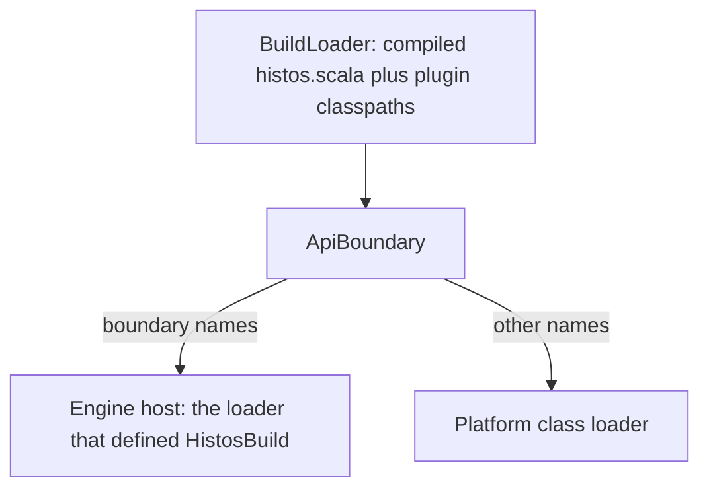

# Histos Plugin Architecture

**Status:** Implemented
**Org:** early-effect
**Repo:** `early-effect/histos`

This document is the plugin contract: what a plugin author writes, what a build author writes, and what the engine guarantees. The api types live in [`api/src/histos/plugin`](../api/src/histos/plugin). The loader and the runtime live in [`engine/src/histos/load`](../engine/src/histos/load). Command dispatch lives in [`app/src/histos/cli`](../app/src/histos/cli). [architecture.md](architecture.md) describes the rest of the tree as built, and [roadmap.md](roadmap.md) holds planned work, including the Specular plugin in the Specular repository.

Declarations live in the source files this document links, and examples live in the tests it links. CI compiles both. This document holds the rules, the reasons, and the invariants that the code does not state.

## Overview

A Histos plugin is a Scala 3 library compiled against `histos.api`, plus one entry object that the engine loads from the jar the build names. The entry returns pure data (task specs, command specs, CI jobs) and a runner the engine calls later. The project graph stores the data. The effect is the value `run` returns, a `ZIO[Scope, PluginRunError, PluginOutput]`.

The build opts in inside `histos.scala`: one file, one list. The loader never scans the dependency classpath for an entry, and a jar applies nothing just because it is present. Module settings a plugin offers are ordinary functions that return a new `ModuleDef`, the same way `.main`, `.jsEnv`, and `.in` do.

`central` is an in-tree module. `Publisher.publish` returns `IO[PublishError, Published]`. It is not a `HistosPlugin`, and the plugin loader does not load it.

## Background

Histos replaces sbt and zipx for a repo that has moved. Plugins are ordinary libraries on `histos.api`, and docs, docker, deploy, coverage, Central releases, and the dependency-update bot are meant to be plugins ([roadmap.md](roadmap.md) orders them). What hurts in sbt, by name, and what Histos does instead:

| sbt | Why it is hostile | Histos |
| --- | --- | --- |
| AutoPlugin `trigger` and `requires` | A jar on the classpath mutates a build the author did not name. | `use` names the plugin. There is no trigger, and no `requires` that pulls another plugin in. |
| `plugins.sbt` split from `build.sbt` | Two files and two classpaths, so the plugin graph is a second build. | One file, `histos.scala`. A header of literals lets that one file compile against the jars it names. |
| `SettingKey` / `TaskKey` and the project, configuration, and task axes, plus `:=` and `++=` | Scope is a stringly product. The plugin surface is a macro language. | A setting is a function `ModuleDef => ModuleDef`. A task is a `DeclaredTask` the engine runs. There is no scope axis. |
| A plugin that cannot be called as Scala | `site / makeSite` is a key, so the build file cannot treat it as a value. | `Specular.site` is a function. `.pipe` applies it, and the author can also write `Specular.site(module(...))`. |
| Binary compatibility of sbt as the plugin surface | Plugins break when sbt breaks, and the compatibility story is the whole builder. | The surface is `histos.api`. Before 1.0 it may break. `LinkStrategy.Api` is a typed refusal, and there is no shim. |

Publishing is a task a plugin can implement. `central` compiles as an in-tree module that sees `api` plus the ZIO it declares in `histos.scala`.

## Guarantees and Scope

### Guarantees

- A plugin compiles against `histos.api` only. The launcher supplies Histos and ZIO at runtime. The engine, the scheduler, the CLI, and `central` are off the plugin compile classpath.
- Enablement is one explicit list in `histos.scala`. The loader reads the jars the build names and scans nothing else for an entry.
- The graph stores descriptions. `Seal` and `Need` are data on the task. The runner is an effect the engine calls inside a `Scope`.
- A plugin task id cannot replace `inspect` or `versions`.
- A plugin command reaches the CLI without a grammar change per plugin, and the engine never names a plugin.
- A plugin CI job is data that `Workflow` renders. Its step is `./histos run <plugin>/<task>`.
- Before 1.0, a binary plugin must match the api jar the launcher loads. The token is `ApiDigest`, the sha256 of that jar. A mismatch is a typed error that names the plugin and both digests. Source plugins and `plugin(path"...")` compile against the running api.
- Plugin classes live on the build classloader only. A project compile never sees them.
- A plugin author tests `run` with ZIO Test and `PluginFixture`, against `api` only.
- Only a `Seal.Hermetic` task with no `Need` is sendable. `Sendable.decide` makes that call for core and plugin actions alike.

### Out of scope

- sbt 1.x plugin API compatibility: no AutoPlugin, `SettingKey`, `TaskKey`, `plugins.sbt`, `sbt.AutoPlugin` entry, or `project/plugins.sbt`.
- A binary-compatibility promise for `histos.api` before 1.0: no MiMa and no shim. `LinkStrategy.Api` exists so a header can name it and get a typed refusal.
- Test frameworks. `TestProvider` in [`TestProvider.scala`](../api/src/histos/TestProvider.scala) names an `sbt.testing.Framework` that the test child process loads, and `ProviderRunner` runs in that child. A test framework is a different seam.
- Scala Native compiler plugins. `NativeComponent.Plugin` in [`NativeLibs.scala`](../engine/src/histos/native/NativeLibs.scala) is the `nscplugin` jar passed as `-Xplugin`, a compiler plugin.
- Loading `central` through the plugin classloader.
- A filesystem or network sandbox. Enforcement is the declaration plus `Sendable`. [roadmap.md](roadmap.md) tracks the sandbox.
- Remote execution. A remote cache stores results and runs nothing elsewhere.
- BSP build targets for plugin tasks. BSP serves JVM compile cells. Agents run a plugin task through the MCP `run` tool.
- Cross-plugin task dependencies. A task may depend on another task of the same plugin, or on compiling a named module cell.
- A second settings language, a context-function front end, or closures from `histos.scala` stored on the graph. `Runner.Closure` stays the non-sendable bucket.

## The plugin is data plus a runner

One object in the plugin jar extends `HistosPlugin` in [`HistosPlugin.scala`](../api/src/histos/plugin/HistosPlugin.scala). It has an `id`, a `contribute` that returns a `Contribution` and is not a `ZIO`, and a `run` that takes a `RunRequest` and is the effect. The engine calls both. The plugin never calls the engine and never sees `Scheduler` or `Workflow`.

`contribute` runs while `Projects` evaluates `graph`, on the load fiber, because that is when the data is copied onto the graph. It must be total: no I/O and no `throw`. Its return type is not a `ZIO`, which is the enforcement. A throw anyway becomes `BuildError.PluginDefect(plugin, binary)`, where `binary` is the exception class name. The exception message never enters the typed error. Load never calls `run`.

`ProjectGraph.plugins` holds data only: `RegisteredPlugin` in [`Request.scala`](../api/src/histos/plugin/Request.scala) is the plugin id, its `EntryName`, and its `Contribution`. The plugin instance and the classloader stay with the loader.

`EntryName` is the JVM binary name of the module class, including the trailing `$`. `Projects` records `EntryName.fromClass(plugin.getClass)`. During load, the loader defines each header entry on `BuildLoader` and reads its public `MODULE$` field. `PluginRuntime` keeps those instances, and `run` calls them. A Scala object is a singleton on its loader, so this is the same instance `Projects` called `contribute` on.

`api` has a compile dependency on `dev.zio::zio:2.1.27`, the same revision this repo's `histos.scala` gives `central`, `engine`, and `app`. The api jar does not shade ZIO. Plugins depend on `histos.api` and inherit that ZIO. At runtime the launcher's ZIO wins, because `zio.*` is a boundary name.

## Types

### Ids and tokens

Every id and token is an opaque type in `histos.plugin`. Each has `inline def apply(inline raw: String)`, backed by a macro in `PluginMacros` ([`Macros.scala`](../api/src/histos/plugin/Macros.scala)) that rejects a bad literal when the plugin compiles. Each also has `from(raw)`, the runtime parser, which returns that type's own error enum, and a `.value` extension that returns the text. `PluginId` in [`PluginId.scala`](../api/src/histos/plugin/PluginId.scala) shows the shape: `PluginId.from` fails with `PluginIdError.Empty` or `PluginIdError.Bad(raw)`. The `ids` and `paths and digests` suites in [`PluginSpec.scala`](../api/test/PluginSpec.scala) check the parsers for most grammars below, plus the compile error for a bad `PluginId` or `RepoPath` literal. `ProjectPath`, `dep"..."`, and `path"..."` follow the same pattern.

| Type | File | Grammar |
| --- | --- | --- |
| `PluginId` | [`PluginId.scala`](../api/src/histos/plugin/PluginId.scala) | Dot-separated segments. Each segment starts with a letter, and the rest are letters, digits, or hyphens. `dev.earlyeffect.specular` is valid. Empty, a slash, a colon, whitespace, an empty segment, or a leading or trailing dot fails. |
| `TaskName`, `CommandName`, `JobName`, `OutputName`, `ParamName`, `FlagName`, `NoteKey` | [`Names.scala`](../api/src/histos/plugin/Names.scala) | A letter, then letters, digits, or hyphens. No slash and no dot. |
| `EntryName` | [`EntryName.scala`](../api/src/histos/plugin/EntryName.scala) | A JVM binary class name: dot-separated identifiers, where a segment may contain single `$` separators and end with `$`. |
| `RepoPath` | [`RepoPath.scala`](../api/src/histos/plugin/RepoPath.scala) | A repo-relative file or directory. Empty, a leading `/`, a backslash, or a `:` fails. Each `/` segment matches `[A-Za-z][A-Za-z0-9._-]*`, so `.`, `..`, and empty segments fail and `docs/index.html` passes. |
| `NoteText`, `PluginDetail` | [`Texts.scala`](../api/src/histos/plugin/Texts.scala) | Non-empty, one line, no control characters. |
| `InputKey` | [`Texts.scala`](../api/src/histos/plugin/Texts.scala) | Non-empty, no whitespace. |
| `EnvName` | [`Texts.scala`](../api/src/histos/plugin/Texts.scala) | A letter or `_`, then letters, digits, or `_`. |
| `ApiDigest`, `ContentHash` | [`ApiDigest.scala`](../api/src/histos/plugin/ApiDigest.scala) | 64 hex digits, stored lowercase. |
| `Cron` | [`Cron.scala`](../api/src/histos/plugin/Cron.scala) | Five whitespace-separated GitHub Actions cron fields, stored single-spaced. Month and weekday names are accepted. |

`TaskName`, `CommandName`, and `JobName` share one grammar and stay distinct types. `inspect` is a legal `TaskName`, and it still cannot shadow the built-in, because a plugin task id always has a slash.

`ProjectPath` keeps the module-directory grammar, which rejects a dot in a segment. `plugin(path"...")` and `.in` take `ProjectPath`. Declared inputs and outputs take `RepoPath`.

`PluginTaskId` in [`PluginTaskId.scala`](../api/src/histos/plugin/PluginTaskId.scala) pairs a `PluginId` with a `TaskName`, and `render` joins them as `plugin/task`. `PluginTaskId.parse` requires exactly one slash. A wrong slash count is `PluginTaskError.Shape`, and a bad segment is `PluginTaskError.Plugin` or `PluginTaskError.Task`, wrapping that segment's own error. `inspect` and `versions` fail with `Shape`. `dev.earlyeffect.specular/versions` parses, and it does not occupy `TaskId.Versions`, because it is a different string.

### Seal and Need

`Seal` and `Need` live in [`Seal.scala`](../api/src/histos/plugin/Seal.scala). `Seal.Hermetic` claims that the declared inputs are everything the task reads. `Seal.Open` makes no claim. `Need.Network` and `Need.Docker` name a capability that keeps the task on this machine. `histos.schedule.Sendable` imports both enums, and `Sendable.decide` is the one policy for core and plugin actions.

### Contribution

`Contribution` in [`Contribution.scala`](../api/src/histos/plugin/Contribution.scala) holds three lists: tasks, commands, and CI jobs. A `DeclaredTask` carries its `TaskName`, its `Seal`, its set of `Need`, its inputs, its outputs, and its dependencies. The other contribution types in that file:

| Type | Shape | Rule |
| --- | --- | --- |
| `DeclaredInput` | `File`, `Directory`, `Module`, `Note`, `Text`, or `Env` | Each case is a cache input. [The digest](#the-digest) lists what each one contributes. |
| `DeclaredOutput` | an `OutputName` and a `RepoPath` | A regular file the run must write. |
| `TaskDep` | `Compile` names a module cell, `Same` names a task of the same plugin | Nothing names a task of another plugin. |
| `CommandSpec` | a `CommandName`, a list of `CliParam`, the `TaskName` it runs, and a `PluginDetail` summary | [Commands](#commands) gives the argv rules. |
| `CiJob` | a `JobName`, the `TaskName`, a `JobWhen`, and `JobPermissions` | `permissions` defaults to `JobPermissions.ContentsRead`. [CI jobs](#ci-jobs) gives the rendering rules. |

Inputs and outputs:

- `Directory` hashes every regular file under that directory, keyed by relative path and sorted. There is no glob dialect.
- A declared output is a regular file. The engine hashes it after `run`. A directory cannot be an output.
- A declared `File` or `Directory` that is missing, or an `Env` that is unset, fails the run with `PluginRunError.Failed` before `run` is called.
- A task with no declared outputs stores `PluginOutput.text` and nothing else, and that text is a legal cache hit. A task that declares files is a hit only when every declared file exists with the sha256 the manifest recorded.

Cells:

- `TaskDep.Compile` and `DeclaredInput.Module` name cells: a module, plus an optional Scala version and an optional platform. A module builds one cell per Scala version and platform. `None` means every cell that module builds, Js and Native included. `Some` must name a cell that module builds, or `Projects` returns `BuildError.PluginMissingCell`. An unknown name, or an aggregate, is `BuildError.PluginMissingModule`.
- `TaskDep.Compile` compiles the selected cells before the task is hashed, and `RunRequest.compiled` carries their classpaths.
- `DeclaredInput.Module` hashes the selected cells' class directories as they are on disk, sorted by Scala version, then platform token. Pair it with `TaskDep.Compile` on the same cells when the task needs fresh classes.

Notes:

- `DeclaredInput.Note` is one module plus one key. `Projects` rejects two notes with the same plugin and key on one module (`BuildError.DuplicateNote`). A note input with no matching note is `BuildError.MissingNote`.
- The runner never sees another plugin's notes: `ModuleView.notes` holds only the running plugin's notes.

Text, commands, and cron:

- `DeclaredInput.Text` carries a plugin-chosen `InputKey` and a literal. The engine derives the cache input name itself, so a plugin never touches `histos.schedule.InputName`.
- `CommandSpec.summary` is a `PluginDetail`, the help line printed after the command name in usage.
- `Cron.from` rejects an empty string, the wrong number of fields, and a field outside GitHub's cron grammar. The renderer prints `cron.value`. A plugin has no way to hand raw text to the YAML layer.

### Link strategy and the api digest

`LinkStrategy` in [`Contribution.scala`](../api/src/histos/plugin/Contribution.scala) is what a header asks for: `ExactBinary`, `Source`, `BinaryOrSource`, or `Api`. `PluginLinked`, in the same file, records which bytes defined the plugin classes. `FromBinary(api)` carries the digest both sides share. `FromSource(published, running)` carries the digest the published binary was built against and the digest of the api jar this process loads. [Link strategies](#link-strategies) is the decision table.

`LinkStrategy.Api` is a real case with no success path. A header `.link(Api)` fails the scan with `PluginLoadError.ApiLink`, even when the digests would match. Nothing rewrites bytecode and nothing runs MiMa.

`ApiDigest` in [`ApiDigest.scala`](../api/src/histos/plugin/ApiDigest.scala) is the sha256 of the `histos-api` jar bytes, and `ApiDigest.resource` is `META-INF/histos/version`, the jar resource that carries it. When the launcher runs from an assembly, `BuildClasspath` extracts that jar to `api/<sha>/histos-api.jar` under the cache. A binary plugin's `META-INF/histos/version` resource is one line holding that hex, and the loader compares it to the sha256 of the api jar it loads. The product label `0.0.1-SNAPSHOT` (the `histos` ship, `Cli.VersionText`, and `Bsp.ServerVersion`) stays put when `histos.api` breaks, so every 0.x binary would match it. The label and the digest are independent, and neither derives from the other.

### Errors

Load and run fail with separate enums, `PluginLoadError` and `PluginRunError` in [`Errors.scala`](../api/src/histos/plugin/Errors.scala). A load error raised before the plugin object exists names a `PluginCoordinate` from [`Coordinate.scala`](../api/src/histos/plugin/Coordinate.scala): `Published(dependency)` for a `plugin(dep)` line, or `Path(path)` for a `plugin(path)` line.

Every case has `message`, the same way `BuildError` and `LoadError` do. Neither enum carries a `Throwable`. `Defect` carries the exception class name. `Linkage` carries the missing class name the JDK reports. `PluginDetail` is the plugin's own message, used when the plugin fails a run on purpose. `PluginLoadError.Io(op)` names the step that failed (`PluginIo.Read`, `Resolve`, `Compile`, or `Open`) and carries no exception. `PluginRunError.MissingNote` is the run-time form of `BuildError.MissingNote`, raised when the engine reads a declared `Note` input and finds no note.

`ApiLink`, `VersionMismatch`, `NoSource`, `EngineLeak`, and `Defect` name the header coordinate and never a `PluginId`. `VersionMismatch` also names both digests. `EngineLeak` names the plugin whose class asked for the refused name: `BuildLoader` records the innermost class on the stack that it defined, and the loader matches that class's code source to a header row. A refused name that no plugin class asked for, such as one the build file looks up itself, is `BuildLeak`, which names only the binary. `ForeignEntry`, `NotEntry`, `IdMismatch`, and `Undeclared` fire after `graph` returns and name the `PluginId`. `Loader.load` wraps every `PluginLoadError` as `LoadError.Plugin(error)`, and the CLI exits 3 with `error.message`. The `contract` suite in [`PluginSpec.scala`](../api/test/PluginSpec.scala) asserts that the `VersionMismatch`, `ApiLink`, `NoSource`, `EngineLeak`, and `Defect` messages name the coordinate.

A slash id that is not in the graph is `PluginRunError.Unknown`, a task failure with exit 1.

## Registration

`use` in [`Builder.scala`](../api/src/histos/Builder.scala) takes one or more `HistosPlugin` values and builds `Uses`. It does not call `contribute`. `Projects` and `Organized` have overloads whose first parameter is `Uses`, beside the `Splits` and `CatalogSpec` overloads in [`Graph.scala`](../api/src/histos/Graph.scala). `Uses` is not a `ProjectDef`, so `Projects(docs, use(...))` does not compile. The list goes first: `Projects(use(Specular.plugin), docs)`. A build that never calls `use` has `plugins = Nil`.

`Projects` registers each plugin inside the `Either[BuildError, ProjectGraph]` it already returns. It calls `contribute` under a `NonFatal` catch and records `EntryName.fromClass(plugin.getClass)`. A throw from `contribute` becomes `BuildError.PluginDefect` with the exception class name. A class name that is not a valid `EntryName` becomes `PluginDefect` with that class name. The throw never escapes the `Either`, and it never becomes a `PluginLoadError`.

`Projects` then checks the registered plugins against each other and against the modules:

- `DuplicatePlugin`: two `use`d plugins share an id.
- `DuplicatePluginTask`: one plugin declares a task name twice. Two plugins may share a local name.
- `UnknownPluginTask`: a `TaskDep.Same`, a `CommandSpec.task`, or a `CiJob.task` names no task of that plugin.
- `CommandShadow`: a command name is in `CommandName.reserved`.
- `DuplicateCommand`: two commands share a name. Command names are one namespace across all plugins.
- `ReservedJob`: a job is named `test`, `versions`, or `workflow` (`JobName.reserved`).
- `DuplicateJob`: two jobs share a name across plugins.
- `DuplicateNote`, `MissingNote`, `PluginMissingModule`, and `PluginMissingCell`, as described under Contribution.

The `registration` suite in [`PluginSpec.scala`](../api/test/PluginSpec.scala) builds a graph for each check, plus the compile error for `use` in second position.

A defect in `contribute` reaches the CLI as `LoadError.BrokenGraph`, exit 3.

## Enablement in `histos.scala`

Two words, two jobs. `plugin(...)` puts a jar on the build classpath. `use(...)` registers its tasks, commands, and jobs. A header plugin that is never `use`d is still resolved, version-checked, and loaded, so the build file can import from it, and it contributes nothing.

The compiler cannot see a jar that the file it is compiling declares. sbt split `plugins.sbt` off for that reason. Histos keeps one file and reads a constrained prefix as text before compiling. The file starts with its `plugin(...)` lines, then `import histos.*`, the imports from the plugins, and the usual `object build extends HistosBuild`. The build file in [`SpecularFixtureSpec.scala`](../engine/test/SpecularFixtureSpec.scala) is a complete example: one `plugin(dep"...")` line, `.pipe(Specular.site)` on the `docs` module, and `Projects(use(Specular.plugin), docs)`. The `plugin header` suite in [`LoadSpec.scala`](../engine/test/LoadSpec.scala) scans every header form, including `.link(...)` with each strategy and `plugin(path"...")`.

There is no `plugin` method in `histos`. `dep` and `path` are `StringContext` extensions in `histos.Literals`, which are out of scope above `import histos.*`. The header lines never reach the compiler.

### Header grammar

`HeaderScan` in [`HeaderScan.scala`](../engine/src/histos/load/HeaderScan.scala) is a text scanner, and it runs before compile. From the start of the file it skips blank lines and whole-line `//` comments. Each remaining header line, trimmed, is one of:

```text
plugin(dep"<coordinate>")
plugin(dep"<coordinate>").link(ExactBinary|Source|BinaryOrSource|Api)
plugin(path"<project path>")
plugin(path"<project path>").link(Source)
```

- The coordinate goes through `Dep.from`, then `Resolve.ranged`: a revision that starts with `latest`, or contains `[`, `]`, `(`, `)`, `+`, or `,`, is a range. `Dep.from` accepts ranges, and the header refuses them. A parse failure or a range is `PluginLoadError.BadCoordinate`, before any resolve. A hyphen, as in `1.0.0-M1`, is an exact revision.
- The path goes through `ProjectPath.from`. A failure, including a path that escapes the repo, is `BadCoordinate`.
- After the closing `")`, the line may hold one `.link(...)` with a known strategy and nothing else. A trailing comment, a semicolon, or an unknown strategy is `BadCoordinate`.
- `plugin(dep)` with no `.link` records `BinaryOrSource`.
- `plugin(path)` records a path request. `.link(Source)` is accepted, and any other strategy is `PathIsSource`.
- `.link(Api)` on a dep is `ApiLink` at scan time, before any lock write or compile.
- A header-position line that starts with `plugin(` and is neither form is `Misplaced`.
- Blank lines, comments, and header forms continue the header. Any other line, `import` included, ends it.
- After the header, a line that starts with `plugin(dep"` or `plugin(path"` is `PluginLoadError.Misplaced(line)`, and compile does not start.

A coordinate built by concatenation or bound to a `val` is invisible to the scanner, because header lines are never typechecked. The build file then fails to compile its import, or `use` fails as `ForeignEntry`. That limit is the cost of having no `plugins.sbt`. `Misplaced` and the concatenation rule belong to the text scan.

### The compilation unit

`HeaderScan.scan` returns a `ScannedBuild` from [`HeaderScan.scala`](../engine/src/histos/load/HeaderScan.scala): `requests`, one `PluginRequest` per header line (`Dep(dependency, link)` or `Path(path)`), and `source`. `Loader` in [`Loader.scala`](../engine/src/histos/load/Loader.scala) exposes `scan(repo)`, which returns that `ScannedBuild`, and `load(repo, apiJar)`, which compiles and loads the build inside a `Scope` that also needs `Resolve` and `ContentStore`.

`source` is the text of the compilation unit: each header `plugin(...)` line becomes an empty line, and blank and comment lines stay as they are. The line count matches the file on disk, so a diagnostic line is the line the author sees. `Loader.load` writes `source` to a temp file, compiles that temp file with `dotty.tools.dotc.Driver`, and deletes it when the load `Scope` closes. Diagnostics that mention the temp path are rewritten to `histos.scala` before `LoadError.CompileFailed`. `Fingerprint.read` hashes the on-disk `histos.scala`, header included. The `plugin header` suite in [`LoadSpec.scala`](../engine/test/LoadSpec.scala) asserts the blanked `source` for a header with a comment and one plugin line.

### Module settings and notes

`pipe` and `note` are methods on `ModuleDef` in [`ProjectDef.scala`](../api/src/histos/ProjectDef.scala). `pipe(f)` applies a `ModuleDef => ModuleDef` to the module. `note(plugin, key, value)` appends a `ModuleNote` from [`Request.scala`](../api/src/histos/plugin/Request.scala). The `registration` suite in [`PluginSpec.scala`](../api/test/PluginSpec.scala) pipes a module through a function that leaves a note and finds the note on the built `Module`.

`Specular.site` is a `ModuleDef => ModuleDef`. It may do only what any build author can do: call `libraryDependencies`, `in`, `note`, and the other methods that return a new `ModuleDef`. It receives no settings DSL.

Notes are how a function leaves plugin-owned data on a module after `Projects` erases `ModuleDef` into `Module` (`Module.notes`). The engine does not interpret them. They become cache inputs when a task declares `DeclaredInput.Note`. Storage is one line of text on purpose: `Module` is a closed case class and cannot carry a type member per plugin. The typed api the author calls is the plugin's function. A plugin that needs richer settings encodes them in `NoteText` and decodes them inside `run`.

## Classloader



`ApiBoundary` in [`BuildLoader.scala`](../engine/src/histos/load/BuildLoader.scala) has no URLs, and its parent is the platform loader. A boundary name loads from the host, the loader that defined `HistosBuild`, so `ProjectGraph` and `HistosPlugin` are the engine's own classes. A refused name throws `ClassNotFoundException`. Every other name goes to the platform loader, which supplies the JDK.

Boundary names (`ClassHome.boundary` in [`Boundary.scala`](../engine/src/histos/load/Boundary.scala)):

- classes in package `histos` with no subpackage (the api surface: `HistosBuild`, `ModuleDef`, `Dep`, and the rest)
- `histos.version.*`
- `histos.plugin.*`
- `zio.*`
- `izumi.reflect.*`, because `zio.Tag` extends `izumi.reflect.Tag` and a summoned `Tag` compiles to izumi calls in the plugin's own classes
- `scala.*`

Every other name under `histos.` is refused before any plugin URL is searched. That covers `histos.schedule`, `histos.zinc`, `histos.load`, `histos.task`, `histos.workflow`, `histos.cli`, `histos.central`, and any engine package added later, including a copy vendored in a plugin jar.

`BuildLoader` is a `URLClassLoader` over the build file's class directory plus the plugin classpaths. It applies the same split before its own search: boundary names go to the parent, refused names throw and are recorded on the loader, and other names use normal parent-first lookup. A stock parent-first `URLClassLoader` would fall back to its own URLs after the parent misses, so a plugin could vendor `histos/schedule/Sendable.class`. The recorded refusal becomes `PluginLoadError.EngineLeak` during load and `PluginRunError.EngineLeak` during a run. Reading a refusal clears it, so a refused lookup fails the load or run that made it and no later run.

The loader rejects plugin classes in reserved packages:

- An entry name under `histos`, `zio`, or `scala` is `PluginLoadError.ReservedPackage`.
- Any other `.class` under `histos/`, `zio/`, or `scala/`, in the direct jar or in a class directory compiled from sources, is `EngineLeak`.

`central` keeps package `histos.central` because it is never loaded as a plugin. A future Central plugin needs a package outside `histos`, or the rule needs an explicit exception.

Plugins on one `BuildLoader` see each other. That is ordinary library visibility, which a build file needs in order to import two plugins. The boundaries that matter are the engine and project compiles.

When plugin code reaches for an engine class:

- At compile time the engine is off the classpath, so scalac fails before a jar exists.
- At load or `run`, `ApiBoundary` does not define it, and `BuildLoader` does not search plugin URLs for it. Linkage failures are caught around entry load and around `run`. A refused `histos.*` name is `EngineLeak`, and any other missing class during a run is `PluginRunError.Linkage`. The task fails and nothing is cached.

That guarantee covers parent delegation and classes defined from plugin URLs. Engine types remain reachable by other means. `./histos` runs with `java -jar`, so the system class loader is the assembly, which contains `histos.schedule` and the rest. `ClassLoader.getSystemClassLoader.loadClass("histos.schedule.Sendable")` still links the engine. The engine evaluates `graph` (which calls `contribute`) and every `run` on `PluginThreads`, a fixed pool and a blocking pool owned by the load `Scope`, whose threads have `BuildLoader` as their context class loader. A fiber that moves to another thread, including a blocking step, still sees `BuildLoader`, and the engine never sets the context loader on a thread it shares. The engine-leak test in [`LoadSpec.scala`](../engine/test/LoadSpec.scala) vendors `histos/schedule/Sendable.class` and covers the plugin-URL path. Nothing covers `getSystemClassLoader`.

### Compile classpath

The build file, and every plugin compiled from sources, compile against `Loader.buildClasspath(apiJar)`, which is `Boundary.jars`:

- the `histos-api` jar the launcher loads
- `scala-library`, the code source of `scala.collection.immutable.Nil`
- `scala3-library`, the code source of `scala.quoted.Quotes`
- `zio`, the code source of `zio.ZIO`
- `zio-stacktracer`, the code source of `zio.internal.stacktracer.Tracer`, because `ZIO.succeed` summons a `Trace` from it
- `izumi-reflect`, the code source of `izumi.reflect.Tag`, because `zio.Tag` extends it and a compile that sees `Tag` without it aborts

Scala 3.10 class files link `scala.runtime` types from `scala3-library`, so a classpath of `scala-library` alone fails to define `build$` for any Scala 3.10 build. [`LoadSpec.scala`](../engine/test/LoadSpec.scala) loads an enum build with no plugin to keep that list honest.

With plugins, `Driver.process` compiles the temp file against those jars plus each plugin's classpath. `Driver.process` takes one flat `-classpath`, where parent-first delegation does not apply, so every plugin classpath leaves out the cell jars the boundary already supplies. `Boundary.supplied` names them: `scala-library`, `scala3-library_3`, `zio_3`, `zio-stacktracer_3`, `izumi-reflect_3`, and any name starting with `histos-api`. A published copy would otherwise be the one the compiler links.

### Project compiles

Project compiles never receive plugin URLs. `GraphCompile` in [`GraphCompile.scala`](../engine/src/histos/zinc/GraphCompile.scala) keeps the module classpath (upstream class directories, then locked jars). `jarBan` and `directoryBan` in [`JvmCompile.scala`](../engine/src/histos/zinc/JvmCompile.scala) reject any classpath entry that contains `META-INF/histos/plugin`, the marker every direct plugin jar has and the api jar lacks. The ban is `ClasspathBan.Histos`, the same ban as `histos/HistosBuild.class`. `directoryBan` skips the `HistosBuild` marker on purpose, because a classes directory may contain the build trait. The plugin marker gets no skip. A module that lists a plugin coordinate in `libraryDependencies`, or depends on a directory that holds the marker, fails to compile.

## How a jar is chosen and loaded

### Lock cells

A header coordinate resolves like a module cell: the direct jar plus every transitive jar, each with its own sha256, resolved for Scala 3.10.0 on the JVM. One checksum cannot carry a plugin that calls a markdown parser or any other library. `DependencyLock.plugins` in [`DependencyLock.scala`](../engine/src/histos/resolve/DependencyLock.scala) holds these cells as `LockedPlugin` values, rendered after the module cells. A cell is a `plugin` line (organization, name, revision, link token), a `direct` line, one `artifact` line per jar, and an optional `source` line. The plugin-cell tests in [`ResolveSpec.scala`](../engine/test/ResolveSpec.scala) parse each form and the refused ones.

- The link tokens are `exact-binary`, `source`, and `binary-or-source`. `Api` has no token, because the scan refuses it before any write.
- `direct` and `artifact` reuse the module-cell grammar. The repository token is the existing `central`, `ivy-local`, or `maven:<url>`.
- `source` is the sources jar of the direct artifact: organization, published name, revision, sha256, repository. It is present for `Source` and `BinaryOrSource` and absent for `ExactBinary`.
- A lock of only plugin cells is valid. An empty file is `LockError.Empty`. A lock with no plugin section still parses.
- The lock wins over the header for the link strategy. Editing `.link(...)` has no effect until `histos resolve --update` rewrites the cell.
- Path plugins have no lock cell, and they compile against the boundary jars only. A path plugin that needs a third-party library belongs on a published coordinate.

### Resolve phases

`Loader.scan` reads the header. It does not check the lock, touch the network, or compile. Coordinates live on `ScannedBuild` and stay off the graph. `updatePlugins`, `checkPlugins`, and `ranged` live in [`Resolve.scala`](../engine/src/histos/resolve/Resolve.scala).

- `histos resolve --update` scans, then `Resolve.updatePlugins` resolves each header dep against Maven Central and writes the plugin cells into `.histos/dependencies.lock`, keeping the module cells. The write needs no `use`, no successful compile, and no `PluginRuntime`, and it happens only after every coordinate resolves. A failed resolve leaves the previous file. Then the build loads and `Resolve.update` rewrites the module cells, keeping the plugin cells. A later compile failure does not roll back the plugin write. `.link(Api)` fails at scan and writes nothing.
- `histos resolve --check` scans, refuses a missing plugin cell as `Unlocked`, re-resolves each plugin cell and fails on drift, then loads and checks the module cells. It never appends a line.
- `histos resolve` with no flag, `./histos test`, `./histos compile`, and every other command that loads the build refuse a missing cell as `Unlocked` and do not solve. They fetch each locked artifact by coordinate and fail on a checksum mismatch (`ResolveError.Checksum`). They never download a classifier the lock does not checksum: if the link needs sources and the cell has no `source` line, the error is `NoSource`.

### The entry resource

A binary plugin's direct jar carries two one-line resources, which the plugin author's build writes. Histos does not generate them.

- `META-INF/histos/plugin` (`HistosPlugin.entryResource`): the `EntryName` of the entry object.
- `META-INF/histos/version` (`ApiDigest.resource`): the hex `ApiDigest` of the api jar the plugin compiled against.

The direct jar is the cell artifact whose organization, `_3` name, and revision match the header. The loader opens it as a zip and reads both lines. It never walks transitive jars and never scans the build classpath, so a marker in a transitive jar is just a library file.

- No direct jar, a missing or empty entry resource, or a line that is not an `EntryName` is `NoEntry`.
- Two lines in the entry resource is `AmbiguousEntry`.
- A missing, empty, or multi-line version resource, or a line that is not a sha256, is `Unversioned`.

A path plugin keeps `META-INF/histos/plugin` at the root of its directory. The loader compiles every `.scala` file under that directory, copies every other regular file into the class directory at the same relative path, and reads the entry line from there. A path plugin has no version resource, and a missing directory is `NoEntry`.

### Link strategies

The loader decides each cell from the lock strategy and the two digests:

| Lock strategy | Digests match | Digests differ |
| --- | --- | --- |
| `ExactBinary` | `FromBinary` | `VersionMismatch` |
| `BinaryOrSource` | `FromBinary` | `FromSource`, or `NoSource` when the cell has no `source` line |
| `Source` | `FromSource`, or `NoSource` when the cell has no `source` line | the same |

`FromBinary` puts the direct jar and the cell's other jars, minus the boundary-supplied ones, on `BuildLoader` and on the build file's classpath. The entry class is defined from the direct jar. An exact match on `BinaryOrSource` takes this path quietly.

`FromSource` fetches the locked sources jar, checks its sha256, and compiles it before the build file, with the same in-process Scala 3 compiler that compiles `histos.scala`. Its scalac classpath is the boundary jars plus the cell's third-party jars. The direct jar is left off, and so is every cell jar the boundary supplies, including a published `histos-api` whose bytes differ from the running one. The resulting class directory replaces the direct jar on `BuildLoader` and on the build file's classpath, and the third-party jars stay on both. The classes `run` uses are the ones just compiled, including when `.link(Source)` compiled against a matching digest.

A path plugin always links as `FromSource`, with the running digest as both values.

The link tests in [`LoadSpec.scala`](../engine/test/LoadSpec.scala) cover this table, the path plugin, and the engine leak.

Compiled plugin classes live under `<cache>/plugins/<digest>`. The digest covers the running `ApiDigest`, the compiler version, the source bytes (the sources jar, or the path-plugin tree), and the cell's artifact checksums. A directory is reused only after its `.complete` marker exists. Builds never delete these directories. `histos cache list` lists them. `histos cache clean` removes those unused for `ContentStore.Retention` (30 days) whose digest is not in any project's keep file, and `--dry-run` previews. A successful load replaces that project's keep file with the plugin directories that load used, so a plugin this project no longer uses can age out. Another project's file still keeps its own.

### Entry checks

After the build file compiles and before `graph` runs, the loader defines each header entry class on `BuildLoader` and reads its public `MODULE$` field, so the entry must be a public object. A `MODULE$` the loader cannot read, or one that is not a `HistosPlugin`, is `NoEntry`. A failure while defining the entry class, or a throw from its initializer when `MODULE$` is read (`java.lang.ExceptionInInitializerError`), is `PluginLoadError.Defect`.

After `graph` returns, the loader loads each registered entry class from `BuildLoader` and checks it:

- Its code source must be the header's direct jar (`FromBinary`) or the compiled class directory (`FromSource` and path plugins). Anything else is `ForeignEntry`, for example a plugin object defined in `histos.scala` itself.
- Its `EntryName` must equal the header's entry line, or the error is `NotEntry`.
- The object's `id` must equal the registered id, or the error is `IdMismatch`.
- A class the loader cannot find is `Undeclared`.

## Running a task

### The runtime

`LoadedBuild` in [`LoadedBuild.scala`](../engine/src/histos/load/LoadedBuild.scala) pairs the `ProjectGraph` with a `PluginRuntime` from [`PluginRuntime.scala`](../engine/src/histos/load/PluginRuntime.scala). `PluginRuntime.run(id, args)` runs one plugin task against `ActionCache`, `RemoteCache`, and `Resolve`, and fails with `PluginRunError`. `bind` maps every plugin task id to a run with `PluginArgs.empty`. `links` holds one `PluginLink` per loaded plugin: its id, its `PluginLinked`, and its runtime classpath as `artifacts`.

`PluginRuntime` is an engine type, off `histos.api`. `Loader.load` builds it while it still holds `BuildLoader`, and the load `Scope` closes that loader through an `acquireRelease` finalizer. Nothing reads the classloader back out of the `Scope`. No production code calls `bind` today. [`LoadSpec.scala`](../engine/test/LoadSpec.scala) and [`PluginRunSpec.scala`](../engine/test/PluginRunSpec.scala) call it.

### Task ids and dispatch

`TaskId.Inspect` and `TaskId.Versions` are the bare strings `inspect` and `versions`, and `TaskId.from` stays a loose non-empty parser. Plugin keys are `PluginTaskId.render`, which always contains a slash.

- CLI: `histos run <plugin>/<task>` parses a single-slash id as `Command.Plugin(id, PluginArgs.empty)`. A platform token is `CliParseError.TaskPlatform`, and an id that does not parse is `BadPluginTask`. Bare `histos run <module>` still runs a main. A contributed command also becomes `Command.Plugin`.
- Server: the CLI sends `Call.Task(id.render)` to a running `./histos server`, which runs the task on its held graph. With no matching server, the CLI loads the build and runs the task in process.
- MCP: the `run` tool sends `Call.Task` for a slash id, to the server or to the MCP process's own held graph. `cancel` interrupts the fiber that `Calls.tracked` forked for that id. There is no plugin-specific MCP tool and no BSP target.
- `Call.Task` carries only the id, so a run through the server or MCP receives `PluginArgs.empty`. Command arguments reach the runner only in process.

`histos graph`, the server's graph call, and the MCP `graph` tool print the same text (`GraphText.render` in [`GraphText.scala`](../app/src/histos/cli/GraphText.scala)). After the project lines, each plugin prints:

- `plugin <id> binary`, or `plugin <id> source <published> <running>` for a `FromSource` link
- `task <plugin>/<task> <seal> <needs> <paths>`, where `<paths>` lists declared `File` and `Directory` paths and never env values
- `command <name>` and `job <name>`

[`CliSpec.scala`](../app/test/CliSpec.scala) parses slash ids and unknown roots, and asserts the graph text for a contribution with an `Env` input.

`./histos server` holds the loaded graph. Before each call it compares `Fingerprint.read` with the held fingerprint, and a change calls `Loader.load`. Success swaps the generation and closes the previous build classloader after the last call holding it finishes. Failure keeps the previous graph and is that call's error. `Fingerprint.read` hashes `histos.scala`, `.histos/dependencies.lock`, and every regular file under each header `plugin(path)` directory, in sorted relative order. The lock hash covers binary plugins.

### The action

`Action` in [`Action.scala`](../engine/src/histos/schedule/Action.scala) carries a `Policy`. Core tasks use `Policy.Core`, the default. Each plugin task is an `Action` with `TaskKind.Plugin` (from [`Task.scala`](../engine/src/histos/task/Task.scala)) and `Policy.Plugin(seal, needs, Some(repo), outputs)`. `root` and `outputs` drive the file check on a cache hit and stay out of the digest. `Digest.of`, in the same file, appends a `plugin <seal> <needs>` line only for `Policy.Plugin`, so a seal change invalidates the key and `Policy.Core` keys keep their text.

`Sendable.ofAction` in [`Sendable.scala`](../engine/src/histos/schedule/Sendable.scala) maps `Policy.Plugin` to `decide(Runner.Plugin(seal), needs)`. Under `Policy.Core`, a `TaskKind.Plugin` counts as `Seal.Open` and stays local. `decide` returns `Send` for `Hermetic` with no needs. Any `Need`, or `Open`, is `Stay`. [`SchedulerSpec.scala`](../engine/test/SchedulerSpec.scala) checks the digest line, that an open plugin is never stored, and that a hermetic task with no outputs stores its text.

### The digest

The key covers the declared inputs, hashed by the engine, plus inputs the plugin cannot omit:

- each entry on the plugin's runtime classpath (`PluginLink.artifacts`): a jar's sha256, or a class directory's tree hash
- the running `ApiDigest`
- `PluginTaskId.render`
- for each `TaskDep.Compile`, the class directories of the selected cells
- the digests of the actions it depends on, and the seal and needs line

Declared inputs contribute:

- `File`: the file's sha256
- `Directory`: a hash over each regular file's relative path and sha256, sorted by relative path
- `Module`: the class-directory hashes of the selected cells
- `Note`: the text of that module's note
- `Text`: the literal
- `Env`: the sha256 of the value

`Digest.of` sorts inputs by name. A plugin that reads an undeclared file does not change the digest. The key is a declaration, and nothing sandboxes it: `Sendable` still says `Send` for a hermetic task that lied and opened a socket, and the residual risk is a poisoned cache. `histos graph` prints each task's seal, needs, and declared paths so a reviewer can see the claim.

### The request

`RunRequest` in [`Request.scala`](../api/src/histos/plugin/Request.scala) carries the task id, the repo root, `modules`, `args`, `inputs`, and `compiled`. The same file defines what the runner reads and returns:

- `modules` has one `ModuleView` per module: its name, its base directory, and its notes. `ModuleView.notes` holds only the running plugin's notes.
- `args` is a `PluginArgs`: named texts and a set of flags. `get` and `flag` read them, and `require` fails with `PluginRunError.MissingArg`.
- `inputs` is each declared input after hashing, as a `MaterialInput`, in declaration order. Each case mirrors a `DeclaredInput` case and adds the hash or the value the engine read. `Env` carries the raw value, because the runner has to read what it declared. The raw value never reaches the manifest, the workflow, or `histos graph`.
- `compiled` has one `CellClasspath` per cell the task's `TaskDep.Compile` entries select. `compile` is the main class directory, upstream class directories, the JVM standard library, and compile-scope jars. `test` starts with the test class directory and ends with test-scope jars when the module has test sources, and equals `compile` otherwise.
- `run` returns a `PluginOutput`: the text, plus one `WrittenFile` (an `OutputName` and a `RepoPath`) per file it wrote.

### Execution

`PluginRuntime.run` plans the plugin actions, then runs the requested task through `Scheduler.execute` in [`Scheduler.scala`](../engine/src/histos/schedule/Scheduler.scala):

1. Every cell that a reachable task names in `TaskDep.Compile` compiles first, test sources included when the module has them. A compile failure fails the run with `PluginRunError.Failed`.
2. Dependencies run before dependents. A `TaskDep.Same` sibling runs with `PluginArgs.empty`, and only the requested task receives the caller's arguments. A dependency cycle fails the run with `PluginRunError.Failed` carrying the scheduler's cycle message.
3. For each plugin action the scheduler looks in the remote cache when one is on, then in the local action cache. A hit for a task with declared outputs must find every declared file under the repo with the sha256 the manifest recorded. A missing or changed file is a miss. A text-only hit (no declared outputs) is always accepted.
4. On a miss, the engine hashes the inputs, builds the `RunRequest`, and runs `plugin.run(request)` inside `ZIO.scoped` on `PluginThreads`. Each plugin jar or class directory enters the key once, named by the sha256 of its bytes (or of its directory hash) and never by its path, so the same cell keys the same in another cache and two jars that share a file name stay two inputs.
5. After success, every `WrittenFile` must name a declared output (otherwise `ExtraOutput`), and every declared output must exist as a regular file (otherwise `MissingOutput`). A failed check stores nothing.
6. The stored value is the manifest (`PluginManifest` in [`PluginManifest.scala`](../engine/src/histos/schedule/PluginManifest.scala)): `PluginOutput.text` when the task declares no outputs, or a `histos-manifest v1` header, the file count, one `<sha256> <path>` line per declared output, then the text. Both caches store only that UTF-8 text, and output bytes stay in the work tree.
7. `Policy.Plugin` stores a result only when the verdict is `Send`. A `Stay` result is returned and never written. `Policy.Core` stores every local success and uploads only a `Send`.

On a hit, `run` returns the stored text, plus a `WrittenFile` for each declared output.

The CLI and the server run plugin tasks against the local action cache in the content store, with the remote cache off. Output file bytes never travel through `RemoteCache`. Another machine that receives a manifest without the files misses and runs locally.

[`PluginRunSpec.scala`](../engine/test/PluginRunSpec.scala) runs scripted plugins through `PluginRuntime.run` and covers note isolation, the missing and undeclared output checks, an unknown id, argument routing to the requested task only, a compile failure before the run, a plugin jar that keeps its key at another path, two jars that share a file name, and interruption.

### Failure and cancellation

Interruption closes the inner `Scope`, so `acquireRelease` in the plugin runs its release. A plugin that starts a process ties it to that `Scope`, and the engine installs no shutdown hook for it. Failure, a defect, interruption, a missing output, and linkage store nothing. Interruption stays interruption: CLI exit `CliExit.Interrupted` (130), with no `PluginRunError`. Partial files may remain in the work tree. They never count as a hit, and the next run overwrites them. There is no transactional output directory.

- A defect in `contribute` is `BuildError.PluginDefect`, then `LoadError.BrokenGraph`, exit 3.
- A failure while defining the entry class or running its initializer is `PluginLoadError.Defect`, then `LoadError.Plugin`, exit 3.
- A `Die` inside `run`, including a throw before `run` returns its effect, is `PluginRunError.Defect(binary)`, exit 1. A `ClassNotFoundException` or `NoClassDefFoundError` is `Linkage` instead.

Each carries a class name in `message`. The CLI prints `message` and never branches on exception text.

## Commands

`Grammar.root` in [`Grammar.scala`](../app/src/histos/cli/Grammar.scala) is a closed zio-cli tree built in source. It cannot grow a subcommand per plugin, and `Cli.execute` parses before `Loader.load`, so the grammar never sees plugin specs. A dynamic zio-cli tree has the same ordering problem. Plugin commands use one fallback, on an unknown root word.

`Grammar.reject` maps a zio-cli `CommandMismatch` to `CliParseError.UnknownRoot` when the first token is outside `CommandName.reserved`, and to `UnknownCommand` when it is inside (`histos cache nope`). Flag and argument errors keep their own cases (`histos test --nope`). Only `UnknownRoot` loads the build.

1. The built-in grammar runs unchanged. A success never consults plugins.
2. `CommandName.reserved` is the root vocabulary: `version`, `graph`, `run`, `test`, `testOnly`, `testQuick`, `compile`, `assembly`, `publish`, `mcp`, `acp`, `bsp`, `server`, `toolchain`, `cache`, `resolve`, `workflow`, `reload`, `reboot`. `acp` has no built-in command today and stays reserved so a plugin cannot claim the word. `Projects` rejects a plugin command with a reserved name (`CommandShadow`). `path`, `list`, and `clean` are cache subcommands and stay free at the root, so `histos list` can be a plugin command while `histos cache list` stays built-in.
3. On `UnknownRoot`, `Cli.execute` loads the build and calls `PluginCommands.parse` with every `CommandSpec` in `graph.plugins`, each bound to its plugin.
4. A match parses the remaining tokens with the spec's `CliParam`s and becomes `Command.Plugin(id, args)`. No match, or a parameter error, prints usage with each plugin command and its summary appended, exit 2.
5. `~` applies the same rule to the inner tokens. `~ test` never loads in order to decide the command. `~ site` loads once, the same as `site`, and wraps the result in `Command.Watch`.

`PluginCommands.parse` in [`PluginCommands.scala`](../app/src/histos/cli/PluginCommands.scala) takes a list of `BoundCommand` (a `CommandSpec` paired with its `PluginId`) and the argv, and returns the `PluginTaskId` and `PluginArgs` or a `CliParseError`. The argv schema is the spec's data, and the plugin never parses argv:

- `CliParam.Text` parameters are required positionals, in declaration order.
- At most one `CliParam.OptionalText` follows them. A spec with two is rejected every time it is invoked.
- `CliParam.Flag(name)` is the boolean `--name`, anywhere in the tokens. An unknown flag is rejected.
- Too few positionals is `MissingArgument`, and too many is `UnexpectedArguments`.

[`CliSpec.scala`](../app/test/CliSpec.scala) parses a contributed command with one positional and one flag, and checks which failures load the build.

`histos run <plugin>/<task>` passes `PluginArgs.empty`. A runner that needs an argument and starts through `run` returns `PluginRunError.MissingArg` from `PluginArgs.require`.

A typo of a root word (`histos tst`) loads the build before printing usage, so a broken `histos.scala` on that path exits 3 (`LoadFailed`). That is the cost of plugin commands being data loaded from the build. `histos version` and `histos cache nope` do not load.

## CI jobs

`Workflow.document` in [`Workflow.scala`](../engine/src/histos/workflow/Workflow.scala) renders `ci.yml` as the `test` job, a `versions` job when the catalog is non-empty, one job per `JobWhen.Always` plugin job, then the `workflow` drift job. The plugin never writes YAML. The golden [`plugin-always.yml`](../engine/test/fixtures/ci/plugin-always.yml) is the rendered `ci.yml` for one `JobWhen.Always` job named `docs`, and [`WorkflowSpec.scala`](../engine/test/WorkflowSpec.scala) compares `Workflow.render` against it.

The step is `./histos run` plus the rendered task id, quoted the same way as test cells, so CI does not depend on `CommandSpec`. `JobPermissions.ContentsRead` renders `contents: read`, the default and the workflow header's value. `ContentsWrite` renders `contents: write` on that job only. No other permission token exists, so a plugin cannot emit `id-token: write`.

`JobWhen.Schedule(cron)` renders a separate `.github/workflows/histos-<job>.yml`, because `cron` is a workflow-level key and would schedule `test` too. That file has `on.schedule` with the cron, a top-level `permissions: contents: read`, and the same job. `WorkflowSpec` holds the expected `histos-nightly.yml` body, both `ContentsWrite` cases, and the drift and orphan cases below.

- `Workflow.render(graph, setup)` returns the `ci.yml` text. `Workflow.renderAll(graph, setup)` returns `ci.yml` plus every scheduled file, each a `RenderedWorkflow` (file name and body).
- `histos workflow --check` fails with `CiError.Drift` when a rendered body differs, when a scheduled file is missing, or when a `histos-*.yml` exists that `renderAll` did not emit.
- `histos workflow --update` writes every rendered file and deletes those orphans. A workflow with any other name stays. Removing a `CiJob` stops its schedule on the next update, and `--check` fails until then.

A dependency-update bot fits this shape: `Seal.Open` or `Need.Network`, `JobWhen.Schedule`, never sent and never cached.

## What the author tests

`PluginFixture.request` in [`PluginFixture.scala`](../api/src/histos/plugin/PluginFixture.scala) builds a `RunRequest` from a plugin id, a task name, and a repo path, with optional modules, args, and inputs. It does nothing else: it loads no jar, opens no scheduler, and hashes nothing. The author passes the `MaterialInput` values the test cares about. `compiled` is always empty.

A plugin suite is ZIO Test (`ZIOSpecDefault`) on `histos.api` and `zio-test`. ZIO Test provides `Scope`. The suite calls `plugin.run(PluginFixture.request(...))` and asserts on the `PluginOutput` or the `PluginRunError`.

The in-tree fake is `Echo` in [`PluginSpec.scala`](../api/test/PluginSpec.scala), so testing the api module compiles it without the engine. It declares one `Seal.Open` task named `echo` and returns `PluginOutput("echo", Nil)` from `ZIO.succeed`. Written outside `histos.plugin`, it needs `import histos.plugin.*` and `import zio.{Scope, ZIO}`.

`PluginSpec` registers it through `Projects(use(Echo), ...)` and asserts the graph holds the matching `RegisteredPlugin`. A second fake, `Quiet`, throws from `run`, which proves `Projects` never calls `run`. A third, `Boom`, throws from `contribute`, which proves the message stays out of `BuildError.PluginDefect`. `Echo` stays a single class with `ZIO.succeed` and is not a loader test.

## Worked example: a Specular-shaped fixture

[`SpecularFixtureSpec.scala`](../engine/test/SpecularFixtureSpec.scala) is a test fixture shaped like the Specular plugin, so the build-file shape is real. It is not the Specular repository, and it is not part of the engine. The id is `dev.earlyeffect.specular`. The `site` task is `Seal.Open`, because a preview reads the work tree and writes a site.

The spec holds three sources as text and compiles them during the test:

- a second jar, `dev.earlyeffect::specular-text`, whose `SiteText.render(root)` returns `site:<root>`
- the plugin jar, with `Specular.site` (a `ModuleDef => ModuleDef` that leaves a `role` note), `Specular.plugin`, and the entry object `SpecularPlugin`, which declares the `site` task, a `site` command, and a `docs` CI job
- the `histos.scala` described under [Enablement](#enablement-in-histosscala)

The plugin source shows the rules a real plugin follows:

- `SpecularPlugin` is a public object, because the loader reads its public `MODULE$` field.
- The package `dev.earlyeffect.specular` is the build file's import.
- `ProjectName` has no literal, so `contribute` builds the name with `ProjectName.from`. The literal `"docs"` always parses, and the `Left` branch keeps `contribute` total.
- `run` calls `SiteText.render` from the second jar, so a loader that put only the direct jar on `BuildLoader` would fail that call with `PluginRunError.Linkage`.
- The declared output is the file `docs/index.html`. `ProjectPath` rejects the dot in `index.html`, and `RepoPath` accepts it.

The test publishes both jars into a temp Maven directory, runs `Resolve.updatePlugins` against it, loads the build, and asserts:

- the link is `FromBinary` with `specular_3` and `specular-text_3` on the plugin classpath, and the lock cell lists both checksums plus a `source` line
- the registered entry is `dev.earlyeffect.specular.SpecularPlugin$`, with the `site` command, the `site` task and its output, and the `docs` job
- the `docs` module carries the `role` note
- `run` returns `PluginOutput("site:docs", ...)`, so `SiteText.render` ran
- the rendered workflow contains `./histos run dev.earlyeffect.specular/site` and none of the plugin's source text
- `Sendable.decide` on the task's `Seal.Open` is `Stay(Hold.Plugin)`, so a later edit cannot start uploading docs

## Security and Privacy

A plugin is code the build author enabled by coordinate or by repo path. It runs in the launcher process, as the user who ran `./histos`, on the build classloader. Explicit `use` is the trust boundary, and nothing sandboxes it. A hostile plugin that the author named can read the repo, the environment, and the network through ordinary JDK APIs, whether or not it declared `Need.Network`. `ApiBoundary` stops parent delegation and classes defined from plugin URLs from linking engine packages. `getSystemClassLoader` under `java -jar` still sees the assembly, and the context loader does not stop `java.lang.ProcessBuilder` or `java.nio.file`. Severity of a hostile enabled plugin is high. The mitigation is the locked cell (every jar is pinned) and review of the coordinate. The classloader is not a security sandbox.

`Need` and `Seal` are the cache boundary. `Network` and `Docker` keep a task off the remote cache, so a task that admits it talks to the network never uploads its output. A task that lies is the medium-severity cache-poison case under Known limits. Credentials (Central, a deploy token) are never manifest inputs and never appear in a workflow file, whose step is only `./histos run <id>`. A runner reads credentials from the environment when it declares `DeclaredInput.Env`, or from a path it declares. Undeclared secrets do not enter the key, and nothing protects them from the plugin either. The graph printer never prints env values.

`plugin(path)` takes a `ProjectPath`, so the sources are under the repo. A path that escapes is `BadCoordinate` at scan time, and the header accepts no absolute path.

`ContentsWrite` on a job is a capability the author opted into by `use`ing a plugin that declared it. The default job permission is `contents: read`, the same as `ci.yml`. A plugin cannot raise permissions with a free string.

Plugin classes on a project classpath would let project code call the plugin, and would let a published jar depend on Histos. `META-INF/histos/plugin` is banned in jars and in class directories, and the api jar is banned through `HistosBuild`.

The digest check refuses a binary built against a different api jar. It is an integrity check for the api surface and carries no signature. Jars come from the repository named in the lock and are checksummed the same way locked compile jars are (`ResolveError.Checksum`).

## Observability

Histos has no metrics stack, and plugins add none. The signals are CLI output, `histos graph`, MCP's `graph` and `run` tools, and the workflow drift check.

- An exact digest match is quiet.
- A `FromSource` link prints nothing during load. `histos graph` shows `source <published> <running>` on the plugin line.
- `VersionMismatch`, `ApiLink`, `NoSource`, `EngineLeak`, and `Unlocked` print the error `message`, which names the header coordinate. `VersionMismatch` also names both digests. `BuildLeak` names only the refused binary. The exit is `CliExit.LoadFailed` (3), through `LoadError.Plugin` or `LoadError.BrokenGraph`.
- A plugin task failure, including `PluginRunError.Unknown` and `PluginRunError.Defect`, prints `message` and exits `CliExit.TaskFailed` (1). Interruption exits 130.
- A cache hit is quiet, the same as a compile cache hit. A `Stay` task logs no cache decision.
- Workflow drift is `CiError.Drift` when a rendered plugin job changes a committed file, or when an orphan `histos-<job>.yml` remains.

`PluginLoadError.Defect`, `BuildError.PluginDefect`, and `PluginRunError.Defect` print the exception class name and never the exception message. The class name and the plugin's coordinate or id are enough to open the plugin's own test.

## Known limits

| Limit | Severity | Mitigation |
| --- | --- | --- |
| `java -jar` leaves the assembly as the system loader, so `getSystemClassLoader` still links `histos.schedule`. | Medium | Outside the `ApiBoundary` guarantee. The context loader is `BuildLoader` on every thread that runs `graph` or `run`. |
| A hermetic plugin reads an undeclared file or opens a socket, and the digest stays the same. | Medium | The declaration is the key. `Stay` results are never stored. `histos graph` shows the claim. There is no sandbox. |
| `UnknownRoot` loads the build, so a root typo pays for a load and a broken build reports exit 3. | Low | Only `UnknownRoot` loads. `histos cache nope` and `histos test --nope` do not. |
| ZIO on `api` widens the jar that projects might touch. | Medium | Projects are banned from the api jar through `HistosBuild`, and from plugins through `META-INF/histos/plugin` in both `jarBan` and `directoryBan`. The launcher's ZIO wins at runtime. |
| The header scan misses a `plugin(dep)` written as ordinary Scala. | Medium | The compiler sees blank lines where the header was. A later header form is `Misplaced`. Otherwise the build fails closed: the import does not compile, or `use` is `ForeignEntry`. |
| `central` in `histos.central` cannot be loaded as a plugin under the package rule. | Low | Central is not a plugin. A later wrapper picks a package outside `histos`, or changes the rule on purpose. |
| Adding policy to `Digest.of` could change compile cache keys. | Medium | Only `Policy.Plugin` adds a line. `Policy.Core` keeps its text. |

[roadmap.md](roadmap.md) lists the open plugin-isolation and plugin-step work.

## Alternatives Considered

### sbt AutoPlugin

The familiar model: `plugins.sbt`, an AutoPlugin object, `trigger` (`allRequirements`, `noTrigger`), `requires`, and `SettingKey` / `TaskKey` updated with `:=` and `++=`. A plugin is on when its jar is on the meta-build classpath and its trigger says so. Settings appear in projects the build file never mentioned.

Rejected. The trigger is the bug. In Histos the graph is the list of projects the file passed to `Projects`, fixed when load finishes, and a plugin that adds settings the author did not call breaks that. `requires` is the same bug one level up: enabling A silently enables B. Scope axes exist so one key can mean different things in `Compile`, `Test`, and `ThisBuild`. Histos settings are functions on `ModuleDef`, and test dependencies are their own method (`.testDependencies`). Calling the plugin as Scala is impossible while the surface is a key macro, and the compatibility surface would be sbt itself.

The idea Histos keeps is a named object in a jar, loaded because the header named the coordinate.

### Just call a main class

`java -cp specular.jar dev.earlyeffect.specular.Main`, or a `histos` subcommand that starts that main with `ProcessBuilder`. No trait, no contribution, no graph.

Rejected. A main class has no `ModuleDef => ModuleDef`, so `.pipe(Specular.site)` cannot exist. It declares no `Seal` or `Need`, so `Sendable.decide` cannot see it, and the safe default would be to never cache it (deleting the hermetic case) or to always cache it (uploading a network task). It produces no CI job the renderer can emit, so either the plugin writes YAML or the engine special-cases Specular. Its arguments are an `Array[String]` inside the plugin, so the CLI cannot reject a bad flag before the process starts. Failure collapses to a process exit code with no `PluginRunError`. Cancellation becomes a process kill the runner has to invent, where a `Scope` already handles it. The main's classpath is whatever the author put on the command, which is how engine classes leak.

A main class is the right shape for a tool a task runs as a subprocess (a node binary, a linker). The Native linker works that way: a child process calls Scala Native, and the engine never loads `scala.scalanative`. That boundary is a different one.

### Mill-style magic imports

`import $ivy.`...`` inside the build file, so one compile both resolves and imports. Rejected. It is a second language hidden in an import-shaped comment, the same split as `plugins.sbt` with worse tooling. Histos already has `dep"..."` literals and a lock file, and the header reuses both. A magic import would grow a resolver inside the compiler wrapper and would still need an explicit `use` to avoid AutoPlugin triggers. The header is one mechanism for one decision.

### Dynamic zio-cli grammar

Build `CliCommand` values from `CommandSpec` and pass them to `root.subcommands`. Rejected as the parsing strategy. The built-in tree is compile-time and parsing runs before load, so the dynamic tree is empty until a second parse after load. That second parse is the fallback Histos already has, without teaching zio-cli a data schema and without the risk of a plugin command beating `test` because it registered first. `PluginCommands` is smaller than a second zio-cli construction.

### One checksum line per plugin

A single `plugin org name revision sha repo` line, with that one URL on `BuildLoader`. Rejected. Specular, and any plugin that is an ordinary library, links types from other jars. A markdown parser is not a boundary name. `ZIO.succeed` in a fixture hides the miss until `run` fails with `Linkage`. The module lock already records directs plus transitive artifacts, each checksummed, and a plugin coordinate uses that cell. The entry resource stays on the direct jar, so a transitive library is never a second plugin.

### A sealed assembly as the only plugin jar

Shade every dependency into the direct jar and keep one checksum. Rejected. Shading fights parent-first ZIO and the reserved-package rule: a shaded `zio.*` or `scala.*` is either a duplicate the boundary already supplies, or a reserved-package refusal. It also needs a second lock format for bytes the module cell already pins. The cell wins because the resolver, the checksum check, and `test` / `compile` materialization already exist.

## Key Decisions

1. **`HistosPlugin` is one trait on `histos.api`.** `contribute` is data. `run` is `ZIO[Scope, PluginRunError, PluginOutput]`. One object is the fixed entry. The graph stores `RegisteredPlugin`, copied from `contribute`, and never the trait.
2. **`Seal` and `Need` live in `histos.plugin`.** Plugins cannot import `histos.schedule`, and a second pair of enums would drift from `Sendable.decide`. The policy function stays in the engine.
3. **Enablement is `plugin(...)` in a header plus `use(...)` on `Projects`.** The header is text. The loader blanks those lines into a temp file, and `Driver.process` compiles the temp file. `use` names the instances. `Projects` calls `contribute`, so a jar on the classpath cannot mutate the build.
4. **The classpath is a lock cell, and the entry resource is read from the direct jar only.** `META-INF/histos/plugin` is one line in the direct jar, opened as a zip. Transitive jars are libraries, each checksummed, and never scanned for an entry. `FromBinary` puts the cell jars on `BuildLoader`. `FromSource` replaces the direct jar with the class directory compiled from the locked sources and keeps the third-party jars. A classpath scan is the AutoPlugin bug.
5. **Task ids are `pluginId/localName`.** `TaskId.from` stays loose for engine use. The rendered plugin id always has a slash, so `inspect` and `versions` cannot be occupied, and `specular/versions` does not shadow `versions`. A slash id never reaches `program`.
6. **`ApiBoundary` is parented on the platform loader, and boundary names load from the engine host.** The compile classpath is the api jar, `scala-library`, `scala3-library`, ZIO, `zio-stacktracer`, and `izumi-reflect`. Allowed packages are the api root, `histos.version`, `histos.plugin`, `zio`, `izumi.reflect`, and `scala`. A second api `URLClassLoader` would make `ProjectGraph` a different class. Other `histos.*` names are refused before plugin URLs are searched. The system loader under `java -jar` is outside this boundary.
7. **Commands dispatch after the built-in grammar, on `UnknownRoot` only.** A mismatch under a reserved root word stays `UnknownCommand`. `~` applies the same rule to its inner tokens. `path`, `list`, and `clean` stay free at the root. Built-ins win twice: the grammar matches first, and `CommandShadow` rejects the shadow in `Projects`. The plugin never parses argv.
8. **CI jobs are data on the contribution, and `Workflow` renders them.** Scheduled jobs are separate `histos-<job>.yml` files, so `cron` never wraps `test`. An orphan of that shape is drift, and `--update` deletes it. The step is `./histos run <plugin>/<task>`.
9. **Cache eligibility is `Sendable.decide`.** The plugin-specific parts are `Policy.Plugin` on `Action`, the declared-file check on both hit paths, and the refusal to store a `Stay` result. Declared inputs plus the plugin classpath, the api digest, and the task id are the key. `outputs = Nil` stores `PluginOutput.text`. Undeclared reads go undetected.
10. **Until 1.0, binary plugins match the `ApiDigest` of the api jar being loaded.** That digest changes whenever the jar bytes change, and `0.0.1-SNAPSHOT` does not. `BinaryOrSource` compiles the locked source jar on mismatch, before `Driver.process`, and loads that class directory in place of the direct jar. `.link(Source)` compiles even when the digests match. `ExactBinary` mismatch is `VersionMismatch`. `Api` is `ApiLink` with no success path. `plugin(path)` compiles against the boundary jars, so it matches the running api by construction.
11. **`central` is not loaded by this loader.** It stays the in-tree module that compiles against `api` and not the engine. The fixture in this repo stays a fixture.
12. **Test providers and `nscplugin` stay outside.** They are different seams. Folding them in would put `sbt.testing` or a compiler flag api on `HistosPlugin`.
13. **Module settings are functions.** `pipe` applies `ModuleDef => ModuleDef`. Notes are the residual stored on `Module`, because the case class cannot carry a type member per plugin. A note input is `(ProjectName, NoteKey)`, and the runner sees only its own plugin's notes.
14. **ZIO 2.1.27 is a compile dependency of `api`.** The runner signature needs it. The launcher supplies the runtime copy, and plugins do not pin their own ZIO.
15. **`resolve --update` writes plugin cells before compile.** `scan` needs no successful load. `test`, `compile`, and `--check` refuse a missing cell and never download an unlocked jar.

## History

The plugin series landed as eight commits:

- `c6bafde` added the plugin types to `histos.api`: ids, `Contribution`, the link and error enums, `ApiDigest`, `RepoPath`, and `PluginFixture`, and moved `Seal` and `Need` into `histos.plugin`.
- `4a6bfd7` added `use`, `Uses`, `ModuleDef.pipe`, `ModuleDef.note`, `Module.notes`, `ProjectGraph.plugins`, the plugin `BuildError` cases, and the `Echo` fake.
- `d440ce0` added the header scan, the temp compilation unit, `ApiBoundary`, `BuildLoader`, plugin lock cells, `Resolve.updatePlugins`, `PluginRuntime`, `LoadError.Plugin`, and the `META-INF/histos/plugin` project-classpath ban, loading exact-binary plugins only.
- `449ef75` added `Command.Plugin`, `UnknownRoot`, `PluginCommands`, `Policy.Plugin`, `TaskKind.Plugin`, the declared-file check on cache hits, and scoped plugin runs.
- `8809552` rendered plugin jobs into `ci.yml` and `histos-<job>.yml`, with orphan drift and deletion.
- `844dcc4` added source and path plugins, the `plugins/<digest>` cache directory and its clean, path-plugin fingerprinting, and the `BinaryOrSource` default.
- `f50fa66` added the Specular-shaped fixture with two jars served from a temp resolver.
- `7eeacb3` compiled `TaskDep.Compile` cells before a plugin task and added `RunRequest.compiled`.

Later, `6dd46d3` made MCP a client of the server, so MCP runs plugin tasks through `Call.Task` and no longer installs `PluginRuntime.bind`. This repo's own `histos.scala` enables no plugin.

## References

- [architecture.md](architecture.md): the modules, the process model, and the error enums around this contract.
- [roadmap.md](roadmap.md): plugin isolation, plugin tasks as typed steps, the sandbox, and the real plugins (Specular, Central, docs, docker, deploy, coverage, the dependency-update bot).
- [`api/src/histos/plugin`](../api/src/histos/plugin): `HistosPlugin`, the ids, `Contribution`, `Request`, `Errors`, `PluginFixture`, and `PluginMacros`.
- [`Builder.scala`](../api/src/histos/Builder.scala), [`ProjectDef.scala`](../api/src/histos/ProjectDef.scala), [`Graph.scala`](../api/src/histos/Graph.scala): `use`, `pipe`, `note`, and plugin registration in `Projects`.
- [`engine/src/histos/load`](../engine/src/histos/load): `HeaderScan`, `Loader`, `Boundary`, `BuildLoader`, `PluginJar`, `PluginCompile`, `PluginInputs`, `PluginCells`, and `PluginRuntime`.
- [`DependencyLock.scala`](../engine/src/histos/resolve/DependencyLock.scala) and [`Resolve.scala`](../engine/src/histos/resolve/Resolve.scala): plugin cells, `updatePlugins`, `checkPlugins`, and `ranged`.
- [`engine/src/histos/schedule`](../engine/src/histos/schedule): `Action`, `Policy`, `Digest`, `Sendable`, `Scheduler`, and `PluginManifest`.
- [`Workflow.scala`](../engine/src/histos/workflow/Workflow.scala): `renderAll`, plugin jobs, and orphan drift.
- [`JvmCompile.scala`](../engine/src/histos/zinc/JvmCompile.scala) and [`ClassMarker.scala`](../engine/src/histos/zinc/ClassMarker.scala): the project-classpath bans.
- [`ContentStore.scala`](../engine/src/histos/cache/ContentStore.scala): `Retention`, the keep list, and `clean` over `cas` and `plugins`.
- [`Grammar.scala`](../app/src/histos/cli/Grammar.scala), [`Cli.scala`](../app/src/histos/cli/Cli.scala), [`PluginCommands.scala`](../app/src/histos/cli/PluginCommands.scala), [`GraphText.scala`](../app/src/histos/cli/GraphText.scala): dispatch, `UnknownRoot`, argv, and the graph text.
- [`Daemon.scala`](../app/src/histos/server/Daemon.scala) and [`Calls.scala`](../app/src/histos/server/Calls.scala): `Fingerprint.read`, reload, and `Call.Task`.
- [`HistosMcp.scala`](../app/src/histos/mcp/HistosMcp.scala) and [`Session.scala`](../app/src/histos/client/Session.scala): the MCP `run` and `cancel` tools.
- [`LoadSpec.scala`](../engine/test/LoadSpec.scala), [`PluginRunSpec.scala`](../engine/test/PluginRunSpec.scala), [`SpecularFixtureSpec.scala`](../engine/test/SpecularFixtureSpec.scala), [`ResolveSpec.scala`](../engine/test/ResolveSpec.scala), [`SchedulerSpec.scala`](../engine/test/SchedulerSpec.scala), [`WorkflowSpec.scala`](../engine/test/WorkflowSpec.scala), [`PluginSpec.scala`](../api/test/PluginSpec.scala), [`CliSpec.scala`](../app/test/CliSpec.scala): the tests that hold this contract.
