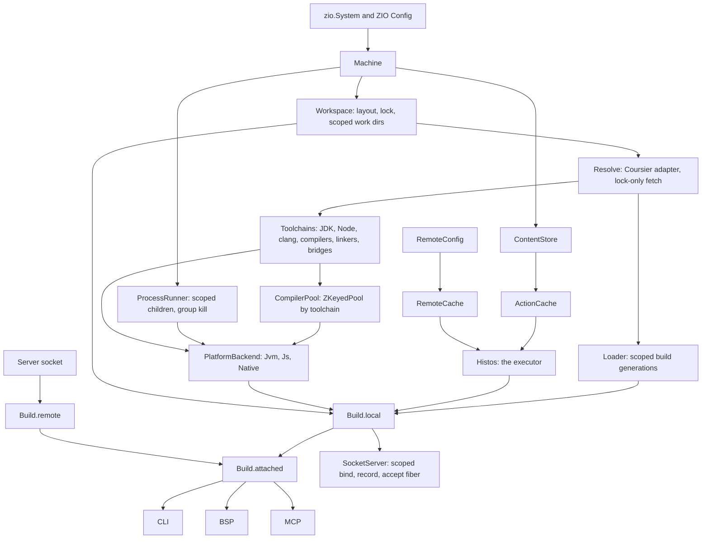
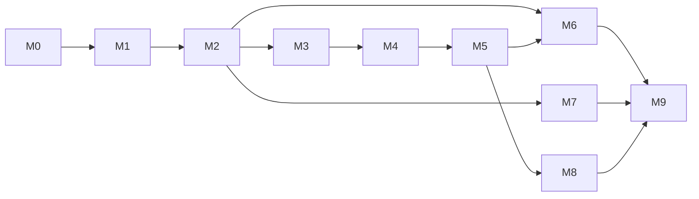

# Histos roadmap

**Status:** Draft for review
**Date:** 2026-10-22
**Baseline:** `main` at `7eeacb3`
**Companion:** [audit.md](audit.md), the ledger every milestone below closes

This file states what Histos is for, what exists today, the architecture we are building toward, and the order of work. [architecture.md](architecture.md) describes the tree as built, and [plugins.md](plugins.md) is the plugin contract. M0 retired `plan.md` and turned `design.md` into `architecture.md`. "Design decision 12" below is the rule from that retired file that MCP results are the CLI text.

## Why Histos

Scala deserves a build tool built from the language's best idea about effects.

sbt's task engine predates effect systems. Its settings and three scope axes form a macro language, AutoPlugin triggers change builds the author never named, and the meta-build is a second project with its own classpath. Mill made tasks cached functions, which was the right step, but a Mill task is plain Scala: failure is an exception or a `Result`, a long-lived resource is a worker with a close hook, and concurrency is the evaluator's thread pool. Those pieces do not compose the way an effect does.

Histos treats a build as a typed value and every capability of the build as a ZIO effect. Effects compose, so compile, link, test, package, and publish are steps that combine. The `Histos` executor runs them in parallel along the dependency graph, keeps going past independent failures, and interrupts cleanly. Services and scoped layers own every resource a build opens: compilers, class loaders, child processes, sockets, temp directories, and HTTP clients. Aspects decorate capabilities the way `TestAspect` decorates a spec and heddle `Middleware` decorates routes: caching, remote send, timing, tracing, retries, permits, and sandboxing are decorations applied with `@@`.

The same build serves a person at a terminal, Metals over BSP, and an agent over MCP, through one application service.

## Principles

1. **The build is a value.** Evaluating `histos.scala` yields an immutable, validated `ProjectGraph`. Literals for versions, coordinates, and names fail at compile time. The graph holds descriptions and the engine holds effects.
2. **Every capability is a typed effect.** A build step is `Step[R, E, A]`: a stable identity, declared inputs, and a `ZIO[R & Scope, E, A]`. Built-in work and plugin work use the same type. What the cache may do with a step is a subtype (`LocalStep`, `CachedStep`, `HermeticStep`), so the compiler rejects caching a publish. Specific work gets domain aliases (`CompileStep`, `TestStep`).
3. **Steps compose and `Histos` runs them.** Dependencies are step values, so the `Histos` executor sees the whole graph before it runs. A step starts when its own upstreams finish. An independent failure never hides another one: failures are data in the outcome.
4. **Resources belong to services, and services come from scoped layers.** Anything that opens closes on success, failure, and interruption. Long-lived resources (a compiler instance, a build class loader, a socket) are pooled or versioned by a layer, and nothing escapes its scope.
5. **Aspects decorate capabilities.** Cross-cutting behavior is a `StepAspect` applied with `@@`, composed like `TestAspect` and heddle `Middleware`. The build file attaches decorations as data, and the engine interprets them, so the graph stays pure.
6. **Errors are typed all the way out.** Every service has an error enum. Adapters map platform failures at the boundary, with the path, coordinate, or URL and a reason enum. Wrapping nests the inner error. `message` is a rendering for surfaces. Tests match values.
7. **The lock is the authority for every byte.** User dependencies, compilers, linkers, bridges, plugins, JDKs, and Node all resolve through the lock with a checksum. A cache key is portable across machines.
8. **One application service, many surfaces.** The CLI, BSP, MCP, and the server wire are codecs over one `Build` service. A surface decodes, calls the service, and encodes.
9. **Agent-native means typed.** The type rule holds on MCP too: every tool returns a typed report or a typed fault, and none returns a bare `String`. Agents receive streamed progress, and they cancel by run id.
10. **The build describes CI.** The workflow is a render of the graph's needs, with a drift check. Tool setup comes from what the graph builds.
11. **Histos builds Histos at every step.** Each PR keeps `./histos test` and `./histos workflow --check` green on this repository and keeps the snapshot launcher loop working.

## Where we are

About 35,700 lines of Scala across `api`, `central`, `engine`, and `app`. The house style holds in the basics: more than 100 error enums, opaque types with literal macros, and an `app` module with no `throw`, `return`, `null`, `var`, casts, or partial accessors. The gaps are architectural. The scheduler exists and only plugins use it, most layers are `ZLayer.succeed` of an `object`, errors are flattened to strings at the protocol edge, and several toolchain decisions never reach the processes that run.

| Capability | State | Notes |
| --- | --- | --- |
| Typed graph, literals, `BuildError` | Works | Reports the first error only. `Module` has 18 fields and many overloads (G1 to G3). |
| Build file load, plugin header, `ApiBoundary` | Works | Context class loader handling and sticky refusals are unsafe in a long-lived server (B10, B11). |
| Dependency resolution and lock | Works for module dependencies | Compilers, linkers, semanticdb, and bridges bypass the lock (L1). |
| JVM compile, Scala 3 and 2.13, via Zinc | Works, never incremental | Fresh compiler and empty previous result on every compile (S8). Layer barrier between topological layers (K5). |
| Failed cell does not cancel siblings | Compile yes, test no | P4. |
| Test subprocess, providers, `testOnly`, `testQuick`, watch | Works | Process groups, line threads, and the quick stamp need work (B16 to B19, P6). |
| Scala.js link, run, test | Works on a prepared machine | Bridges are Scala source in strings, recompiled per run. Node comes from `PATH` (P1, P2, B22). |
| Scala Native link, run, test | Works on a prepared machine | `HISTOS_NATIVE` is dropped at compile and test (B23). Relinks from scratch (P2). |
| JDK selection and provisioning | Selection works | Engine staging is zip-only (B24). |
| Node selection | Display only | B22. |
| Local Maven publish | Works for JVM-only modules | Jvm+Js collide on one jar (B1). |
| Snapshot upload | Works | Accepts http with Basic auth, never closes its client, ignores interrupt (B28 to B34). |
| Assembly | Works for this repository only | Hardcoded modules and main class (P8). |
| Version catalog (zipx scheme) | Works | |
| CI render and drift check | Works | Tool steps come from a marker file and a Boolean (C1). |
| Plugins: loader, link strategies, run, CI jobs | Works against a fixture | No real plugin yet. |
| Scheduler and action cache | Plugins only | Compile, test, publish, and run bypass it (K1). |
| Remote cache | In-memory stub | No client or configuration (D10). |
| Server: attach, reload, reboot | Partial | Client loads before attaching, reboot leaves the old JVM, a Metals-only session never reloads (B2 to B8). |
| BSP for Metals | Works on JVM | Single in-flight request, no cancel (A10). |
| MCP | Works | String results, serial requests, no progress (A2, A8, A23). |
| ACP | Handshake only | It is not the Agent Client Protocol. Dropped in M0 until an agent client needs it (A11). |

## What we keep, change, and drop

**Keep.** These parts of the vision earned their place:

- The pure, validated graph with compile-time literals and exact Scala versions.
- Explicit plugin enablement: a header names the jar and `use` names the plugin. The `ApiBoundary` class loader design. Plugins compile against `histos.api` only.
- The lock as the authority, with checksums and no silent re-solve.
- Separate classpaths per module, one subprocess per test cell, and continuation past independent failures.
- One-shot batch by default, an opt-in warm server, and reload in the same JVM.
- The frozen script launcher and a JVM engine.
- Metals through a native BSP session. No Bloop export and no presentation compiler of our own.
- Sendability through `Seal`, `Need`, and `Sendable.decide`.
- zipx version identity and the rendered workflow with a drift check.
- From the 2026-10-16 draft: one action type for local runs, the local cache, a remote cache, and later remote execution. Generators (protobuf, OpenAPI) as steps whose outputs feed compile. Publishers behind one interface, with credentials and signing as layers.

**Change.**

- A closed `TaskKind` plus hand-wired pipelines becomes `Step` values run by the `Histos` executor, with caching and remote send as aspects.
- `ZLayer.succeed(object)` becomes services with constructor injection that own their resources in scoped layers, including a pooled compiler.
- Per-platform copies become `PlatformBackend` layers.
- Toolchain fetches outside the lock become locked tool cells.
- String results on MCP become typed reports and typed faults. This retires design decision 12 (MCP results as CLI text).
- CI tool steps from a marker file become steps derived from the graph's needs.
- Anonymous `ModuleDef => ModuleDef` settings become recorded module aspects, and string notes become typed keys.
- Errors flattened to `message` become nested enums.

**Drop.**

- ACP, until an agent client needs the real protocol.
- Dead code: `ToolchainView`, `runCells`, stub compile nodes, stale `Stale` cases, test-only code in main sources.
- Scala source generated as strings.
- Design prose that narrates code line by line.

## Target architecture

The signatures below are sketches of unbuilt code, kept until each one lands and becomes a link. Sections that say a miniature proved them record what Scala accepted.

### Steps

`Step` lives in `histos.api`, under the package `histos.step`, so plugins build steps with the same type the engine uses. The api already depends on ZIO for `HistosPlugin.run`, and this commits to that dependency (decision 1).

```scala
package histos.step

enum Phase:
  case Generate, Compile, TestCompile, Link, Test, Package, Publish, Run

/** Stable identity of a step in one graph. */
enum StepId:
  case Cell(module: ProjectName, version: ScalaVersion, platform: Platform, phase: Phase)
  case Plugin(task: PluginTaskId)

/** What identifies the work. The digest is these inputs plus the content hash of each upstream value. */
final case class StepInfo(id: StepId, inputs: Chunk[Input], needs: Set[Need])

/** How a value is kept in the action cache, hashed into a downstream key, and which files a hit must find. */
@implicitNotFound("${A} has no Stored codec, so it cannot be cached or feed a hermetic step")
trait Stored[A]:
  def encode(value: A): Chunk[Byte]
  def decode(bytes: Chunk[Byte]): Either[StoredError, A]
  def outputs(value: A): Chunk[OutputFile]
```

### Kinds are subtypes, names are aliases

Steps differ in what the cache may do with them, and that difference belongs in the type. One rule decides between the two tools:

- **Subtype** when `Histos` or an aspect treats the step differently. The compiler then rejects the wrong combination.
- **Alias** when only the name changes, so signatures read like the domain.

The kind is a covariant phantom parameter on one core class. The aliases hide it, so the name people write is still `Step[R, E, A]`.

```scala
sealed trait StepKind
object StepKind:
  sealed trait Local extends StepKind     // never cached: run, publish, open plugin tasks
  sealed trait Cached extends StepKind    // the local action cache may serve it: test
  sealed trait Hermetic extends Cached    // local and remote caches may serve it: compile, link, package

type Step[-R, +E, +A]         = Step.Of[R, E, A, StepKind]
type LocalStep[-R, +E, +A]    = Step.Of[R, E, A, StepKind.Local]
type CachedStep[-R, +E, +A]   = Step.Of[R, E, A, StepKind.Cached]
type HermeticStep[-R, +E, +A] = Step.Of[R, E, A, StepKind.Hermetic]

object Step:
  sealed trait Of[-R, +E, +A, +K <: StepKind]:
    def @@[R1 <: R, E1 >: E, K2 <: StepKind](aspect: StepAspect[R1, E1, K2])(using Fits[K, K2]): Of[R1, E1, A, K]
    def zip[R1 <: R, E1 >: E, B, K1 >: K <: StepKind](that: Of[R1, E1, B, K1]): Of[R1, E1, (A, B), K1]
    /** A pure derivation. It keeps the kind and is never stored. `@@` decorates the step it derives from. */
    def map[B](f: A => B): Of[R, E, B, K]

  /** Each constructor pins the output type first, so `R` and `E` come from the effect. */
  def local[A]: MakeLocal[A]
  def cached[A: Stored]: MakeCached[A]
  def hermetic[A: Stored]: MakeHermetic[A]

  extension [R, E, A, K <: StepKind](upstream: Of[R, E, A, K])
    /** The key hashes the upstream value, so a step of any kind may feed a hermetic one if its value has a codec. */
    def andThenHermetic[B: Stored](info: StepInfo)(using Stored[A]): ThenHermetic[R, E, A, B]

  extension [R, E, A](step: CachedStep[R, E, A])
    def sandboxed: HermeticStep[R, E, A]

@implicitNotFound("this aspect decorates ${Need} steps, and the step is ${Have}")
final class Fits[-Have, +Need] private (val proof: Have <:< Need)
```

Domain aliases sit on top of the kinds and live next to the services they name. The engine defines the built-in ones, and a plugin defines its own the same way.

```scala
type GenerateStep = HermeticStep[Generators, GenerateError, GeneratedSources]
type CompileStep  = HermeticStep[Compilers, CompileError, CompiledCell]
type LinkStep     = HermeticStep[Linkers, LinkError, Linked]
type PackageStep  = HermeticStep[Workspace, PackageError, PackagedJar]
type TestStep     = CachedStep[ChildProcess, TestError, TestReport]
type PublishStep  = LocalStep[Publisher, PublishError, Published]
type RunStep      = LocalStep[ChildProcess, ProgramError, ExitStatus]

def compile(plan: CompilePlan): CompileStep =
  Step.hermetic[CompiledCell](plan.info)(ZIO.serviceWithZIO[Compilers](_.compile(plan)))

val linked: HermeticStep[Compilers & Linkers, CompileError | LinkError, Linked] =
  compile(plan).andThenHermetic[Linked](info.link(cell)): classes =>
    ZIO.serviceWithZIO[Linkers](_.link(classes))

// A network generator is local, and its output is content, so the compile it feeds stays hermetic.
val generated: LocalStep[Network, FetchError, GeneratedSources] = fetchSchema(url)
val compiledGenerated =
  generated.andThenHermetic[CompiledCell](info.compile(cell)): sources =>
    ZIO.serviceWithZIO[Compilers](_.compile(plan.withSources(sources)))
```

What the kinds buy:

- `publish @@ StepAspect.cached` and `run @@ StepAspect.remote` fail to compile. Today `Sendable.decide` catches them at runtime.
- `testQuick` becomes `test @@ StepAspect.cached` over the step digest, which already covers every declared input. `SuiteStamp` and its incomplete stamp go away (P6).
- `sandboxed` turns the original rule "tests become sendable only after the jail exists" into a type: a test is a `CachedStep` until the sandbox lifts it to `HermeticStep`.
- A plugin task's kind is its type. The seal printed on the graph is read from the step, so the declaration and the effect cannot disagree.
- `Histos` reads a runtime mirror of the kind, set by the same constructor that sets the phantom, together with the step's `Need`s. That is what `Sendable.decide` becomes.
- A hermetic step keys its upstream by content. A comment-only edit that leaves the classes byte-identical makes link and package cache hits (early cutoff), and a network generator can feed a hermetic compile.

ZIO-style shorthand such as `UStep[A]` and `URStep[R, A]` waits until the first infallible step needs it.

**Proved in two miniatures on 2026-10-22** (Scala 3.10.0, ZIO 2.1.27, clean under `-Wunused:all`, no casts):

- `@@` keeps the kind: `compiled @@ timed @@ cached @@ remote` is still a `CompileStep`.
- An aspect on the wrong kind is a compile error with a readable message, for example "this aspect decorates StepKind.Hermetic steps, and the step is StepKind.Local". That covers `remote` or `cached` on a local step, `remote` on a cached test, `remote` on a mapped cached step, and `remote` on a zip that mixes hermetic and local steps.
- The aspect's kind is contravariant, so widening `remote` to an any-kind aspect is rejected, and the restriction cannot be bypassed by an upcast.
- Composing aspects intersects their kinds in either order: `remote @@ timed` and `timed @@ remote` both decorate a compile and are both rejected on a test.
- `zip` infers the weakest kind: hermetic with hermetic stays `HermeticStep`, and hermetic with local is `Step`.
- The partially applied constructors infer `R` and `E` from the effect, and a dependent step's lambda input is already typed.
- Error channels infer as unions: a compile, link, test, package chain is `CompileError | LinkError | TestError | PackageError`, and a zip adds a fifth type without widening.
- A local step whose value has a codec feeds a hermetic step. A value without one fails with "Opaque has no Stored codec, so it cannot be cached or feed a hermetic step".
- `map` keeps the kind, and `@@ remote` on a mapped compile decorates the compile.
- `StepAspect.lift` accepts ZIO aspects, including `timeoutFail`, which adds its error to the union.
- `sandboxed` lifts a cached step, after which `@@ remote` compiles.
- The runner is a pattern match over the step ADT with no casts or unchecked patterns.
- `@@` on a `zip` group decorates every member, the way `TestAspect` decorates a suite. `@@` on a dependent step or a mapped step decorates the step that does the work.

**Left for implementation:**

- The message for a mixed group names the top kind `StepKind`. It should say "mixed".
- The `Stored` codec for class directories hashes the class files. That is the cost of early cutoff.
- How `Histos` performs on a large graph, measured in M3.

### The `Histos` executor

The executor is the `Histos` service, named for the tool the same way ZIO's effect type is named for its library. It lives in the engine package `histos.schedule` and replaces `Scheduler` there. The root `histos` package is the api surface that `ApiBoundary` shows to plugins, so the executor stays out of it.

`Histos` generalizes today's `SchedulerLive`: one promise gate per distinct `StepId`, digests from declared inputs plus the content hash of each upstream value, and execution as soon as a step's own upstreams finish. Parallelism is bounded per resource class (CPU-heavy compile, IO-heavy fetch, child processes).

```scala
package histos.schedule

trait Histos:
  def start[R, E, A](goal: Step[R, E, A]): URIO[R & Scope, Running[E, A]]

object Histos:
  val live: ZLayer[ActionCache & RemoteCache & Parallelism, Nothing, Histos]

final case class Running[+E, +A](
    events: ZStream[Any, Nothing, StepEvent[E]],
    outcome: UIO[Outcome[E, A]],
)

enum Outcome[+E, +A]:
  case Done(value: A)
  case Failed(failures: NonEmptyChunk[StepFailure[E]])

enum StepFailure[+E]:
  case Failed(id: StepId, cause: Cause[E])
  case Skipped(id: StepId, upstream: NonEmptyChunk[StepId])

enum StepEvent[+E]:
  case Started(id: StepId)
  case Noted(id: StepId, note: StepNote)
  case Finished(id: StepId, source: Source, took: Duration)
  case Stopped(failure: StepFailure[E])

enum Source:
  case Ran, LocalHit, RemoteHit
```

`StepNote` carries diagnostics, suite events, and child output lines. The CLI renders events. BSP maps diagnostics to `build/publishDiagnostics`. MCP maps events to progress notifications.

### Aspects

The aspect has heddle's `Middleware` shape, plus the lowest kind it accepts. It receives the step, including its key and codec, so a cache aspect can encode values without a cast. Because `K` is contravariant, an aspect for any kind applies everywhere, and a hermetic-only aspect applies to hermetic steps alone. The check is `Fits` evidence on `Step.@@`, which is what gives the readable message.

```scala
trait StepAspect[-R, +E, -K <: StepKind]:
  def apply[R1 <: R, E1 >: E, A, K1 <: StepKind](step: Step.Leaf[R1, E1, A, K1]): Step.Leaf[R1, E1, A, K1]
  /** The composite accepts only the steps both sides accept. */
  def @@[R1 <: R, E1 >: E, K2 <: StepKind](that: StepAspect[R1, E1, K2]): StepAspect[R1, E1, K & K2]

object StepAspect:
  val identity: StepAspect[Any, Nothing, StepKind]
  def lift[R, E](aspect: ZIOAspect[Nothing, R, E, Any, Nothing, Any]): StepAspect[R, E, StepKind]
  val timed: StepAspect[Any, Nothing, StepKind]
  val traced: StepAspect[Any, Nothing, StepKind]
  def exclusive(locks: OutputLocks): StepAspect[Any, Nothing, StepKind]
  def limited(pool: Parallelism): StepAspect[Any, Nothing, StepKind]
  def retry(policy: Schedule[Any, FetchFault, Any]): StepAspect[Any, Nothing, StepKind]
  def pluginLoader(loader: BuildLoaderLease): StepAspect[Any, Nothing, StepKind]
  val cached: StepAspect[ActionCache, Nothing, StepKind.Cached]
  val declaredOutputs: StepAspect[Any, Nothing, StepKind.Cached]
  val remote: StepAspect[RemoteCache, Nothing, StepKind.Hermetic]
```

`Scheduler.publish` already contains four aspects written inline: the local cache, the manifest file check, the remote lookup, and the upload by verdict. M2 extracts them. `ZIOAspect` from ZIO core covers effect-only decorations through `lift`.

Aspects come from three places:

- **The engine** applies defaults: `cached`, `remote`, `exclusive`, `limited`, `timed`.
- **A plugin** decorates its own steps, for example `retry` on a network fetch.
- **The build file** attaches `Decoration` values, which the engine interprets. The graph never stores a function.

```scala
// histos.api
enum Decoration:
  case Timeout(limit: Duration)
  case Retry(attempts: Attempts)
  case Serial
  case NeverCache

module("core", Jvm)(scala"3.10.0").decorate(Decoration.Timeout(10.minutes))
```

Histos's own tests already use the idea: [`Requires`](../engine/test/Requires.scala) is a ZIO Test aspect that ignores a spec when a machine tool is missing.

### Services and layers



Rules for this graph:

- Implementations are case classes with constructor injection (`ZLayer.derive` where it fits). A trait exists only where two real implementations exist: `Build.local` and `Build.remote`, a live and an in-memory `RemoteCache`, three `PlatformBackend`s.
- `Machine` is the only reader of the environment and JVM properties. `HISTOS_*` settings are ZIO Config, validated at startup.
- The batch command builds the graph once and exits. The server builds it once and keeps the scoped resources (`CompilerPool`, build generations, the socket) for its lifetime.

### Errors

- Every service has an error enum, and IO cases carry `path` and an `IoFault` reason enum mapped at the adapter.
- A wrapping case nests the inner enum. `PluginRunError.Compile(GraphCompileError)` replaces `Failed(PluginDetail(error.message))`.
- Inside composition, error channels are inferred unions. The `Build` service maps each union into one closed `CellError` enum that nests each domain error. That gives the wire codec, the MCP schemas, and `CliExit` a tagged, exhaustive shape, and it works because a closed enum has the `Mirror` that `derives JsonCodec, Schema` needs, where a union has none.
- Step failures are `Outcome` data. `BuildFault` is for requests that could not start: a bad selection, a broken build file, a different server version.
- Defects keep their `Cause` in `StepFailure` and render by class name.

### One application service

```scala
trait Build:
  def submit(request: Request): ZStream[Any, BuildFault, BuildEvent]
  def cancel(run: RunId): IO[BuildFault, Unit]

enum Request derives JsonCodec:
  case Compile(selection: Selection)
  case Test(selection: Selection, suites: TestSelection)
  case Publish(target: PublishTarget, selection: Selection)
  case Run(target: RunTarget)
  case Graph, Toolchain, Reload
  case Resolve(action: ResolveAction)
  case Workflow(action: WorkflowAction)
  case Assembly(destination: Option[RepoPath])

enum TestSelection derives JsonCodec:
  case All
  case Only(patterns: NonEmptyChunk[SuitePattern])
  case Quick

enum BuildEvent derives JsonCodec:
  case Started(run: RunId)
  case Step(event: StepEvent[CellError])
  case Finished(report: Report)
```

`Build.attached` reads `.histos/server.json` and picks `Build.remote` or `Build.local`. The CLI maps a `Report` to `CliExit` in one function.

MCP follows the same type rule as every other surface. Each tool's output schema is a tagged enum of its report and `BuildFault`, so a fault is typed and still validates against the declared schema, which is the check that pushed design decision 12 to strings. `isError` marks the fault case. A build that ran and failed is a report, because the outcome is data.

```scala
enum CompileResult derives Schema, JsonCodec:
  case Report(outcome: ReportOutcome, cells: Chunk[CellReport], diagnostics: Chunk[Diagnostic], text: String)
  case Fault(fault: BuildFault)
```

The `text` field on a report is a rendering for agents that want prose. Cancellation is one path: the server mints the `RunId`, and socket EOF, MCP `notifications/cancelled`, and BSP `$/cancelRequest` all call `cancel`.

## Milestones

Each milestone is one GitHub stack. Each PR closes named ledger rows and checks them in [audit.md](audit.md). A bug PR starts with the failing test. A PR that questions a ZIO mechanism starts with a miniature spec.

### M0. Truth and a safety net

**Goal:** Docs describe this tree, tests catch a refactor that changes an error, and unused surface is gone before the refactors start.

- `histos/drop-acp`: delete `app/src/histos/acp`, the `acp` root command, its tests, and its mentions in the README and docs. `acp` stays in `CommandName.reserved`, so a plugin cannot claim the word before ACP returns. Closes A11.
- `histos/docs-truth`: `design.md` becomes `architecture.md` (modules, process model, BSP table, error enums, without line references). `plan.md` is deleted. `plugins.md` is corrected and its examples compile. README points at the roadmap. Closes D1 to D21.
- `histos/typed-asserts`: tests match error values, cover the four untested `BuildError` cases, and stop flattening errors to `IllegalStateException`. Closes T1 to T5.
- `histos/test-aspects`: a `Requires(Tool.*)` `TestAspect` for clang, Node, npm, Firefox, and the ivy-local Scala Native jars. Network use is not gated, because Coursier's cache serves those specs offline. `zio.System` with `withLiveSystem` in tests. Remove stray SemanticDB files and find their writer. Closes T6 to T9.

**Exit:** no test identifies which error happened by its message, and no test flattens a typed error into an exception (`rg 'IllegalStateException\(.*message|left\.map\(_\.message\)' */test` is empty). `.message` appears only where the rendering is the subject. `./histos test` passes on a machine without clang or Firefox and reports the gated specs as ignored.

### M1. Fix what is broken today

**Goal:** No known hang, leak, collision, or ignored toolchain decision. Each PR is small and independent.

- `histos/publish-platform`: one coordinate per platform cell. Closes B1.
- `histos/server-lifecycle`: attach before load, the listening promise completes from the accept fiber's exit, `serve` ends when accepting ends, interruptible reads (miniature first), finalizer order, fingerprint checks on BSP requests, a set of splices, and the dead `Stale` cases removed. Closes B2 to B9.
- `histos/plugin-isolation`: the context class loader is pinned to an executor whose threads carry the build loader (miniature first), refusals are per run, entry initialization is inside `attempt`, failures name the right plugin, digests use coordinate plus checksum, BSP build-file diagnostics compile the header-stripped unit with the plugin jars, and `izumi.reflect` crosses the boundary if a test proves it must. Closes B10 to B14, B38, B39.
- `histos/child-process`: `acquireRelease` around start, a process group for every child, a streamed line reader, and closed class loaders. Closes B16 to B21.
- `histos/toolchain-execution`: the resolved Node runs Js, `HISTOS_NATIVE` travels as a value, tar.gz staging that keeps file modes, atomic staging into a scoped temp directory, and a read-only probe. Closes B22 to B27.
- `histos/snapshot-publisher`: an https-only `SnapshotRepository`, `Config.Secret` credentials, a scoped `HttpClient`, an interruptible send, `zio.Clock`, a `Published` ADT, and parse errors with their own enums. Closes B28 to B34, B40.
- `histos/cache-hygiene`: temp files scoped and swept, a per-project keep set, and `cache clean` matching its contract. Closes B35 to B37.

**Exit:** each closed row has a test that failed before its fix. `ServerSpec` covers reload, `NoServer`, and reboot.

### M2. Steps, executor, aspects

**Goal:** The kernel from the target architecture runs compile, which is the hottest path, and plugin tasks.

- `histos/steps-api`: `histos.step` on the api: kinds, aliases, constructors, `zip`, `map`, `andThenHermetic`, `sandboxed`, `Fits`, `Stored`, and `StepAspect` with `lift`. The two 2026-10-22 miniatures become an api spec that asserts each accepted composition and each rejection message with `typeCheckErrors`, and the sketches in this roadmap become links to that code.
- `histos/executor`: the `Histos` executor service replaces `Scheduler`, with bounded parallelism, failure as data, and the event stream. The cache, manifest, remote lookup, and upload logic move out of `Scheduler` into `cached`, `declaredOutputs`, and `remote`. `timed` and `traced` are added.
- `histos/compile-steps`: compile cells become steps keyed by `CompileKey`. This deletes the layer barrier, the blocking-queue side channel, `runCells`, the discarded source hash, and the 9 to 12 parameter methods.
- `histos/plugin-steps`: plugin tasks run on `Histos`. `TaskDep.Compile` depends on real compile steps, the stub nodes go away, `pluginLoader` and `declaredOutputs` become aspects, and planning covers only reachable steps. Typed errors are nested.

**Exit:** a gated spec shows an unrelated cell compiling while a slow upstream in an earlier layer is still running. An identical second compile is a `LocalHit` through `cached`. `rg 'LinkedBlockingQueue|AtomicBoolean' engine/src` is empty. Closes K1 to K18.

### M3. Services that own resources

**Goal:** Resource ownership lives in scoped layers, and compile is incremental.

- `histos/machine-config`: `Machine.layer` from `zio.System`, with `HISTOS_*` as ZIO Config, and the test JDK fixtures read the same source. Closes S1, T12.
- `histos/workspace`: a `Workspace` service with one lock reader, one tree delete, and scoped work directories. IO errors carry the path and an `IoFault`. Blocking moves to `attemptBlocking`. Closes S2 to S4, S11, S13.
- `histos/process-runner`: `TestProcess` becomes `histos.process.ChildProcess`, used by test, link, run, and the JDK hand-off. Closes S10.
- `histos/incremental-zinc`: a persisted analysis store, a previous result, and a `CompilerPool` (`ZKeyedPool` keyed by the locked toolchain), scoped to the server or to one batch run. A precompiled provider runner removes the second compile. Closes S8, S9.
- `histos/service-shape`: case-class implementations with constructor injection, no 1:1 traits without a seam, `Resolve.scala` and `Loader.scala` split by concern, the `resolve` to `load` cycle removed, and context types where methods take more than five parameters. Closes S5 to S7, S12.

**Exit:** editing one file in this repository recompiles that file and its dependents, and `.histos/analysis` is populated. Two compiles in one server share a compiler instance. Record no-op and one-file-edit times for this repository before and after.

### M4. The lock covers every jar

**Goal:** Every byte Histos runs is pinned and checksummed, and tool versions are data.

- `histos/tool-lock`: a `ToolLock[T]` parser shared by the JDK and Node locks, one `ArchiveStage`, and one resolution walk. Closes L4 to L6.
- `histos/tool-cells`: compiler, semanticdb, Scala.js linker and environment, Chekhov, Scala Native tools, and bridge jars resolve through `Resolve` into tool cells in the lock. Every raw `coursier.Fetch(FileCache())` goes away, and one suffix function is used everywhere. Closes L1, L3.
- `histos/tool-versions`: `jsVersion` on the module beside `nativeVersion`, a typed tool catalog for the remaining defaults, and the build-file compiler version read from the running compiler. Closes L2, B15.
- `histos/launcher-verify`: the snapshot path verifies the pin, downloads and unpacks atomically, `histos.bat` matches the POSIX script, and `BootstrapSpec` runs as effects. Closes L7, L8, T13.

**Exit:** with the network off and the cache warm, every command in this repository runs. `rg 'FileCache\(\)' engine/src` is empty.

### M5. Platforms as backends

**Goal:** JVM, Js, and Native are three implementations of one service, and test, link, run, package, and publish are steps.

- `histos/toolchains`: a `Tool[T]` type class (lock, origins, home probe, archive format) with givens for `Jdk`, `Node`, and `Clang`, plus a `Toolchains` service. A scoped `ResolvedTools` layer resolves once per session, and every backend consumes it.
- `histos/bridges`: the Js and Native bridges become real modules in this repository, compiled by this build, shipped with the launcher snapshot, pinned as tool cells, and cached by tool and revision. Each bridge sits behind a `Bridge` seam keyed by tool and revision, so more than one implementation can coexist: two Scala.js linker revisions, or a Node and a browser JS environment. Closes P1, P2.
- `histos/backends`: `PlatformBackend` with `compile`, `link`, and `launch`, one layer per platform. The six launch copies in `ModuleTest` and the dispatch in `Program` collapse. Closes P3, P9 to P14.
- `histos/test-steps`: test cells become steps, and suite failures are data (the test half of design commit 4). Test-compile diagnostics become events. A test cell is a `TestStep`, a `CachedStep`, so `testQuick` is `@@ StepAspect.cached` over a digest that covers the linked classpath, the toolchain, and the flags, and `SuiteStamp` and `QuickRecord` are deleted, and the specs this step rewrites drop their `case _ => false` fallbacks and share one fixture. Closes P4 to P7, P15, T10, T11.
- `histos/assembly-steps`: assembly reads its modules and main class from the graph's assembly spec, and publish runs as `Step.local`. Closes P8.

**Exit:** `ModuleTest.scala` is gone or under 400 lines. A Js test uses the locked Node. A test failure in one cell leaves other cells' results in the report.

### M6. One application service, four codecs

**Goal:** Every surface is a thin codec over `Build`, and agents get structured results.

- `histos/wire-types`: `Request`, `BuildEvent`, `Report`, `BuildFault`, and `RunId` with derived codecs on the opaque types. `Call` and `Message(Int, String)` are deleted. Suite patterns are parsed at the edge, and a plugin command's arguments travel with the call. Closes A1, A3, A4, A12, A19, A21, A25.
- `histos/build-service`: `Build.local`, `Build.remote`, and `Build.attached`. The CLI becomes a renderer, the `*Local` copies and the package cycle go away, and one function maps a report to an exit code. Closes A5, A16 to A18, A20, A24.
- `histos/surface-aspects`: per-request fibers behind one writer, cancellation by `RunId`, write locks keyed by cell output directory in place of the global permit, and run-scoped log annotations. Closes A8 to A10, A13, A14.
- `histos/mcp-reports`: each MCP tool returns its tagged report-or-fault enum, progress notifications come from events, and `isError` marks the fault case. No tool result is a `String`. `ToolchainView` returns as the toolchain report or is deleted. The MCP section of `architecture.md` changes with it. Closes A2, A15, A23.
- `histos/bsp-thin`: a `Classpaths` service in the engine, a `BspMethod` enum, and an opaque `TargetUri`. Closes A6, A7.
- `histos/server-specs`: concurrent splices, a permit released on interrupt, and `testOnly` through the server. Closes A22.

**Exit:** `Cli.scala` is under 500 lines. An MCP compile failure returns diagnostics with path, line, and severity. An agent cancels its own test run.

### M7. The api grows up

**Goal:** The build file is shorter, illegal states do not typecheck, and plugins extend the build with typed steps.

- `histos/module-shape`: a `TestRunner` enum, platform settings on platform values (`Js(env, kind)`, `Native(revision, clang)`), one builder value in place of 16 `apply` and 5 `trusted` overloads, `BuildError` accumulated into a `NonEmptyChunk`, aggregates and edges that hold their children by reference, and positions that point at the referencing call. Closes G1 to G3, G12, G19 to G21.
- `histos/literals`: one `Literal[A, E]` type class behind every literal macro, a `ProjectName` literal and a constant-name check in `module`, interpolators that reject arguments by type, and typed `Dep` fields. Closes G4, G5, G7 to G9.
- `histos/scalac-literal`: a `scalac"..."` literal checked at compile time against a table of known flags, with the BSP rule for fatal warnings. This unblocks the ascent flags. Closes G13.
- `histos/module-aspects`: recorded `ModuleAspect(owner, name)` settings visible in `histos graph`, typed `NoteKey[A]` with a codec, and `Decoration`. Closes G14, G15.
- `histos/plugin-tasks`: a plugin task is a typed spec plus a `Step` of its declared kind. A hermetic plugin task is a `HermeticStep`, and the seal on the graph is read from that kind. `TaskDep` opens to this plugin's steps and to core cell phases, errors are nested, and `PluginFixture` sets compiled inputs, and specs cover what `plugins.md` describes: a run through the fixture, a full plugin lock cell, and a combined header. Closes G6, G10, G11, G16, G17, T14.
- `histos/central-shape`: one artifact type, one digest type, and the duplicates removed. Closes G18.

**Exit:** this repository's `histos.scala` and the ascent copy compile on the new builder. Moving a `jsEnv` onto a JVM-only module fails to compile.

### M8. CI from what the graph needs

**Goal:** The workflow is a pure function of the graph.

- `histos/ci-needs`: a `ToolSetup` ADT in `histos.workflow`, derived from the graph (Native needs clang of the declared major, a browser environment needs its pinned browser, and test-only tool needs come from the module). The `.github/ci-tools` marker and `setup: Boolean` are deleted. Closes C1.
- `histos/ci-matrix`: the CLI accepts `--platform` and `--scala`, and split axes render. Pull requests run the affected set. Closes C2.
- `histos/ci-publish`: a snapshot publish job on the default branch, contributed by the publish plugin.

**Exit:** `./histos workflow --check` passes with no marker file, and the rendered tool steps change when a Native module is added to a fixture graph.

### M9. Dogfood and the ecosystem

**Goal:** Histos replaces sbt and zipx for real early-effect repositories.

- The ascent copy at `~/projects/early-effect/ascent-histos`: tests, mains, flags, and a daily Metals session in Cursor.
- The Specular `HistosPlugin` in the Specular repository, on a snapshot of `histos.api`.
- A Central release plugin with credentials and signing as layers, following the 2026-10-16 publisher design.
- zipx surface plugins: docs, docker, deploy, coverage, and the dependency-update bot.
- A benchmark of cold, warm, no-op, and one-file-edit builds against sbt 2 and Mill on the ascent copy.
- These docs move to a Specular site built by Histos, where examples are compiled tests.

**Exit:** one early-effect library builds, tests, and publishes snapshots with Histos alone.

### Order



The critical path is M0, M1, M2, M3, M4, M5, M6. M7 can run beside M3 to M5 once the step types exist, because it touches the api and the build file. M8 needs the backends to know what each platform requires.

The order approved on 2026-10-20 maps onto this plan. The Metals BSP session and plugins already exist, and their bugs are in M1 and M6. The ascent tests and flags are M7 and M9. The Specular plugin is M9. Generated CI exists, and its marker file is M8. The Scala.js editor host waits until after M9.

## Decisions

Recorded 2026-10-22.

1. **`Step` lives on `histos.api`, in `histos.step`, and the api commits to ZIO.** Plugins build steps with the same type the engine runs. The api already depended on ZIO for `HistosPlugin.run`.
2. **Names.** The step type is `Step`, the familiar build word, and it reads cleanly in error text and MCP reports. Its decorator is `StepAspect`, following `ZIOAspect` and `TestAspect`. The executor service is `Histos`, the loom the tool is named for, in the engine package `histos.schedule`. Domain concepts keep their plain names: `ProjectGraph`, `Module`, `Outcome`. The CI renderer's tool steps are `ToolSetup`, which keeps them apart from GitHub's `steps:` and from `Step`.
3. **The type rule holds on MCP.** Every tool returns a tagged enum of its typed report and `BuildFault`. No tool result is a `String`. This retires design decision 12.
4. **ACP is dropped until an agent client needs it.** M0 deletes the handshake. The real Agent Client Protocol would return as a codec over `Build`. `acp` stays a reserved command word.
5. **Bridges are modules in this repository.** They are compiled by this build, shipped with the launcher snapshot, and pinned as tool cells. A `Bridge` seam keyed by tool and revision lets more than one implementation coexist.
6. **Lean into subtyping and aliasing.** What the cache may do with a step is a subtype (`LocalStep`, `CachedStep`, `HermeticStep`), carried as a phantom kind under the `Step[R, E, A]` alias. Specific work gets domain aliases (`CompileStep`, `TestStep`, `PublishStep`). Subtype when behavior differs, alias when only the name differs.
7. **A hermetic step keys its upstream by content.** The key hashes the upstream value through its `Stored` codec, which gives early cutoff and lets a network generator feed a hermetic compile. `andThenHermetic` needs a codec for the upstream value, whatever the upstream's kind.
8. **`map` keeps the kind and is never stored.** It is a pure derivation, and `@@` on it decorates the step it derives from.
9. **Unions inside, one enum at the edge.** Steps compose with inferred error unions. The `Build` service maps them into one closed `CellError` enum for the wire, MCP, and exit codes.

## Not now

Each has a direction and waits for the milestone that makes it cheap:

- A filesystem and network sandbox, as `StepAspect.sandbox(needs)`, before any test is sendable.
- A remote cache client and remote execution on the same `Step` and `remote` aspect.
- MiMa on `histos.api` and `LinkStrategy.Api`, at 1.0.
- An sbt importer, once a second repository repeats the ascent shape.
- The Scala.js editor host and a DAP server.
- A non-snapshot release of Histos. Integration stays on the snapshot channel until the feature is called complete.

## Working rules

- One stack per milestone, one PR per concern, and each PR checks its ledger rows.
- A suspected bug gets a failing test first. A question about a ZIO mechanism gets a miniature spec first. A question about type inference gets a `scala-cli` miniature first.
- Tests assert values: graphs, events, reports, and error cases.
- No new dependency without asking first, with the reason.
- Docs link to real code and do not copy it. Sketches of unbuilt code are fine until the code lands.
- Code comments explain only what the code cannot say: a constraint, a reason, or an outside rule.
- `./histos test` and `./histos workflow --check` stay green on this repository after every PR.
