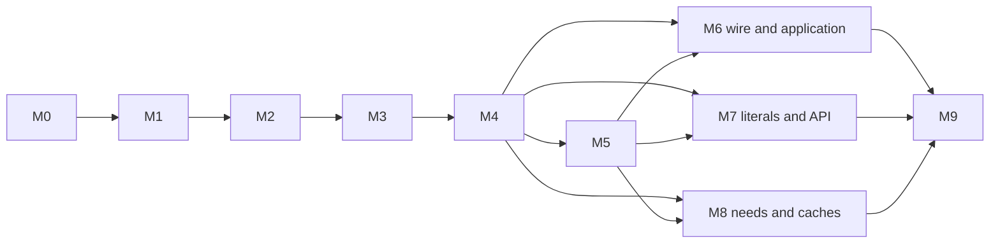

# Histos roadmap

M0-M3 establish the kernel and resource ownership. M4 adds tool identity, the JDK and Node floors, and the launcher pin. Later milestones build on those contracts.

[architecture.md](architecture.md) describes current source contracts. [audit.md](audit.md) preserves historical findings and owns every remaining concern. [plugins.md](plugins.md) is the current plugin contract. This roadmap is a plan, not another copy of implemented APIs.

## Direction

The build is immutable data. Work is a typed effect. Dependencies compose as Step values; Histos schedules them with bounded concurrency and independent failures as outcome data. Scoped construction owns compilers, classloaders, sockets, processes, temporary files and HTTP clients.

A human and an agent are the same operator. They drive the same operations through one typed request. The CLI renders a report and an exit. MCP returns that report as data and streams the same events. BSP is the editor protocol. `histos mcp`, `histos bsp`, and `histos server` start a transport and are not operations. The CLI, server, and MCP already share that request for the operations this tree implements. MCP publishes each CLI line before the JSON report. Cancel names the minted run id, and a second call interrupts the tool that is still running. Compile and test reports carry the diagnostic. Run, assembly, and publish still leave that chunk empty (A2).

Both operators see each decision as it happens, and either can ask what an operation will do before paying for it. The answer is the work plan: which units would run, and why. It is not a predicted duration.

The numbers a person reads are source files, class files produced this round, and modules (name, Scala version, and platform). A Zinc cell is a scheduling unit, not a tally. Until a class count is honest, the floor is source files.

The lock is authoritative for the dependency and tool artifacts it records. A JDK or Node floor is a minimum already installed on the machine. `.histos/toolchain.local` and `.histos/node.local` name a home the user already chose. Neither declared inputs nor these locks make arbitrary plugin code, system packages, clang, or browsers hermetic. Portable source-root identity and a real sandbox remain distinct work.

## Delivered foundations and current scope

| Milestone | State | What is present |
| --- | --- | --- |
| M0 | Delivered | Truthful baseline docs, typed test assertions, machine-tool test aspects, ACP deletion |
| M1 | Delivered | Platform publish coordinates, server lifecycle, plugin isolation, scoped child ownership, runtime choices reaching execution, safe snapshot publisher and cache hygiene |
| M2 | Delivered | Step kinds/composition/aspects, Histos executor, compile dependencies without layer barriers, real plugin compile steps, test/run/publish orchestration |
| M3 | Delivered | Captured Machine/config, path-bearing IO and Workspace scopes, shared ChildProcess, incremental Zinc and scoped batch compiler reuse, provider installation reuse, service/package separation |
| M4 | Implementation delivered | Typed tool catalog and lock cells, classifiers, selected byte identities, staged updates, JDK 21 and Node 25 floors, immutable launcher pin and update transaction |
| M5-M8 | Partly enabled, not delivered | M4 supplies tool/runtime data and verification seams. Backend, application, public plugin/API and graph-derived CI contracts remain |
| M9 | Future | Real second-repository adoption, real plugins and measured performance |

The core is linked rather than recopied: [Step](../api/src/histos/step/Step.scala), [StepKind](../api/src/histos/step/StepKind.scala), [Fits](../api/src/histos/step/Fits.scala), [Stored](../api/src/histos/step/Model.scala), [StepAspect](../api/src/histos/step/StepAspect.scala), [StepSpec](../api/test/StepSpec.scala), [Histos](../engine/src/histos/schedule/Histos.scala), and [ScheduleAspects](../engine/src/histos/schedule/ScheduleAspects.scala). Mixed-kind composition already exists. Public plugin submission of arbitrary typed Steps does not: its SPI remains descriptions plus run (G16).

M3 compiler reuse is scoped to a compile batch. Server-lifetime pool reuse and cold/warm/no-op/edit measurements were earlier goals without supplied completion evidence; they survive under P19, not as proof of S8. Unix Node/Native descendant ownership and pipe cleanup were completed under B42/B43. Windows engine support still belongs to P12.

## M4. Verify selected tool and runtime bytes

**Goal:** Exact artifact/runtime identities survive every consumer and cache boundary, with explicit update authority and no hidden tool solve.

### Decisions and tradeoffs

- **Catalog as data.** ToolCatalog separates compiler, Js and Native defaults; modules override Js/Native revisions. New versions do not require another engine literal. The broader platform-only builder shape remains M7.
- **Explicit dependency transaction.** `resolve --update` stages plugins, loads that generation, solves module/tool cells, and commits once after success. Ordinary execution fetches/checks exact locked bytes. `--check` still re-solves module/plugin drift, but not tool graphs.
- **Selected tool identity.** ToolInput names the chosen role/version/variant and verified artifacts, including classifiers. Compile, pool and execution keys need their relevant subsets. One captured lock generation covers an operation; the next request can choose a new one.
- **Embedded provenance is separate.** Running Dotty compiles the build/source plugins; module and auxiliary bridge compilers come from tool cells. Source cache keys need actual embedded support/runtime bytes, not only the API digest and version text.
- **Installed platform floors.** Histos does not install a JDK or Node. The running JVM, or `toolchain.local`, must be JDK 21 or newer. A Js module needs `node` on `PATH`, or `node.local`, at Node 25 or newer. A newer version satisfies the floor. A present override that is missing or too old is rejected.
- **Immutable launcher pin.** Startup consumes exact revision and hash, never latest metadata. Only dedicated launcher update reads metadata, streams bounded bytes, serializes commit across processes, checks for concurrent pin changes, and replaces the pin last. Workflow rendering consumes the existing pin offline. The script finds `java` and runs that jar.
- **One current PR.** The M3 resource follow-ups and M4 concerns stay together by explicit approval. The prior M3 merge remains historical; no extra stack is required for this integration.

See [ToolCatalog](../api/src/histos/ToolCatalog.scala), [LockedTools](../engine/src/histos/resolve/LockedTools.scala), [ToolInput](../engine/src/histos/resolve/ToolInput.scala), [BuildCompiler](../engine/src/histos/toolchain/BuildCompiler.scala), [Toolchain](../engine/src/histos/jdk/Toolchain.scala), [NodeToolchain](../engine/src/histos/node/NodeToolchain.scala), and [LauncherPin](../engine/src/histos/publish/LauncherPin.scala).

### Delivered acceptance slices and final platform gate

1. **Consumers and keys:** Js TestMain override/kind, Native application Scala versus bridge Scala, selected-key relevance, root completeness, classifiers, empty-graph mandatory tools, quick-success validation, current runtime selection and embedded provenance. Owns L1-L3, B15, L9-L14 and L20.
2. **Platform floors:** JDK 21 and Node 25, numeric comparison, and rejection of a present override that is missing or too old. Owns L4-L6, L8, and L15-L18, which are superseded: Histos does not install a JDK or Node.
3. **Launcher and transport:** Realistic fixed, chunked, and close-delimited payloads, bounded atomic update, cross-process conflict, pin and cache-privacy checks, and script drift. Owns L7, L19, T13, and S16's compiler-acquisition follow-up. T16 is superseded.
4. **Integrated proof:** Rebuild the final source runtime, run the complete repository suite and targeted regressions, check lock/workflow/scripts, prove warm local commands with external networking denied, then publish the approved API/launcher snapshots and verify/repin their exact bytes. Re-review every general/security/simplicity finding.

Acceptance is defined by the complete suite, deterministic lock, workflow, and script checks, selected-byte cache regressions, and offline command behavior. The exact artifact identity lives in the [launcher lock](../.histos/launcher.lock); current test and CI results belong to the PR. Publishing and deliberate remote updates use the network.

Source-root portability, clang and browser packaging, and sandboxing retain their later milestone owners. The Windows launcher script is not an execution gate.

## Target boundaries still to build

- **PlatformBackend:** compile, link, launch and packaging use typed requests/results. Shared orchestration stays outside adapters. Resource/tool views are operation-owned, with verified identity retained until the child boundary. No Tool[T]/Toolchains/ResolvedTools layer is added merely to rename working services.
- **Build application service:** local and remote implementations share Request, BuildEvent, Report, BuildFault and RunId. Internal error unions map to one closed CellError enum nesting domain errors. A request that cannot start is a fault; completed failed cells are report data.
- **Surface codecs:** CLI maps a report to an exit in one place. BSP maps typed diagnostics and cancels by run id. MCP exposes the same operations as the CLI, with tagged report-or-fault schemas plus progress. Text is an optional rendering, never the only result shape. The socket codec preserves the same typed contract. The M6 exit is this boundary: parity, observation, and preview, not only a schema.
- **Session resources:** Build owns build-generation leases and scoped compiler/resource reuse. Runtime selections refresh per operation, not indefinitely with an old server graph. Concurrent requests need output-scoped locks, not one global run permit.
- **Public plugin steps:** A task's cache kind must come from the typed Step rather than a separate declaration that can disagree. Core phase dependencies and a deliberate API classloader boundary replace the current Compile/Same limit.
- **Recorded build data:** Platform settings, TestRunner, module aspects, typed notes and CI tool needs are data. Illegal combinations do not typecheck; runtime input parsers retain typed errors.

The existing Step algebra does not by itself provide these services, a sandbox, a live remote cache or portable cache keys.

## M5. Execution and platform contracts

**Goal:** Complete test/link/run/cache semantics before consolidating platform adapters.

Some work once assigned here already exists: test, run, and publish are Steps, the chosen Node reaches Js launches, and M4 provides the JDK and Node floors. Do not reimplement those foundations.

Proposed focused slices:

- **Test outcomes and cache:** Preserve independent preparation/suite failures as data, emit full test-compile diagnostics, replace incomplete SuiteStamp/QuickRecord behavior with a complete typed digest/persistence contract, including upstream jars and flags. M4's verified runtime/tool seam stays in M4. Owns P4-P7/P15.
- **Fixtures and portable keys:** Share typed scoped fixture construction without broad Central catalog substitution, retain resolver/cache policy, and model source roots explicitly. Owns T10/T11/T15 and P16. Incorrect M4 fixture policy remains an M4 verification obligation (T17).
- **Compiled bridges:** Ship bridge modules compiled by this build and pinned through tools; cache bridge/link work by selected revision and inputs. Permit coexisting Js/Native revisions/environments behind a narrow Bridge seam. Owns P1/P2.
- **Backends and runtime reports:** Consolidate the repeated test, provider, and run paths and dispatch, finish typed adapter errors, remove dead APIs, repair eager machine and path probes, and close Windows engine gaps. Owns P3, P9, P10, and P12-P14. P18 is superseded: toolchain reports the runtime it accepted.
- **Packaging/resource policy:** Honor the graph assembly spec, move publisher filesystem checks into effects, remove LazyVals partiality and casts, and define cleanup-failure reporting without weakening ordinary cancellation safety. Owns P8, P11, and P20. P21 is superseded: Histos does not parse JDK or Node archives.

Tool request namespace/component duplication remains current integration work (L21), not a promise that a constant magnet is the final backend design.

**Exit:** Mixed platform/revision tests consume the correct bytes, one preparation failure does not hide independent cell results, no incomplete quick success is accepted, and packaged bridge/cache reuse is measured. File length is not an acceptance criterion.

## M6. One application contract, four codecs

**Goal:** A human and an agent request the same operation, see the same decisions, and can read what the operation will do before it runs. Reports, progress, and cancellation are that operation, not a separate channel per surface.

Attach-before-load, reload/reboot and every-splice BSP target changes already exist. Source request-lock/runtime work in M4 is a prerequisite, not completion of this service. Parking this work after M9 would make the agent an afterthought. P6 and P15 are delivered. The preview still does not say which suites testQuick would skip. A compile preview does not.

- **Wire types:** Typed selections, test modes, targets, events, reports, faults and run ids; preserve plugin command arguments. Owns A1/A3/A4/A12/A19/A21/A25.
- **Build local/remote/attached:** Delete duplicated continuations/renderers and package cycles; centralize exit mapping, generation leasing and resource construction. Owns A5/A16-A18/A20/A24 and P19's session reuse/measurements.
- **Multiplex and cancel:** Per-request supervised fibers, one serialized writer, run-id cancellation and output-directory locks; propagate diagnostics/progress without IO defects. A8 and A23 are delivered: the session reads while a tool runs, each CLI line is a notification, and cancel of the minted id interrupts that fiber. A9, A10, A13, and A14 remain.
- **Thin BSP/MCP:** Engine classpath service, typed BSP method/target URI, tagged MCP report/fault schemas and progress. Owns A2/A6/A7. A15's unused ToolchainView is now deleted, not a new reporting abstraction to preserve. BSP stays the editor protocol. Agent parity is not a longer BSP surface.
- **Operator parity:** One request both codecs send: version, graph, compile, test, run, publish, assembly, clean, cleanFull, resolve, workflow, cache path, cache list, cache clean, launcher update, reload, reboot, watch, cancel, and a contributed plugin command with its arguments. `test`, `testOnly`, and `testQuick` stay one operation with a mode, and one server case. Empty clean and cleanFull still run before the graph is adopted. `resolve --update` is the staged load on every path. `workflow` includes launcher scripts on every path. `mcp`, `bsp`, and `server` stay entry points. A25, A26, and A27 are delivered.
- **Observation:** Events stream on the terminal and on MCP, in order. The compile report counts source files compiled, skipped, and failed; class files produced this round; and modules entered (name, Scala version, platform). The floor is source files. A class count that is not yet honest is omitted, never filled with the classes-directory census. `compiling` is said when the work starts. `skipped` names one reason. An unchanged test compile is not reported as tests skipped when the suites then run. The terminal line keeps path, position, and severity. Compile and test reports carry that diagnostic. Run, assembly, and publish still leave the chunk empty (A2). Run and assembly show the compile they perform. The report stays queryable after the summary is printed. A29, A30, A31, A32, A33, and A23 are delivered.
- **Preview:** A mode of the operation, not a boolean on every argv. It returns the units and the reasons, writes nothing, and does not invent a duration. The cheap layer names selected modules, Scala versions, platforms, upstreams, and input sources, with reasons selected, upstream, or not selected. A claim that particular sources are stale waits on a miniature that proves Zinc can answer without writing class files or `inc.zip`. Until that miniature is green, the preview says file-level staleness is unknown. Owns A34 and the request-mode half of A19.
- **Remaining server tests:** NoServer, permit-on-interrupt, testOnly through server, and concurrency/error paths not already covered by M1. Owns remaining A22.

**Exit:** An agent and a human can request the same operation and read the same report. An MCP compile failure carries path, position, and severity. Either operator can cancel the run they started, by run id, while it is in flight. A one-file edit tallies as files, classes produced, and modules, not as one cell. A compile preview names the sources Zinc would recompile, or says invalidation is unknown, and writes nothing. Wire foundations can start after M4 without waiting for every backend rewrite.

## M7. Honest public build and plugin APIs

**Goal:** Illegal build settings are excluded by types, and plugins extend core phases through typed steps.

- **Early literals/flags:** Validated project/runtime textual literals and a scalac literal checked against supported flags, including BSP fatal-warning rules. Owns G4/G7-G9/G13/G22. This can unblock ascent before the full platform builder redesign.
- **Module shape:** TestRunner and platform-owned settings, a small builder rather than overload proliferation, accumulated BuildError, reference-based edges/aggregates and positions of referencing calls. Owns G1-G3/G12/G19-G21.
- **Typed recorded settings:** ModuleAspect ownership/conflicts, NoteKey codecs and decoration data. Owns G14/G15.
- **Plugin phases and fixtures:** Public typed Step contract with explicit classloader boundary, dependencies on link/test/package, nested registration/version errors, compiled fixture inputs and complete contract examples as tests. Owns G6/G10/G11/G16/G17/T14.
- **Domain ownership:** Unify artifact/digest/revision duplicates across central/API/runtime namespaces where that removes ambiguity. Owns G5/G18.

M4's ToolCatalog and JsVersion are partial progress, not platform-safe modules or an accumulated graph error API.

**Exit:** Repository and ascent build files compile on the new builder; Js settings on JVM-only values do not compile; plugin fixtures exercise the public phases without engine imports.

## M8. CI from graph needs

**Goal:** Render required tools/platforms and restore installs by exact revision/package set.

M4 supplies catalog revisions and the JDK and Node floors, so CI needs and caches can start without requiring every PlatformBackend implementation. Bridge and browser details align with M5 as they stabilize. Generated CI does not install a JDK or Node.

- **Needs and caches:** ToolSetup ADT derived from module/test/environment needs; remove `.github/ci-tools` and setup Boolean. Cache runtime/tool/browser/system packages by exact compatible inputs; warm jobs do not repeat browser downloads or install-deps. Owns C1.
- **Matrix and selection:** CLI accepts platform/Scala filters that split axes render, with affected-module PR selection. Owns C2.
- **Workflow ownership:** Generated jobs stay in the workflow renderer. The Windows launcher script is not a CI job.
- **Publish plugin:** Snapshot publication on the default branch through an explicit plugin, with scoped credentials. Non-snapshot releases remain a separate authorized action.

**Exit:** Workflow check passes without the marker; fixture graph changes alter rendered needs; a warm job restores rather than reinstalls the same browser/package set.

## M9. Dogfood and measured adoption

Adopt Histos in the ascent copy and a real early-effect library: tests, mains, flags and ordinary Metals sessions. Integrate the real Specular plugin and snapshot publisher, then docs/docker/deploy/coverage/update-bot capabilities as explicit plugins. Measure cold, warm, no-op and one-file-edit builds, not only microbenchmarks. Move docs to a Histos-built site when its examples are compiled tests.

**Exit:** One early-effect library builds, tests and publishes snapshots with Histos alone. Fixture-shaped plugins are not that proof.

## Dependencies and PR boundaries

The M5 edges concern later backend/platform/bridge integration, not a ban on starting wire types, literals or CI needs. M4 identity/security requirements cannot be deferred just to close the milestone. Subsequent concerns can use focused PRs after their interfaces are stable; milestone numbers do not mandate one stack per milestone. The current approved resource-follow-up/M4 work remains one PR.

## Working rules and deferred capabilities

- A bug starts with the same regression red, then green. A disputed ZIO mechanism or inference rule starts with a miniature.
- Check ledger rows only with named evidence. Source changes, worker labels, skipped tests and structural Windows checks are not executed acceptance.
- Keep the complete Histos suite and workflow/script drift green after integration; distinguish full runs from testQuick success stamps.
- No dependency addition without approval. Use verified snapshots for integration; no non-snapshot release until feature-complete authorization.
- Docs link to source/tests without line anchors or copied implemented examples. Comments explain constraints, not implementation narration.
- Humans merge PRs. Publication authority does not authorize releases or merges.

Sandboxing, live remote cache/execution, MiMa/Api linking at 1.0, an importer, the Scala.js editor host and DAP remain future capabilities. Tests are not sendable until a real isolation policy makes that claim honest. MCP returns the JSON report and publishes each CLI line before that result. Cancel by the minted run id works while the tool is held. A compile or test failure carries path, position, and severity on the report. Run, assembly, and publish still leave that chunk empty (A2). `preview` of compile, test, publish, clean, cleanFull, and run writes nothing and says file-level staleness is unknown. Which suites testQuick would skip is not in that plan. Duration history stays with M9. A preview does not invent a clock time.
